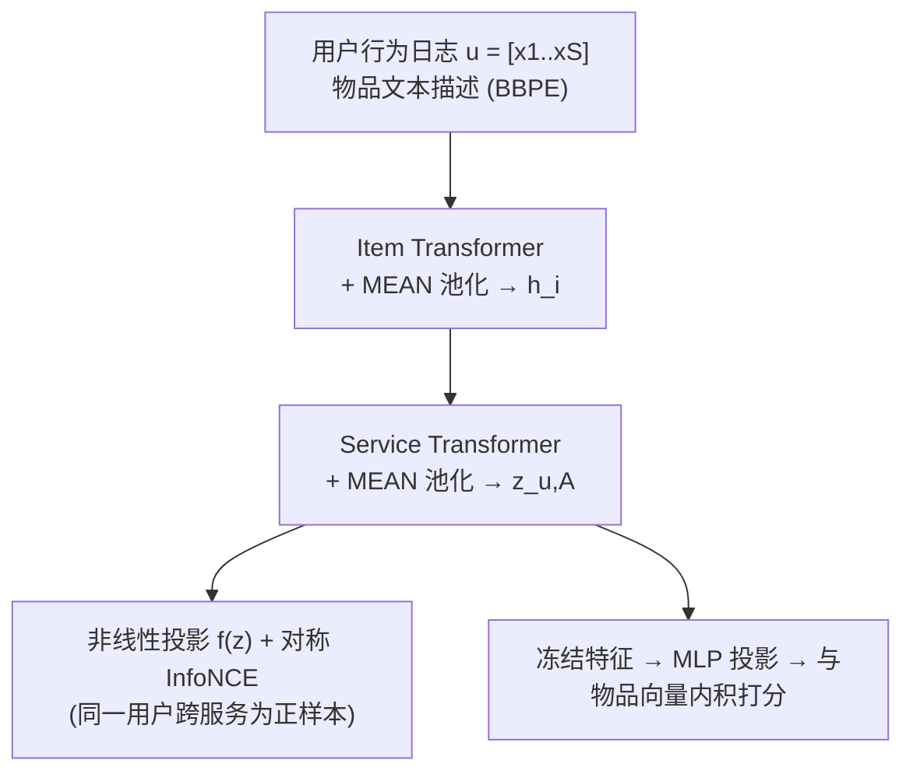
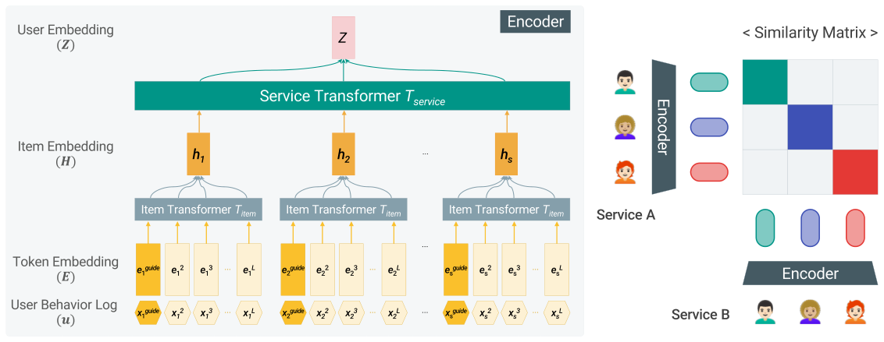

# Scaling Law for Recommendation Models: Towards General-purpose User Representations (面向通用用户表征的推荐模型缩放定律)

- **会议/期刊**: AAAI 2023
- **作者与机构**: Kyuyong Shin, Hanock Kwak, Su Young Kim 等（NAVER CLOVA / NAVER AI Lab）
- **推荐链路定位**: 召回（冻结的通用用户编码器 + MLP，可插拔服务于下游排序/召回）
- **研究方向**: 自监督对比学习与交互去噪 / 跨域与多场景推荐
- **论文原文**: [论文原文链接](https://arxiv.org/abs/2111.11294v5)
- **开源代码**: 暂未开源

## TL;DR (1分钟核心速览)

面向"推荐系统能否像 BERT/CLIP 一样做任务无关的大规模用户预训练"这一空白，本文提出 CLUE：将每个服务视为一种模态，用字面文本描述物品 + 层级双 Transformer 编码行为序列，以"同一用户跨服务表征互为正样本"做对称 InfoNCE 预训练（50B token / 11M 用户）。在 Amazon 两域与 6 个工业下游任务上采用 1 正 100 负采样排序（HR@1/NDCG@10/MRR），冻结表征 + 轻量 MLP 即较 SOTA 任务专属模型提升 3%–29%（Clothing HR@1 +29.5%），线上 CTR +7.3%，并首次观察到用户建模的幂律缩放律。

## Background & Motivation (背景与核心矛盾)

- **主流范式**: 用户建模长期是"任务专属 + 微调式"：BST/DeepFM/LightGCN 从本服务日志端到端训练；UserBERT/UniSRec 虽做对比预训练，仍需在下游微调，且强依赖物品 ID。
- **前人局限**: ① 物品 ID 体系跨平台不共享，模型无法跨服务、跨公司迁移（ShopperBERT 的 ID-based MLM 在 ICLT 任务上直接不可用）；② 任务专属日志的推理开销高昂（同精度下单条样本需 43× 计算与 8× 内存），且新用户/冷用户日志稀疏时几乎失效。
- **核心洞察 (Key Insight)**: 若把物品一律转写为自然语言描述（商品名、新闻标题、搜索 query），则"同一用户在两个服务中的行为"天然构成 CLIP 式的成对语义对齐信号；且用户建模的训练损失也服从关于算力的幂律曲线，泛化能力随预训练损失的下降单调改善。
- **本文切入点**: 用文本抹平服务间格式差异，把"跨服务同一用户"当作正样本对做免微调的特征级迁移，并系统刻画数据量、模型容量、序列长度、批大小四个缩放因子。

## Method (核心方法设计)

### 1. 整体框架 (Overall Architecture)

输入为某服务下的用户行为日志 $u=[x_1,\dots,x_S]$，每个物品$x_i$由 BBPE 分词后的文本描述构成（前若干 token 标记服务类型）。物品级 Item Transformer 先把每个物品的 token 序列池化为物品向量，Service Transformer 再在物品序列上建模跨物品时序依赖，末层隐向量均值池化为用户表征$z_{u,A}$。预训练阶段对同一用户在服务 A、B 的$z_{u,A},z_{u,B}$做对称对比；下游阶段**冻结编码器**，仅将$z$ 拼接后接一个 4 层 MLP（512-256-128-64-ReLU）与物品 Sentence-BERT 向量点积打分，无需微调。

<figure class="paper-figure" markdown="span">
  <figcaption>图1：CLUE 的整体流程。编码器编码用户行为日志，即由自然语言文本（u）描述的项目序列。该描述变为 token 嵌入（E），随后经过 Item Transformer，并进行均值池化（H）。项目嵌入向量序列随后传入 Service Transformer。用户嵌入（Z）为 Service Transformer 最后隐藏向量的均值。最后，对用户嵌入进行对比预训练。</figcaption>
</figure>

### 2. 关键设计拆解 (Key Designs)

1. **层级双 Transformer（Item → Service）**：单层 Transformer 把物品 token 与行为序列混在一条超长序列里，物品内词序与物品间时序互相干扰、且无法复用物品语义。本文显式拆成两级映射 $T_{item}:\mathbb{R}^{L\times D_{in}}\to\mathbb{R}^{L\times D_{out}}$与$T_{service}:\mathbb{R}^{S\times D_{out}}\to\mathbb{R}^{S\times D_{out}}$，中间以均值池化衔接：$h_i=\mathrm{MEAN}(T_{item}(E_i)),\ z=\mathrm{MEAN}(T_{service}(H))$。分离编码使同等算力下可覆盖更长的行为序列（表 5 中 ICLT MRR 0.6333→0.6440）。
2. **以"服务即模态"的跨服务对比对齐**：CLIP 依赖图文成对数据，而两个异构服务的物品无法按 ID 对齐。本文改用物品的文本描述作为唯一跨域锚点，将同一用户在两服务的表征视为正样本、batch 内其他用户为负样本，直接优化
 $\ell_{u,A,B}=-\log\frac{\exp(\langle f(z_{u,A}),f(z_{u,B})\rangle/\tau)}{\sum_{v}\exp(\langle f(z_{u,A}),f(z_{v,B})\rangle/\tau)}$，
 并取对称交叉熵 $(\ell_{u,A,B}+\ell_{u,B,A})/2$。物理直觉：文本是跨平台唯一稳定的共享语义空间，用户在同一语义空间下的行为模式一致性即用户身份的隐式标签。
3. **训练目标、负采样与推理效率**：全程使用 **in-batch negatives**（无额外难负采样），因此负样本量受批大小硬性约束——这正是本文发现"模型容量不是唯一决定因素、批大小与序列长度同样支配性能"的根源；作者用 batch shuffling 缓解固定负样本集带来的偏差。推理端因表征可离线预计算，下游只需 0.5M 参数、0.5G 内存，较 Transformer 类任务专属模型提速 43×。

## Experimental Setup & Evaluation Protocol (实验设置与评估协议)

- **数据集与预处理**: 预训练集来自搜索引擎与电商共享用户池，剔除两月内无行为的用户，重复行为去重，每个物品用 BBPE 分词。

| 数据集 | #Users | #Items | #Interactions | 稀疏度/密度 | 特征/场景说明 |
| :--- | :---: | :---: | :---: | :---: | :--- |
| Pretrain (Search+E-com) | 11M | — | 5.3B logs / 50B tokens | 2 年跨度 | 跨服务共享用户池，文本描述输入 |
| Amazon Books | — | — | 每人 ≤64 条，最近 3 条为目标 | 评分≥4 过滤 | 仅用商品 title，benchmark |
| Amazon Clothing | — | — | 同上 | 评分≥4 过滤 | 仅用商品 title，benchmark |
| Industrial (PCR/MMR/NVR/OTAR/FWR/ICLT) | — | — | — | 含无日志场景 | 电商/营销/新闻/OTA/网漫/跨公司 |

- **数据划分与防穿越 (Splitting Strategy)**: 按用户级切分，**训练/验证/测试集之间无共享用户**；Amazon 侧按时间序列取最近 3 条评价为目标集（近 Leave-Last-Out 式时序切分）。
- **排名评测协议 (Ranking Protocol)**: `Sampled Ranking` —— 每个测试样本由 1 个真值物品 + **100 个随机采样负例**构成候选池，报告 HR@1、NDCG@10、MRR；未做 Full-Ranking 全库排序。
- **对比基线与超参设置**: 任务专属类 DeepFM/BST/LightGCN/YTMoE，预训练迁移类 UserBERT/UniSRec，任务无关类 ShopperBERT/SimCLR，另设 CLUE+任务专属的 Hybrid。最佳 CLUE 为 160M 参数、序列长 128、批大小 256、训练 100k 步；下游 MLP 固定 512-256-128-64。

## Key Experimental Results (实验关键数据)

### 1. 主实验对比 (Main Results)

基准数据集（同域预训练后迁移，三指标）：

| 模型 | Books HR@1 | Books NDCG@10 | Books MRR | Clothing HR@1 | Clothing NDCG@10 | Clothing MRR |
| :--- | :---: | :---: | :---: | :---: | :---: | :---: |
| DeepFM | 0.0580 | 0.1857 | 0.1552 | 0.0812 | 0.2082 | 0.1777 |
| BST | 0.0676 | 0.1916 | 0.1606 | 0.1169 | 0.2294 | 0.2046 |
| LightGCN | 0.0889 | 0.1875 | 0.1690 | 0.0924 | 0.2245 | 0.1929 |
| YTMoE | 0.0947 | 0.1925 | 0.1742 | 0.0846 | 0.2048 | 0.1783 |
| UserBERT | 0.0850 | 0.1826 | 0.1644 | 0.1208 | 0.2544 | 0.2228 |
| UniSRec | 0.0618 | 0.1895 | 0.1601 | 0.1091 | 0.2228 | 0.1971 |
| **CLUE (15M)** | **0.1087** | **0.2104** | **0.1854** | **0.1564** | **0.2857** | **0.2481** |
| Improv.% | +14.8% | +9.3% | +6.4% | +29.5% | +12.3% | +11.4% |

工业下游任务（MRR，任务专属最优 vs 任务无关最优 vs CLUE）：

| 任务 | 最优任务专属 | 最优任务无关 | **CLUE** | Improv.% |
| :--- | :---: | :---: | :---: | :---: |
| PCR (电商) | 0.6642 (UserBERT) | 0.6626 (SimCLR) | **0.6857** | +3.2% |
| MMR (营销) | 0.4514 (UserBERT) | 0.4578 (SimCLR) | **0.4713** | +3.0% |
| NVR (新闻) | 0.6903 (UniSRec) | 0.6789 (SimCLR) | **0.6924** | +0.3% |
| OTAR (OTA) | 0.3439 (LightGCN) | 0.3415 (SimCLR) | **0.3653** | +6.2% |
| FWR (网漫) | 无日志可用 | 0.2468 (UniSRec) | **0.2804** | +13.6% |
| ICLT (跨公司) | 0.6334 (UserBERT) | 0.6440 (SimCLR) | **0.6560** | +1.9% |

### 2. 消融实验 (Ablation Study)

| 配置 | PCR MRR | ICLT MRR | 说明 |
| :--- | :---: | :---: | :--- |
| Single Transformer (235M, len 2048) | 0.6808 | 0.6333 | 去除层级拆分 |
| **Stacked Item+Service (完整 CLUE)** | **0.6857** | **0.6440** | 同算力下更优 |
| CLUE 输出 2160 维 | 0.6822 | — | 存储 153GB |
| CLUE 输出 300 维 | 0.6857 | — | 降维无损，可省 7× 存储 |

### 3. 关键实验发现 (Key Findings)

1. **负样本瓶颈导致"容量非唯一"**：图 2(a) 显示固定批大小后单纯放大模型（4M→160M）收益饱和，而批大小 32→512、序列长度 16→256 各自带来平滑增益；论文在 10% 数据（113 万用户）加 batch shuffling 即追平用全量日志训练的 LightGCN（ICLT 任务），说明对比学习的缩放律比监督信号更复杂，需四因子协同放大。
2. **泛化由预训练损失而非任务相似度决定**：图 4 左右两侧给出幂律曲线（PF-days 对测试损失近似对数线性）与强相关趋势；但图 5 的 token 分布 Kendall 秩相关仅 0.13–0.45，与下游相对提升并不完全对齐，作者明确承认"如何判定一个可迁移域仍无判据"。
3. **预训练表征专治稀疏与冷启**：线上 PCR 五日 A/B 中，新用户组 GNN 为 −0.7%（劣于 TopPop），CLUE(120M) 为 +4.5%；冷用户 +13.4%、重度用户 +10.7%。随任务侧日志增多，GNN 与 CLUE 的差距收窄，说明通用表征的边际价值集中在日志稀缺区间。

## Highlights & Limitations (亮点、对比与审稿批判)

- **与代表作对比 (vs. Prior Work)**: 对比 UserBERT/UniSRec，本文不做下游微调（feature-based），且用文本而非物品 ID 作锚点，因而唯一具备跨公司迁移能力（ICLT 0.6560 vs UserBERT 0.6334）；对比 ShopperBERT，后者 ID-based MLM 使跨平台评测不可行；对比 CLIP，本文把"服务"上升为模态、用同用户弱标签替代成对监督，解决了异构物品无法配对的问题。
- **可迁移亮点**: ① "物品文本描述 + 冻结表征 + 轻量 MLP"这一低成本迁移范式，可直接用于新业务冷启；② 用 batch shuffling 缓解 in-batch 负样本同质化，是批大小受限场景的通用技巧。
- **审稿级局限批判**: ① 评测采用 1 正 100 负的 Sampled Ranking，未报告 Full-Ranking 与方差/显著性检验，指标绝对差异（如 NVR +0.3%）在采样波动下可信度存疑；② 预训练数据为工业私有（50B token、11M 用户），无法复现，缩放律结论的外部效度缺乏验证；③ 冻结表征虽省算力，但牺牲了任务侧细粒度序列信号——Hybrid 方案在多数任务优于纯 CLUE，说明"免微调"并非最优解。

## Rating (四维评分)

- **方法创新性 (Novelty)**: ⭐⭐⭐⭐ （把 CLIP 的"服务即模态"落地到用户建模，并在推荐领域首次给出可复现的幂律缩放曲线与因子分解分析）
- **评估协议与实验扎实度 (Protocol & Experiments)**: ⭐⭐⭐ （覆盖 2 个公开域 + 6 个工业域 + 线上 A/B，含无日志与跨公司场景；但仅 1:100 采样排序、缺显著性检验与 Full-Ranking）
- **写作与数学规范度 (Clarity & Rigor)**: ⭐⭐⭐⭐ （公式极简且符号自洽，缩放因子的算力折算口径清晰；损失与架构推导略浅、附录承担过多细节）
- **工业落地与复现价值 (Industrial & Practical Value)**: ⭐⭐⭐⭐ （43× 提速、0.5G 内存、线上 CTR +7.3% 的实证极具落地说服力，但数据与代码均未开源，复现门槛高）

