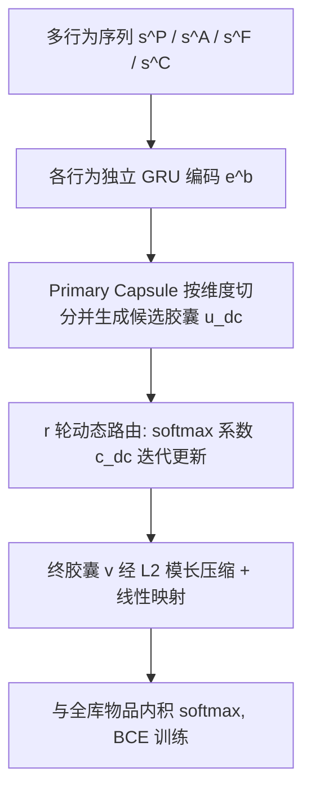
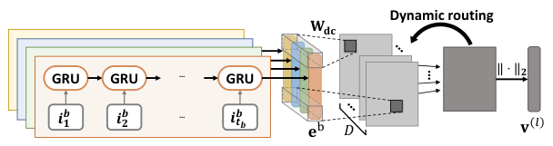
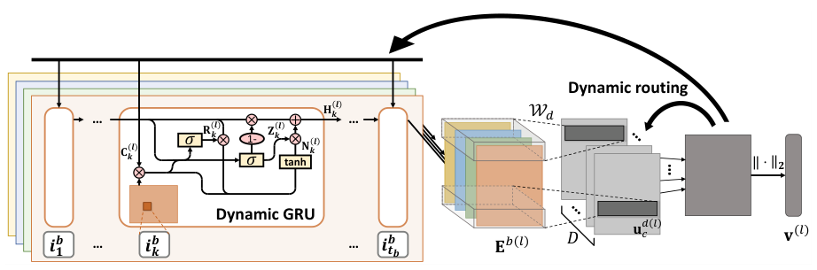

# Dynamic Multi-Behavior Sequence Modeling for Next Item Recommendation (面向下一物品推荐的多行为序列动态建模)

- **会议/期刊**: AAAI 2023
- **作者与机构**: Junsu Cho, Dongmin Hyun, Dongwon Lim, Hyeonjae Cheon, Hyoung-iel Park, Hwanjo Yu（POSTECH 与韩国 GS Retail）
- **推荐链路定位**: 召回（Next-Item 序列召回）
- **研究方向**: 序列与会话推荐
- **论文原文**: [https://arxiv.org/abs/2301.12105v1](https://arxiv.org/abs/2301.12105v1)
- **开源代码**: 暂未开源（但作者发布了新数据集 GS Retail，见 http://di.postech.ac.kr）

## TL;DR (1分钟核心速览)

面向「点击—收藏—加购—购买」并存的多行为序列推荐，本文指出该场景存在**行为分布极不均衡、异质信息互补、关键信息个性化、行为序列间强相关**四大特性，而现有单一拼接序列或粗粒度向量融合均无法刻画。作者提出 DyMuS：为每个行为独立建 GRU，再用**胶囊动态路由**按用户与序列间相关性自适应融合；DyMuS+ 进一步把路由下沉进 GRU 内部（dynamic GRU）实现 item 级个性化。在 Leave-One-Out + **全库排序**协议下，Taobao/Tmall/GS Retail 上 H@10 相对最优基线提升 24.5%–40.8%。

## Background & Motivation (背景与核心矛盾)

- **主流范式**: 序列推荐以单行为序列为主（GRU4Rec、SASRec、FMLP-Rec）；多行为工作分两支——把行为当辅助信号（HMG-CR、CML）或当多任务（METAS、EHCF），仅 MBN、TGT 真正建模多行为**序列**。
- **前人局限**: ① 把所有行为拼成一条统一序列后长度爆炸，稀疏行为（购买）被高频行为（点击）淹没；② MBN 的 meta 编码器与 TGT 的 behavior-aware Transformer 只产出**粗粒度**行为表示，无法针对不同用户判断「该行为序列里哪个属性（品类/品牌/价格）重要」。
- **核心洞察 (Key Insight)**: 各行为序列的重要性不是全局固定的，而是**由其他序列的信息反向决定**——若用户近期点击集中在同一品类，购买序列的解读方式也应随之改变。这天然是一个「按输入动态加权候选表示」的问题，正是胶囊动态路由的适用场景。
- **本文切入点**: 不做序列拼接，而是"分而治之"：独立编码 + 基于相关性的迭代式动态路由融合，并把路由改造成只用 $D$ 个终胶囊以保证可扩展性。

## Method (核心方法设计)

### 1. 整体框架 (Overall Architecture)

输入用户的多行为序列集合 $\mathcal{S}=\bigcup_{b\in\mathcal{B}}\{s^b\}$，每个行为$b$用独立 GRU 编码得到$e^b=h_{t_b}$；随后将$D$个维度视为$D$个 primary capsule，每个 primary capsule 跨行为线性变换生成候选胶囊，经$r$轮路由迭代得到终胶囊$v^{(r)}\in\mathbb{R}^{C}$（取$C=D$），以$v^{(r)}$与物品嵌入的内积做 softmax 全库打分，BCE 训练。DyMuS+ 把同一套路由嵌进 GRU 的隐状态（胶囊化隐状态 + 调整状态$C_k$），使序列内每个 item 的表征也被跨序列信息修正。推理与常规双塔一致，仅多$r$ 轮轻量迭代。

<figure class="paper-figure" markdown="span">
  <figcaption>图1：DyMuS 的总体架构。</figcaption>
</figure>

### 2. 关键设计拆解 (Key Designs)

1. **效率改造的胶囊动态路由（sequence-level 融合）**：原始 CapsNet 需为每个类别建胶囊，直接套用会有 $|\mathcal{I}|$量级开销。本文只保留$D$个终胶囊，候选胶囊由第$d$个 primary capsule 跨所有行为生成：$u_{dc}=\mathbf{W}_{dc}\times[e^1_d,\dots,e^{|\mathcal{B}|}_d]^{\top}\in\mathbb{R}^{L}$；系数$c^{(l)}_{dc}=\mathrm{softmax}_{c}(b^{(l)}_{dc})$，终胶囊$v^{(l)}_c=\alpha\sum_{d=1}^{D}c^{(l)}_{dc}u_{dc}$，再用模长$\bar{v}=[\|v_1\|_2,\dots,\|v_C\|_2]^\top$、$v=\mathbf{w}\cdot\bar{v}+b$ 还原到实数域。直觉：模长编码"该异质信息存在的强度"，方向编码"是什么信息"，故长度压缩天然实现重要性筛选。

2. **Dynamic GRU（item-level 个性化）**：DyMuS 各序列独立编码，item 级信息无法互相影响。DyMuS+ 令 GRU 隐状态为 $D\times L$胶囊矩阵，并引入调整状态$\mathbf{C}^{(l)}_k$，用 capsule-wise 乘法$\mathbf{W}\otimes\mathbf{H}=[\mathbf{W}_1h_1\dots\mathbf{W}_Dh_D]^\top$重写门控（如$\mathbf{R}^{(l)}_k=\sigma(\mathbf{W}^{ir}i^b_k*(\mathbf{W}^{cr}\otimes\mathbf{C}^{(l)}_k+\mathbf{B}^{cr})+\mathbf{W}^{hr}\otimes\mathbf{H}^{(l)}_{k-1}+\mathbf{B}^r)$），并按$\mathbf{C}^{(l+1)}_k=\mathbf{C}^{(l)}_k+\mathbf{N}^{(l)}_k*[r^{(l)}_1\dots r^{(l)}_C]$ 把路由反馈写回每个 item。效果是"当前 item 在序列中的语义角色"随其他行为序列变化而重估。

3. **路由反馈与训练目标**：第 $l$轮的 logit 更新显式引入**预测物品嵌入**作为融合质量的判据：$p^{(l)}=\sum_{i}i_i\cdot\mathrm{softmax}(v^{(l)}\cdot i_i)$，$r^{(l)}_c=\mathbf{W}^{coef}_c\times[v^{(l)}_c\parallel p^{(l)}]^\top$，$b^{(l+1)}_{dc}=b^{(l)}_{dc}+u_{dc}\cdot r^{(l)}_c$；最终$\hat{y}_{i}=\mathrm{softmax}(v^{(r)}\cdot i_i)$。损失为 BCE：$\mathcal{L}=-\frac{1}{|\mathcal{S}_T|}\sum_{\mathcal{S}}\sum_{i\in\mathcal{I}}\left(y\log\hat{y}+(1-y)\log(1-\hat{y})\right)$，**无需负采样**（全库 softmax 隐式归一化），$r=2$为默认值，$L\in\{2,\dots,32\}$。

<figure class="paper-figure" markdown="span">
  <figcaption>图2：DyMuS+ 的总体架构。</figcaption>
</figure>

## Experimental Setup & Evaluation Protocol (实验设置与评估协议)

- **数据集与预处理**: 统一按目标行为（Purchase）做 `5-core` 过滤，并截取每用户最近 500 条交互。

| 数据集 | #Users | #Items | #Interactions(总) | 稀疏度/密度 | 特征/场景说明 |
| :--- | :---: | :---: | :---: | :---: | :--- |
| Taobao | 987,994 | 4,162,024 | ~1.00e8 | 极稀疏 | 4 行为（P/A/F/C），2017，9 天 |
| Tmall | 424,170 | 1,090,390 | ~0.55e8 | 极稀疏 | 4 行为，≤2014，186 天 |
| GS Retail（新） | 13,334,687 | 3,477,502 | ~1.80e8 | 极稀疏 | 韩国电商，3 行为（P/A/C），2021，32 天 |

- **数据划分与防穿越 (Splitting Strategy)**: `Leave-One-Out`——目标行为最近一次交互为测试、第二次为验证，其余训练；序列按时间戳严格截断，无穿越。
- **排名评测协议 (Ranking Protocol)**: 无偏 `Full-Ranking`，测试物品与**全库所有其他物品**比较；指标 H@10/20、N@10/20。
- **对比基线与超参设置**: 单行为基线 BPR-MF、GRU4Rec、SASRec、FMLP-Rec（另给出统一序列的多行为改造版）；多行为基线 METAS、EHCF、HMG-CR、CML、MBN、TGT。Adam，$D\in\{16,\dots,128\}$，序列长$L\in\{10,\dots,100\}$，胶囊长$L\in\{2,\dots,32\}$，$r=2$，显著性用 Student$t$-test（$p<0.01$，标 `*`）。

## Key Experimental Results (实验关键数据)

### 1. 主实验对比 (Main Results)

| 数据集 | 指标 | GRU4Rec | SASRec | FMLP-Rec | MBN | TGT | DyMuS | DyMuS+ | Improv.% |
| :--- | :--- | :---: | :---: | :---: | :---: | :---: | :---: | :---: | :---: |
| Taobao | H@10 | 0.0945 | 0.1391 | 0.2286 | 0.2089 | 0.1768 | 0.2758* | **0.3166*** | +38.5% |
| Taobao | N@10 | 0.0659 | 0.1030 | 0.1772 | 0.1630 | 0.1239 | 0.2101* | **0.2369*** | +33.7% |
| Tmall | H@10 | 0.0554 | 0.0720 | 0.0862 | 0.0980 | 0.0331 | 0.0982 | **0.1380*** | +40.8% |
| Tmall | N@10 | 0.0380 | 0.0608 | 0.0612 | 0.0630 | 0.0204 | 0.0694* | **0.0941*** | +49.4% |
| GS Retail | H@10 | 0.4150 | 0.4119 | 0.4061 | 0.4345 | 0.2661 | 0.4988* | **0.5409*** | +24.5% |
| GS Retail | N@10 | 0.3774 | 0.4036 | 0.3253 | 0.3443 | 0.1948 | 0.4103* | **0.4270*** | +5.8% |
| **#Prm (Taobao)** | — | 153.4M | 19.1M | 76.6M | 89.4M | 77.4M | 77.4M | 81.7M | — |
| **Inf.t (s, Taobao)** | — | 15.6 | 14.2 | 15.8 | 32.5 | 23.5 | 20.4 | 28.6 | — |

### 2. 消融实验 (Ablation Study)

Taobao 上 N@10（DyMuS 完整版 0.2101 / DyMuS+ 0.2369）：

| 变体 | w/o 路由（Sum） | w/o 路由（Self-Att） | -P（去购买） | -A（去加购） | -F（去收藏） | -C（去点击） |
| :--- | :---: | :---: | :---: | :---: | :---: | :---: |
| DyMuS | 0.1805 | 0.1820 | 0.1212 | 0.2078 | 0.1947 | 0.0872 |
| DyMuS+ | 0.2057 | 0.2187 | 0.1643 | 0.2163 | 0.2011 | 0.1027 |

### 3. 关键实验发现 (Key Findings)

1. **融合算子比编码器更关键**：把动态路由换成 Sum / Self-Attention 后 DyMuS+ 从 0.2369 掉到 0.2057 / 0.2187（-13.2% / -7.7%），说明提升并非来自更强的序列编码器，而是来自"按用户自适应选择异质胶囊"这一机制。
2. **行为贡献高度非对称且被模型正确放大**：移除点击序列（-C）导致 DyMuS 崩塌至 0.0872（-58.5%），远超 MBN 在同样操作下的 0.0535（相对其 0.1630 基线 -67%，但绝对值更低），说明本文方法确实从每条序列抽取了更多有效信息；而 -A 几乎无损（0.2078），反映加购与购买信息冗余度最高。
3. **性能-开销折中优于图/Transformer 类多行为模型**：DyMuS+ 参数量 81.7M、推理 28.6s，低于 MBN 的 89.4M/32.5s 却取得 +33.7% N@10；路由轮数 $r$从 1→2→4 带来 N@10 0.1971→0.2101→0.2151 的单调增益，但$r$或$L$过大即过拟合，$r=2$ 是性价比拐点。

## Highlights & Limitations (亮点、对比与审稿批判)

- **与代表作对比 (vs. Prior Work)**: 相比 MBN（meta 序列编码器 + recurring-item predictor）与 TGT（behavior-aware Transformer + 时序 GNN），本文不在"编码更强"上竞争，而在**融合层**用可解释的迭代路由替代粗粒度向量拼接；相比 HMG-CR / CML 依赖图结构与对比学习，本文完全不需要构图，工程上更轻。
- **可迁移亮点**: ① "只建 $D$个终胶囊"的把分类式胶囊降为表征式胶囊的技巧，可迁移到任何需要"多源表征自适应加权"的场景（多场景、多模态、多任务专家融合）；② 用**预测物品嵌入**$p^{(l)}$ 作为路由反馈信号，比单纯用相似度更贴合推荐目标。
- **审稿级局限批判**: ① 所有数据集均为 `5-core` 过滤 + 截断 500 条，长尾/冷启动用户完全没有评估，实际电商场景的稀疏端表现未知；② 路由超参 $r$、胶囊长度$L$ 需逐数据集调优且过拟合敏感，DyMuS+ 推理时间比 DyMuS 高出 40%，在线召回的延迟预算存疑；③ 只预测单一目标行为（Purchase），未验证多目标联合排序。

## Rating (四维评分)

- **方法创新性 (Novelty)**: ⭐⭐⭐⭐ （首次把胶囊动态路由引入多行为序列建模，并以 $D$ 终胶囊改造解决可扩展性，机制清晰但本质仍是注意力式加权）
- **评估协议与实验扎实度 (Protocol & Experiments)**: ⭐⭐⭐⭐ （三数据集含自建大规模新数据集、无偏全库排序 + $t$ 检验 + 参数量/推理时间对比齐全，缺冷启动与长尾分桶）
- **写作与数学规范度 (Clarity & Rigor)**: ⭐⭐⭐⭐ （四大特性的动机逐条对应到设计、公式完整；但 dynamic GRU 张量维度记号较密集，$r^{(l)}_c$ 与调整状态的更新依赖关系需反复对照）
- **工业落地与复现价值 (Industrial & Practical Value)**: ⭐⭐⭐⭐ （无需构图、参数量与推理开销低于 MBN/TGT，且发布真实电商数据集；但无官方代码，超参敏感度增加复现成本）

