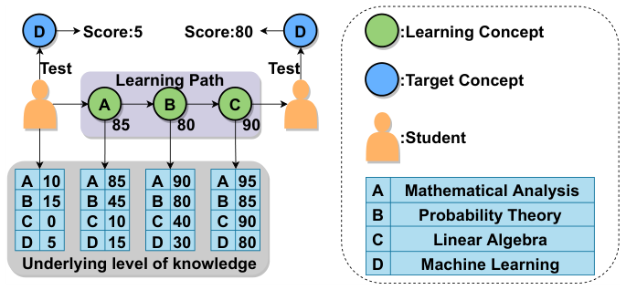
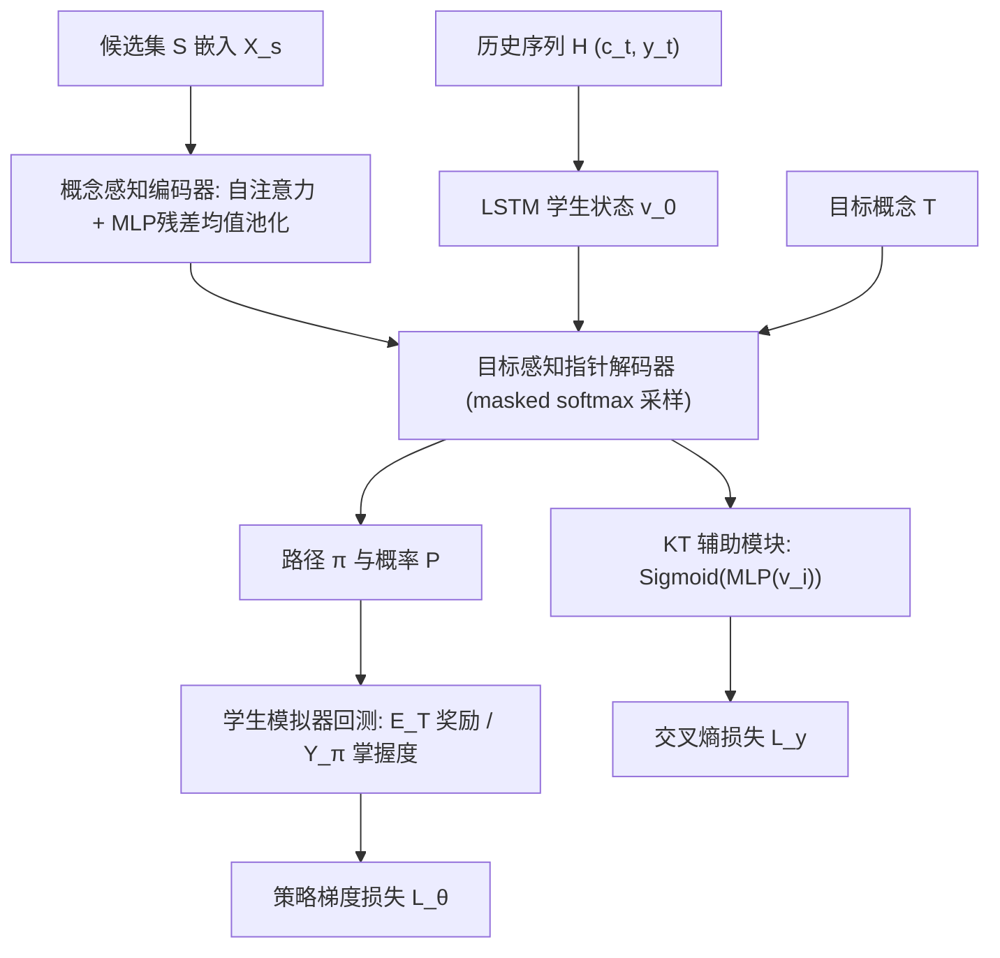
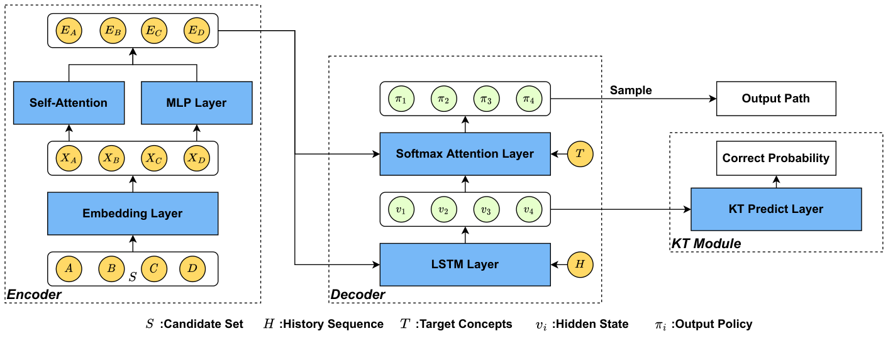

# Set-to-Sequence Ranking-based Concept-aware Learning Path Recommendation (集合到序列排序式概念感知学习路径推荐)

- **会议/期刊**: AAAI 2023
- **作者与机构**: Xianyu Chen, Jian Shen, Weinan Zhang, Yong Yu 等（上海交通大学）；Wei Xia, Weiwen Liu, Ruiming Tang（华为诺亚方舟实验室）；Kai Dong, Dingyin Xia（华为）
- **推荐链路定位**: 端到端生成式（一次性生成整条路径序列）
- **研究方向**: 序列与会话推荐 / 强化学习与动态探索推荐
- **论文原文**: [https://arxiv.org/abs/2306.04234v1](https://arxiv.org/abs/2306.04234v1)
- **开源代码**: [MindSpore models / SRC](https://gitee.com/mindspore/models/tree/master/research/recommend/SRC)

## TL;DR (1分钟核心速览)

在线教育需要一次性为学生规划整条学习路径（而非逐步推荐），此场景**搜索空间巨大且反馈只在路径结束后出现一次**。已有方法或用知识图谱规则硬约束生成、或用协同过滤特征搜路径，既未挖掘概念间的协同/前置关联，也浪费了路径末端的目标概念掌握度反馈。本文提出 SRC，把路径推荐形式化为 **set-to-sequence** 问题：概念感知编码器挖集合内关联、LSTM + 注意力指针解码器逐步选概念、以归一化学习增益 $E_T$ 为奖励做策略梯度，并引入知识追踪（KT）辅助任务提供稠密监督。在 ASSIST09、Junyi 与华为工业数据集上，以 DKT/CoKT 模拟器回测、路径长度 20 的设置下，SRC 在全部 4 种候选集场景均最优，最强基线处最高相对提升约 +31.5%（ASSIST09, p=3）。

## Background & Motivation (背景与核心矛盾)

- **主流范式**: 学习内容推荐分两支——(i) 逐步推荐下一个学习项，每步可获即时答题反馈并据此调整；(ii) 一次性规划定长路径（排课、学期规划场景）。本文聚焦后者，因为其搜索空间更大、可用反馈更少，难度更高。
- **前人局限**: 基于知识图谱/概念关系的方法把关系当作生成规则做约束，未真正建模概念间复杂关联；基于 CF 特征搜索的方法模型过简、生成算法弱。少数用 RL 的工作（Liu et al. 2019）依赖**每步实时反馈**，本质是 step-by-step 场景，路径场景拿不到。
- **核心洞察**: 同一路径上的概念会互相影响（如图 1：学好数学分析对概率论帮助大、对线性代数帮助小），因此路径质量应按 **list-wise** 整体评估；而目标概念的增益 $E_T$ 只在路径结束后可测，天然对应"单条轨迹一个延迟奖励"的策略梯度设定，奖励极稀疏。
- **本文切入点**: 用 set-to-sequence 范式同时解决"概念关联建模"与"延迟反馈优化"，再用 KT 辅助任务补足稀疏奖励下的训练稳定性。

<figure class="paper-figure" markdown="span">
  <figcaption>图1：学生学习过程示意图：通过学习由三个概念 A、B、C 组成的路径，提升学生对概念 D 的掌握程度。学生在路径学习前后接受测试，以了解其对 D 的掌握情况。底部四个表格展示学生在每一步对所有概念的潜在掌握程度，该信息在训练过程中不可访问。我们只能知道学生对当前学习概念的掌握程度。例如，学习 B 后，我们知道其对 B 的掌握程度为 80。</figcaption>
</figure>

## Method (核心方法设计)

### 1. 整体框架 (Overall Architecture)

输入为候选概念集 $S$（$m$个）、学生历史序列$H=\{(c_t,y_t)\}$与目标概念集$T$。编码器对$S$做集合内概念关联建模得到$E_s$；解码器以$H$初始化 LSTM 学生状态，每步用"学生状态 + 概念表示 + 目标概念表示"的注意力打分在**剩余未选概念**上做 softmax 采样，得到路径$\pi$与逐步概率$P$；KT 辅助模块用每步 LSTM 状态预测该概念的正确率；整条路径结束后由学生模拟器返回$E_T$与$Y_\pi$，分别驱动策略梯度损失与交叉熵辅助损失。

<figure class="paper-figure" markdown="span">
  <figcaption>图2：我们的框架概览。SRC 由编码器、解码器和 KT 辅助模块组成。编码器捕获候选集 S 中概念之间的相关性，以获得概念表示 ES。解码器基于 ES、T 和 H 的信息生成 S 的排序，并输出策略 π。KT 辅助模块负责预测路径上每一步的正确概率。</figcaption>
</figure>

### 2. 关键设计拆解 (Key Designs)

1. **概念感知双支编码器（解决 C1）**：单纯池化无法建模概念关联，纯 Transformer 又会因策略梯度下单路径单奖励的极端稀疏而 over-smooth / 难收敛，且丢失概念自身特性。本文**并置两支再拼接**：自注意力支负责全局关联，MLP + 均值池化残差支负责保留个体特征：

$$E_s^{a}=\mathrm{softmax}\!\left(\frac{QK^{\top}}{\sqrt{d}}\right)V,\qquad E_s^{l}=E^{l}+\frac{1}{m}\sum_{i=1}^{m}e^{l}_i,\qquad E_s=[E_s^{a};E_s^{l}]$$

物理直觉：关联项让"学 A 对学 B 的增益"进入表示，残差项防止概念在集合中被同质化，二者互补——消融也证实缺任一支都掉点。

2. **目标感知指针解码器（解决 list-wise 生成 + C2）**：路径生成不可微、且需避免重复选概念。解码器以历史序列初始化学生状态 $v_0=g([x_{c_1};y_1]W_h,\dots)$，第$i$步对每个候选概念$s_j$ 打分并在剩余集合上归一化：

$$d_i^{j}=w_1^{\top}\!\left(W_1v_{i-1}+W_2e_s^{j}+W_3x_T+b\right),\quad P(\hat\pi_i=s_j)=\frac{e^{d_i^{j}}}{\sum_{s_k\in S\setminus\pi_{<i}}e^{d_i^{k}}}\ \ (s_j\notin\pi_{<i})$$

三项分别刻画学生当前知识状态、候选概念表示、目标概念需求——即"在当前状态下，学哪个概念最贴近目标 $T$"，随后$v_i=g(e_s^{\pi_i},v_{i-1})$ 更新状态。掩码 softmax 天然保证无重复且给出可采样概率，从而把排序过程转成 Plackett-Luce 式序列决策。

3. **KT 辅助任务 + 策略梯度损失（解决 C3）**：路径中段拿不到学生对已学概念的掌握度，LSTM 状态缺少监督。用 MLP + Sigmoid 预测每步掌握概率 $p^{y_{\pi_i}}=\mathrm{Sigmoid}(f^{y}(v_i))$，与实际$y_{\pi_i}$ 做交叉熵。总损失：

$$\mathcal{L}=\underbrace{-E_T\sum_{i=1}^{n}\log p_{\pi_i}}_{\mathcal{L}_{\theta}}+\ \beta\,\mathcal{L}_{y},\qquad \mathcal{L}_y=-\sum_{i=1}^{n}\left[y_{\pi_i}\log p^{y_{\pi_i}}+(1-y_{\pi_i})\log(1-p^{y_{\pi_i}})\right]$$

$\beta\in\{0,1\}$控制是否启用 KT。**无负采样**（候选集内掩码 softmax 即是分布），推理时按$P$采样或贪心解码，单条路径$O(n\cdot m\cdot d)$，在线开销可忽略。

## Experimental Setup & Evaluation Protocol (实验设置与评估协议)

- **数据集与预处理**: 公开数据无 5-core 过滤，直接用原始静态答题日志训练模拟器。

| 数据集 | #Users(students) | #Items(concepts) | #Interactions | 稀疏度/密度 | 特征/场景说明 |
| :--- | :---: | :---: | :---: | :---: | :--- |
| ASSIST09 | 3,841 | 167 | — | 平均序列长 49.54 | 公开 K12 数学答题日志 |
| Junyi | 5,002 | 712 | — | 平均序列长 54.19 | 公开在线教育平台日志 |
| Industrial (Huawei) | 159 | 614 | — | 平均序列长 108.99 | 华为内部工业数据集 |

- **数据划分与防穿越**: 论文**未明确给出 train/valid/test 划分比例**；核心做法是先在静态日志上训练 DKT / CoKT 两个学生模拟器，再用模拟器对模型生成的路径做在线回测，从根本上规避"直接复用已有交互序列"的穿越问题。
- **排名评测协议**: 非传统 Full-Ranking 指标（无 HR/NDCG），而是**生成式回测**：给定候选集 $S$生成$n=20$的路径，指标为归一化学习增益$E_T=\frac{E_e-E_b}{E_{sup}-E_b}\in[-1,1]$。候选集来源设 4 档：p=0 固定$n$个概念；p=1 全概念按$n$分块随机取一块；p=2 随机抽$n$ 个；**p=3 用全概念集（等价于全库候选，最难）**。
- **对比基线与超参设置**: Random、Rule-based（按单概念增益排序）、MPC、GRU4Rec、DQN 共 5 个基线；Embedding $d=64$，batch 128，dropout 0.5，L2$4\times10^{-5}$，学习率$10^{-3}\to10^{-5}$衰减；显著性$p<0.001$。

## Key Experimental Results (实验关键数据)

### 1. 主实验对比 (Main Results)

DKT 模拟器下的 $E_T$（路径长 20）：

| Model | ASSIST09 p=0 | p=1 | p=2 | p=3 | Junyi p=0 | p=1 | p=2 | p=3 |
| :--- | :---: | :---: | :---: | :---: | :---: | :---: | :---: | :---: |
| Random | 0.0707 | 0.0995 | 0.1159 | 0.1290 | -0.0854 | -0.0054 | -0.0091 | -0.0075 |
| Rule-based | 0.1675 | 0.2070 | 0.1950 | 0.4233 | 0.0525 | 0.0969 | 0.1115 | 0.3481 |
| MPC | 0.0834 | 0.1163 | 0.1293 | 0.1399 | -0.0584 | 0.0176 | 0.0121 | 0.0209 |
| GRU4Rec | 0.0862 | 0.1505 | 0.1682 | 0.0755 | -0.0390 | 0.0112 | 0.0152 | -0.1394 |
| DQN | 0.1215 | 0.1767 | 0.0723 | 0.2949 | 0.0713 | 0.0234 | -0.0118 | 0.2023 |
| **SRC** | **0.3135** | **0.2971** | **0.2345** | **0.5567** | **0.2555** | **0.1761** | **0.1508** | **0.5809** |
| Improv. | +87.2% | +43.5% | +20.2% | **+31.5%** | +258% | +81.7% | +35.3% | **+66.9%** |

CoKT 模拟器（更难，多组基线为负）：ASSIST09 上 SRC 取得 0.1885 / 0.1559 / 0.1574 / 0.2340，最优基线 DQN 为 0.1403 / 0.1281 / 0.0710 / 0.1253（p=3 处 +86.8%）；Junyi 上 SRC 为 0.0569 / -0.0238 / -0.0360 / 0.1709，仍全面最优。工业数据集上 SRC 在 DKT 下 p=0 达 **0.9319**（DQN 仅 0.4495，Random 为 -0.8202），接近上限 1。

### 2. 消融实验 (Ablation Study)

ASSIST09 + DKT 下各变体（SRC$_A$/SRC$_M$：编码器仅用自注意力/仅用 MLP；SRC$^-$：$\beta=0$ 去掉 KT）：

| 变体 | p=0 | p=1 | p=2 | p=3 |
| :--- | :---: | :---: | :---: | :---: |
| SRC$^-_M$ (MLP, 无 KT) | 0.2881 | 0.2878 | 0.2276 | 0.5391 |
| SRC$_M$ (MLP) | 0.3098 | 0.2954 | 0.2311 | 0.5405 |
| SRC$^-_A$ (仅自注意力, 无 KT) | 0.2234 | 0.2018 | 0.1587 | 0.4539 |
| SRC$_A$ (仅自注意力) | 0.2943 | 0.2891 | 0.2301 | 0.5378 |
| SRC$^-$ (双支, 无 KT) | 0.3025 | 0.2910 | 0.2291 | 0.5290 |
| **SRC (full)** | **0.3135** | **0.2971** | **0.2345** | **0.5567** |

### 3. 关键实验发现 (Key Findings)

1. **双支编码器增益来自互补而非冗余**：去掉自注意力支（SRC$_M$）在 p=3 掉到 0.5405，去掉 MLP 支（SRC$_A$）掉到 0.5378，均低于完整版 0.5567；说明"关联"与"个体特征"缺一不可，单纯平滑聚合收益有限。
2. **KT 辅助任务是稀疏奖励下的"稳定器"**：SRC$_A$去掉 KT 后从 0.2943 崩至 0.2234（p=0，−24.1%），且实验中偶发不收敛；而在含 MLP 支的 SRC$_M$ 上去掉 KT 仅从 0.3098 降到 0.2881（−7.0%）。即模型越依赖自注意力，单路径单奖励的策略梯度越难训练，KT 提供的逐步稠密监督是必要的正则项。
3. **路径长度收益存在饱和**：所有模型 $E_T$ 随长度上升，但 p=3 场景在长度超过 20 后增益趋缓——全概念集下真正有助于目标概念的概念数量有限，短路径已选尽，追加概念被遗忘效应抵消，说明"更长≠更好"，n=20 是性价比拐点。

## Highlights & Limitations (亮点、对比与审稿批判)

- **与代表作对比 (vs. Prior Work)**: 相比 Liu et al. 2019 的 step-by-step RL 方案，SRC 不再依赖每步即时反馈，而用 KT 辅助任务"伪造"稠密监督，适配一次性规划场景；相比 Rule-based / 知识图谱约束方法，SRC 用注意力**学习**概念关联而非硬编码规则；相比 GRU4Rec / BERT4Rec 类序列重建范式，SRC 优化的是路径末端学习增益，而非重构历史行为，这正是 p=3 大搜索空间下 GRU4Rec 甚至劣于 Random 的原因。
- **可迁移亮点**: (1) "主策略梯度损失 + 辅助可观测任务交叉熵"的组合，可用于任何延迟奖励、稀疏导出的列表生成任务（如课程包推荐、营销触达序列）；(2) 掩码 softmax 指针解码天然免负采样且保证无重复，适合集合去重式生成。
- **审稿级局限批判**: (1) **评测完全依赖模拟器**：学生掌握度 $E_T$ 由 DKT/CoKT 在静态日志上训练后仿真给出，两个模拟器下结论差异巨大（CoKT 下多组出现负增益），说明结论对模拟器性质高度敏感，缺少真实在线 A/B（作者自述线上实验"正在进行"）；(2) **实验规范性不足**：未报告数据划分比例、随机种子与方差/置信区间，也未与 SLATES / 基于 PL 的 list-wise 排序基线比较；每个数据集候选规模仅 167/712，p=3 场景仍远小于真实万级概念库。

## Rating (四维评分)

- **方法创新性 (Novelty)**: ⭐⭐⭐⭐ （首次把学习路径推荐显式形式化为 set-to-sequence + list-wise PL 式决策，双支编码器与 KT 辅助任务组合有明确动机支撑）
- **评估协议与实验扎实度 (Protocol & Experiments)**: ⭐⭐⭐ （三数据集 + 双模拟器 + 4 种候选集 + 显著性检验较周全，但无划分细节、无方差报告、缺线上验证）
- **写作与数学规范度 (Clarity & Rigor)**: ⭐⭐⭐⭐ （公式推导与掩码 softmax、损失组成交代清楚，符号一致；对为何不用纯 Transformer 给出了过平滑与训练难度的合理归因）
- **工业落地与复现价值 (Industrial & Practical Value)**: ⭐⭐⭐⭐ （MindSpore 已开源，推理 $O(nmd)$ 极轻，华为真实场景验证接近奖励上限；但依赖模拟器离线训练，冷启动新概念仍需人工先验）

