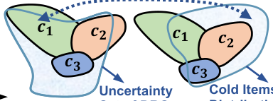
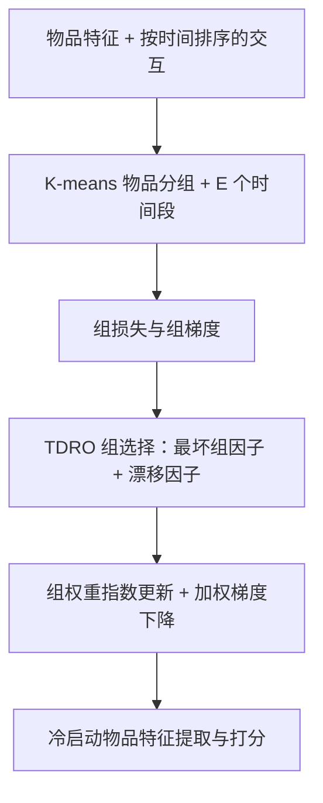
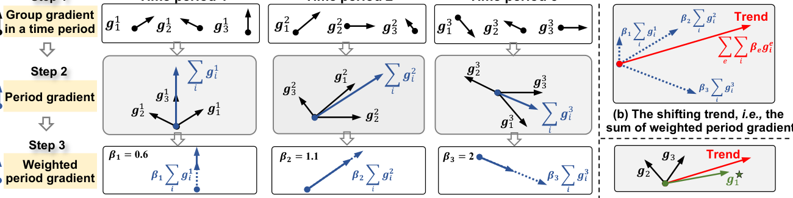

# Temporally and Distributionally Robust Optimization for Cold-Start Recommendation (面向冷启动推荐的时间分布鲁棒优化)

- **会议/期刊**: AAAI 2024
- **作者与机构**: Xinyu Lin, Wenjie Wang, Jujia Zhao, Yongqi Li, Fuli Feng, Tat-Seng Chua; NUS / PolyU / USTC
- **推荐链路定位**: 精排（可嵌入冷启动物品召回/精排模型的训练目标）
- **研究方向**: 冷启动与长尾推荐
- **论文原文**: [https://arxiv.org/abs/2312.09901v3](https://arxiv.org/abs/2312.09901v3)
- **开源代码**: [https://github.com/Linxyhaha/TDRO](https://github.com/Linxyhaha/TDRO)

## TL;DR (1分钟核心速览)

冷启动物品特征相对暖启动物品存在**时间漂移**，传统特征提取器在暖启动物品上经 ERM 训练后，难以泛化到未来冷启动物品；直接套用 DRO 又会过度关注暖启动物品中的少数组，与未来冷启动物品中可能流行的组不一致。本文提出 TDRO：用**最坏组因子**提升性能下界，用**漂移因子**基于跨时间段梯度趋势强调潜在流行组。在 Amazon、Micro-video、Kwai 三数据集的全库排序协议下，TDRO 使 CLCRec 的冷启动物品 Recall@20 分别相对提升约 23.0%、22.2%、16.3%。

## Background & Motivation (背景与核心矛盾)

- **主流范式**: 冷启动推荐通常学习一个物品特征提取器，在暖启动物品上对齐特征表示与协同过滤交互表示；推理时冷启动物品仅依赖特征表示打分。
- **前人局限**: 物品类别、缩略图等特征会随时间漂移，ERM 易过拟合暖启动物品多数组；而常规 DRO 过度优化暖启动物品少数组，未必对应未来冷启动物品中的流行组，产生 **DRO 不一致性**。
- **核心洞察 (Key Insight)**: 冷启动物品的特征分布并非随机偏移，而是沿时间呈现可捕捉的漂移趋势；应同时保证最坏组性能并强调与未来分布方向一致的组。
- **本文切入点**: 将 DRO 的组选择从“只看当前最大损失”扩展为“最坏组损失 + 时间漂移趋势相似度”的联合准则。

图 1 直观展示了商品类别/视觉特征随时间漂移，以及常规 DRO 与未来冷启动分布不一致的问题。

<figure class="paper-figure" markdown="span">
  <figcaption>图1：(a) 商品类别特征向卫生用品偏移的一个示例。(b) 在 Micro-video 数据集上三个时间段内商品缩略图视觉特征的 T-SNE 可视化。星号表示每个时间段的平均商品特征。(c) 三个商品组随时间偏移趋势的一个示例。(d) DRO 不一致性问题的示意图。</figcaption>
</figure>

## Method (核心方法设计)

### 1. 整体框架 (Overall Architecture)

TDRO 不改变后端冷启动推荐模型结构，只重写训练时的组选择与梯度加权。具体地，先用 K-means 按物品特征将暖启动物品分成 $K$组，再按时间戳将交互切为$E$ 个时间段。每步计算各组损失与组梯度，并用最坏组因子和漂移因子得到组权重；随后以加权梯度更新特征提取器与交互预测器。推理阶段与 backbone 完全一致，不增加在线打分开销。

### 2. 关键设计拆解 (Key Designs)

1. **最坏组因子（Worst-case Factor）**：常规 Group-DRO 选择损失最大的组，可提升最差组性能，但会过度牺牲其他组。TDRO 保留 $\bar{L}_j$作为下界保障，同时在联合准则中只占权重$1-\lambda$，避免单一 worst-case 组垄断训练。其作用类似“抬高下限”，但不放弃未来可能流行的组。

2. **漂移因子（Shifting Factor）**：用梯度方向刻画物品特征随时间的漂移趋势。定义时间段权重 $\beta_e=\exp(p\cdot e)$，越接近测试期权重越大；漂移趋势为$\mathrm{trend}=\sum_{e=1}^{E}\sum_{i=1}^{K}\beta_e g_i^e$，其中$g_i^e=\nabla_\theta \bar{L}_i^e(\theta)$。组选择准则为  
$j^{*}=\arg\max_{j}(1-\lambda)\bar{L}_{j}(\theta_{t})+\lambda\langle g_{j},\mathrm{trend}\rangle$。  
内积越大，说明该组梯度与未来漂移方向越一致；这使 TDRO 优先优化“可能变流行”的组，而非仅当前最差组。

3. **训练目标、负采样与推理效率**：总优化为组加权梯度下降  
$\theta_{t+1}=\theta_t-\eta\sum_{i=1}^{K}w_i^{t+1}\nabla\bar{L}_i(\theta_t)$，  
其中组权重用指数更新并归一化：  
$w_i^{t+1}\propto w_i^t\exp(\eta_w[(1-\lambda)\bar{L}_i+\lambda\langle g_i,\mathrm{trend}\rangle])$。  
为缓解分组后稀疏性带来的训练不稳定，采用流式损失 $\bar{L}_i^t=(1-\mu)\bar{L}_i^{t-1}+\mu\bar{L}_i^t$。负采样完全沿用 backbone（如 CLCRec/GAR）的对比或 BPR 类损失；TDRO 仅增加训练期组梯度计算，推理与 backbone 同量级。

<figure class="paper-figure" markdown="span">
  <figcaption>图2：在三个组和三个时间段（即 i ∈{1, 2, 3} 和 e ∈{1, 2, 3}）下偏移因子的示意图。(a) 展示了在每个时间段获取加权周期梯度的三个步骤。然后，通过对加权周期梯度求和，可得到如 (b) 所示的偏移趋势。最后，通过计算组梯度与偏移趋势之间的相似度，得到如 (c) 所示的每个组的偏移因子。</figcaption>
</figure>

## Experimental Setup & Evaluation Protocol (实验设置与评估协议)

- **数据集与预处理**: 正文未展开完整统计，原文附录 Table 5 给出详细规模；下表仅列数据域、特征与切分要点。

| 数据集 | #Users | #Items | #Interactions | 稀疏度/密度 | 特征/场景说明 |
| :--- | :---: | :---: | :---: | :---: | :--- |
| Amazon | 见附录 | 见附录 | 见附录 | 见附录 | 服装域，含丰富视觉特征 |
| Micro-video | 见附录 | 见附录 | 见附录 | 见附录 | 工业短视频，缩略图视觉 + 文本描述 |
| Kwai | 见附录 | 见附录 | 见附录 | 见附录 | 短视频，含视觉特征；无全局时间戳 |

- **数据划分与防穿越 (Splitting Strategy)**: Amazon、Micro-video 按时间戳以 8:1:1 切分训练/验证/测试；Kwai 因缺全局时间戳，沿用 CLCRec 的随机切分。验证/测试中未在训练集出现的物品视为冷启动物品，其余为暖启动物品。
- **排名评测协议 (Ranking Protocol)**: 采用无偏 **Full-Ranking**，分别在全部物品、暖启动物品、冷启动物品上排序；指标为 Recall@20 与 NDCG@20。
- **对比基线与超参设置**: 基线含 DUIF、DropoutNet、M2TRec、MTPR、Heater、CB2CF、CCFCRec、InvRL、CLCRec、GAR，并对比 S-DRO；TDRO 可即插即用于 CLCRec 与 GAR。超参主要含组数 $K$、时间段数$E$、漂移强度$\lambda$、时间权重陡峭度$p$与流式步长$\mu$；显著性用 one-sample t-test，$p<0.01$。

## Key Experimental Results (实验关键数据)

### 1. 主实验对比 (Main Results)

下表选取 Recall@20 的代表性结果，覆盖鲁棒训练、辅助损失、DRO 与不变学习基线；“All/Cold”分别为全库与冷启动物品排序。

| 方法 | Amazon All | Amazon Cold | Micro All | Micro Cold | Kwai All | Kwai Cold |
| :--- | :---: | :---: | :---: | :---: | :---: | :---: |
| DUIF | 0.0042 | 0.0129 | 0.0318 | 0.0771 | 0.0208 | 0.0158 |
| DropoutNet | 0.0050 | 0.0050 | 0.0187 | 0.0222 | 0.0099 | 0.0066 |
| Heater | 0.0065 | 0.0040 | 0.0469 | 0.0868 | 0.0452 | 0.0087 |
| CB2CF | 0.0078 | 0.0074 | 0.0496 | 0.0928 | 0.0624 | 0.0064 |
| CCFCRec | 0.0071 | 0.0117 | 0.0435 | 0.0699 | 0.0098 | 0.0129 |
| InvRL | 0.0120 | 0.0150 | 0.0578 | 0.0754 | 0.0588 | 0.0191 |
| CLCRec | 0.0106 | 0.0135 | 0.0583 | 0.0623 | 0.0743 | 0.0160 |
| GAR | 0.0079 | 0.0124 | 0.0644 | 0.0840 | 0.0588 | 0.0051 |
| CLCRec + S-DRO | 0.0121 | 0.0144 | 0.0656 | 0.0719 | 0.0661 | 0.0172 |
| **CLCRec + TDRO** | **0.0130** | **0.0166** | **0.0703** | **0.0761** | **0.0841** | **0.0186** |
| **GAR + TDRO** | **0.0087** | **0.0150** | **0.0711** | **0.0947** | **0.0598** | **0.0052** |

相对 CLCRec，TDRO 在 Amazon/Micro/Kwai 的 Cold Recall@20 分别提升 **23.0% / 22.2% / 16.3%**；相对 GAR，Cold 分别提升 **21.0% / 12.7% / 2.0%**。说明 TDRO 对两类 SOTA 冷启动 backbone 均有增益，且在时间漂移更强的短视频数据上更明显。

### 2. 消融实验 (Ablation Study)

以 CLCRec 为 backbone，分别移除 worst-case 因子与 shifting 因子：

| 变体 | Amazon All | Amazon Cold | Micro All | Micro Cold | Kwai All | Kwai Cold |
| :--- | :---: | :---: | :---: | :---: | :---: | :---: |
| CLCRec | 0.0106 | 0.0135 | 0.0583 | 0.0623 | 0.0743 | 0.0160 |
| w/o Worst-case | 0.0121 | 0.0157 | 0.0648 | 0.0687 | 0.0790 | 0.0145 |
| w/o Shifting | 0.0126 | 0.0160 | 0.0643 | 0.0622 | 0.0797 | 0.0165 |
| **TDRO** | **0.0130** | **0.0166** | **0.0703** | **0.0761** | **0.0814** | **0.0186** |

### 3. 关键实验发现 (Key Findings)

1. **两个因子互补而非冗余**：Micro-video 上移除 shifting 后 Cold Recall 从 0.0761 降至 0.0622，说明漂移趋势对捕捉未来流行组至关重要；Kwai 上移除 worst-case 后 Cold 从 0.0186 降至 0.0145，说明下界保障仍不可缺。
2. **漂移越强，TDRO 增益越稳定**：按训练/测试平均特征距离将用户分为 Group1–3，Amazon 上 CLCRec 分别为 0.0218/0.0075/0.0024，TDRO 为 0.0254/0.0110/0.0027；漂移最大的 Group3 虽绝对值最低，但 TDRO 仍保持正向提升。
3. **兼顾最差组与潜在流行组**：Amazon 上 TDRO 将最差物品组 Recall@20 从 0.0166 提至 0.0173，并将 Top 25% 流行冷启动物品组从 0.0088 提至 0.0125，说明其不是单纯“救长尾”，而是同时抬升下界与未来热门组。

## Highlights & Limitations (亮点、对比与审稿批判)

- **与代表作对比 (vs. Prior Work)**: CLCRec 用对比损失对齐特征与 CF 表示，GAR 用对抗约束拉近分布，二者均未显式建模时间漂移；S-DRO 将 DRO 用于暖启动长尾，但会过度强调暖启动物品少数组。TDRO 的关键差异是用**时间梯度趋势**修正 DRO 组选择。
- **可迁移亮点**: 梯度趋势可作为轻量“环境重要性”信号，迁移到跨域/多场景推荐；组权重指数更新与流式损失也适合稀疏分组训练。
- **审稿级局限批判**: 组数 $K$、时间段数$E$依赖预定义，实验显示$K=5$附近最佳但性能并非随$K$ 单调，超参较敏感；训练期需计算多组梯度，且 Kwai 缺全局时间戳只能随机切分，削弱了时间漂移评估的严格性；线上 A/B 与推理延迟未充分展开。

## Rating (四维评分)

- **方法创新性 (Novelty)**: ⭐⭐⭐⭐ （将 DRO 组选择与时间梯度趋势结合，视角新颖且有清晰物理直觉）
- **评估协议与实验扎实度 (Protocol & Experiments)**: ⭐⭐⭐⭐ （三数据集、Full-Ranking、双 backbone、消融与用户/物品分组分析较完整）
- **写作与数学规范度 (Clarity & Rigor)**: ⭐⭐⭐⭐ （公式推导与算法流程清晰，但部分数据集统计留在附录）
- **工业落地与复现价值 (Industrial & Practical Value)**: ⭐⭐⭐⭐ （即插即用、开源代码、推理零额外开销；训练期组梯度计算与超参调优需工程权衡）

