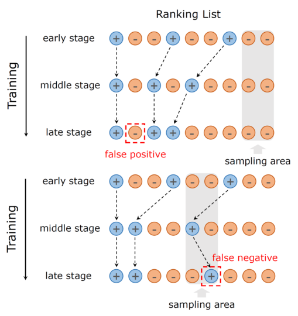
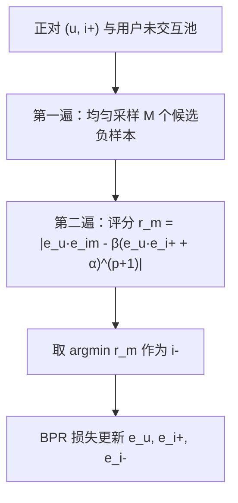
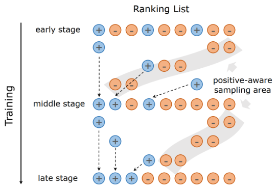

# Adaptive Hardness Negative Sampling for Collaborative Filtering (自适应难度负采样用于协同过滤)

- **会议/期刊**: AAAI 2024
- **作者与机构**: Riwei Lai, Rui Chen, Qilong Han, Chi Zhang (哈尔滨工程大学), Li Chen (香港浸会大学)
- **推荐链路定位**: 召回（隐式反馈 MF 训练阶段的负采样策略）
- **研究方向**: 协同过滤与双塔召回 / 自监督对比学习与交互去噪
- **论文原文**: [https://arxiv.org/abs/2401.05191v1](https://arxiv.org/abs/2401.05191v1)
- **开源代码**: [https://github.com/Riwei-HEU/AHNS](https://github.com/Riwei-HEU/AHNS)

## TL;DR (1分钟核心速览)

现有隐式 CF 负采样无论随机（RNS）还是难负采样（DNS/DENS）都只能抽取**固定难度**的负样本，分别引发假阳性（FPP：高初始分的无关物品更新不足）与假阴性（FNP：未交互的正向物品被压到列表低位）。本文提出自适应难度负采样范式 **AHNS** 及三条准则，给出可解析实例 **AHNS$_{p<0}$**：以正样本得分为自变量构造幂律目标难度曲线，在候选集内选评分最贴近该目标者。在 ML-1M 与 3 个 Amazon 数据集、80/20 划分下，R@20 较最强基线提升 1.6%–8.2%，单轮训练耗时与 DNS 基本持平（36.72s vs 37.08s）。

## Background & Motivation (背景与核心矛盾)

- **主流范式**: 隐式 CF 用 BPR 损失拉大正负样本内积差；负采样分两派——静态分布（RNS 均匀、PNS 热度偏置）与难负采样（DNS 取候选集最高分、MixGCF 正负混合合成、DENS 因子解耦门控）。
- **前人局限**: 作者用"负样本得分 / 对应正样本得分"定义**难度**并实测：RNS 全程锁死在 ≈0，DNS ≈0.3，DENS ≈0.4。即所有方法在整个训练过程只能采一个难度档位，因而（i）只采易负样本时高初始分无关物品得不到充分下压（FPP）；（ii）只采难负样本时未交互的正向物品被误判为负而排名下滑（FNP），DNS/DENS 在训练后期 NDCG 明显回落。
- **核心洞察 (Key Insight)**: 难度不应对全体样本设同一常数，而应是**正样本得分的单调递减函数**——低分正样本配高难度负样本以加速其优化并充分更新高负样本（治 FPP），高分正样本配低难度负样本以保护潜在正例（治 FNP）。
- **本文切入点**: 把"难度调度"从"按 epoch 的课程学习"（同 epoch 内仍固定难度）改为"按正样本逐对自适应"，并给出满足三准则的闭式评分函数与 NDCG 下界证明。

<figure class="paper-figure" markdown="span">
  <figcaption>图2：固定难度负采样存在的问题。</figcaption>
</figure>

## Method (核心方法设计)

### 1. 整体框架 (Overall Architecture)

对每个正对 $(u,i^+)$走两阶段采样：第一遍从用户未交互物品中均匀抽$M$个构成候选集$\mathcal{C}$（$M \ll |\mathcal{I}|$，保证效率）；第二遍对每个候选$i_m$计算评分$r_m$，取$r_m$最小者为最终负样本$i^-$，组成三元组送入 BPR 训练。核心在于评分函数把"负样本得分"与"由正样本得分推算出的目标得分"做差取绝对值，等价于让所选负样本落在幂律难度曲线上；由于该曲线随正样本得分单调下降，采样难度自动随训练进程与样本难易逐对调整。全流程无需额外网络参数、无对抗训练，仅一次候选打分，与 DNS 同量级开销。

<figure class="paper-figure" markdown="span">
  <figcaption>图3：自适应难度负采样示意图。</figcaption>
</figure>

### 2. 关键设计拆解 (Key Designs)

1. **AHNS 三准则（范式的可判定定义）**：把"好负采样"从启发式提升为可验证约束——**C1 正样本感知**（难度由对应正样本决定，而非全局常数）；**C2 负相关**（正样本得分越高，所选负样本难度越低）；**C3 可调**（能适配不同数据集与 Top-K 指标）。既有方法被证明只是满足其中 1–2 条的"松弛特例"：DENS 满足 C1，CuCo（反课程）部分满足 C2，DNS(M,N) 通过超参满足 C3。
2. **可解析实例 AHNS$_{p<0}$（幂律难度曲线）**：候选评分$r_m = |\boldsymbol{e}_u^{\top}\boldsymbol{e}_{i_m} - \beta(\boldsymbol{e}_u^{\top}\boldsymbol{e}_{i^+} + \alpha)^{p+1}|$，取$i^- = \arg\min_{i_m\in\mathcal{C}} r_m$。令$r_m \to 0$得理想负样本得分$\boldsymbol{e}_u^{\top}\boldsymbol{e}_{i^-} = \beta(\boldsymbol{e}_u^{\top}\boldsymbol{e}_{i^+}+\alpha)^{p+1}$，于是其难度$\mathrm{Hardness}(i^{-*}) \approx \beta(\boldsymbol{e}_u^{\top}\boldsymbol{e}_{i^+}+\alpha)^{p}$，求导$\frac{d\,\mathrm{Hardness}}{d(\boldsymbol{e}_u^{\top}\boldsymbol{e}_{i^+})} = p\beta(\boldsymbol{e}_u^{\top}\boldsymbol{e}_{i^+}+\alpha)^{p-1} < 0$（当$p<0$）。**直觉**：$p<0$天然给出"高分正样本→低难度、低分正样本→高难度"的反比曲线，一条式子同时满足 C1/C2；$\alpha$平移拐点、$\beta$缩放幅值、$p$ 控制曲线陡峭度，实现 C3。
3. **训练目标、负采样与推理开销**：损失仍为标准 BPR $\mathcal{L} = \sum_{(u,i^+,i^-)} -\ln\sigma(\boldsymbol{e}_u^{\top}\boldsymbol{e}_{i^+} - \boldsymbol{e}_u^{\top}\boldsymbol{e}_{i^-})$，**每正对仅 1 个负样本**、免去 SSM 的多负样本前向；采样为"两遍式候选内选择"，非 in-batch、非对抗。推理阶段采样模块完全移除，仅剩内积检索，线上零额外开销。

## Experimental Setup & Evaluation Protocol (实验设置与评估协议)

- **数据集与预处理**:

| 数据集 | #Users | #Items | #Interactions | 密度 | 场景说明 |
| :--- | :---: | :---: | :---: | :---: | :--- |
| ML-1M | 6.0k | 3.7k | 1000.2k | 4.47% | 电影评分，稠密基准 |
| Amazon-Phones | 27.9k | 10.4k | 194.4k | 0.07% | 电商评论，极稀疏 |
| Amazon-Sports | 35.6k | 18.4k | 296.3k | 0.05% | 户外运动，极稀疏 |
| Amazon-Tools | 16.6k | 10.2k | 134.5k | 0.08% | 工具类，极稀疏 |

- **数据划分与防穿越**: 沿用 DENS/He et al. 设定，按用户 **80%/20% 随机比例划分** train/test，再从训练集随机抽 10% 作验证集（非全局时间戳切分，存在轻度未来信息泄漏风险）。
- **排名评测协议**: 指标为 R@20、N@20、N@50；原文未显式声明候选集规模，从其沿用 DENS/MF 评测栈推断为**全库未交互物品排序（Full-Ranking）**，但论文正文未明写正负比与候选裁剪，属复现时的模糊点。
- **对比基线与超参**: 骨干统一为 **MF，$d=64$**，Xavier 初始化，Adam（lr=0.001），batch=2048，100 epoch；候选规模$M \in \{4,8,16,32,64\}$，$\alpha,\beta \in \{0.1,\dots,1.0\}$网格搜索；最佳结果相对最强基线显著性$p<0.01$。

## Key Experimental Results (实验关键数据)

### 1. 主实验对比 (Main Results)

| Method | ML-1M R@20 | ML-1M N@20 | Phones R@20 | Phones N@20 | Sports R@20 | Sports N@20 | Tools R@20 | Tools N@20 |
| :--- | :---: | :---: | :---: | :---: | :---: | :---: | :---: | :---: |
| RNS (BPR) | 22.86 | 35.46 | 11.06 | 5.98 | 6.73 | 3.60 | 5.53 | 2.99 |
| SSM | 24.87 | 37.74 | 11.37 | 6.13 | 7.08 | 3.80 | 5.72 | 3.10 |
| DNS | 24.66 | 36.64 | 12.08 | 6.64 | 7.74 | 4.25 | 6.66 | 3.78 |
| MixGCF | 24.75 | 37.54 | 12.20 | 6.73 | 7.68 | 4.32 | 6.82 | 3.88 |
| DENS | 25.07 | 37.67 | 12.16 | 6.68 | 7.90 | 4.35 | 6.66 | 3.76 |
| DNS(M,N) | 25.09 | 37.58 | 12.27 | 6.75 | 7.84 | 4.31 | 6.86 | 3.76 |
| CuCo | 25.12 | 37.53 | 12.19 | 6.68 | 7.68 | 4.25 | 6.76 | 3.82 |
| AHNS$_{p=-1}$ | 25.17 | 37.72 | 13.02 | 7.08 | 8.42 | 4.58 | 7.27 | 4.02 |
| **AHNS$_{p=-2}$** | **25.51** | **38.77** | **13.03** | **7.14** | **8.52** | **4.61** | **7.42** | **4.05** |
| **Improv.%** | **+1.6%** | **+2.7%** | **+6.2%** | **+5.8%** | **+7.8%** | **+6.0%** | **+8.2%** | **+4.4%** |

### 2. 消融实验 (Ablation Study)

该方法本质是"替换采样器"，无可拆模块，故论文以**变体对比 + 超参鲁棒性 + 效率**替代经典消融：

| 配置 | ML-1M N@20 | Phones N@20 | Sports N@20 | Tools N@20 | 单轮耗时(s, ML-1M) |
| :--- | :---: | :---: | :---: | :---: | :---: |
| AHNS$_{p=-1}$（难度曲线更平缓） | 37.72 | 7.08 | 4.58 | 4.02 | ≈36.7 |
| AHNS$_{p=-2}$（难度曲线更陡） | **38.77** | **7.14** | **4.61** | **4.05** | **36.72** |
| 固定难度 DNS | 36.64 | 6.64 | 4.25 | 3.78 | 37.08 |
| DNS(M,N)（大候选调难度） | 37.58 | 6.75 | 4.31 | 3.76 | 393.09 |
| MixGCF（合成负样本） | 37.54 | 6.73 | 4.32 | 3.88 | 39.54 |
| RNS（无候选选择） | 35.46 | 5.98 | 3.60 | 2.99 | 5.09 |

### 3. 关键实验发现 (Key Findings)

1. **自适应难度确为增益主因，而非"更难即更好"**：$p=-1\to p=-2$（曲线更陡、后期负样本更易）在四个数据集上单调提升 N@20（37.72→38.77、7.08→7.14、4.58→4.61、4.02→4.05）；而固定高难度 DNS/DENS 在训练后期 NDCG 出现明显回落，仅在中前期占优。
2. **稀疏度放大收益**：ML-1M 上 R@20 仅 +1.6%（已近饱和），而密度低两个数量级的 Amazon 三集提升 6.2%–8.2%，说明 AHNS 在交互极少、FNP 风险更高的场景价值最大。
3. **性能增益几乎零时延代价**：AHNS$_{p=-2}$ 单轮 36.72s，与 DNS（37.08s）/DENS（37.41s）同级，远低于 DNS(M,N) 的 393.09s 与 SSM 的 63.62s——后者通过"扩大候选集 / 多负样本"调难度，代价是 10 倍以上训练时间；AHNS 仅用一次候选打分即换来更高精度。

## Highlights & Limitations (亮点、对比与审稿批判)

- **与代表作对比 (vs. Prior Work)**: 相比 **DNS**（固定取最高分，FNP 严重）与 **DENS**（仅做到 C1 正样本感知，难度仍固定档）的关键差别是引入"目标难度作为正样本得分的函数"，把难度从常数变成逐对可调；相比 **CuCo**（按 epoch 调度的课程学习，同 epoch 内仍固定），做到同 epoch 内不同正样本不同难度；相比 **DNS(M,N)**（靠超大候选集与超参硬调难度，393s/epoch），用解析曲线实现同样可控性而耗时降一个数量级。
- **可迁移亮点**: (1) 用"负样本分/正样本分"的**相对难度**度量，天然抵消训练中全体物品得分同步上升的漂移，可直接用于双塔召回、图推荐（LightGCN）的负采样诊断；(2) 幂律目标曲线 $d\propto(\hat{s}^++\alpha)^{p}$ 可作为任意 pairwise 损失的"动态间隔"插件，与 focal loss 的"聚焦难分样本"思想同构。
- **审稿级局限批判**: (1) 全部实验只在 **MF** 单骨干上验证，未接入 LightGCN/序列模型，结论的架构泛化性未证；数据划分为随机 80/20 而非全局时间戳，存在未来交互泄漏，且未显式声明 Full-Ranking 与候选裁剪，复现口径偏模糊。(2) 引入 $\alpha,\beta,p,M$四个超参，论文自承最优值随数据集与指标变化、难以先验确定（仅展示"较宽区间内鲁棒"），调参成本被低估；同时每正对需对$M$个候选逐一前向打分，$M$ 增大时训练吞吐线性下降，大规模工业场景需额外工程优化。

## Rating (四维评分)

- **方法创新性 (Novelty)**: ⭐⭐⭐⭐ （首次以"固定难度"统一诊断 FPP/FNP，并用幂律难度曲线把课程学习"逐 epoch"推广到"逐样本"，配 C1–C3 准则与 NDCG 下界证明，理论闭环较完整）
- **评估协议与实验扎实度 (Protocol & Experiments)**: ⭐⭐⭐ （4 个数据集 + 7 个强基线 + $p<0.01$ 显著性充分，但仅 MF 单骨干、划分与排序协议表述含糊，且缺组件级消融）
- **写作与数学规范度 (Clarity & Rigor)**: ⭐⭐⭐⭐ （难度定义、四定理推导链条清晰，Fig. 4 直观解释 $p,\alpha,\beta$的几何作用；NDCG 下界证明中用了$1+z\le 2^z$ 等松弛，界较松）
- **工业落地与复现价值 (Industrial & Practical Value)**: ⭐⭐⭐⭐ （代码开源、推理零额外开销、训练耗时与 DNS 持平而精度更高，是"低成本替换现有采样器"的即插即用方案；超参需按场景重调是主要落地摩擦）

