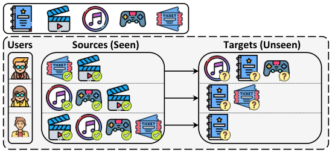
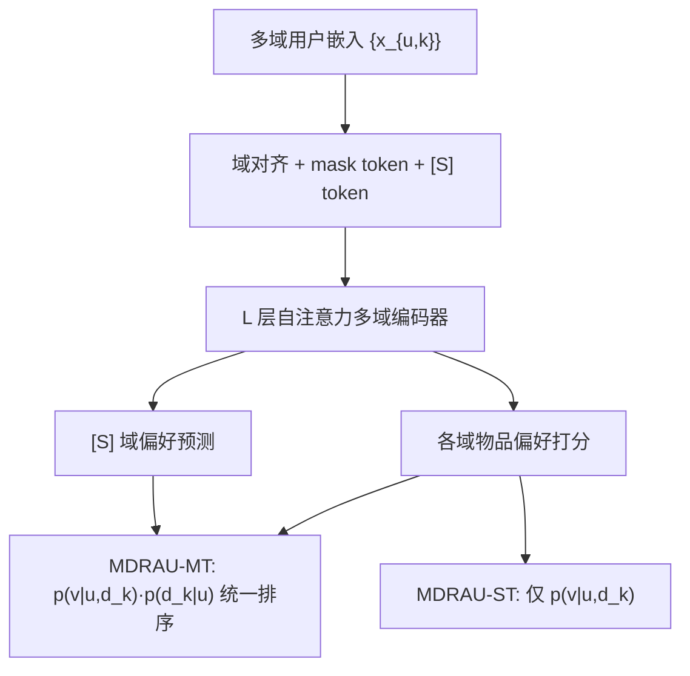
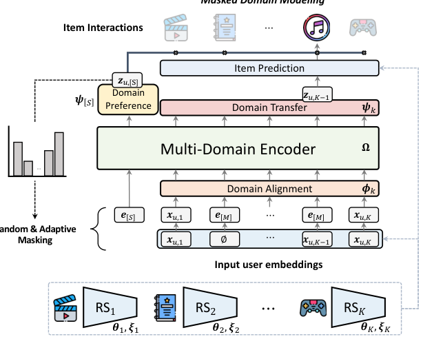

# Multi-Domain Recommendation to Attract Users via Domain Preference Modeling (通过域偏好建模吸引用户的多域推荐)

- **会议/期刊**: AAAI 2024
- **作者与机构**: Hyunjun Ju 等；POSTECH、UIUC、Yonsei University
- **推荐链路定位**: 端到端跨域召回与排序
- **研究方向**: 跨域与多场景推荐 / 冷启动与长尾推荐
- **论文原文**: [论文原文链接](https://arxiv.org/abs/2403.17374v1)
- **开源代码**: 暂未开源

## TL;DR (1分钟核心速览)

针对多域平台中用户只交互部分域、需从未见域吸引用户的新任务 MDRAU，本文指出 seen→unseen 映射组合可达 $2^K-2$ 且需同时建模域级与物品级偏好，提出 DRIP：以掩码域建模统一学习多对多映射，并用 [S] token 预测域偏好。Amazon P1/P2 的 Top-K 排序下，MDRAU-ST 的 R@20 最高提升 14.86%，MDRAU-MT 的 R@20 提升 25.64%/32.66%。

## Background & Motivation (背景与核心矛盾)

- **主流范式**: CDR 多采用一对一的 source→target 映射，近年 UniCDR/CAT-ART 用域共享/域特异表征处理多域，但仍以已交互域推荐或单目标域为主。
- **前人局限**: ① 用户可见域子集不同，$K$个域最多产生$2^K-2$ 种 seen→unseen 组合，逐对学习映射不可行；② 多目标域统一列表需域级偏好，现有方法只重物品级打分，跨域合并依赖后处理。
- **核心洞察 (Key Insight)**: 若把部分已见域人为 mask，则可把“已见→未见”转化为自监督式的“上下文→缺失域”预测，从而统一模拟大量映射场景。
- **本文切入点**: 将用户偏好显式分解为域级与域内物品级，并用 masked domain modeling 联合学习二者。

<figure class="paper-figure" markdown="span">
  <figcaption>图1：MDRAU任务的概念示意图。一个平台运行五个不同的服务域，每个用户与全部服务域的一个子集进行部分交互。MDRAU旨在从每个用户的未见域提供推荐以吸引用户。</figcaption>
</figure>

## Method (核心方法设计)

### 1. 整体框架 (Overall Architecture)

各域先由域内 RS 编码出用户/物品嵌入；用户域嵌入经 projector 对齐后，未见域替换为可学习 mask token，句首加入 [S] token，送入 L 层 self-attention 多域编码器。编码后，[S] 表征经域偏好预测器输出 $p(d_k|u)$，各域表征经域特异 projector 与物品嵌入内积得到$p(v|u,d_k)$。训练时随机/自适应 mask 已见域并预测其交互；推理时输入用户未见域为 mask，MDRAU-ST 仅用物品分，MDRAU-MT 用两级分数乘积统一排序。

<figure class="paper-figure" markdown="span">
  <figcaption>图2：所提出的DRIP框架概览。</figcaption>
</figure>

### 2. 关键设计拆解 (Key Designs)

1. **多域编码与掩码输入（统一多对多映射）**：各域独立训练导致嵌入分布不一致，先用 $g_{\phi_k}$对齐；未见域用 mask 替换：$\bar{x}_{u,k}=(1-G_{u,k})e_{\mathrm{M}}+G_{u,k}x_{u,k}$，并构造$H_u^0=[e_{\mathrm{S}},g_{\phi_1}(\bar{x}_{u,1}),\ldots,g_{\phi_K}(\bar{x}_{u,K})]^\top$。self-attention 让每个域表征吸收其他域上下文，避免为每个 source-target 对单独建映射。
2. **域级 + 物品级偏好分解（支持跨域统一列表）**：由 $p(v|u)=p(v|u,d_k)p(d_k|u)$分解，域级为$p(d_k|u)=\frac{\exp(z_{u,\mathrm{S},k})}{\sum_{d_i\in\mathcal{D}}\exp(z_{u,\mathrm{S},i})}$，物品级为$p(v|u,d_k)=\frac{\exp(\mathrm{sim}_k(z_{u,k},x_{v,k}))}{\sum_{\hat v\in V_k}\exp(\mathrm{sim}_k(z_{u,k},x_{\hat v,k}))}$。其直觉是：多未见域排序既要“选哪个域”，也要“域内选哪个物品”，避免后处理归一化破坏全局最优。
3. **Masked Domain Modeling + 自适应 mask**：训练时对已见域采样 $m_{u,k}\sim\mathrm{Bern}(p_{u,k})$，$p_{u,k}\propto p(d_k|u;\Theta)$，把被 mask 域当作伪未见域；损失为$\mathcal{L}_{\mathrm{DRIP}}=-\sum_u\sum_{d_k}m_{u,k}\sum_{v\in V_k}R_{u,v}\log[p(v|u,d_k)p(d_k|u)]$。训练用域内全物品 softmax NLL，无 BPR 式负采样；推理需对目标域全库打分，开销随域数与物品规模增长。

## Experimental Setup & Evaluation Protocol (实验设置与评估协议)

| 数据集/域 | #Users | #Items | #Interactions | 密度 | 特征/场景说明 |
| :--- | ---: | ---: | ---: | ---: | :--- |
| P1-Book | 35,987 | 39,049 | 1,726,231 | 0.12% | Amazon 多域；物品域间互斥，用户跨域重叠 |
| P1-Movie | 17,056 | 15,620 | 609,552 | 0.23% | 同上，域内独立 RS |
| P1-CD | 5,941 | 9,069 | 211,617 | 0.39% | 同上，稀疏度较高 |
| P1-Game | 1,049 | 1,064 | 20,568 | 1.84% | 小域，适合检验跨域迁移 |
| P2-Home | 10,317 | 7,605 | 127,091 | 0.16% | 第二平台场景 |
| P2-Health | 8,690 | 5,750 | 123,905 | 0.25% | 同上 |
| P2-Grocery | 4,869 | 2,884 | 71,269 | 0.51% | 同上 |
| P2-Tools | 1,804 | 1,422 | 18,040 | 0.70% | 小域 |

- **数据集与预处理**: 沿用 Amazon 多域子集；正文未报告额外 5-core 过滤，用户/物品规模见表。
- **数据划分与防穿越**: 原文未显式说明比例或时间切分；MDRAU-ST 以每个目标域中未交互用户为测试用户，输入中 mask 未见域；MDRAU-MT 按每个用户各自的未见域集合评估，目标域用户交互不参与训练。
- **排名评测协议**: 采用 Top-K 隐式反馈排序，报告 R@20/50、N@20/50；域内对全物品按模型分数排序，MDRAU-MT 以 $p(v|u,d_k)p(d_k|u)$ 合并为统一列表。原文未给出采样负例比。
- **对比基线与超参**: 8 个基线覆盖 BPRMF、MMOE/PLE、EMCDR+/PTUPCDR+、CAT-ART+/UniCDR；DRIP 用 id-based encoder + 内积，$d$与投影维度$m$见附录；显著性用 paired t-test，$p<0.05$。

## Key Experimental Results (实验关键数据)

### 1. 主实验对比 (Main Results)

MDRAU-ST（单目标域）R@20：

| 方法 | P1-Book | P1-Movie | P1-CD | P1-Game | P2-Home | P2-Grocery | P2-Tools | P2-Health |
| :--- | ---: | ---: | ---: | ---: | ---: | ---: | ---: | ---: |
| BPRMF | 0.0174 | 0.0223 | 0.0378 | 0.0572 | 0.0363 | 0.0781 | 0.0981 | 0.0466 |
| MMOE | 0.0161 | 0.0306 | 0.0338 | 0.0729 | 0.0305 | 0.0966 | 0.0799 | 0.0494 |
| PLE | 0.0103 | 0.0307 | 0.0375 | 0.0750 | 0.0279 | 0.0953 | 0.0814 | 0.0500 |
| EMCDR+ | 0.0322 | 0.0449 | 0.0574 | 0.0846 | 0.0464 | 0.1049 | 0.1045 | 0.0640 |
| PTUPCDR+ | 0.0311 | 0.0426 | 0.0559 | 0.0875 | 0.0460 | 0.1040 | 0.1108 | 0.0653 |
| CAT-ART+ | 0.0325 | 0.0472 | 0.0566 | 0.0770 | 0.0434 | 0.1115 | 0.1031 | 0.0603 |
| UniCDR | 0.0359 | 0.0493 | 0.0589 | 0.0876 | 0.0468 | 0.1181 | 0.1206 | 0.0674 |
| **DRIP** | **0.0403**\* | **0.0526**\* | **0.0677**\* | **0.0936**\* | **0.0527**\* | **0.1184** | **0.1229**\* | **0.0726**\* |
| 提升% | 12.42 | 6.84 | 14.86 | 6.78 | 12.57 | 2.70 | 11.10 | 7.78 |

MDRAU-MT（多目标域统一列表）：

| 方法 | P1 R@20 | P1 N@20 | P2 R@20 | P2 N@20 |
| :--- | ---: | ---: | ---: | ---: |
| BPRMF | 0.0249 | 0.0256 | 0.0528 | 0.0503 |
| MMOE | 0.0188 | 0.0191 | 0.0486 | 0.0513 |
| PLE | 0.0190 | 0.0190 | 0.0491 | 0.0516 |
| EMCDR+ | 0.0362 | 0.0374 | 0.0531 | 0.0525 |
| PTUPCDR+ | 0.0367 | 0.0377 | 0.0546 | 0.0538 |
| CAT-ART+ | 0.0395 | 0.0395 | 0.0522 | 0.0497 |
| UniCDR | 0.0434 | 0.0446 | 0.0588 | 0.0574 |
| **DRIP** | **0.0545**\* | **0.0556**\* | **0.0780**\* | **0.0773**\* |
| 提升% | 25.64 | 24.55 | 32.66 | 34.80 |

### 2. 消融实验 (Ablation Study)

P1 / MDRAU-MT：

| 设计 | R@20 | R@50 | N@20 | N@50 |
| :--- | ---: | ---: | ---: | ---: |
| DRIP | **0.0545** | **0.0698** | **0.0556** | **0.0612** |
| Single-domain learning | 0.0281 | 0.0371 | 0.0272 | 0.0310 |
| Many-to-one + post-processing A | 0.0432 | 0.0593 | 0.0447 | 0.0511 |
| Many-to-one + post-processing B | 0.0409 | 0.0520 | 0.0424 | 0.0463 |
| Uniform domain dist. | 0.0122 | 0.0210 | 0.0120 | 0.0164 |
| Domain activeness dist. | 0.0409 | 0.0534 | 0.0419 | 0.0466 |
| w/o Adaptive Masking | 0.0513 | 0.0663 | 0.0520 | 0.0576 |

### 3. 关键实验发现 (Key Findings)

- **ST 上多源注意力与掩码推断共同起效**：P1 Book R@20 从 UniCDR 的 0.0359 提至 0.0403（+12.42%），CD 从 0.0589 提至 0.0677（+14.86%）；一对一 EMCDR/PTUPCDR 因无法利用多源相关性而落后。
- **MT 收益显著更大，域级偏好是主要缺口**：P1/P2 的 R@20 相对最佳基线提升 25.64%/32.66%。BPRMF 的 KL 散度在基线中较好，说明其隐式捕捉域分布，但物品级能力弱；DRIP 同时优化两级偏好，故统一列表最优。
- **两级联合学习不可替代**：单域学习 R@20 仅 0.0281（较 DRIP -48.4%），固定域分布（uniform）跌至 0.0122；后处理式 many-to-one 最高仅 0.0432，说明域级偏好必须在训练中端到端学习。自适应 mask 带来小幅但稳定的增益（0.0513→0.0545）。

## Highlights & Limitations (亮点、对比与审稿批判)

- **与代表作对比 (vs. Prior Work)**: 与 EMCDR/PTUPCDR 的逐对映射不同，DRIP 用 masked domain modeling 统一覆盖 $2^K-2$ 种 seen→unseen 组合；与 UniCDR/CAT-ART 主要服务已见域或依赖全局嵌入不同，DRIP 显式推断未见域嵌入与域级偏好，且无需多列表后处理。
- **可迁移亮点**: ① 将“未见域推荐”转成“缺失域自监督预测”，可迁移到多业务冷启动与跨场景召回；② 用 [S] token + 自适应 mask 把域级偏好作为可学习先验，适合多目标域统一排序。
- **审稿级局限批判**: ① 训练/推理均对域内全物品做 softmax 或全库打分，域数和物品规模大时开销明显；② 实验仅两个 Amazon 离线平台，切分与采样协议未完全展开，且无线上 A/B，工业稳健性仍需验证；③ 自适应 mask 增益有限，超参敏感度与多域扩展性讨论不足。

## Rating (四维评分)

- **方法创新性 (Novelty)**: ⭐⭐⭐⭐ （将 masked domain modeling 用于多对多跨域映射，且显式分解域级/物品级偏好，任务定义与机制均有新意）
- **评估协议与实验扎实度 (Protocol & Experiments)**: ⭐⭐⭐⭐ （8 个 CDR/多任务基线、双平台、ST/MT 双场景与显著性检验完整，但切分和负采样协议披露不足）
- **写作与数学规范度 (Clarity & Rigor)**: ⭐⭐⭐⭐ （概率分解清晰、符号统一，训练与推理公式对应紧密，复杂度分析略欠）
- **工业落地与复现价值 (Industrial & Practical Value)**: ⭐⭐⭐ （统一多域排序思路可落地，但全库 softmax/全量打分与无开源代码限制复现和线上部署）

