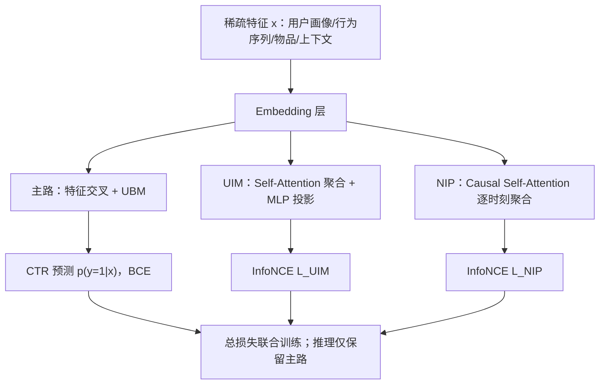
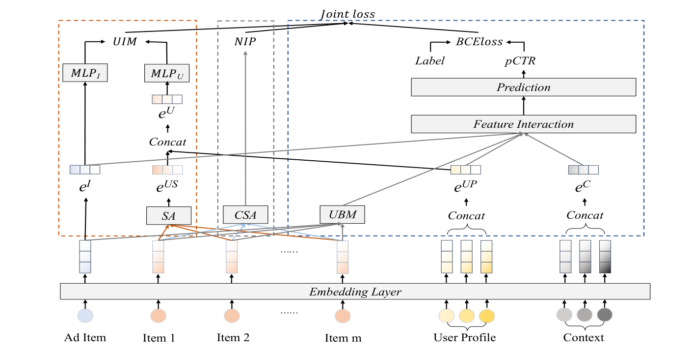

# AT4CTR: Auxiliary Match Tasks for Enhancing Click-Through Rate Prediction (AT4CTR：以辅助匹配任务增强点击率预估)

- **会议/期刊**: AAAI 2024
- **作者与机构**: Qi Liu, Xuyang Hou, Defu Lian, Zhe Wang, Haoran Jin, Jia Cheng, Jun Lei；中国科学技术大学 & 美团
- **推荐链路定位**: 精排 / CTR 预估
- **研究方向**: CTR/CVR 预估与特征交叉 / 自监督对比学习与交互去噪
- **论文原文**: [论文原文链接](https://arxiv.org/abs/2312.06683v2)
- **开源代码**: 暂未开源

## TL;DR (1分钟核心速览)

针对工业 CTR 中负样本下采样加剧数据稀疏、主 BCE 又需同时拟合上下文与交互特征而难以专注用户-物品相关性的问题，AT4CTR 在训练期引入 UIM 与 NIP 两个 InfoNCE 辅助匹配任务：前者拉近正样本用户/物品表征，后者用因果自注意力做下一物品预测。在 Taobao 与美团广告数据上，按测试集不降采样的 AUC/Logloss 评估，AUC 分别达 0.9535/0.7441，线上 A/B 的 RPS 相对提升 1.27%。

## Background & Motivation (背景与核心矛盾)

- **主流范式**: 深度 CTR 沿特征交叉（Wide&Deep、DeepFM、DCN）与行为序列建模（DIN、DIEN、DBPMaN）两条线，主要靠网络结构提升精度。
- **前人局限**: 工业负样本下采样会丢弃难负例，加剧正样本稀疏；主 BCE 需同时处理 context 与其他交互特征，难以充分学习 user-item 相关性。DeepMCP 的辅助二分类与主任务同质、缺少额外信号；DMR 用负采样近似 full softmax，信号弱且 item 量大时实现不友好；CL4CTR 的自监督对比至少三倍训练开销。
- **核心洞察 (Key Insight)**: “点击”是强偏好信号，正样本的用户/物品表征应高度相关；用户历史点击序列本身可视为用户表征，下一物品预测能提供因果训练信号；InfoNCE 的 in-batch 负例可补足被下采样丢弃的难负例。
- **本文切入点**: 不改推理结构，仅在训练期加 UIM+NIP 两个匹配任务，以低成本正则表征学习。

## Method (核心方法设计)

### 1. 整体框架 (Overall Architecture)

输入稀疏特征 $x=[x_{UP},x_{US},x_I,x_C]$，经 Embedding 层后分三路：主路做特征交叉与用户行为序列建模并输出$p(y=1|x)$；UIM 路用独立 self-attention 聚合行为序列、mean-pool 得$e_{US}$，与用户画像$e_{UP}$ 拼接后用 MLP 投影；NIP 路用因果 self-attention 逐时刻聚合历史行为。两辅助路均以 InfoNCE 计算匹配损失，与主 BCE 联合训练；推理时只保留主路，不增加参数与延迟。

<figure class="paper-figure" markdown="span">
  <figcaption>图 1：AT4CTR 的整体框架。SA 表示自注意力，CSA 表示因果自注意力。UBM 指用户行为序列建模。UIM 和 NIP 是所提出的两个辅助匹配任务。</figcaption>
</figure>

### 2. 关键设计拆解 (Key Designs)

1. **UIM：用户-物品匹配任务**：主 BCE 的梯度被多字段特征摊薄，正样本 user/item 相关性未被显式约束。先构造 $e_U=\mathrm{concat}(e_{UP},e_{US})$、$e_{US}=\mathrm{meanpool}(\mathrm{SA}(x_{US}))$，再用两个独立 MLP 对齐两侧维度得$r_U,r_I$，并以对称 InfoNCE 拉近正对、推开 batch 内其他物品/用户：

$\mathcal{L}_{ui}=-\frac{1}{n^+}\sum_{k=1}^{n^+}\log\frac{\exp(\mathrm{sim}(r_U^{+},r_I^{+})/\tau_1)}{\sum_{j=1}^{n}\exp(\mathrm{sim}(r_U^{+},r_I^{j})/\tau_1)}$对称项$\mathcal{L}_{iu}$同理，$\mathcal{L}_{UIM}=\mathcal{L}_{ui}+\mathcal{L}_{iu}$。直觉是给主任务补一条显式的相关性学习信号，缓解稀疏。

2. **NIP：下一物品预测任务**：行为序列含用户决策的因果线索，但常规序列模块只被主 BCE 弱监督。用因果 self-attention 得前 $k$个行为的聚合表示$r_i^k$，预测第$k+1$个物品$e_i^{k+1}$，同位置其他样本物品作为 in-batch 负例：

$\mathcal{L}_{pi}=-\frac{1}{n(m-1)}\sum_{i=1}^{n}\sum_{k=1}^{m-1}\log\frac{\exp(\mathrm{sim}(r_i^{k},e_i^{k+1})/\tau_2)}{\sum_{j=1}^{n}\exp(\mathrm{sim}(r_i^{k},e_j^{k+1})/\tau_2)}$对称项$\mathcal{L}_{ip}$同理，$\mathcal{L}_{NIP}=\mathcal{L}_{pi}+\mathcal{L}_{ip}$。它加速序列模块收敛，并借 InfoNCE 挖掘难负例。

3. **训练目标、负采样与推理效率**：总损失为 $\mathcal{L}_{total}=\mathcal{L}_{main}+\lambda_{UIM}\mathcal{L}_{UIM}+\lambda_{NIP}\mathcal{L}_{NIP}$，其中$\mathcal{L}_{main}$ 为点击 BCE。UIM/NIP 均用 batch 内负例，无需维护全库 item 采样器；辅助头只在训练期存在，推理零额外参数与延迟。对比 CL4CTR 的三倍训练成本，本文训练增量很小，适合工业日更。

## Experimental Setup & Evaluation Protocol (实验设置与评估协议)

- **数据集与预处理**: Taobao 过滤行为数少于 10 的用户；Industry 为美团本地生活搜索广告日志。

| 数据集 | #Users | #Items | #Fields | #Instances | 特征/场景说明 |
| :--- | :---: | :---: | :---: | :---: | :--- |
| Taobao | 987,991 | 4,161,138 | 7 | 100,095,182 | 公开电商点击/购买等行为，按时间构造序列 |
| Industry | 40M | 417K | 168 | 6.6B | 美团搜索广告，10 个月训练、次日测试；训练负采样比 0.1 |

- **数据划分与防穿越 (Splitting Strategy)**: Taobao 沿用 CAN 的划分协议（文中未展开具体比例/时间窗）；Industry 采用全局时间戳切分：前 10 个月训练，次日样本测试，避免未来信息穿越。
- **排名评测协议 (Ranking Protocol)**: CTR 场景非全库召回排序；测试集保留原始曝光分布、不再负采样，用全测试样本 AUC 衡量排序，用 Logloss 衡量概率校准。
- **对比基线与超参设置**: 基线覆盖特征交叉（FM、WideDeep、DeepFM）、行为序列（DIN、DIEN、DBPMaN）与辅助任务（DeepMCP、DMR、CL4CTR）。Embedding 维度 $d=16$（Industry）/$18$（Taobao）；学习率$5e^{-4}$/$1e^{-3}$；$\tau_1=0.07$、$\tau_2=0.1$；Adam，5 次平均，$p<0.01$ 显著性。

## Key Experimental Results (实验关键数据)

### 1. 主实验对比 (Main Results)

| 数据集 | 模型 | AUC | Logloss | Improv. (AUC / Logloss, vs 最佳基线) |
| :--- | :--- | :---: | :---: | :---: |
| Industry | FM | 0.7177 | 0.1955 | — |
| Industry | WideDeep | 0.7335 | 0.1923 | — |
| Industry | DeepFM | 0.7327 | 0.1924 | — |
| Industry | DIN | 0.7420 | 0.1906 | — |
| Industry | DIEN | 0.7424 | 0.1905 | — |
| Industry | DBPMaN | 0.7426 | 0.1905 | — |
| Industry | DeepMCP | 0.7426 | 0.1906 | — |
| Industry | CL4CTR | 0.7428 | 0.1904 | — |
| Industry | **AT4CTR** | **0.7441*** | **0.1902*** | **+0.175% / -0.105%** |
| Taobao | FM | 0.8025 | 0.2723 | — |
| Taobao | WideDeep | 0.8733 | 0.2233 | — |
| Taobao | DeepFM | 0.8690 | 0.2263 | — |
| Taobao | DIN | 0.9402 | 0.1544 | — |
| Taobao | DIEN | 0.9479 | 0.1430 | — |
| Taobao | DBPMaN | 0.9509 | 0.1382 | — |
| Taobao | DeepMCP | 0.9514 | 0.1376 | — |
| Taobao | CL4CTR | 0.9508 | 0.1384 | — |
| Taobao | **AT4CTR** | **0.9535*** | **0.1345*** | **+0.221% / -2.25%** |

### 2. 消融实验 (Ablation Study)

| 模型 | Industry AUC | Industry Logloss | Taobao AUC | Taobao Logloss |
| :--- | :---: | :---: | :---: | :---: |
| DBPMaN | 0.7426 | 0.1905 | 0.9509 | 0.1382 |
| + UIM | 0.7438 | 0.1903 | 0.9529 | 0.1360 |
| + UIM + NIP | **0.7441** | **0.1902** | **0.9535** | **0.1345** |

### 3. 关键实验发现 (Key Findings)

1. **UIM 是主增益，NIP 是增量补强**：Taobao 上仅加 UIM 使 AUC 从 0.9509 升至 0.9529（+0.0020），再加 NIP 仅 +0.0006；Industry 上分别为 +0.0012 与 +0.0003。原因在于行为序列每行为只有 item id、category 等有限特征，next-item 信号弱于直接 user-item 对齐。
2. **小比例负采样下可追平不降采样**：Industry 在负采样比 0.1 时，AT4CTR 达到与不降采样相近的性能，同时存储 39.0T vs 230.2T、训练 6.4h vs 39.5h，约省 6 倍成本；且提升随负采样比增大而减小，符合 in-batch 合成负例补足难负例的假设。
3. **泛化到不同 CTR 主干且线上有效**：与 WideDeep/DeepFM 结合提升更明显（Taobao DeepFM AUC 0.8690→0.8802），因无行为序列时 UIM 显式补相关性信号；线上 10% 流量一个月 A/B 中 RPS 相对 +1.27%、ROI +7.21%。

## Highlights & Limitations (亮点、对比与审稿批判)

- **与代表作对比 (vs. Prior Work)**: DeepMCP 的辅助二分类与主任务同质，缺少额外训练信号；DMR 用负采样近似 full softmax，信号偏弱；CL4CTR 自监督对比使训练成本约三倍。AT4CTR 用对称 InfoNCE + in-batch 负例，训练增量小、推理零延迟。
- **可迁移亮点**: 任意 CTR/精排模型可在训练期挂 UIM/NIP 辅助头，尤其适合负样本下采样场景；用 batch 内负例补 hard negative，避免维护全库 item 采样器。
- **审稿级局限批判**: Taobao 划分比例与时间窗未充分披露，CTR 评估仍是曝光样本 AUC/Logloss，非全库 ranking，受曝光分布与校准影响；NIP 对 $\lambda_{NIP}$ 较敏感，且 InfoNCE 依赖较大 batch，跨卡分布式负例实现细节未展开。

## Rating (四维评分)

- **方法创新性 (Novelty)**: ⭐⭐⭐ （将 CF 式 InfoNCE 双辅助任务引入 CTR，机制清晰有效，但并非全新建模范式）
- **评估协议与实验扎实度 (Protocol & Experiments)**: ⭐⭐⭐⭐ （公开 Taobao + 6.6B 工业数据，5 次平均、0.01 显著性与线上 A/B；Taobao 划分细节略缺）
- **写作与数学规范度 (Clarity & Rigor)**: ⭐⭐⭐⭐ （UIM/NIP 对称 InfoNCE 公式完整、符号清楚；超参敏感性与分布式负例细节略简）
- **工业落地与复现价值 (Industrial & Practical Value)**: ⭐⭐⭐⭐⭐ （已部署，推理零额外参数/延迟，0.1 负采样下省约 6 倍存储与训练时间，A/B RPS +1.27%）

