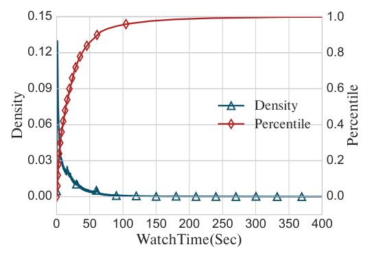
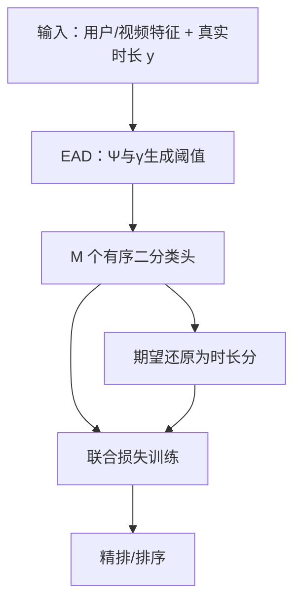
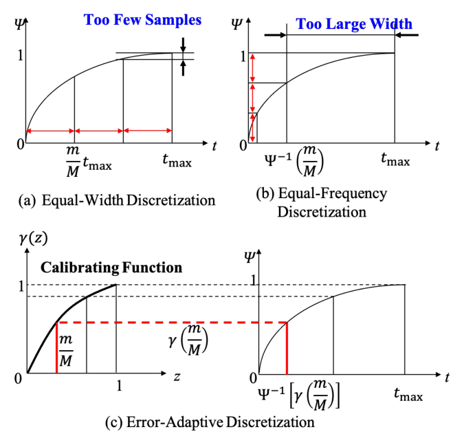

# CREAD: A Classification-Restoration Framework with Error Adaptive Discretization for Watch Time Prediction in Video Recommender Systems (面向视频推荐观看时长预测的误差自适应离散化分类-还原框架)

- **会议/期刊**: AAAI 2024
- **作者与机构**: Jie Sun, Zhaoying Ding, Xiaoshuang Chen, Qi Chen, Yincheng Wang, Kaiqiao Zhan, Ben Wang；快手科技
- **推荐链路定位**: 精排（观看时长作为排序目标预估）
- **研究方向**: CTR/CVR 预估与特征交叉 / 观看时长有序回归
- **论文原文**: [论文原文链接](https://arxiv.org/abs/2401.07521v1)
- **开源代码**: 暂未开源

## TL;DR (1分钟核心速览)

视频观看时长右偏长尾，等宽/等频分桶分别放大还原误差或学习误差。CREAD把时长转为多个有序二分类，并用EAD按分布校准分桶、以Huber还原和单调正则训练；在点wise MAE与随机样本对XAUC协议下，KuaiRec、CIKM和工业日志均领先，线上A/B观看时长+0.29%。

## Background & Motivation (背景与核心矛盾)

- **主流范式**: 短视频推荐用观看时长作为排序目标，直接回归（VR/WLR）或把时长离散后做有序回归（OR/D2Q）。
- **前人局限**: 1）观看时长右偏长尾，30%观看≤3秒、80%≤32秒，L1/L2回归易被头部/离群点主导；2）等宽分桶尾部桶样本过少、学习误差大，等频分桶尾部桶过宽、还原误差大，桶边界设计缺乏误差权衡。
- **核心洞察**: 离散化的预测误差可分解为学习误差与还原误差，前者由桶内样本概率决定，后者由桶宽决定；用CDF校准函数在等宽与等频之间插值可调出更优分桶。
- **本文切入点**: 提出CREAD，用EAD按数据分布最小化加权误差界，再以有序分类+期望还原替代单点回归。

<figure class="paper-figure" markdown="span">
  <figcaption>图1：观看时长的概率密度图。</figcaption>
</figure>
*图1：观看时长概率密度呈右偏长尾。*

## Method (核心方法设计)

### 1. 整体框架 (Overall Architecture)

CREAD先由EAD根据训练集观看时长CDF生成$M$个阈值，将每个样本转为$M$个二值标签$\mathbb{I}(y>t_m)$；共享MLP+分类头输出$M$个累计概率$\hat\phi_m=P(y>t_m|x)$，再用$\hat y=\sum_m\hat\phi_m(t_m-t_{m-1})$还原时长，最后与真实值计算Huber还原损失，并与交叉熵、单调正则联合训练。推理时一次前向得到$M$个概率并求和，作为精排时长分；分桶预处理离线完成。

### 2. 关键设计拆解 (Key Designs)

1. **误差自适应离散化EAD**：痛点是把连续时长切成桶时，学习误差要求桶宽大、还原误差要求桶宽小，等宽/等频各偏一端。EAD用CDF校准函数在两者间取值：$t_m=\Psi^{-1}[\gamma(m/M)]$，并最小化$J(D)=A_w(D)+\beta A_b(D)$；$A_w$与桶内样本概率成反比、$A_b$随桶宽增大，故β控制长尾尾部桶的宽度。

<figure class="paper-figure" markdown="span">
  <figcaption>图4：EAD 与传统方法的比较。</figcaption>
</figure>
*图4：EAD与等宽/等频分桶的误差权衡对比。*

2. **有序分类与期望还原**：$M$个二分类器预测$P(y>t_m|x)$，用$\hat y=\sum_m\hat\phi_m(t_m-t_{m-1})$还原期望；针对分类器可能违反单调性，加$L_{ord}=\sum_m\max(\hat\phi_{m+1}-\hat\phi_m,0)$。这样既保留序关系，又把回归转成多分类学习。

3. **训练目标、负采样与推理**：总损失$L=\lambda_{ce}L_{ce}+\lambda_{restore}L_{restore}+\lambda_{ord}L_{ord}$，$L_{restore}$用Huber抗长尾离群；全样本二分类标签，无负采样；推理需$M$次前向但共享MLP，开销可控。

## Experimental Setup & Evaluation Protocol (实验设置与评估协议)

- **数据集与预处理**:

| 数据集 | #Users | #Items | #Interactions | 稀疏度/密度 | 特征/场景说明 |
| :--- | :---: | :---: | :---: | :---: | :--- |
| KuaiRec | 7,176/1,411 | 10,728/3,327 | 12,530,806/4,676,570 | 训练≈16.3% | 快手短视频曝光日志，训练/评估子集 |
| CIKM | 87,934/13,292 | 122,994/37,154 | 1,235,381/123,529 | ≈0.011% | 电商搜索会话停留时长 |
| Industrial | ≈50M/日 | 未披露 | ≈6B/日×14 | — | 短视频工业日志，14天训练、次日测试 |

- **数据划分与防穿越 (Splitting Strategy)**: 工业为全局时间戳切分（14天训练→次日测试）；KuaiRec/CIKM按论文给定训练/评估子集，非Leave-One-Out；未提5-core过滤。
- **排名评测协议 (Ranking Protocol)**: 点wise MAE + 随机样本对XAUC（Sampled Pairwise），**不是Top-N全库排序**；训练无负采样，$M$个二分类标签覆盖全部样本。
- **对比基线与超参设置**: VR/WLR连续回归，OR/D2Q离散式；共享MLP，$M=30$，$\beta=3.0$，$\lambda_{ce}=100$、$\lambda_{ord}=10$、$\lambda_{restore}=1$；Adam、batch=1024、10 epoch；未报告显著性检验。

## Key Experimental Results (实验关键数据)

### 1. 主实验对比 (Main Results)

| 方法 | 类型 | KuaiRec XAUC↑ | KuaiRec MAE↓ | CIKM XAUC↑ | CIKM MAE↓ | Industrial XAUC↑ | Industrial MAE↓ |
| :--- | :---: | :---: | :---: | :---: | :---: | :---: | :---: |
| VR | Cont. | 0.5333 | 3.6992 | 0.6058 | 2.3780 | 0.6324 | 20.3672 |
| WLR | Cont. | 0.5483 | 3.5722 | 0.6310 | 1.9785 | 0.6323 | 20.2740 |
| OR | Disc. | 0.5883 | 3.2946 | 0.6313 | 1.9157 | 0.6344 | 20.1263 |
| D2Q | Disc. | 0.5677 | 3.3090 | 0.6568 | 2.5499 | 0.6423 | 19.0740 |
| **CREAD** | Disc. | **0.6009** | **3.2150** | **0.6671** | **1.7928** | **0.6459** | **18.6716** |

相对各数据集最强基线：KuaiRec XAUC +2.14%、MAE -2.42%；CIKM XAUC +1.57%、MAE -6.42%；Industrial XAUC +0.56%、MAE -2.11%。若按原文SOTA D2Q口径，KuaiRec XAUC提升+5.85%，Industrial MAE提升+2.11%。

### 2. 消融实验 (Ablation Study)

| 变体 | 尾桶宽度(s) | 尾桶样本占比 | XAUC↑ | MAE↓ |
| :--- | :---: | :---: | :---: | :---: |
| Equal-Frequency | 981.93 | 3.3% | 0.5962 | 3.2477 |
| Equal-Width | 33.0 | 0.0011% | 0.5982 | 3.2492 |
| EAD β=0.5 | 858.69 | 0.1437% | 0.5977 | 3.2419 |
| EAD β=1.0 | 377.95 | 0.0101% | 0.5992 | 3.2451 |
| **EAD β=3.0** | **315.21** | 0.0077% | **0.6009** | **3.2150** |
| EAD β=10.0 | 34.74 | 0.0076% | 0.6001 | 3.2335 |

另：去掉$L_{ord}$后MAE恶化0.0132，尾部桶误差显著增大；$L_{restore}$用Huber优于MSE/MAE。

### 3. 关键实验发现 (Key Findings)

1. **离散式整体压过连续式**：KuaiRec上OR/D2Q的MAE为3.2946/3.3090，优于VR/WLR的3.6992/3.5722；工业上D2Q的19.0740优于WLR的20.2740，说明把长尾目标转为序分类更稳。
2. **EAD在β=3.0取得最优平衡**：尾桶宽315.21s，介于等频981.93s与等宽33.0s之间；XAUC 0.6009、MAE 3.2150为全表最佳。β过小接近等频、β过大接近等宽，均变差。
3. **单调正则主要修尾部**：去掉$L_{ord}$后MAE恶化0.0132，图6显示尾部桶MAE显著增大；线上5天/20%流量A/B主指标观看时长+0.291%，点赞/关注/分享/评论波动不显著。

## Highlights & Limitations (亮点、对比与审稿批判)

- **与代表作对比 (vs. Prior Work)**: VR/WLR只看pointwise误差、忽略序关系与长尾；OR用等频/固定阈值分桶；D2Q做时长去偏的分位数回归但未显式优化桶边界。CREAD把分桶误差界写进目标，并用EAD+单调正则联合约束。
- **可迁移亮点**: 任何连续目标（停留时长、LTV、延迟转化）都可套“CDF校准分桶+有序二分类+Huber还原”；单调正则可约束累计概率不交叉。
- **审稿级局限批判**: β、α、$M$仍需按数据网格搜索，静态阈值需周期性重校准；尾桶样本占比低至0.0077%，极长尾估计方差大；未开源，离线仅点wise/采样pair协议，非全库Top-N排序。

## Rating (四维评分)

- **方法创新性 (Novelty)**: ⭐⭐⭐⭐ （误差分解把分桶从启发式变为可优化目标，虽本质仍属有序回归扩展）
- **评估协议与实验扎实度 (Protocol & Experiments)**: ⭐⭐⭐⭐ （KuaiRec/CIKM+工业+5天A/B较完整，但缺全库排序与显著性检验）
- **写作与数学规范度 (Clarity & Rigor)**: ⭐⭐⭐⭐ （误差界推导清晰，符号统一；个别XAUC提升数值表述需核对量纲）
- **工业落地与复现价值 (Industrial & Practical Value)**: ⭐⭐⭐⭐ （共享MLP+$M=30$易上线，A/B+0.29%；但β调参和未开源降低复现性）

