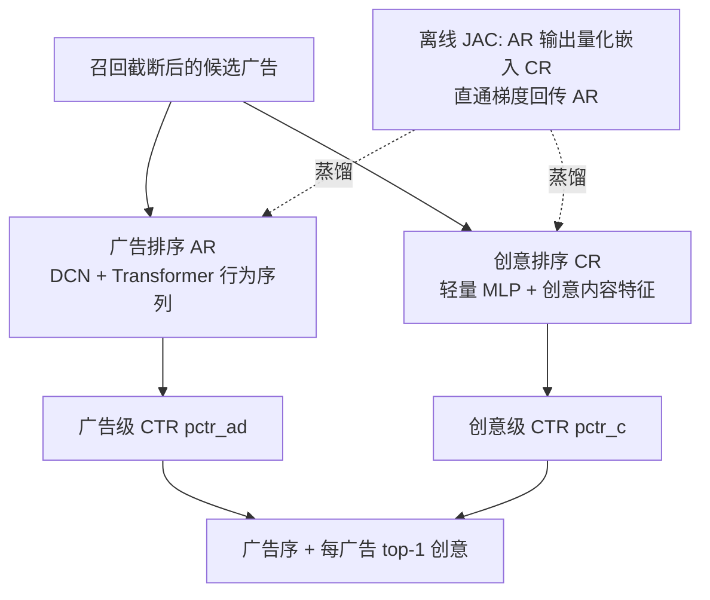
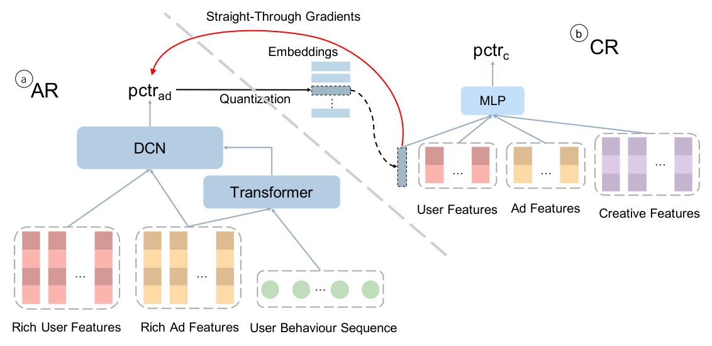

# Parallel Ranking of Ads and Creatives in Real-Time Advertising Systems (实时广告系统中广告与创意的并行排序)

- **会议/期刊**: AAAI 2024
- **作者与机构**: 杨志广、王璐、甘春、桑柳芳（通讯）等，京东（JD.com）推荐广告团队
- **推荐链路定位**: 精排（广告精排 + 创意精排，同一级并行）
- **研究方向**: CTR/CVR 预估与特征交叉 / 去偏公平与工业架构
- **论文原文**: [论文原文链接](https://arxiv.org/abs/2312.12750v1)
- **开源代码**: 暂未开源

## TL;DR (1分钟核心速览)

广告系统需在 $M>1000$个广告$\times$ $N>10$ 个创意上做联合排序，串行架构陷入两难：Pre-CR（CACS）把创意排序前置可感知创意，但需对全部候选创意打分，实测响应时间（RT）涨 18.9% 只换来 8.54% CTR；Post-CR 延迟低却让广告排序阶段"看不见"创意。本文提出 **Peri-CR**：召回后广告排序与创意排序**并行请求**（共享 90ms 预算，CR 仅用 28ms），并以离线大模型 **JAC** 通过量化编码 + 直通梯度实现双向感知、在线拆分为两个小模型。在京东 18 亿训练样本日志上，线上 A/B（5 天）CTR +10.12%、RPM +7.67%、RT 与无创意排序持平；离线 AUC 74.70%/GAUC 71.98%，NSCTR 0.2427。

## Background & Motivation (背景与核心矛盾)

- **主流范式**: 工业广告系统采用"召回→精排"级联；创意排序作为附属模块，按放置位置分为 Post-CR（广告排序后串行）与 Pre-CR（CACS，创意排序前置 + 双塔向量内积）。
- **前人局限**: ① Pre-CR 需对 $M\times N$ 量级创意打分，延迟预算极紧，被迫退化为简单向量内积双塔，深度交叉网络能力无法释放（CACS：延迟 +5.3% 仅换 3.1% CTR）；② Post-CR 在广告精排阶段无法获知最终展示创意，而创意对 CTR 的影响极大（图 1 中同一商品不同创意的 CTR 从 2.2% 到 3.3%，且存在明显性别偏好差异），造成精排特征缺失。
- **核心洞察 (Key Insight)**: 联合打分 $p(y=1|x,c)$的$M\times N$排列在时延上不可行，但可由贝叶斯分解为"广告级 CTR$\times$ 给定广告的创意条件分布"两个因子，二者**无需在同一请求内串行依赖**——创意分数只用于给已排好的广告挑图，广告分数不需要等待创意分数。
- **本文切入点**: 在线把 CR 从主链路解耦成并行旁路（Peri-CR），离线用一个共享的大联合模型（JAC）把创意信息"蒸馏"进两个小模型，使在线小模型互为感知。

## Method (核心方法设计)

### 1. 整体框架 (Overall Architecture)

召回截断后，广告排序（AR）与创意排序（CR）**同时发起请求**、共享同一份时延预算：AR 输入 30+ 用户特征、40+ 广告特征、300+ 交叉特征及 Transformer 行为序列，经 DCN（512-512-256-128）输出广告 CTR $\hat{p}^{ad}_{ctr}$；CR 仅用 11 用户特征、5 广告特征、创意 ID 与内容特征，经 128-64-32 的轻量 MLP 输出创意 CTR$\hat{p}^{c}_{ctr}$。线上 CR 以广告历史统计 CTR 代替 AR 实时输出的$\hat{p}^{ad}_{ctr}$（同一广告在一次请求内该值恒定），从而彻底切断串行依赖；离线则用 JAC 大模型把真实$\hat{p}^{ad}_{ctr}$量化后注入 CR，实现协同优化与知识迁移。最终按$\hat{p}^{ad}_{ctr}$排序广告、按$\hat{p}^{c}_{ctr}$ 为每个广告选 top-1 创意。

<figure class="paper-figure" markdown="span">
  <figcaption>图 3：提出的广告与创意排序联合优化（JAC）框架，包括两个子模型：(a) Ad Ranking（AR）采用深度交叉网络（DCN）作为主架构预测广告 CTR，以丰富的用户和广告特征为输入；它还使用 transformer 对用户行为序列建模；(b) Creative Ranking（CR）使用特征更少、规模更小的网络，并利用 AR 输出估计创意 CTR。</figcaption>
</figure>

### 2. 关键设计拆解 (Key Designs)

1. **Peri-CR 并行架构（把创意排序移出主链路）**：痛点在于串行级联使两模块争夺同一时延预算。做法是把 CR 与 AR 置于同一级并行请求，端到端 RT 取两者最大值而非之和，CR 获得的 28ms 独立预算可用于个性化建模而非 bandit/树模型。直觉：创意选择本质是"广告已定后的条件问题"，并行不会破坏因果顺序，只是把依赖搬到了离线训练阶段。

2. **JAC 联合优化与量化蒸馏（让两模型互相感知）**：AR 缺创意信息、CR 缺广告精度。JAC 先由式 (2)(3) 的贝叶斯分解把联合排序解耦为 $f_\theta(x)\cdot e^{-f_\theta(x)}=p(y=1|x)\cdot p(c|x,y=1)$，再在 CR 侧引入 AR 输出的量化嵌入：
$$q=\left\lfloor K\cdot\log_{r+1}\left(1+r\cdot \hat{p}^{ad}_{ctr}\right)\right\rfloor,\quad K=8192$$
其中对数变换拉伸低 CTR 区间的分辨率、$r$ 由信息增益确定。由于取整不可导，采用 VQ-VAE 式**直通梯度**把 CR 的梯度直接拷贝回 AR，使 AR 收到创意侧的监督信号、CR 获得广告侧精确表征，同时抑制 CTR 估计抖动。

3. **训练目标、负采样与推理效率**：两子模型均以点击交叉熵训练（batch 512、Adagrad、lr 0.05、1 epoch、无 dropout），**不做任何负采样**以保留创意稀疏反馈；CR 的 $\hat{p}^{ad}_{ctr}$ 嵌入维度 128、码本 8192。在线推理 AR/CR 各自前向、无串行等待，JAC 引导仅增加可忽略开销（实测 Post-CR→Post-CR+ 仅 +4.17% RT 中约 4ms）。

## Experimental Setup & Evaluation Protocol (实验设置与评估协议)

- **数据集与预处理**: 京东真实广告日志（5/1–6/30），无负采样、无 5-core 过滤；创意反馈极稀疏：

| 数据集 | #Users | #Items(Ads) | #Interactions | 稀疏度/密度 | 特征/场景说明 |
| :--- | :---: | :---: | :---: | :---: | :--- |
| 训练集（前 60 天） | — | — | ≈18 B | CTR 2.4% | 全量曝光日志，含行为序列 |
| 测试集（6/30） | 53 M | 16 M 广告 / 54 M 创意 | 300 M | 每创意均曝光仅 6 次 | 单日全局时间切分 |

- **数据划分与防穿越 (Splitting Strategy)**: 严格**全局时间戳切分**——前 60 天训练、6 月 30 日单日测试，杜绝未来信息泄漏。
- **排名评测协议 (Ranking Protocol)**: 广告侧用 `Full-Ranking` 意义上的 AUC / GAUC（GAUC 按用户分组）；创意侧用 sCTR 与本文提出的 NSCTR（同为全量曝光重放、无采样负例）。线上以 5 天连续 A/B 的 CTR、RPM、RT 为准。
- **对比基线与超参设置**: no-CR（随机创意）、Post-CR（DSSM 双塔）、Post-CR+（DSSM + JAC 引导）、Pre-CR（CACS）、Peri-CR（独立 MLP）、Peri-CR+；AR 嵌入维度 16、CR 嵌入维度 4；未报告显著性检验（工业 A/B 以连续 5 天稳定增益为准）。

## Key Experimental Results (实验关键数据)

### 1. 主实验对比 (Main Results)

线上 A/B（5 天连续，相对 no-CR 基线）：

| 架构 | CTR 提升 | RPM 提升 | RT (ms) |
| :--- | :---: | :---: | :---: |
| no-CR | — | — | 90 |
| Post-CR | +6.25% | +5.63% | 94 (+4.44%) |
| Pre-CR (CACS) | +8.54% | +6.81% | 107 (+18.9%) |
| **Peri-CR+ (本文)** | **+10.12%** | **+7.67%** | **90 (0%)** |

离线创意排序（sCTR / NSCTR）与广告排序（AUC / GAUC）：

| 模型 | sCTR | NSCTR | 模型 | AUC | GAUC |
| :--- | :---: | :---: | :--- | :---: | :---: |
| VAM-HBM | 0.2528 | 0.2267 | AR | 74.58% | 71.83% |
| CACS | 0.2589 (+2.4%) | 0.2319 (+2.3%) | AR+ | 74.70% (+0.12%) | 71.98% (+0.15%) |
| CR | 0.2559 (+1.2%) | 0.2392 (+5.5%) | **ACR (JAC)** | **74.87% (+0.29%)** | **72.14% (+0.31%)** |
| CR+ | 0.2492 (−1.4%) | 0.2423 (+6.9%) | | | |
| **JAC** | 0.2478 (−2.0%) | **0.2427 (+7.0%)** | | | |

### 2. 消融实验 (Ablation Study)

| 消融配置 | 关键指标变化 | 说明 |
| :--- | :--- | :--- |
| Post-CR → Post-CR+（+JAC） | CTR +3.73%，RPM +1.96%，RT 94→98ms | JAC 蒸馏对串行架构增益最大 |
| Peri-CR → Peri-CR+（+JAC） | CTR +0.92%，RPM +0.52%，RT 不变 | 并行架构下蒸馏增益被 RT 优势放大 |
| AR → AR+（+JAC 梯度） | CTR +0.78%，RPM +0.55%，RT 不变 | 广告侧单模块获创意监督信号 |
| CR → CR+（+JAC 嵌入） | NSCTR 0.2392→0.2423（+1.2%），AUC 持平 | 小模型逼近大联合模型 JAC（0.2427） |

### 3. 关键实验发现 (Key Findings)

1. **sCTR 是误导性指标，NSCTR 才是可靠代理**：CR+/JAC 的 sCTR 反而低于 CACS（0.2492/0.2478 vs 0.2589），但 NSCTR 高出 5.5–7.0%；对 6 次历史创意排序升级做相关性分析，NSCTR 与线上 CTR 提升的 Pearson 相关系数达 0.988，远超 sCTR (0.636)、AUC (0.741) 甚至 GAUC (−0.152)。根因是 sCTR 过滤样本后改变了广告分布——创意数少的广告被过滤比例低、权重大，系统性高估。
2. **并行解耦的收益是"时延-效果双赢"而非权衡**：Pre-CR 付出 +18.9% RT 只换来比 Post-CR 高 2.3pt 的 CTR，而 Peri-CR+ 在 RT 与 no-CR 持平的条件下 CTR 再高出 1.58pt、RPM 高 0.86pt；Peri-CR 的 CR 分支仅耗 28ms，尚有大量预算可继续加深模型。
3. **蒸馏的有效性在架构间不对称**：JAC 对 Post-CR 提升最猛（+3.73% CTR），因为其原本完全感知不到创意；对 Peri-CR 仅 +0.92%，说明并行架构本身已消除大部分信息缺失，蒸馏主要补足"广告-创意交叉"这一残差项。

## Highlights & Limitations (亮点、对比与审稿批判)

- **与代表作对比 (vs. Prior Work)**: CACS 用 Pre-CR + 双塔，靠"前置"换感知但牺牲时延与模型容量；Post-CR 靠"后置"换时延但牺牲精排特征；本文用"并行 + 离线蒸馏"把二者矛盾转化为训练期问题，本质是把在线串行依赖搬到离线联合模型。与常规多任务/多阶段级联（DCN、DSSM）相比，本文的增量在于**架构级解耦 + 量化直通蒸馏**这一组合，而非新的特征交叉算子。
- **可迁移亮点**: ① 用"大联合模型量化输出 + 直通梯度"把一路特征蒸馏进另一路小模型，可迁移到粗排-精排一致性、召回-精排对齐等场景；② NSCTR 的"按广告曝光数重加权还原原始分布"思路，可直接用于任何存在样本过滤偏差的列表级离线评估。
- **审稿级局限批判**: ① 离线实验完全依赖京东单一平台日志，无公开基准（如 Criteo/Avazu）复现，AUC 仅 +0.29% 的增益缺乏显著性检验；② NSCTR 仅"近似"还原广告分布，论文自承未找到因果推断中的工具变量；③ 在线并行依赖 AR 输出的历史统计 CTR 替代实时值，存在训练-推理不一致（train-serving skew），且并行架构在流量洪峰下的资源争抢未讨论。

## Rating (四维评分)

- **方法创新性 (Novelty)**: ⭐⭐⭐⭐ （首次把创意排序从主链路解耦为并行旁路，并以量化直通蒸馏实现离线互相感知，架构层面的组合创新清晰，但单点算子均为已有技术复用）
- **评估协议与实验扎实度 (Protocol & Experiments)**: ⭐⭐⭐⭐ （18 亿样本工业日志 + 5 天线上 A/B + 6 次历史升级的指标相关性验证相当扎实，缺公开数据集与显著性检验）
- **写作与数学规范度 (Clarity & Rigor)**: ⭐⭐⭐ （架构与工程描述清楚，但式 (2)–(4) 的贝叶斯/softmax 推导省略了过多假设，$f_\theta(x)e^{-f_\theta(x)}$ 的合法性交代不足）
- **工业落地与复现价值 (Industrial & Practical Value)**: ⭐⭐⭐⭐⭐ （零延迟增长 + 双位数 CTR 提升，且给出可直接照搬的 RT 预算分配与离线指标设计，是典型可落地工业范式）

