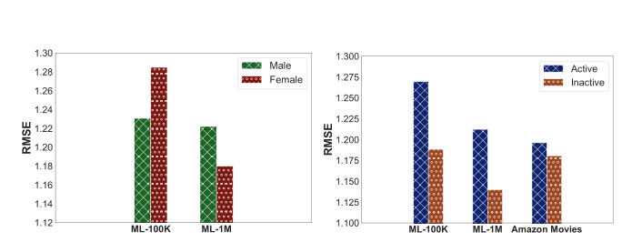
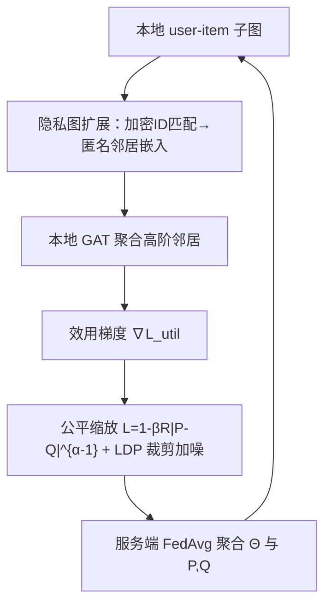
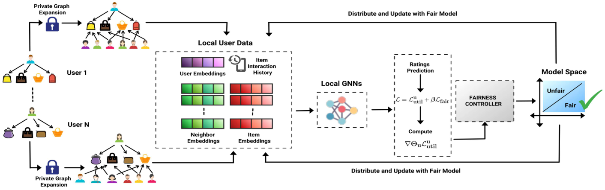

# No Prejudice! Fair Federated Graph Neural Networks for Personalized Recommendation (无偏见！面向个性化推荐的公平联邦图神经网络)

- **会议/期刊**: AAAI 2024 (Full Paper)
- **作者与机构**: Nimesh Agrawal, Anuj Kumar Sirohi, Sandeep Kumar, Jayadeva（印度理工学院德里分校 EE 系 / Yardi School of AI）
- **推荐链路定位**: 召回/端到端评分预测（联邦客户端本地训练）
- **研究方向**: 去偏公平、可信隐私与工业架构 / 图神经网络推荐
- **论文原文**: [https://arxiv.org/abs/2312.10080v2](https://arxiv.org/abs/2312.10080v2)
- **开源代码**: [https://github.com/CharlieMat/FedFairRec](https://github.com/CharlieMat/FedFairRec)

## TL;DR (1分钟核心速览)

联邦推荐下，服务端既看不到全局用户-物品二部图，也拿不到性别/活跃度等敏感属性，导致"群体公平"难以落地；而已有的 F2MF 只用矩阵分解，无法建模高阶协同关系。F2PGNN 用**公钥匹配的归纳式隐私图扩展**把高阶邻居"拉"到本地子图，用 **LDP 噪声化的群体统计量**在服务端计算公平正则，并把该正则解析地化简为**逐用户学习率缩放因子** $L$。在 ML-100K / ML-1M / Amazon-Movies（20-core、逐用户按时间戳 80/10/10）上，RMSE 群体差异较 SOTA 下降 47.65%–99.78%，多数数据集上效用不降反升。

## Background & Motivation (背景与核心矛盾)

- **主流范式**: 联邦推荐（FRS）以 FedAvg + 矩阵分解为主干，客户端本地更新用户/物品嵌入，仅上传参数；公平性研究（如 F2MF）在此框架上加群体统计正则。
- **前人局限 ①**: MF 只利用显式 user-item 交互，二部图中的高阶协同信号被完全丢弃，导致**固有群体偏差 (inherent bias)** 很高——即便 β=0，F2MF 在 ML-1M(A) 上的 RMSE 差异高达 0.8797。
- **前人局限 ②**: 把 GNN 塞进 FL 需要全局图与敏感属性，FedPerGNN 用每轮重复加解密换取高阶邻居，FeSoG 只采信"可信用户"故交互覆盖极窄；且二者均未考虑公平约束。
- **核心洞察 (Key Insight)**: 群体公平目标 $\mathcal{L}_{fair}$ 对模型参数的梯度，恰好正比于**效用梯度乘一个标量**，因此公平无需改动网络结构，只需在本地按"我是否属于优势组"缩放学习率即可。
- **本文切入点**: 用隐私图扩展补齐高阶信息 + 用梯度缩放实现免敏感属性上传的群体公平 + 用 LDP 同时护住梯度与群体统计。

<figure class="paper-figure" markdown="span">
  <figcaption>图 1：公平预算 β=0 时，F2PGNN 在两个用户属性上的 RMSE 差异（群体不公平性）：（左）性别，（右）活跃度</figcaption>
</figure>

## Method (核心方法设计)

### 1. 整体框架 (Overall Architecture)

每轮开始，服务端广播全局模型 $\Theta^i$与群体统计$\{P,Q\}$；客户端先用**归纳式隐私图扩展**：以服务端公钥加密自己评分过的物品 ID 上送，服务端对加密 ID 做匹配后回传匿名用户嵌入字典，客户端据此把本地子图扩充出共交互邻居。随后在扩展子图上跑本地 GAT 得到用户/物品表示并算效用损失，再用标量$L$缩放梯度、按式 (8) 加噪生成群体统计，一并上传；服务端聚合模型参数与$P,Q$ 并进入下一轮，直至收敛。

<figure class="paper-figure" markdown="span">
  <figcaption>图 2：F2PGNN：面向个性化推荐的群体公平感知联邦图神经网络示意图</figcaption>
</figure>

### 2. 关键设计拆解 (Key Designs)

1. **隐私保护归纳式图扩展 (Inductive Graph Expansion)**：痛点是要高阶邻居就得暴露交互历史。作者让用户用公钥 $E$加密**仅本轮新增**的物品 ID 上送，服务端返回 item→邻居匿名嵌入的映射字典，用户在本地拼出高阶子图。由于只加密增量条目，复杂度为$O(m)$，且天然支持新用户（归纳式），通信量远低于 FedPerGNN 的逐轮全量重加密。

2. **公平正则的梯度缩放化 (Fairness Controller)**：痛点是在服务端算群体差异必须知道用户属于 $S_0$还是$S_1$。作者定义$P=\frac{1}{|S_0|}\sum_{u\in S_0}M_u$、$Q=\frac{1}{|S_1|}\sum_{u\in S_1}M_u$（$M_u=-\mathcal{L}^{util}_u$），对$\mathcal{L}=\mathcal{L}_{util}+\beta\mathcal{L}_{fair}$、$\mathcal{L}_{fair}=|P-Q|^{\alpha}$ 求导可得：

$$\nabla_{\Theta_u}=\big(1-\beta R\,|P-Q|^{\alpha-1}\big)\frac{\partial \mathcal{L}^{util}_u}{\partial \Theta_u}=L\cdot\frac{\partial \mathcal{L}^{util}_u}{\partial \Theta_u}$$

其中 $R=\alpha(-1)^{\mathbb{I}(P<Q)}(-1)^{\mathbb{I}(u\notin S_0)}$。物理直觉：$R>0$表示该用户所在组表现更好，$L<1$抑制其学习；反之$L\ge 1$ 加速落后组——公平由此转化为"按群体表现调节学习率"，无需改动模型结构，且天然 model-agnostic。

3. **双重 LDP 与训练/推理开销**：梯度先按 L2 范数裁剪阈值 $\delta$再叠加$\mathrm{Lap}(0,\lambda)$，隐私预算上界$\epsilon\le 2\delta/\lambda$；群体统计则按式 (8) 拆成$P^{per}/P^{add}$、$Q^{per}/Q^{add}$四路加高斯噪声$\mathcal{N}(0,\sigma^2)$，服务端按式 (9) 求比值聚合，使服务器无法反推组成员身份。总损失即$\mathcal{L}=\mathcal{L}_{util}+\beta\mathcal{L}_{fair}$，无负采样（评分回归任务）；每 epoch 服务端额外复杂度仅$O(NmG)$，因组数$G$ 极小，开销可忽略。

## Experimental Setup & Evaluation Protocol (实验设置与评估协议)

- **数据集与预处理**（全部先过 `20-core` 过滤，保证每组都有足够样本以剥离"数据不平衡导致的伪不公平"）：

| 数据集 | #Users | #Items | #Interactions | 稀疏度/密度 | 敏感属性 / 场景说明 |
| :--- | :---: | :---: | :---: | :---: | :--- |
| ML-100K | 917 (943) | 937 (1,682) | 94,443 | 0.11% | Gender(G) / Activity(A)，小规模电影 |
| ML-1M | 6,022 (6,040) | 3,043 (3,706) | 995,154 | 5.4% | Gender(G) / Activity(A)，中规模电影 |
| Amazon-Movies | 5,497 (5,515) | 13,457 (13,509) | 458,450 | 0.62% | Activity(A)，大规模稀疏电商 |

- **数据划分与防穿越**: 对**每个用户历史按评分时间戳排序**后做 `80/10/10` 训练/验证/测试划分，属逐用户时序切分，避免未来交互泄漏。
- **排名评测协议**: 本文实为**评分预测 (Rating Prediction)** 任务，指标为 `RMSE`（越低越好），**并非 Full-Ranking 全库排序**；公平性用差异度量 $\mathcal{L}_{fair}=\big|\frac{1}{|S_0|}\sum_{u\in S_0}M(u)-\frac{1}{|S_1|}\sum_{u\in S_1}M(u)\big|^{\alpha}$，$\alpha=1$。无负采样环节。
- **对比基线与超参**: 基线仅有 **F2MF**（唯一同时具备联邦+群体公平的 MF 方法），另以 β=0 版本作固有偏差参照。GAT 隐藏维 $d=64$、dropout 0.2、SGD 学习率$\{0.001,0.01,0.05\}$、batch dropout$K\in\{0.1,0.5\}$、β 网格$\{0.3,0.5,0.7,0.9\}$；论文未报告显著性检验。

## Key Experimental Results (实验关键数据)

### 1. 主实验对比 (Main Results)

RMSE(Disparity)，括号内为群体差异，加粗为最优：

| Dataset (Attr.) | Method | β=0.0 | β=0.5 | β=0.9 | 公平性 Improv. |
| :--- | :--- | :---: | :---: | :---: | :---: |
| ML-100K (G) | F2MF | 1.5801(0.1242) | 1.4569(0.0938) | 1.5118(0.1213) | — |
| | **F2PGNN** | **1.2444(0.0539)** | **1.2616(0.0512)** | **1.2758(0.0491)** | **↓47.65%** |
| ML-100K (A) | F2MF | 1.5397(0.2452) | 1.4625(0.2526) | 1.4966(0.2290) | — |
| | **F2PGNN** | **1.2478(0.0811)** | **1.2467(0.0804)** | **1.2470(0.0804)** | **↓54.92%** |
| ML-1M (G) | F2MF | 1.2425(0.2441) | 1.1995(0.2327) | 1.2236(0.2396) | — |
| | **F2PGNN** | **1.2118(0.0420)** | 1.1950(0.0392) | **1.1831(0.0367)** | **↓84.22%** |
| ML-1M (A) | F2MF | 1.2663(0.8797) | 1.2101(0.8351) | 1.1773(0.7910) | — |
| | **F2PGNN** | **1.1927(0.0724)** | **1.1779(0.0567)** | **1.1641(0.0379)** | **↓95.21%** |
| Amazon (A) | F2MF | **1.0968(2.5444)** | **1.0660(2.4661)** | **1.0907(2.5157)** | — |
| | F2PGNN | 1.1889(0.0157) | 1.1843(0.0114) | 1.1788(**0.0052**) | **↓99.78%** |

### 2. 消融实验 (Ablation Study)

| 变体 / 组件 | 关键指标 | 说明 |
| :--- | :---: | :--- |
| w/o 高阶图扩展（退化为 F2MF 范式） | 固有差异 0.1242 vs 0.0539（ML-100K-G, β=0） | 高阶邻居缺失使固有偏差放大 ~57% |
| w/o 公平约束（β=0） | 差异 0.0724（ML-1M-A） | 加 β=0.9 后降至 0.0379（−48%） |
| w/ LDP 梯度裁剪 δ=0.2、λ 增大 | RMSE 最多 +1.88% / +0.27% / +0.474% | 分别对应 ML-100K(G) / ML-1M(G) / Amazon(A) |
| w/o 群体统计加噪 | 服务器可反推用户组别 | 加噪后 $P^{add},Q^{add}$ 混叠，属性不可辨 |

### 3. 关键实验发现 (Key Findings)

1. **公平收益主要来自图结构而非正则强度**：β=0 时 F2PGNN 的固有差异已比 F2MF 低 52%–92%（ML-1M-A: 0.0724 vs 0.8797），说明把高阶共交互引入本地表征本身就是最强的"去偏"，正则只是二次修正。
2. **β 的边际效用随数据规模放大、在小数据上饱和**：ML-100K(G) 从 β=0→0.9 差异仅降 8.9%（0.0539→0.0491），而 ML-1M(A) 降 47.7%、Amazon(A) 降 66.9%；且 ML-100K(A) 在 β 超过阈值后出现不稳定，提示稀疏小图上公平正则易与效用冲突。
3. **隐私代价出奇地低**：最坏配置（δ=0.2 + 大 λ）下 RMSE 仅上升 1.88%，远小于公平带来的效用增益（1.12%–15.9%），说明梯度裁剪+拉普拉斯噪声在此场景起到了隐式正则作用，可"免费"叠加在公平约束之上。

## Highlights & Limitations (亮点、对比与审稿批判)

- **与代表作对比**: vs. **F2MF**（同为公平联邦推荐，但仅 MF、忽略高阶交互，且只对群体统计加噪）——本文补上 GNN 且对梯度也加 LDP；vs. **FedPerGNN**（隐私图扩展但逐轮全量重加密、无公平约束）——本文改为增量加密，通信开销从全量降到 $O(m)$；vs. **FeSoG**（仅采信可信用户、交互覆盖稀疏）——本文不裁剪邻居来源。
- **可迁移亮点**: ①「把公平正则解析成逐样本学习率缩放因子 $L$」这一技巧与模型无关，可直接套到 LightGCN / SASRec 等任意主干；②加密增量 ID 匹配的图扩展思路，可用于任何"需要跨客户端高阶邻居但不得上传原始交互"的联邦图场景。
- **审稿级局限批判**: ①**评测过窄**——仅一个基线 F2MF，且任务是评分预测 RMSE，未做 Full-Ranking 排序指标（Recall/NDCG）与 Top-K 公平性（如 exposure parity），与真实推荐链路差距大；②**场景假设偏理想**——同步更新、无计算/通信异构，且 20-core 过滤后 Amazon 仅 5.5K 用户，与工业联邦规模相差数个量级；③超参敏感，δ/λ/β 三者耦合需网格搜索，论文未给自动选择策略。

## Rating (四维评分)

- **方法创新性 (Novelty)**: ⭐⭐⭐⭐ （首次把 GNN 引入公平联邦推荐，且把公平约束解析化简为学习率缩放，思路干净；但图扩展与 LDP 均为已有技术的组合）
- **评估协议与实验扎实度 (Protocol & Experiments)**: ⭐⭐⭐ （逐用户时序划分规范、三数据集覆盖稀疏/稠密，但仅单基线、无排序指标、无显著性检验，说服力受限）
- **写作与数学规范度 (Clarity & Rigor)**: ⭐⭐⭐⭐ （$\mathcal{L}_{fair}$到$L$的梯度推导清晰、隐私预算$\epsilon\le 2\delta/\lambda$与复杂度$O(NmG)$分析到位；部分符号如$R$ 的示性函数表达略显晦涩）
- **工业落地与复现价值 (Industrial & Practical Value)**: ⭐⭐⭐⭐ （代码已开源，增量加密使通信可行，公平模块 model-agnostic 易插拔；但同步假设与评分预测任务使其离线上排序系统仍有距离）

