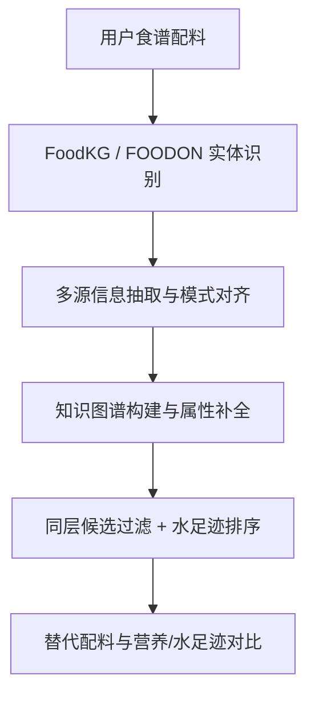
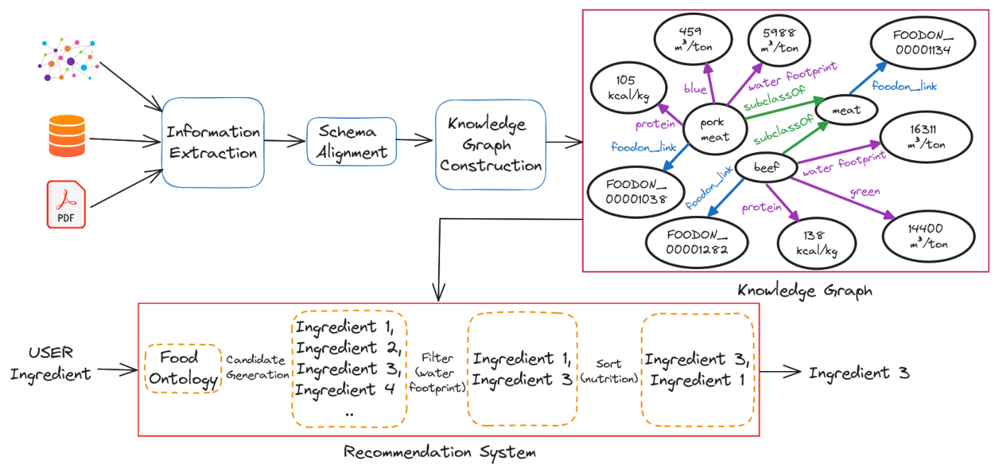

# Knowledge-Powered Recommendation for an Improved Diet Water Footprint (知识驱动的饮食水足迹改进推荐)

- **会议/期刊**: AAAI 2024 (Demonstration, 3 pages)
- **作者与机构**: Saurav Joshi, Filip Ilievski, Jay Pujara；USC Information Sciences Institute / Vrije Universiteit Amsterdam
- **推荐链路定位**: 应用层重排（食谱内配料替代）
- **研究方向**: 图神经网络与知识图谱推荐
- **论文原文**: [论文原文链接](https://arxiv.org/abs/2403.17426v1)
- **开源代码**: 暂未开源

## TL;DR (1分钟核心速览)

针对食谱配料替代缺乏环境水足迹约束的问题，本文以 FoodKG 为核心，融合 USDA 营养、FOODON 本体与水足迹文献，构建 20,778 节点、13 类关系的食品知识图谱，并用四层 MLP 补全缺失属性；系统按 FOODON 同层候选与水足迹升序推荐替代配料。演示案例将水足迹从 20,135 降至 5,215 m³/吨（约 74.1%），脂肪从 30.32 降至 11.84 g；但原文无离线全库排序、采样排序、基线或消融实验，评估仅为单例系统演示。

## Background & Motivation (背景与核心矛盾)

- **主流范式**: 健康感知食物推荐主要依赖内容属性或协同过滤；知识图谱推荐则把食谱视为配料、营养与本体关系的聚合，以增强上下文感知能力。
- **前人局限**: 现有食物推荐很少把“水足迹”作为可计算的推荐约束；同时，多源食品数据中配料命名不一致、营养与水足迹属性缺失，导致无法直接做可持续替代排序。
- **核心洞察 (Key Insight)**: 配方中的配料可按 FOODON 层级找到同层“父配料/候选配料”；若能在 KG 中补齐水足迹与营养边，就能用“同层替代 + 水足迹更低”实现可解释推荐。
- **本文切入点**: 用知识图谱流水线把 Recipe1M、USDA、FOODON 与水足迹文献对齐，构建一个可交互的配料替代推荐系统。

## Method (核心方法设计)

### 1. 整体框架 (Overall Architecture)

系统从用户食谱输入出发，先在 FoodKG 中识别配料实体及其 FOODON 层级；随后抽取营养、本体与水足迹三元组，做配料名规范化与关系语句嵌入对齐；再用统一配料 ID 构建知识图谱，并用神经模块补全缺失的营养/水足迹值；最后在 Django 界面中选取同层候选、过滤水足迹更高的配料，按水足迹升序返回替代建议，并展示替换前后的水足迹与营养变化。全流程以 1s 级图谱查询支撑交互式演示。

<figure class="paper-figure" markdown="span">
  <figcaption>图1：系统架构，包括五个步骤：源识别、信息抽取、模式对齐、知识图谱构建和用户界面开发。</figcaption>
</figure>

### 2. 关键设计拆解 (Key Designs)

1. **多源食品知识图谱对齐（Source Alignment）**：痛点起因是 Recipe1M、USDA、FOODON 与水足迹 PDF 的配料名和模式不一致；本文先把复杂配料名归一为主描述词，再把图关系转成英文句子并用 Sentence Transformers 编码，公式为 $\mathbf{s}_{r}=\mathrm{SBERT}(\mathrm{verbalize}(r))$，作为后续属性补全特征。这样可把异构文本与本体关系压到同一语义空间，缓解实体缺失与命名歧义。

2. **营养/水足迹神经补全（Neural Imputation）**：KG 中并非每个配料都有完整营养与水足迹值；本文用四层全连接网络，以配料嵌入与关系类型为输入，连续 ReLU 输出预测值，$\hat{y}_e=\mathrm{ReLU}(\mathrm{MLP}([\mathbf{h}_e;\mathbf{r}]))$。训练用 Adam 与 MSE：$\mathcal{L}_{\mathrm{MSE}}=\frac{1}{|\mathcal{E}|}\sum_{e\in\mathcal{E}}(y_e-\hat{y}_e)^2$。其直觉是用关系上下文补齐稀疏属性，使候选配料可被统一水足迹指标排序。

3. **基于本体的替代排序（Ontology-Constrained Ranking）**：推荐时不从全库自由召回，而是先经 FOODON 找到父配料，再取同层候选并排除水足迹更大的项，最后按水足迹最小化排序：$c^\*=\arg\min_{c\in\mathcal{C}(p),\,\mathrm{WF}(c)<\mathrm{WF}(p)}\mathrm{WF}(c)$。该设计把“可持续”转成可解释的约束排序；无负采样，推理开销主要来自 KG 查询与候选枚举，原文报告平均响应约 1s。

## Experimental Setup & Evaluation Protocol (实验设置与评估协议)

- **数据集与预处理**: 原文是系统演示，未给出经典推荐数据集统计与过滤规则；仅报告 FoodKG 规模与最终图谱规模：

| 数据集/资源 | #Users | #Items | #Interactions/三元组 | 稀疏度/密度 | 特征/场景说明 |
| :--- | :---: | :---: | :---: | :---: | :--- |
| FoodKG / Recipe1M / USDA / FOODON | 未报告 | 100 万+食谱与配料 | 约 6,700 万数据点 | 未报告 | 食谱、营养、本体与水足迹文献 |
| 最终知识图谱 | — | 20,778 节点 | 13 类关系 | 未报告 | 用于配料替代与属性补全 |

- **数据划分与防穿越 (Splitting Strategy)**: 原文未定义训练/验证/测试划分，也没有时间戳切分或冷启动划分；属于演示系统，而非离线基准评测。
- **排名评测协议 (Ranking Protocol)**: 未使用 `Full-Ranking` 或 `Sampled Ranking`，未报告 Recall/NDCG/HR 等排序指标；候选来自 FOODON 同层且水足迹不更高的配料，按水足迹升序，属于规则约束排序。
- **对比基线与超参设置**: 未报告 baseline、embedding 维度、显著性检验；仅说明 MLP 为四层 dense + 连续 ReLU，Adam 优化、MSE 损失。

## Key Experimental Results (实验关键数据)

### 1. 主实验对比 (Main Results)

原文没有标准主实验表，也没有与协同过滤/健康食物推荐/KG 推荐基线对比；唯一可核验的是演示案例：

| 设置 | 水足迹 (m³/ton) | 脂肪 (g) | 相对变化 | 说明 |
| :--- | :---: | :---: | :---: | :--- |
| 替换前原配方 | 20,135 | 30.32 | — | 黄油奶油、鲜奶油、巧克力软糖饼干等 |
| 推荐替代后 | **5,215** | **11.84** | 水足迹 **↓74.1%**；脂肪 **↓60.9%** | 单例演示，非平均指标 |
| Improv. | **74.1%** | **60.9%** | — | 不能外推为整体推荐性能 |

### 2. 消融实验 (Ablation Study)

原文未报告消融实验；以下仅列出应被检验但缺失的关键组件：

| 消融项 | 指标 | 结果 | 结论 |
| :--- | :--- | :---: | :--- |
| w/o 水足迹排序 | 水足迹节省 | 未报告 | 无法判断约束排序贡献 |
| w/o KG 属性补全 | 覆盖率/误差 | 未报告 | 无法判断补全模块价值 |
| w/o FOODON 同层候选 | 营养合理性 | 未报告 | 无法判断本体过滤贡献 |

### 3. 关键实验发现 (Key Findings)

- 单例中水足迹从 20,135 降至 5,215 m³/ton，降幅约 74.1%，说明“同层替代 + 水足迹升序”在特定食谱上可产生显著环境收益；但该案例同时伴随脂肪下降，原文称营养变化具有偶然性，不能证明普遍健康改善。
- 最终图谱为 20,778 节点、13 类关系，平均查询延迟约 1s，表明中小规模食品 KG 可支撑交互式配料替代；但论文未报告大规模用户并发或图谱扩展后的延迟。
- 原文没有离线 ranking、baseline、消融与用户研究，因此无法回答推荐准确率、用户接受度、营养安全性与真实水足迹节省之间的因果关系，系统效果仍停留在演示级证据。

## Highlights & Limitations (亮点、对比与审稿批判)

- **与代表作对比 (vs. Prior Work)**: 相比 FoodKG 等语义食品知识图谱工作，本文把“水足迹”作为新的推荐约束并落地到配料替代界面；相比传统健康食物推荐（内容/协同过滤），它强调本体层级与可解释属性排序；但方法层面主要是系统集成，而非新的 KG 推荐算法。
- **可迁移亮点**: “本体层级候选过滤 + 多源属性对齐 + 缺失属性神经补全”可迁移到碳足迹、过敏原、价格等约束推荐；把可持续指标转成排序约束，也适合电商配料/替代品场景。
- **审稿级局限批判**: 其一，缺少离线基准、基线、消融与用户研究，无法量化推荐质量；其二，候选生成与排序规则较简单，水足迹数据来自 PDF 抽取，存在噪声与覆盖偏差，且 1s 延迟仅在小规模图谱上报告。

## Rating (四维评分)

- **方法创新性 (Novelty)**: ⭐⭐ （应用集成新颖，但缺少算法层面的 KG 推荐新机制）
- **评估协议与实验扎实度 (Protocol & Experiments)**: ⭐ （无标准划分、无 Full/Sampled Ranking、无 baseline/消融/显著性检验）
- **写作与数学规范度 (Clarity & Rigor)**: ⭐⭐⭐ （系统流水线清晰，但公式与评估细节极简，属 demo 论文写法）
- **工业落地与复现价值 (Industrial & Practical Value)**: ⭐⭐ （Django/AWS 演示可落地，但未开源、图谱规模小、数据治理成本高）

