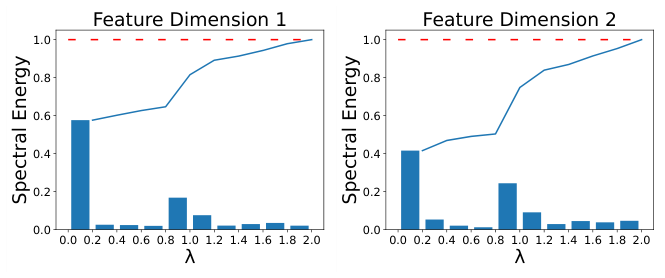
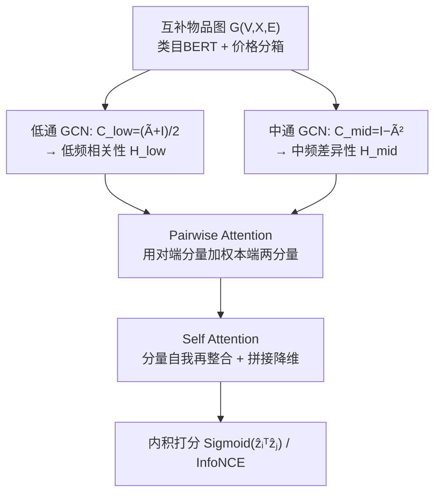

# Spectral-Based Graph Neural Networks for Complementary Item Recommendation (基于谱域的互补物品推荐图神经网络)

- **会议/期刊**: AAAI 2024
- **作者与机构**: Haitong Luo, Xuying Meng, Suhang Wang, Hanyun Cao, Weiyao Zhang, Yequan Wang, Yujun Zhang（中科院计算所、UCAS、宾州州立、BAAI、紫金山实验室）
- **推荐链路定位**: 召回（Item-to-Item 互补召回 / 链接预测）
- **研究方向**: 图神经网络与知识图谱推荐 / 协同过滤与双塔召回
- **论文原文**: [https://arxiv.org/abs/2401.02130v4](https://arxiv.org/abs/2401.02130v4)
- **开源代码**: [https://github.com/luohaitong/SComGNN](https://github.com/luohaitong/SComGNN)

## TL;DR (1分钟核心速览)

互补推荐的核心是「相关但不同」（iPhone ↔ AirPods），前人要么只建模相关性（易退化为推荐替代品），要么用类目映射粗暴近似差异性（差异性并不止于类目）。本文首次从谱域观察互补图：其能量集中在**低频（相关性）+ 中频（差异性）**，高频几乎为零（$S_{high}<0.5$）。据此设计低通滤波器$C_{low}=(\tilde{A}+I)/2$与中通滤波器$C_{mid}=I-\tilde{A}^2$ 显式解耦两类分量，再用「pairwise + self」两阶段注意力自适应配比。在四个 Amazon 「also-bought」数据集上，以逐物品留一边的链接预测协议 + HR/NDCG 评测，HR@10 相对最优基线提升 4.4%–14.3%。

## Background & Motivation (背景与核心矛盾)

- **主流范式**: 一是把互补关系从一般「相关」关系中解耦出来的图模型（DecGCN、CARL 等），二是用类目映射网络引入多样性的 P-Companion / ALCIR。
- **前人局限**: (1) 只建模 relevance，忽略 dissimilarity，导致把互补召回做成**替代品召回**（iPhone→Galaxy S23）；(2) 用类目差异近似 dissimilarity，但外观、功能、价格上的差异被完全抹掉，且**无法在两种属性间做可控权衡**。
- **核心洞察 (Key Insight)**: 图信号中「节点与邻居越相似、频率越低」，因此互补图的相关性天然落在低频、差异性（与邻域的偏离）落在中频。对 Appliances 做 Laplacian 特征分解可见能量集中在 $\lambda\approx 0$与$\lambda\approx 1$；四个数据集的$S_{high}=x^\top Lx/x^\top x$ 均落在 0.32–0.42，印证「低频 > 中频 > 高频」。
- **本文切入点**: 不做新的空间聚合，而是**先在谱域设计滤波器形状，再等价转回空间域实现**，用两个滤波器把两种属性拆开，再用注意力按物品对动态配比。

<figure class="paper-figure" markdown="span">
  <figcaption>图2：Appliances 数据集的光谱能量分布</figcaption>
</figure>

## Method (核心方法设计)

### 1. 整体框架 (Overall Architecture)

输入为物品-物品互补图（节点特征 = BERT 类目嵌入 ⊕ 等深分箱价格），两条并行 GCN 分支共享输入 $X$：低通分支与中通分支各传播 1 层，得到$H_{low}$、$H_{mid}$。随后进入两阶段注意力：先做 **pairwise attention**，用对端物品的低/中频向量去加权本端物品的两个分量（同一物品在不同物品对中获得的配比不同）；再做 **self attention**，让每个分量各自再整合一次，缓解对端噪声。两路输出拼接降维得$\hat{z}_i$，以$\hat{z}_i^\top\hat{z}_j$ 的内积 + Sigmoid 作为互补概率，用 InfoNCE 对比损失训练，推理即双塔内积召回（可上 ANN）。

### 2. 关键设计拆解 (Key Designs)

1. **谱域低通/中通滤波器（把属性解耦成可实现的算子）**：痛点是用线性核只能做低通/高通，做不出「保留中频、滤掉两端」的中通。低通取 $F_{low}(\lambda)=1-\lambda/2$，转空间域得$C_{low}=(\tilde{A}+I)/2$（自信息 + 一阶邻居，即相关性）；中通取二次核$F_{mid}(\lambda)=-(\lambda-1)^2+1$，转空间域得$C_{mid}=I-\tilde{A}^2$，即「自身减去两跳邻域」——正是节点相对邻域的**偏离量**，物理直觉与「差异性」严格对齐。两者都是$O(|E|)$与$O(2|E|)$ 的稀疏算子，无特征分解开销。
2. **两阶段注意力（按物品对动态配比 relevance / dissimilarity）**：固定权重无法刻画「同一物品在不同搭配中差异性权重不同」。第一阶段 $\alpha^{j_{low},i}_{f}=\mathrm{softmax}_f\big((h^{L}_{j,low})^\top h^{L}_{i,f}\big)$，$z_i^{low}=\sum_f \alpha^{j_{low},i}_f h^{L}_{i,f}$，即由对端$v_j$的低频表示决定本端两分量的混合比；第二阶段用$z_i^{low}$再对$\{z_i^{low},z_i^{mid}\}$做一次同构 softmax 得$\tilde{z}$，最后$\hat{z}_i=[\tilde{z}_i^{low}\oplus\tilde{z}_i^{mid}]W$。二级设计的意义是把「对端驱动的配比」与「自身一致性」分离，消融显示简单 concat 甚至不如只用低频。
3. **训练目标与推理效率**：$\mathcal{L}=-\sum_{e_{i,+}}\log\frac{\exp(\hat{z}_i^\top\hat{z}_{+}/\tau)}{\sum_{j=0}^{M}\exp(\hat{z}_i^\top\hat{z}_j/\tau)}$，正样本为图中邻居，负样本从**无连边节点均匀采样**（$M$个，非 in-batch 免负采样）；注意$\hat{z}_i$随物品对变化（pairwise attention 依赖对端），因此是**成对动态表征**而非固定塔向量——这点使在线部署需按候选对重算注意力，复杂度$O(8d')$，是其主要工程代价。

## Experimental Setup & Evaluation Protocol (实验设置与评估协议)

- **数据集与预处理**（Amazon，取「also-bought」为互补边；节点为物品，无用户维度）：

| 数据集 | #Items | #Edges | $S_{high}$ | 特征/场景说明 |
| :--- | :---: | :---: | :---: | :--- |
| Appliances | 804 | 8,290 | 0.3408 | 小规模，可做谱分解可视化 |
| Grocery | 38,548 | 642,884 | 0.4034 | 快消复购场景 |
| Toys | 24,638 | 614,730 | 0.3150 | 玩具/游戏 |
| Home | 75,514 | 776,766 | 0.4169 | Home & Kitchen，最大规模 |

- **数据划分与防穿越**: 沿用前作的**逐物品留边**协议——每个物品随机抽 1 条边作验证、1 条边作测试，其余边全部训练（非全局时间戳切分，存在同物品其余边泄漏到训练集的风险）。
- **排名评测协议**: 链接预测式排序，对候选物品按 $\hat{z}_i^\top\hat{z}_j$打分后计算$\mathrm{HR}@\{5,10\}$与$\mathrm{NDCG}@\{5,10\}$；论文未显式声明全库 Full-Ranking，结合实现应为「1 正 + 采样负候选」的 Sampled Ranking，且**未报告多次运行方差与显著性检验**。
- **对比基线与超参**: 传统 GNN（GIN、GraphSage）与互补推荐模型（Popularity、DCF、P-Companion、ALCIR）共 6 个；两个滤波器层数均 1，嵌入维度 $d'=16$，所有基线统一使用相同对比学习设置与在验证集上调参。

## Key Experimental Results (实验关键数据)

### 1. 主实验对比 (Main Results)

| 模型 | Appliances HR@5 / HR@10 / NDCG | Toys HR@5 / HR@10 / NDCG | Grocery HR@5 / HR@10 / NDCG | Home HR@5 / HR@10 / NDCG |
| :--- | :---: | :---: | :---: | :---: |
| GIN | 0.4347 / 0.6226 / 0.4279 | 0.5242 / 0.7408 / 0.4866 | 0.4344 / 0.6107 / 0.4425 | 0.4843 / 0.6552 / 0.4681 |
| GraphSage | 0.4402 / 0.6574 / 0.4215 | 0.5313 / 0.7514 / 0.4863 | 0.6255 / 0.8000 / 0.5359 | 0.7272 / 0.8417 / 0.6061 |
| Popularity | 0.2040 / 0.3208 / 0.2906 | 0.1809 / 0.2816 / 0.2914 | 0.2556 / 0.3690 / 0.3392 | 0.2263 / 0.3505 / 0.3223 |
| DCF | 0.3630 / 0.5366 / 0.3817 | 0.4876 / 0.6714 / 0.4661 | 0.5991 / 0.7574 / 0.5326 | 0.6846 / 0.7798 / 0.6015 |
| P-Companion | 0.3545 / 0.5414 / 0.3759 | 0.4098 / 0.6017 / 0.3923 | 0.4943 / 0.6774 / 0.4152 | 0.5847 / 0.7220 / 0.5145 |
| ALCIR | 0.3754 / 0.5394 / 0.3792 | 0.3930 / 0.5959 / 0.3994 | 0.5067 / 0.6892 / 0.4614 | 0.5411 / 0.6885 / 0.4826 |
| **SComGNN** | **0.4919 / 0.7127 / 0.4377** | **0.6561 / 0.8589 / 0.5501** | **0.7207 / 0.8565 / 0.5959** | **0.7943 / 0.8789 / 0.6610** |
| Improv. (HR@10) | +7.8% | +14.3% | +13.3% | +4.4% |

### 2. 消融实验 (Ablation Study)

| 变体 | Appliances HR@10 / NDCG | Toys HR@10 / NDCG | Grocery HR@10 / NDCG | Home HR@10 / NDCG |
| :--- | :---: | :---: | :---: | :---: |
| 完整 SComGNN | **0.7127 / 0.4377** | **0.8589 / 0.5501** | **0.8565 / 0.5959** | **0.8789 / 0.6610** |
| w/o $l$（仅中频） | 0.1855 / 0.2457 | 0.1365 / 0.2236 | 0.2194 / 0.2560 | 0.1745 / 0.2375 |
| w/o $m$（仅低频） | 0.6420 / 0.4235 | 0.7186 / 0.4907 | 0.7839 / 0.5389 | 0.8387 / 0.6239 |
| w/o $a$（直接 concat） | 0.6766 / 0.4195 | 0.8228 / 0.5149 | 0.8034 / 0.5330 | 0.8626 / 0.6223 |

### 3. 关键实验发现 (Key Findings)

1. **低频是不可缺的地基，中频是增益项**：去掉低通后 HR@10 从 0.7127 崩到 0.1855（Appliances），而去掉中通仅降到 0.6420；这与 $S_{high}<0.5$（低频能量 > 中频）的谱观察定量一致，说明「先保相关性、再补差异性」是正确优先级。
2. **差异性必须「被整合」而非「被拼接」**：w/o $a$在 Home 上 NDCG 0.6223 甚至低于 w/o$m$ 的 0.6239，Grocery 的 HR@10 只从 0.7839 提到 0.8034；两阶段注意力把这部分提升到 0.8565 / 0.6610，证明中频向量本身含噪，需按物品对重新配比才生效。
3. **传统 GNN 强于互补专用模型，谱解耦才是关键差异**：GraphSage 在 Grocery/Home 上（0.8000 / 0.8417）显著超过 P-Companion（0.6774 / 0.7220）与 ALCIR（0.6892 / 0.6885）；SComGNN 相对 GraphSage 仍有 7.1%（Grocery）与 4.4%（Home）的提升，说明收益来自「频率分量解耦」而非更强聚合器。案例研究进一步佐证：仅低频 → 全是咖啡（替代品）；仅中频 → 棒棒糖、番茄丁（无关）；两者合并 → 糖、可可（真互补）。

## Highlights & Limitations (亮点、对比与审稿批判)

- **与代表作对比 (vs. Prior Work)**: 相比 P-Companion / ALCIR 用**类目多样性**这一离散代理近似 dissimilarity，本文用 $C_{mid}=I-\tilde{A}^2$ 在**连续表征空间**度量「相对两跳邻域的偏离」，可覆盖外观、价格、功能等类目外差异；相比 GraphSage/GIN 的单一低通聚合，本文显式保留被低通滤掉的中频信号，并给出可解释的谱-语义映射。
- **可迁移亮点**: (1) 「先画滤波器频谱、再等价转空间算子」的设计范式，可直接迁移到替代品去偏、跨域桥接物品召回等需要「相关但不同」信号的场景；(2) 用 $S_{high}=x^\top Lx/x^\top x$ 这一免特征分解指标快速诊断数据集的频率构成，作为选模型先验。
- **审稿级局限批判**: (1) **评估协议偏弱**——每物品仅留 1 条测试边、未声明 Full-Ranking、未做多次运行均值与显著性检验，HR@10 的 4.4%（Home）提升是否稳健存疑；(2) **推理开销与表征非固定**——pairwise attention 使 $\hat{z}_i$ 依赖候选对，无法预先离线固化物品向量，只能对 top-K 候选重算，与「双塔 + ANN」的工业召回范式存在张力；同时未与 LightGCN 类强基线、以及带时间戳的序列式互补（真购买先后）做对比。

## Rating (四维评分)

- **方法创新性 (Novelty)**: ⭐⭐⭐⭐ （首个把互补关系映射到低/中频谱并给出空间域等价算子，$I-\tilde{A}^2$ 的中通核简洁且有明确物理直觉）
- **评估协议与实验扎实度 (Protocol & Experiments)**: ⭐⭐⭐ （四个真实数据集 + 6 基线 + 消融与案例分析完整，但单边测试划分、无 Full-Ranking 声明、无方差与显著性检验）
- **写作与数学规范度 (Clarity & Rigor)**: ⭐⭐⭐⭐ （谱域-空间域推导与复杂度 $O(3|E|)+O(8d')$ 交代清楚，但两阶段注意力的必要性缺少理论刻画，仅靠消融佐证）
- **工业落地与复现价值 (Industrial & Practical Value)**: ⭐⭐⭐⭐ （代码开源、稀疏算子实现简单，1 层 16 维即可最优，但成对动态注意力对在线延迟与向量索引不友好）

