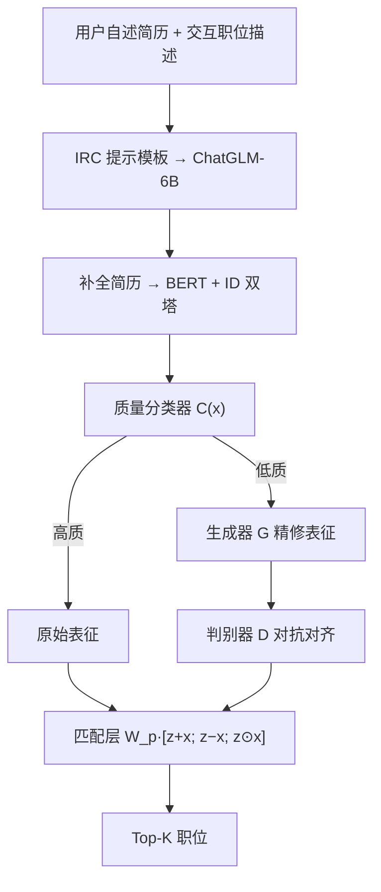

# Enhancing Job Recommendation through LLM-based Generative Adversarial Networks (基于 LLM 生成对抗网络的职位推荐增强)

- **会议/期刊**: AAAI 2024
- **作者与机构**: Yingpeng Du、Di Luo、Rui Yan、Hongzhi Liu、Yang Song、Hengshu Zhu、Jie Zhang（北京大学 / 中国人民大学 / BOSS 直聘职业科学实验室 / 南洋理工大学）
- **推荐链路定位**: 召回（双塔文本匹配打分）
- **研究方向**: 大语言模型推荐 (LLM4Rec) / 冷启动与长尾推荐
- **论文原文**: [https://arxiv.org/abs/2307.10747v1](https://arxiv.org/abs/2307.10747v1)
- **开源代码**: 暂未开源

## TL;DR (1分钟核心速览)

在线招聘中用户自述简历质量低、信息缺失，直接让 LLM"润色简历"又会引入大量幻觉，而对交互记录稀少的少样本（长尾）用户更是雪上加霜。本文提出 LGIR：先用用户历史交互过的职位描述作为额外上下文引导 LLM 做"交互式简历补全"(IRC) 以抑制编造，再用一个 GAN 把少样本用户的低质简历表征对齐到多样本用户的高质表征上，最后接双塔匹配器。在 BOSS 直聘三个真实数据集上以 1:1:1 比例划分、每正样本采样 20 负样本的 Sampled Ranking 协议评估，map@5 相比最强基线 LightGCN 提升 7.50%–8.38%，ndcg@5 提升 8.22%–9.57%。

## Background & Motivation (背景与核心矛盾)

- **主流范式**: 招聘推荐分三支——行为侧（MF/NCF/LightGCN 协同过滤）、内容侧（BPJFNN 层次注意力 RNN 做简历-职位文本匹配）、混合侧（SHPJF、PJFFF 同时用文本与交互）。
- **前人局限**: ① 纯行为方法无法理解简历文本中的技能语义，在交互稀疏时几乎失效；② 纯内容/混合方法的表征高度依赖用户自述文本，而真实平台用户书写习惯差异极大、简历常"残缺且不结构化"，导致匹配信号噪声大。
- **核心洞察 (Key Insight)**: LLM 的外部知识与文本生成能力本可补全简历，但作者发现两个关键现象：其一，**无约束补全会放大幻觉**（案例中简历与目标职位文本相似度反而从 0.45 掉到 0.39）；其二，**长尾用户交互太少，LLM 缺乏约束信号**，生成质量随交互数单调恶化。
- **本文切入点**: 把"用户交互过的职位描述"当作事实性锚点喂进 prompt 做条件生成；再用 GAN 在表征空间做**非配对**（unpaired）域迁移，把少样本用户的低质表征拉到多样本用户的高质分布上。

## Method (核心方法设计)

### 1. 整体框架 (Overall Architecture)

输入为用户自述简历 $T_c$、其交互过的职位描述集合$R_c=\{T_{j_k}\mid R_{cj_k}=1\}$与职位文本$T_j$。离线阶段：IRC 模块把二者拼接进 prompt，调用 ChatGLM-6B 生成补全简历$G_c$；BERT 编码补全简历与职位文本得$W_{G_c}, W_{T_j}$，与 ID 嵌入拼接经 MLP 得双塔表征$x_{c_i}, x_{j_k}$。随后分类器$C$判定简历质量档位，被判为低质的表征送入生成器$G$精修，判别器$D$ 与之对抗。在线阶段仅需一次前向双塔打分与 top-K 排序。

### 2. 关键设计拆解 (Key Designs)

1. **交互式简历补全 IRC（用行为事实锚定 LLM）**：痛点是无约束 prompt 让 LLM 自由发挥、幻觉淹没有效信息。本文把 $R_c$中职位描述拼入 prompt，即$G_c=\mathrm{LLMs}(\text{prompt}_{\text{IRC}}, T_c, R_c)$，让生成内容被"用户真实投递过的岗位要求"约束。直觉上，交互记录是用户能力的外部证据，等价于给生成过程注入事实性先验，从而把隐性技能（如"熟悉 Axure 原型"）显式化。
2. **非配对 GAN 表征对齐（解决 few-shot 长尾）**：痛点在于低质与高质简历来自不同用户，无法逐条配对做监督回归。本文先用阈值 $\kappa_1,\kappa_2$圈出多样本集$\mathcal{T}^{\uparrow}_C$与少样本集$\mathcal{T}^{\downarrow}_C$训练分类器（交叉熵$\mathcal{L}_C$），再令判别器区分"真实高质表征"与"生成器精修后的表征"：
$$\min_{\Theta_G}\max_{\Theta_D}\;\mathcal{L}_{D}=\mathbb{E}_{x\sim\hat{\mathcal{T}}^{\uparrow}}[\log D(x)]+\mathbb{E}_{\tilde{x}\sim G(\hat{\mathcal{T}}^{\downarrow})}[\log(1-D(\tilde{x}))]$$
其物理直觉是把"简历质量"建模为一个可从数据分布中判别、也可被生成器伪造的隐变量，对抗训练迫使少样本表征迁移到高质流形上。推理时按 $z_{c_i}=x_{c_i}$（若$C\ge0.5$）否则$G(x_{c_i})$ 选择表征。
3. **训练目标、负采样与推理效率**：匹配层采用对称交互算子 $\hat{R}_{i,k}=W_p\cdot[z_{c_i}+x_{j_k};\,z_{c_i}-x_{j_k};\,z_{c_i}\odot x_{j_k}]$，损失为 pairwise BPR 式$\mathcal{L}_{rec}=\sum_{(i,j_1,j_2)}\log\sigma(\hat{R}_{i,j_1}-\hat{R}_{i,j_2})-\lambda\|\Theta\|_2$，训练按分类器→判别器→生成器→推荐目标四阶段交替。负样本为训练集内随机采样（非全库、非 hard negative）；在线推理不含 LLM，成本与普通双塔同级，但简历补全需离线周期性重算。

## Experimental Setup & Evaluation Protocol (实验设置与评估协议)

- **数据集与预处理**（BOSS 直聘 106 天真实日志，覆盖设计/销售/技术三个行业）：

| 数据集 | #Users | #Items | #Interactions | 稀疏度/密度 | 特征/场景说明 |
| :--- | :---: | :---: | :---: | :---: | :--- |
| Designs | 12,290 | 9,143 | 166,270 | 密度约 0.148% | 设计岗，简历文本 + 职位 JD |
| Sales | 15,854 | 12,772 | 145,066 | 密度约 0.072% | 销售岗，长尾最重 |
| Tech | 56,634 | 48,090 | 925,193 | 密度约 0.034% | 技术岗，规模最大 |

- **数据划分与防穿越 (Splitting Strategy)**: 交互记录按 **1:1:1 比例划分**为 train/validation/test（论文称 "equally"），未采用全局时间戳切分，也未显式声明防穿越处理，属该文评估协议的薄弱环节。
- **排名评测协议 (Ranking Protocol)**: **Sampled Ranking**——每个正样本从"已交互 + 未交互"记录中采样 **20 个负样本**（正负比 1:20）参与排序，非全库 Full-Ranking，因此指标绝对值偏高、结论偏乐观。
- **对比基线与超参设置**: 基线含内容型（BPJFNN、SGPT-BE/ST/ST+SRC）、协同型（MF、NCF）、混合型（PJFFF、SHPJF）、图型（LightGCN、LightGCN+SRC）。统一 latent 维度 $d=64$、batch 1024、lr$5\times10^{-5}$、L2 系数$10^{-4}$；本文$d_e=64$、$d_{e'}=128$、$d_c=d_s=d_g=256$；LLM 为 ChatGLM-6B；结果取 5 次随机初始化均值，配对 t 检验$p<0.01$ 显著。

## Key Experimental Results (实验关键数据)

### 1. 主实验对比 (Main Results)

| Method | Designs map@5 | Designs ndcg@5 | Sales map@5 | Sales ndcg@5 | Tech map@5 | Tech ndcg@5 |
| :--- | :---: | :---: | :---: | :---: | :---: | :---: |
| SGPT-ST+SRC | 0.0727 | 0.1177 | 0.0511 | 0.0925 | 0.1541 | 0.2194 |
| BPJFNN | 0.1415 | 0.2156 | 0.1138 | 0.2038 | 0.2018 | 0.2948 |
| MF | 0.1914 | 0.2913 | 0.0887 | 0.1628 | 0.4359 | 0.6054 |
| NCF | 0.2071 | 0.3230 | 0.1463 | 0.2670 | 0.4105 | 0.5706 |
| SHPJF | 0.1862 | 0.2875 | 0.1334 | 0.2436 | 0.3710 | 0.5189 |
| LightGCN | 0.2664 | 0.4218 | 0.1629 | 0.2980 | 0.4676 | 0.6591 |
| LightGCN+SRC | 0.2649 | 0.4189 | 0.1611 | 0.2939 | 0.4719 | 0.6661 |
| **LGIR (ours)** | **0.2887** | **0.4622** | **0.1751** | **0.3225** | **0.5086** | **0.7191** |
| **Improv.%** | *+8.38%* | *+9.57%* | *+7.50%* | *+8.22%* | *+7.78%* | *+7.96%* |

mrr 同样全面领先（0.6319 / 0.4548 / 0.8434，对应 +6.11% / +6.49% / +3.54%）。

### 2. 消融实验 (Ablation Study)

| Variant | Designs map@5 | Sales map@5 | Tech map@5 | 说明 |
| :--- | :---: | :---: | :---: | :--- |
| BASE | 0.2627 | 0.1617 | 0.4994 | 双塔文本匹配 + 原始简历 |
| SRC | 0.2601 | 0.1652 | 0.5048 | 仅 LLM 简单补全，无交互引导 |
| IRC | 0.2859 | 0.1671 | 0.5056 | 交互引导补全，无 GAN |
| **LGIR** | **0.2887** | **0.1751** | **0.5086** | IRC + GAN 对齐 |

### 3. 关键实验发现 (Key Findings)

1. **"无约束 LLM 补全"会反向伤害推荐**：SRC 在 Designs 上 map@5 由 0.2627 降至 0.2601（LightGCN 上 0.2664→0.2649 同样下滑），说明幻觉内容稀释了有效信号；而 IRC 在 Designs 上把 BASE 拉到 0.2859（+8.83%），证实"交互锚定"而非"LLM 本身"才是增益来源。
2. **GAN 的增益集中在长尾用户**：全量指标上 IRC→LGIR 仅 +0.98%（Designs）/+4.8%（Sales），但按交互数五等分后，少样本组的提升显著高于多样本组（图 4），即 GAN 作用机制确实是跨用户分布对齐而非普遍增益。
3. **阈值敏感但稳健**：$\kappa_1\in\{10,20,30,40\}$、$\kappa_2\in\{1,3,5,7\}$网格下最优为$\kappa_1=30,\kappa_2=5$（Designs map@5 0.2887），且次优格点差异仅 0.001–0.002，说明质量标签虽为启发式，分类器对阈值并不苛刻。
4. **案例级验证**：某用户两段历史交互中蕴含目标岗位所需但简历未写的共性能力，IRC 生成简历与目标 JD 文本相似度由 0.40 升至 0.61，而 SRC 反降至 0.40 以下。

## Highlights & Limitations (亮点、对比与审稿批判)

- **与代表作对比 (vs. Prior Work)**: 相较 SHPJF/PJFFF 这类"文本+交互"混合模型，本文的本质区别是把 LLM 当作**可控的条件生成器**而非特征编码器，并用 GAN 显式处理质量异质性；相较 SGPT-ST+SRC 这类"LLM 直接增强"路线，本文指出其失效原因（幻觉 + few-shot）并分别给出对应机制，而非笼统地"上大模型"。
- **可迁移亮点**: ① "行为历史拼进 prompt 作为事实锚点"这一 trick 可直接迁移到 LLM 用户画像/冷启动标签补全；② 用 GAN 做**非配对**表征域对齐，可复用于任意长尾群体（冷启动用户、新物品）向头部流形迁移，无需成对监督。
- **审稿级局限批判**: ① 评估仅用 1:20 采样的 Sampled Ranking 且按比例随机划分、无时间戳切分，指标存在乐观偏差与潜在信息泄漏，缺少 Full-Ranking 复核；② 质量分类器的标签由 $\kappa_1/\kappa_2$ 交互数阈值启发式构造，"简历质量"与"交互数量"被强行等同，混淆了活跃度与文本质量；③ 未报告 LLM 离线补全的调用成本/延迟，也未讨论简历随交互更新时的重算频率，工业可用性论证不足；④ GAN 训练不稳定、四阶段交替训练的收敛性缺乏理论或敏感性分析。

## Rating (四维评分)

- **方法创新性 (Novelty)**: ⭐⭐⭐⭐ （把 LLM 条件生成与 GAN 非配对域对齐串联解决"幻觉 + 长尾"两个独立痛点，组合思路清晰且有案例佐证，但单点技术均为已有组件的迁移应用）
- **评估协议与实验扎实度 (Protocol & Experiments)**: ⭐⭐⭐ （三个真实大规模数据集 + 5 次重复 + 配对 t 检验值得肯定，但 1:20 采样排序、比例随机划分与缺乏全库排序复核明显削弱说服力）
- **写作与数学规范度 (Clarity & Rigor)**: ⭐⭐⭐ （整体框架与三阶段训练流程交代清楚，但式 (10)(11) 的期望下标与生成器目标存在符号笔误，$\hat{\mathcal{T}}$ 上下标混用，GAN 收敛性无分析）
- **工业落地与复现价值 (Industrial & Practical Value)**: ⭐⭐⭐⭐ （在线仅需双塔打分、增益来自离线表征精修，落地路径现实；但代码未开源、ChatGLM 补全成本与更新策略未披露，复现门槛偏高）

