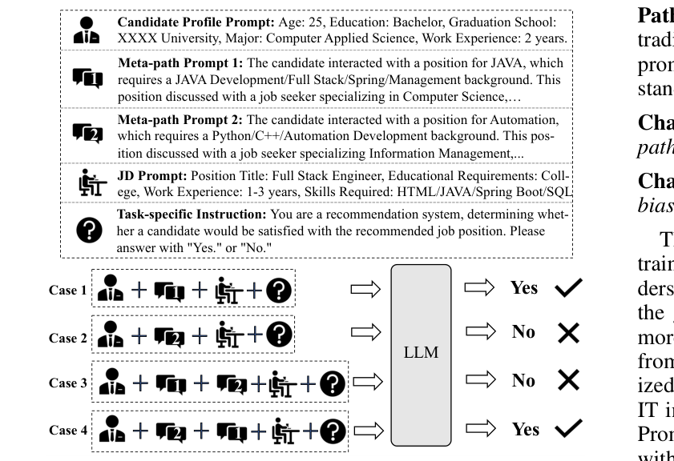
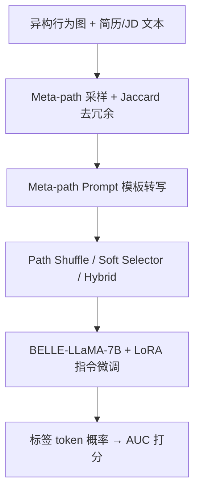
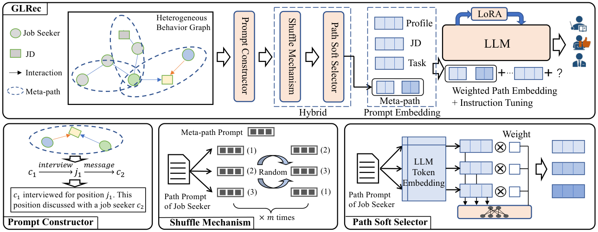

# Exploring Large Language Model for Graph Data Understanding in Online Job Recommendations (面向在线职位推荐的大语言模型图数据理解)

- **会议/期刊**: AAAI 2024
- **作者与机构**: Likang Wu, Zhaopeng Qiu, Zhi Zheng, Hengshu Zhu, Enhong Chen（中国科学技术大学 / BOSS 直聘职业科学实验室）
- **推荐链路定位**: 精排（人岗匹配打分）
- **研究方向**: 大语言模型推荐 (LLM4Rec) / 图神经网络与知识图谱推荐
- **论文原文**: [https://arxiv.org/abs/2307.05722v3](https://arxiv.org/abs/2307.05722v3)
- **开源代码**: [https://github.com/WLiK/GLRec](https://github.com/WLiK/GLRec)

## TL;DR (1分钟核心速览)

在线招聘中简历与 JD 皆为长文本，交互极度稀疏且新岗位（如 AIGC 提示工程师）不断涌现造成 OOD 难题。本文提出 GLRec：用 meta-path prompt constructor 将异构行为图中的高阶路径按边语义模板"翻译"成自然语言句子喂给 BELLE-LLaMA-7B，并针对 LLM 的路径权重敏感与位置偏置设计 path shuffle、path soft selector 及二者混合的增强模块；以 LoRA 指令微调后在 RecrX/RecrY 两个真实招聘数据集上，Point-wise 与 Pair-wise 两类任务、Random/OOD-position/OOD-JD 三种划分下 AUC 全面超越 TALLrec，最高相对提升 29.8%，OOD 场景即便图基线近乎随机猜测仍保持 0.81+。

## Background & Motivation (背景与核心矛盾)

- **主流范式**: 招聘推荐早期把简历-JD 匹配视为监督式文本匹配（CNN/RNN/BiLSTM），后期转向行为图上的高阶消息传递（HGT、DPGNN）以缓解交互稀疏。
- **前人局限**: ① 文本匹配模型缺乏外部世界知识，对新出现的岗位词（prompt engineer）只能做近随机猜测；② 图模型虽能建模高阶关系，但节点表征完全由域内共现驱动，无法理解"新型技能栈"语义，OOD-position/OOD-JD 下性能崩至 0.5–0.6；③ 现有 LLM 推荐器（TALLrec）只吃历史交互序列，**无法读懂非文本的图结构**，个性化被削弱。
- **核心洞察 (Key Insight)**: 招聘异构图的边天然有明确语义（interview / message / match），因此 meta-path 可以被无损转写成自然语言描述；一旦转写成功，LLM 的 in-context 链式推理就能"顺着路径"补全稀疏交互。但作者从线上日志发现两个副作用：不同路径对决策的贡献权重不同（Case 1/2 相同画像不同路径给出相反答案），且路径排列顺序会引发位置偏置（Case 3/4 交换顺序后答案翻转）。
- **本文切入点**: 把图结构"提示化"，再用 shuffle + soft selector 把路径权重与位置偏置同时抹平。

<figure class="paper-figure" markdown="span">
  <figcaption>图2：LLM元路径提示输入中路径权重和位置偏置的真实案例。</figcaption>
</figure>

## Method (核心方法设计)

### 1. 整体框架 (Overall Architecture)

单样本输入由四段拼成：Candidate Profile Prompt（年龄/学历/院校/专业/年限）、M 条 Meta-path Prompt（路径中每个节点填入真实简历或 JD 文本）、JD Prompt（目标岗位）、Task-specific Instruction（Point-wise 回答 "Yes./No."，Pair-wise 回答 "[A]/[B]"）。采样 meta-path 时先用 Jaccard 相似度过滤冗余，再经 shuffle 增广与 soft selector 加权后送入 BELLE-LLaMA-7B；训练只更新 LoRA 参数与选择器参数 $W_a$，prompt 部分掩码不计损失；推理时解析标签 token 位置的 softmax 概率作为匹配分数。

<figure class="paper-figure" markdown="span">
  <figcaption>图1：GLRec用于职位推荐的框架。</figcaption>
</figure>

### 2. 关键设计拆解 (Key Designs)

1. **Meta-path Prompt Constructor（把图变成句子）**：痛点是不变的图 embedding 无法进入 LLM 词表空间。做法是按路径上出现的边类型预定义模板并填槽，例如 $c_1 \xrightarrow{interview} j_1 \xrightarrow{message} c_2$直接写作 "c1 interviewed for position j1. This position discussed with a job seeker c2."；为避免高度相似的路径堆叠导致上下文冗余，用$S_{i,j}=\frac{|P_i\cap P_j|}{|P_i\cup P_j|}\le\gamma$约束入选的$M$ 条路径，取 3 节点路径以兼顾语义与冗余。直觉：LLM 无需学习图卷积，只需"阅读"一条条语义通顺的事实链即可完成高阶推理。

2. **Path Soft Selector（可学习路径权重）**：痛点是对路径做硬采样等价于把所有权重设为相同，而实测不同路径贡献差异巨大。做法是对每条路径 prompt 的 token 嵌入做均值池化得 $H_i$，再算软权重并对 token 嵌入做残差式重加权：

$$\alpha_i=\mathrm{softmax}(W_a H_i),\qquad \hat{e}_t=e_t+\lambda\cdot\alpha_i e_t,\quad t\in M_i$$

其中 $W_a\in\mathbb{R}^{1\times d_e}$，控制器$\lambda\in(0,0.5]$抑制数值尺度漂移（实验中$\lambda=0.1$）。由于$\hat{e}_t$取代了原始$x$ 进入损失，梯度可以反传到选择器，等价于在词嵌入层实现"短语级注意力"。

3. **Shuffle + Hybrid 去位置偏置与训练目标**：对含多路径的样本随机打乱 $m$次（$m=2$）构造增广数据，迫使模型学到顺序不变性；Hybrid 即 shuffle 与 soft selector 同时启用。最终目标在 LoRA 参数$\Theta_L$ 上优化自回归损失：

$$\mathcal{L}_f=\max_{\Theta_L}\sum_{(x,y)\in\mathcal{T}}\sum_{t=1}^{|y|}\log P_{\Theta+\Theta_L}(y_t\mid \hat{e}_x, y_{<t})$$

**负采样与推理开销**：无负采样（Point-wise 正负样本由真实匹配/未匹配构成，Pair-wise 由正负 JD 组对）；推理只需一次前向并取两个候选标签 token 的概率，但 7B 主干 + 512 token 上下文的在线开销显著高于双塔基线。

## Experimental Setup & Evaluation Protocol (实验设置与评估协议)

- **数据集与预处理**（BOSS 直聘真实日志，敏感信息已脱敏，训练:测试 = 5:1）：

| 数据集 | #Candidates | #Jobs | #Match | #Interactions | 说明 |
| :--- | :---: | :---: | :---: | :---: | :--- |
| RecrX | 12,440 | 19,318 | 23,879 | 54,147 | 小规模，稀疏交互 |
| RecrY | 18,260 | 26,576 | 47,725 | 119,529 | 大规模 |

- **数据划分与防穿越**: 三种划分——`Random`（按用户交互记录随机 5:1 切分）、`OOD position`（训练/测试的岗位职能类别交集为空）、`OOD JD`（训练/测试的 JD 条目交集为空），后两者构成严格的分布外泛化检验。
- **排名评测协议**: 未使用 Full-Ranking 或 Sampled Ranking，而是把任务化为二分类、报告 **AUC**；作者明示不用排序指标的理由是 LLM 微调需要 ground-truth 的 item 顺序序列，而现实中不存在该序列。
- **对比基线与超参**: RobertaRec（双塔文本匹配）、HGT（异构图 Transformer）、DPGNN（双向选择偏好 GNN）、TALLrec（LLaMA 指令微调推荐，骨干统一换为 BELLE 以适配中文）。主干 BELLE-LLaMA-7B，LoRA 微调，4×A100 80G，batch 32，最大长度 512，$M\in\{0,1,2,3\}$，$m=2$，$\lambda=0.1$，$\gamma=0.3$，学习率 1e-4；未报告显著性检验。

## Key Experimental Results (实验关键数据)

### 1. 主实验对比 (Main Results)

| Model | Pw-Random RX | Pw-Random RY | Pw-OOD-Pos RX | Pw-OOD-Pos RY | Pw-OOD-JD RX | Pw-OOD-JD RY | Pair-Random RX | Pair-Random RY |
| :--- | :---: | :---: | :---: | :---: | :---: | :---: | :---: | :---: |
| RobertaRec | 0.710 | 0.734 | 0.503 | 0.528 | 0.506 | 0.536 | 0.727 | 0.740 |
| HGT | 0.744 | 0.756 | 0.572 | 0.595 | 0.576 | 0.593 | 0.747 | 0.751 |
| DPGNN | 0.727 | 0.743 | 0.596 | 0.603 | 0.588 | 0.617 | 0.744 | 0.756 |
| TALLrec | 0.842 | 0.829 | 0.770 | 0.788 | 0.766 | 0.798 | 0.849 | 0.825 |
| **GLRec** | **0.891** | **0.876** | **0.810** | **0.843** | **0.814** | **0.852** | **0.905** | **0.883** |
| Improv.↑ | +18.4% | +14.1% | +25.2% | +28.3% | +26.4% | +29.8% | +15.5% | +13.2% |

### 2. 消融实验 (Ablation Study)

数值取自原文图 3 / 图 4（RecrX，Point-wise，AUC；图中未标注精确值的以相对趋势表示）：

| 变体 | AUC 表现 | 结论 |
| :--- | :---: | :--- |
| GLRec 无 meta-path ($M=0$) | ≈0.71 | 退化为纯文本 LLM 推荐 |
| $M=1$ | 显著跃升（0.71→0.80+） | 首条路径激活 in-context 推理 |
| $M=2$/$M=3$ | ≈0.88（峰值） | 继续增益但边际递减 |
| RobertaRec + 同款路径 prompt | ≈0.71（几乎持平） | 判别式模型无法消化路径提示 |
| w/o 增强 → +Shuffle → +Soft Selector → Hybrid | 递增，Hybrid 最稳 | 两类偏置均需处理 |
| 2 路径 vs 3 路径下各策略 | 单一策略互有胜负，Hybrid 方差最小 | 位置与权重因素需联合建模 |

### 3. 关键实验发现 (Key Findings)

1. **图语义是 OOD 泛化的主力而非拟合工具**：GLRec 相对 TALLrec 在 Random 划分仅提升 13.2%–18.4%，但在 OOD-position/OOD-JD 上跃升至 25.2%–29.8%，同期 DPGNN 从 0.727 崩到 0.596、HGT 从 0.744 掉到 0.572 接近随机猜测，说明增益来自 LLM 外部知识 + 路径语义而非域内共现记忆。
2. **路径数量存在"一步到位、快速饱和"现象**：从 $M=0$到$M=1$就贡献了主要涨幅（约 0.71→0.80+），$M=2\sim3$ 达到约 0.88 平台；同 prompt 喂给 RobertaRec 时 AUC 自始至终在 0.71 附近平走，直接证明该收益来自生成式模型的链式推理而非提示里多了几个词。
3. **Pair-wise 恒优于 Point-wise，且顺序敏感必须显式消除**：GLRec 0.905 vs 0.891、TALLrec 0.849 vs 0.842，验证"判断单个岗位是否合适"比"二选一"更难；而图 4 显示不加增强时 2 路径与 3 路径的结果波动明显，Hybrid 策略下最为稳定，证明位置偏置是真实存在的系统性误差源。

## Highlights & Limitations (亮点、对比与审稿批判)

- **与代表作对比 (vs. Prior Work)**: 相比 TALLrec 只把"历史交互物品列表"当上下文，本文首次把**异构图的 meta-path** 结构化地转成自然语言，让 LLM 获得高阶关系推理能力；相比 HGT/DPGNN 用消息传递压缩关系，本文不学图 embedding 而是把图"读"给 LLM，从而在 OOD 上不被域内共现锁死。
- **可迁移亮点**: ① "边语义模板填槽"式 prompt 构造可直接搬到电商（browse→add-cart→buy）、内容社区（click→follow→comment）等异构图；② soft selector 的 $\hat{e}_t=e_t+\lambda\alpha_i e_t$ 是一种极轻量的"句子级注意力"，任何多句 prompt 拼接场景（多兴趣、多会话摘要）都能复用。
- **审稿级局限批判**: ① 评估只用 AUC 二分类，既无 Full-Ranking 全库排序也无采样负例比例说明，无法反映实际曝光排序性能，且未做显著性检验；② 7B 主干 + LoRA + 多路径长 prompt 的在线时延与显存开销全文未报告，与 0.7 级别的双塔基线在工业成本上不可同日而语；③ meta-path 模板依赖平台预定义边类型，$\gamma$、$\lambda$、路径长度 3 等超参缺乏敏感性分析，跨平台迁移成本被低估。

## Rating (四维评分)

- **方法创新性 (Novelty)**: ⭐⭐⭐⭐ （首次让 LLM 通过 meta-path prompt "读懂"异构图，并把路径权重/位置偏置两个 prompt 工程问题抽象成可学习的 soft selector + shuffle 增广，思路清晰但机制相对朴素）
- **评估协议与实验扎实度 (Protocol & Experiments)**: ⭐⭐⭐ （覆盖两类任务与三种划分、含 OOD 检验且对比了图/文本/LLM 三类基线，但仅用 AUC、无全库排序协议、无显著性检验与完整数值消融表）
- **写作与数学规范度 (Clarity & Rigor)**: ⭐⭐⭐⭐ （动机由真实日志 Case 1–4 引出，公式简洁且与图 2/图 3/图 4 对应清楚；损失与 LoRA 推导标准，路径采样细节略欠）
- **工业落地与复现价值 (Industrial & Practical Value)**: ⭐⭐⭐⭐ （代码已开源、数据集来自 BOSS 直聘真实日志，meta-path 模板与 soft selector 极易工程化；但 7B 在线推理成本使其更适合离线重排或候选精筛）

