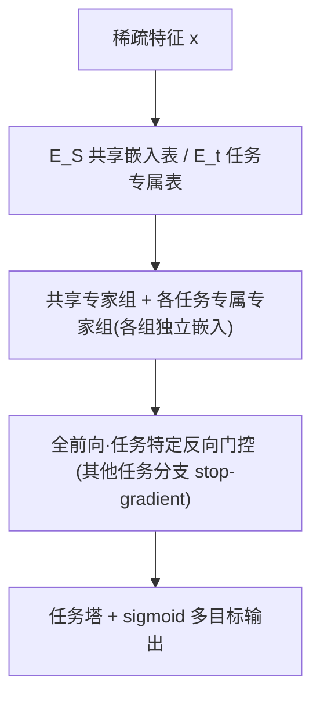
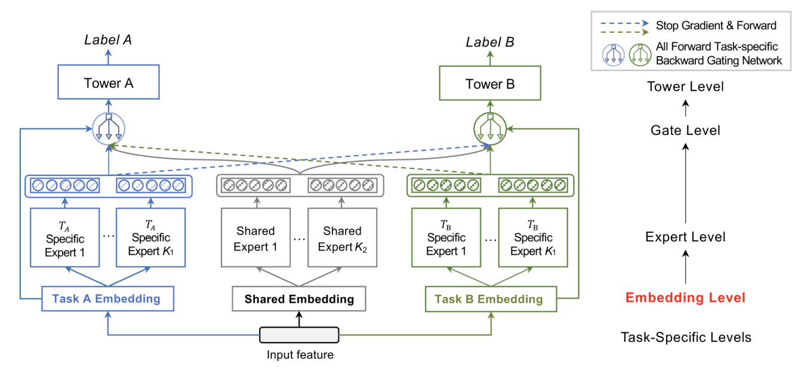
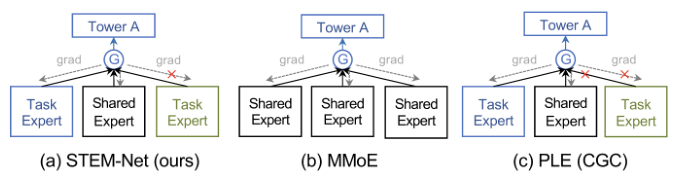

# STEM: Unleashing the Power of Embeddings for Multi-task Recommendation (释放嵌入层的多任务推荐潜力)

- **会议/期刊**: AAAI 2024
- **作者与机构**: Liangcai Su, Junwei Pan 等（清华大学深圳国际研究生院、腾讯）
- **推荐链路定位**: 精排（多目标 CTR 预估）
- **研究方向**: 多任务学习与列表级重排 / CTR 预估与特征交叉
- **论文原文**: [https://arxiv.org/abs/2308.13537v2](https://arxiv.org/abs/2308.13537v2)
- **开源代码**: [https://github.com/LiangcaiSu/STEM](https://github.com/LiangcaiSu/STEM)

## TL;DR (1分钟核心速览)

现有多任务推荐默认「嵌入全共享」，其负迁移诊断只在整个样本集上做平均，掩盖了样本内部的矛盾。本文按两任务期望反馈的分桶序号差把 TikTok 测试集切成 Finish-Overwhelming / Comparable / Like-Overwhelming 三个子集，发现 MMoE/PLE 恰恰在两任务反馈相当的 Comparable 子集上劣于单任务模型。作者据此提出 STEM 范式（共享嵌入表 + 每任务一张专属表）与 STEM-Net（专家独立配表 + 全前向任务特定反向停梯度门控），在 TikTok/QK-Video/KuaiRand1K 上平均 AUC 分别提升约 4e-3/2e-3/4e-3，并首次在脆弱的 Like 任务上取得相对单任务的正迁移（TikTok 0.9095 vs 0.9058）。

## Background & Motivation (背景与核心矛盾)

- **主流范式**: Embedding–Expert–Gate–Tower 四段式。任务特定模块的位置不断下移——Tower 级（Shared-Bottom）、Gate 级（MMoE）、Expert 级（PLE），但**嵌入层始终不动，全任务共享一张表**。
- **前人局限**: ① 负迁移研究把任务内所有样本当作整体，无法回答「负迁移发生在哪类样本」；② 共享嵌入只能学出单一用户偏好，在跨任务偏好相互矛盾的用户-物品对上表达能力不足。
- **核心洞察 (Key Insight)**: 用单任务模型输出把样本按 $\left(b(f_A(x))-b(f_B(x))\right)$十等分桶，反馈悬殊的两端 MTL 均优于单任务（知识互补），但落在 Comparable 桶（区间$(-4,6]$）的样本反而出现负迁移——因为此时两任务各自信号都足够，偏好冲突被放大。
- **本文切入点**: 把任务特异性从 Tower/Gate/Expert 一直下推到 **Embedding** 层，并用梯度隔离保证专属嵌入不被其他任务污染。

## Method (核心方法设计)

### 1. 整体框架 (Overall Architecture)

样本 $x=\{x_1,\dots,x_M\}$先经双轨查表：共享表$E_S$得$h^S_0$，任务$t$的专属表$E_t$得$h^t_0$。共享专家组只吃$h^S_0$、任务专属专家组只吃$h^t_0$，各组**自带独立嵌入表**以杜绝参数干扰。门控层对每个任务塔做「全前向」聚合（聚合共享专家 + 本任务专家 + 其他任务专家），但反向传播时其他任务分支被 `stop-gradient` 截断，只更新本任务与共享通路。最后各任务独立 Tower + sigmoid 输出，BCE 求和训练；推理解码仍是标准点式打分，无序列生成或检索环节。

<figure class="paper-figure" markdown="span">
  <figcaption>图3：STEM-Net 概览。</figcaption>
</figure>

### 2. 关键设计拆解 (Key Designs)

1. **STEM 双轨嵌入范式**：痛点在于单表只能编码一种偏好。改为 $v^t_i=\mathrm{Lookup}(x_i,E_t)$、$v^S_i=\mathrm{Lookup}(x_i,E_S)$，分别拼接成$h^t_0$、$h^S_0$ 输入专家。直觉：把「跨任务共性」与「任务内冲突偏好」拆到两套正交参数空间，使 Comparable 样本上的矛盾偏好可被同时表达而非被平均掉。

2. **All Forward Task-specific Backward 门控**：MMoE 全反向会污染专属表，PLE 只前向本任务专家导致知识无法直连。本文聚合式写作
$$o_t=\sum_{i=1}^{K_1} g^{t\to t}_i h^t_i+\sum_{i=1}^{K_2} g^{S\to t}_i h^S_i+\sum_{t'\neq t}\sum_{i=1}^{K_1} g^{t'\to t}_i\,\mathrm{SG}(h^{t'}_i)$$
权重由 $[g^{t\to t},\{g^{t'\to t}\},g^{S\to t}]=\mathrm{Softmax}(W^t_g(h^t_0+h^S_0))$给出。前向拿全所有专家（迁移最大化），反向被$\mathrm{SG}(\cdot)$ 切断（表征解耦），一举兼得两者。

<figure class="paper-figure" markdown="span">
  <figcaption>图4：MMoE（全前向全反向）、PLE（任务特定前向、任务特定反向）与我们的 STEM-Net（全前向、任务特定反向）的门控网络对比。</figcaption>
</figure>

3. **训练目标与推理开销**：$\mathcal{L}=-\sum_{t}\left[y_t\log\hat{y}_t+(1-y_t)\log(1-\hat{y}_t)\right]$，点式 BCE、无负采样。代价是嵌入表数量$T+1$（实测 TikTok 参数 2.85×、仅 user/item id 专属时 1.95×），门控权重矩阵$W^t_g\in\mathbb{R}^{d\times(K_1T+K_2)}$ 随任务数线性膨胀。

## Experimental Setup & Evaluation Protocol (实验设置与评估协议)

- **数据集与预处理**（训练集中出现少于 10 次的特征值统一替换为默认值）：

| 数据集 | #Users | #Items | #Samples(训练/验证/测试) | #Fields | #Tasks | 正样本率(%) |
| :--- | :---: | :---: | :---: | :---: | :---: | :--- |
| TikTok | 560K | 1.8M | 223.4M / 24.8M / 27.6M | 8 | 2 | 28.31 / 1.60 |
| QK-Video | 970K | 760K | 95.9M / 12.0M / 12.5M | 16 | 2 | 24.01 / 2.03 |
| KuaiRand1K | 1K | 189K | 10.9M / 0.39M / 0.42M | 32 | 8 | 37.76 … 1.78 |

- **数据划分与防穿越**: 论文仅给出训练/验证/测试三元组规模，**未明示是随机划分还是全局时间戳切分**（审稿需追问）。
- **排名评测协议**: 属 CTR 点式任务，采用 **全样本打分**（非 Full-Ranking 未交互全库排序，亦非负采样排序），指标为 AUC 与 Logloss，另设 Comparable 子集上的分桶 AUC 分析。
- **对比基线与超参**: 基线含 Single-Task、Shared-Bottom、OMoE、MMoE、PLE、ESMM、AITM，以及「只加表不改门控」的强基线 ME-MMoE / ME-PLE。嵌入维度 $d=16$，专家 MLP$[512,512,512]$，塔与门控$[128,64]$，专家数$\{1,2,4,8\}$网格搜索，Adam，$lr\in\{1e\text{-}3,5e\text{-}4,1e\text{-}4\}$，batch 4096，$l_2=1e\text{-}6$；未报告显著性检验。

## Key Experimental Results (实验关键数据)

### 1. 主实验对比 (Main Results)

| 模型 | TikTok Avg AUC | TikTok Like AUC | QK-Video Avg AUC | QK Like AUC | KuaiRand1K Avg AUC | Kuai MTL Gain |
| :--- | :---: | :---: | :---: | :---: | :---: | :---: |
| Single-Task | 0.8281 | 0.9058 | 0.9317 | 0.9400 | 0.8433 | — |
| Shared-Bottom | 0.8263 | 0.9022 | 0.9312 | 0.9389 | 0.8234 | −0.0199 |
| MMoE | 0.8265 | 0.9018 | 0.9319 | 0.9401 | 0.8437 | +0.0003 |
| PLE | 0.8264 | 0.9016 | 0.9318 | 0.9399 | 0.8435 | +0.0002 |
| ESMM | 0.8258 | 0.9012 | 0.9288 | 0.9368 | — | — |
| AITM | 0.8266 | 0.9026 | 0.9318 | 0.9398 | — | — |
| ME-MMoE | 0.8274 | 0.9045 | 0.9323 | 0.9407 | 0.8410 | −0.0024 |
| ME-PLE | 0.8275 | 0.9058 | 0.9324 | 0.9410 | 0.8445 | +0.0012 |
| **STEM-Net** | **0.8304** | **0.9095** | **0.9331** | **0.9426** | **0.8480** | **+0.0047** |
| Improv. vs best baseline | +0.35% | +0.41% | +0.08% | +0.17% | +0.41% | — |

### 2. 消融实验 (Ablation Study)

| 变体 | TikTok AUC | 参数倍率 | 说明 |
| :--- | :---: | :---: | :--- |
| STEM-Net-∅（无任何专属嵌入） | 0.8261 | 1.00× | 退化回 MMoE/PLE 水平 |
| 仅 (user id, item id) 专属 | 0.8302 | 1.95× | 接近全量，且 KuaiRand1K 达 0.8448 |
| 仅 user side 专属 | 0.8301 | 1.23× | 性价比最高 |
| 仅 item side 专属 | 0.8260 | 2.62× | KuaiRand1K 崩至 0.8193 |
| 全部特征专属 | **0.8304** | 2.85× | 完整版 |

| 门控输入 | 有 SG (Like AUC) | 无 SG (Like AUC) | Δ |
| :--- | :---: | :---: | :---: |
| $h^t_0$ | 0.9077 | 0.9023 | +0.0054 |
| $h^S_0$ | 0.9089 | 0.9037 | +0.0052 |
| $h^t_0+h^S_0$ | **0.9095** | 0.9008 | +0.0087 |

### 3. 关键实验发现 (Key Findings)

1. **瓶颈在嵌入层而非网络结构**：STEM-Net-∅ 只有 0.8261，与 PLE 的 0.8264 基本持平；一旦给 user/item id 配上专属表即跳到 0.8302，证明增益来自「偏好解耦」而非更深更宽的门控。
2. **停梯度是命门且必须配共享输入**：去掉 SG 后 Like AUC 普跌 0.005–0.009，模型实质退化为 ME-MMoE（全反向污染专属表）；而门控输入若只用 $h^t_0$，因专属嵌入感知不到其他任务信息，平均 AUC 反降约 1e-3，故$h^t_0+h^S_0$ 的组合最优。
3. **矛盾偏好被真实捕获 + 线上可迁移**：对「Like 距离 top-40% 且 Finish 距离 bottom-40%」的 9.63% 用户-物品对，PLE 的共享嵌入分布与 Finish 单任务一致、与 Like 矛盾，而 STEM-Net 的 Like/Finish 专属表分别复现各自单任务分布；线上 A/B 中三个场景分别取得 +0.32%/+0.24%/+0.48% 平均 AUC，带来 4.2%/3.9%/7.1% GMV 提升。

## Highlights & Limitations (亮点、对比与审稿批判)

- **与代表作对比 (vs. Prior Work)**: 相比 MMoE/PLE 把任务特异性停在上层、嵌入仍全共享，本文把特异性推到最底层；相比 ME-MMoE（加表但全反向，专属表被污染）与 ME-PLE（加表但前向不通其他任务专家，迁移受限），STEM-Net 用「全前向 + 停梯度反向」同时拿到迁移与解耦。
- **可迁移亮点**: ① 用单任务期望反馈分桶差值切子集做负迁移诊断，是一套与模型无关、可直接搬到多场景/多目标业务的通用诊断工具；② 用 `stop-gradient` 做嵌入级表征解耦，可低成本嫁接到已有的 MMoE/PLE 线上模型（腾讯生产模型即为 MMoE+NFwFM，仅换嵌入）。
- **审稿级局限批判**: ① 评估只有点式 AUC/Logloss，缺少 GAUC、Top-K 排序指标与显著性检验，数据划分协议（随机/时间切分）未交代，负迁移子集结论仍依赖阈值 $(-4,6]$的人工设定；② 嵌入表数量与门控矩阵随任务数$T$ 线性膨胀（全量专属 2.85× 参数），论文未报告推理 FLOPs/延迟与 PS 通信开销，在百万级特征基数的工业场景下存储与同步成本会显著放大；③ QK-Video 上相对 ME-PLE 的增益仅 +0.08%，泛化稳定性需更多数据集佐证。

## Rating (四维评分)

- **方法创新性 (Novelty)**: ⭐⭐⭐⭐ （把任务特异性下推到嵌入层并用停梯度实现「前向迁移/反向解耦」，机制简洁且与矛盾偏好分析形成闭环，但非全新范式）
- **评估协议与实验扎实度 (Protocol & Experiments)**: ⭐⭐⭐ （三数据集 + 分桶分析 + 线上 A/B 很完整，但缺少排序指标、显著性检验与划分协议说明）
- **写作与数学规范度 (Clarity & Rigor)**: ⭐⭐⭐⭐ （门控公式与三类 MTL 对比图清晰，符号统一；复杂度与参数开销分析略缺）
- **工业落地与复现价值 (Industrial & Practical Value)**: ⭐⭐⭐⭐⭐ （代码开源、已在腾讯广告上线并给出 GMV 数字，改造成本仅限嵌入与门控通路）

