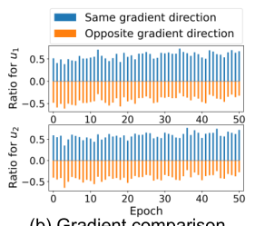
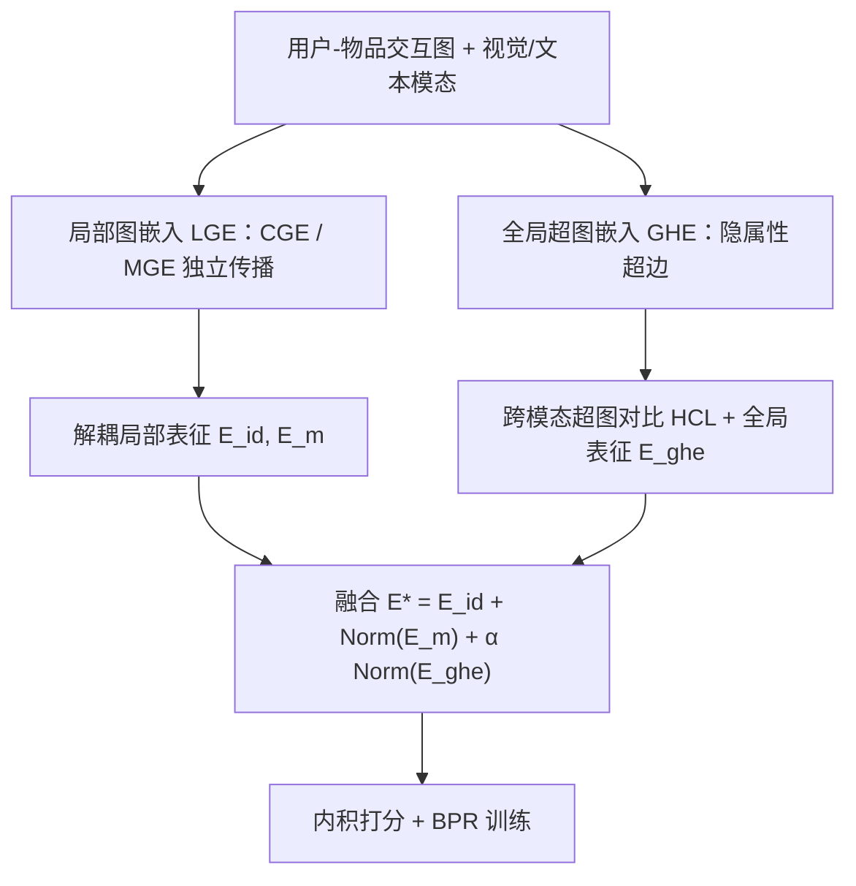
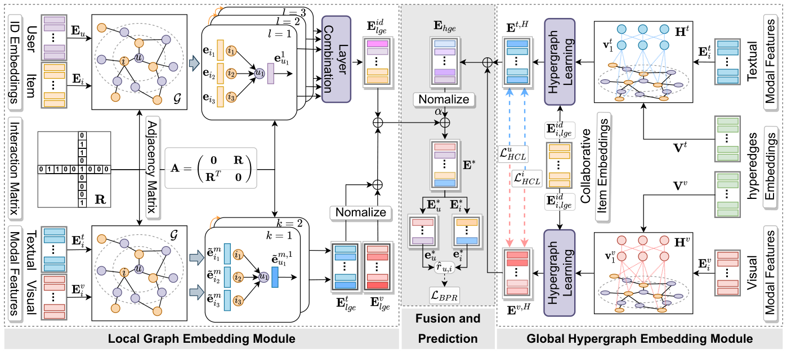

# LGMRec: Local and Global Graph Learning for Multimodal Recommendation (局部与全局图学习驱动的多模态推荐)

- **会议/期刊**: AAAI 2024
- **作者与机构**: Zhiqiang Guo, Jianjun Li, Guohui Li, Chaoyang Wang, Si Shi, Bin Ruan；华中科技大学、武汉数字工程研究所、粤港澳大湾区数字经济研究院
- **推荐链路定位**: 召回 / Top-N 排序
- **研究方向**: 多模态推荐 / 图神经网络推荐
- **论文原文**: [论文原文链接](https://arxiv.org/abs/2312.16400v2)
- **开源代码**: [开源代码仓库链接](https://github.com/georgeguo-cn/LGMRec)

## TL;DR (1分钟核心速览)

LGMRec 针对多模态推荐中“协同信号与模态信号共享用户 ID 导致梯度冲突”和“仅局部交互图难以建模稀疏用户全局兴趣”两大痛点，提出局部图嵌入解耦协同/模态表征，并用隐属性超图捕获跨模态全局依赖。在 Baby/Sports/Clothing 的 5-core、8:1:1 随机划分、全库排序协议下，R@20 相对最强基线最高提升 11.44%。

## Background & Motivation (背景与核心矛盾)

- **主流范式**: 用 GNN 在用户-物品交互图上传播 ID 嵌入，并融合视觉/文本模态特征或模态辅助图学习用户局部兴趣。
- **前人局限**: 一是共享用户 ID 嵌入使协同梯度与模态梯度相互拉扯；二是只在局部交互图上聚合，稀疏用户缺乏稳健的全局兴趣信号。
- **核心洞察 (Key Insight)**: 作者统计发现 Baby 中约 94.26% 用户在训练早期有超过 50% 的 ID 维度梯度方向相反；同时，用户全局兴趣可由“颜色/风格/形状”等隐属性超边刻画，不依赖局部共现。
- **本文切入点**: 将局部协同、局部模态与全局超图三路表征解耦建模，再以跨模态对比与加权融合统一打分。

图1 直观展示了共享 ID 的梯度冲突及局部/全局兴趣差异。  
<figure class="paper-figure" markdown="span">
  <figcaption>图1：(a) 用户ID嵌入共享；(b) 训练期间不同模型更新的用户ID嵌入梯度比较；(c) 局部用户-物品交互图；(d) 用户与归因之间的全局依赖。线条越深表示用户兴趣越大。</figcaption>
</figure>

## Method (核心方法设计)

### 1. 整体框架 (Overall Architecture)

输入用户-物品交互图与物品视觉/文本模态特征。局部图嵌入模块 LGE 分别用 ID 嵌入和模态特征做独立轻量图传播，得到协同表征 $E_{\mathrm{lge}}^{\mathrm{id}}$与模态表征$E_{\mathrm{lge}}^{m}$；全局超图嵌入模块 GHE 将可学习隐属性作为超边，在视觉/文本空间分别构建物品-超边、用户-超边依赖，并通过超图消息传递与跨模态 InfoNCE 得到$E_{\mathrm{ghe}}$；最后融合三路表征做内积打分，用 BPR 与超图对比损失联合训练。

整体框架见图2。  
<figure class="paper-figure" markdown="span">
  <figcaption>图2：所提出的 LGMRec 框架，包含物品的视觉与文本模态（即 m ∈{v, t}）。</figcaption>
</figure>

### 2. 关键设计拆解 (Key Designs)

1. **局部解耦图嵌入（LGE）**：痛点在于共享用户 ID 使协同/模态梯度冲突。CGE 对 ID 嵌入做 $E^{l+1}=D^{-\frac12}AD^{-\frac12}E^l$，$E^0=E_{\mathrm{id}}$；MGE 不共享用户 ID，而是用邻接物品模态均值初始化用户模态$\tilde e_u^m=\frac{1}{|\mathcal{N}_u|}\sum_{i\in\mathcal{N}_u}\tilde e_i^m$，再做同构图传播。这样协同与模态通道独立更新，保留各自兴趣语义。
2. **全局超图嵌入（GHE）**：为突破局部跳数限制，定义可学习隐属性超边 $V^m$，构造$H_i^m=E_i^m V^{m\top}$、$H_u^m=A_u H_i^{m\top}$，并用 Gumbel-Softmax 稀疏化$\tilde H_i^m=\mathrm{GumbelSoftmax}(H_i^m)$；传播为$E_i^{m,h+1}=\mathrm{Drop}(\tilde H_i^m)\mathrm{Drop}(\tilde H_i^{m\top})E_i^{m,h}$。超边充当全局枢纽，把相似模态属性传给无直接交互的用户/物品，缓解稀疏。
3. **训练目标、负采样与推理**：总损失 $\mathcal{L}=\mathcal{L}_{\mathrm{BPR}}+\lambda_2(\mathcal{L}_{\mathrm{HCL}}^u+\mathcal{L}_{\mathrm{HCL}}^i)$，BPR 采用均匀未交互负采样，HCL 以同一用户/物品的视觉与文本全局表征为正对、批内其他样本为负对。推理时预计算$E^*$后内积排序，额外参数仅$O(|M|Ad_m)$，两模块可并行。

## Experimental Setup & Evaluation Protocol (实验设置与评估协议)

- **数据集与预处理**: 采用 Amazon 5-core 过滤，视觉 4096 维、文本 384 维：

| 数据集 | #Users | #Items | #Interactions | 稀疏度/密度 | 特征/场景说明 |
| :--- | :---: | :---: | :---: | :---: | :--- |
| Baby | 19,445 | 7,050 | 160,792 | 99.883% | 母婴；视觉+文本 |
| Sports | 35,598 | 18,357 | 296,337 | 99.955% | 运动户外；视觉+文本 |
| Clothing | 39,387 | 23,033 | 278,677 | 99.969% | 服饰鞋包；视觉+文本 |

- **数据划分与防穿越 (Splitting Strategy)**: `8:1:1 随机划分`，非全局时间戳切分，存在一定时序泄漏风险。
- **排名评测协议 (Ranking Protocol)**: `Full-Ranking` 全库未交互物品统一排序；原文未显式给出采样负例比，按 MMRec 默认全库评测理解。
- **对比基线与超参设置**: 覆盖 BPR、LightGCN/SGL、HCCF、VBPR/MMGCN/LATTICE/MMGCL/MICRO 等；统一 $d=64$、batch 2048、lr 0.001，$t$-test 显著性$p\le0.05$。

## Key Experimental Results (实验关键数据)

### 1. 主实验对比 (Main Results)

| 方法 | Baby R@20 | Baby N@20 | Sports R@20 | Sports N@20 | Clothing R@20 | Clothing N@20 |
| :--- | :---: | :---: | :---: | :---: | :---: | :---: |
| BPR | 0.0607 | 0.0261 | 0.0690 | 0.0314 | 0.0315 | 0.0144 |
| LightGCN | 0.0732 | 0.0320 | 0.0829 | 0.0379 | 0.0514 | 0.0227 |
| SGL | 0.0820 | 0.0363 | 0.0945 | 0.0423 | 0.0586 | 0.0266 |
| HCCF | 0.0756 | 0.0332 | 0.0857 | 0.0394 | 0.0533 | 0.0235 |
| LATTICE | 0.0858 | 0.0370 | 0.0950 | 0.0423 | 0.0702 | 0.0306 |
| MMGCL | 0.0778 | 0.0355 | 0.0994 | 0.0448 | 0.0669 | 0.0297 |
| MICRO | 0.0905 | 0.0406 | 0.1026 | 0.0463 | 0.0743 | 0.0332 |
| **LGMRec** | **0.1002** | **0.0440** | **0.1068** | **0.0480** | **0.0828** | **0.0371** |
| **Improv. (R@20)** | **10.72%** | **8.37%** | **4.09%** | **3.67%** | **11.44%** | **约11.7%** |

### 2. 消融实验 (Ablation Study)

| 变体 | Baby R@20 | Sports R@20 | Clothing R@20 |
| :--- | :---: | :---: | :---: |
| w/o MM（退化为 LightGCN） | 0.0732 | 0.0829 | 0.0514 |
| w/o LGE | 0.0806 | 0.0851 | 0.0741 |
| w/o CGE | 0.0947 | 0.0997 | 0.0807 |
| w/o MGE | 0.0929 | 0.0988 | 0.0804 |
| w/o GHE | 0.0972 | 0.1032 | 0.0803 |
| w/o HCL | 0.0992 | 0.1051 | 0.0812 |
| w/ SUID（共享用户 ID） | 0.0869 | 0.0895 | 0.0713 |
| **LGMRec** | **0.1002** | **0.1068** | **0.0828** |

### 3. 关键实验发现 (Key Findings)

- 主实验中 LGMRec 全面领先，相对最强基线 MICRO，Baby/Sports/Clothing 的 R@20 分别提升 10.72%/4.09%/11.44%，R@10 提升 12.98%/6.51%/11.90%，说明解耦局部+全局超图确实带来稳定增益。
- 去掉 GHE 后 Baby R@20 从 0.1002 降至 0.0972（-3.0%），去掉 LGE 后降至 0.0806（-19.6%），表明局部兴趣是主信号、全局兴趣是抗稀疏补充；而 w/ SUID 降至 0.0869，直接量化了共享用户 ID 的耦合代价。
- 稀疏分桶上，Baby 最稀疏组 $(0,5]$相对最佳基线提升 19.95%，最密集组提升 10.83%；Clothing 更稀疏，最优超边数$A=64$，且$\alpha$ 过大反而下降，说明全局超图需适度注入。

## Highlights & Limitations (亮点、对比与审稿批判)

- **与代表作对比 (vs. Prior Work)**: 相比 MMGCN 的模态特定图传播，本文不共享用户 ID，显式解耦协同/模态通道；相比 LATTICE 的潜在语义图，本文用可学习隐属性超边建模全局多对多依赖；相比 MICRO 的对比融合，本文把跨模态对比放在超图全局空间，兼顾稀疏鲁棒性。
- **可迁移亮点**: 用 Gumbel-Softmax 稀疏化的可学习超边构造“隐属性”，可迁移到短视频、电商多模态召回；跨模态全局 InfoNCE 可用于任何双模态用户表征对齐。
- **审稿级局限批判**: 一是随机 8:1:1 划分而非时间切分，Top-N 指标可能偏乐观；二是超图依赖构造含 $|M|A|I|(|U|+d_m)$级开销，且$A,\alpha,\lambda_2$ 需按数据集网格搜索，大规模工业部署需额外稀疏化与增量更新设计。

## Rating (四维评分)

- **方法创新性 (Novelty)**: ⭐⭐⭐⭐ （解耦局部通道+隐属性超图全局建模组合新颖，且有梯度冲突实证支撑）
- **评估协议与实验扎实度 (Protocol & Experiments)**: ⭐⭐⭐ （三数据集、消融与稀疏分桶较完整，但随机划分、缺少时间切分与线上验证）
- **写作与数学规范度 (Clarity & Rigor)**: ⭐⭐⭐⭐ （模块公式清晰、复杂度有附录分析；部分评测协议表述不够显式）
- **工业落地与复现价值 (Industrial & Practical Value)**: ⭐⭐⭐⭐ （代码开源、MMRec 实现友好；超图构图与超参搜索是主要落地成本）

