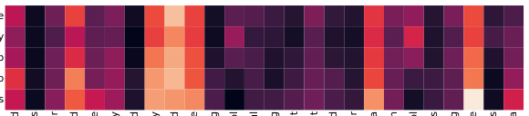
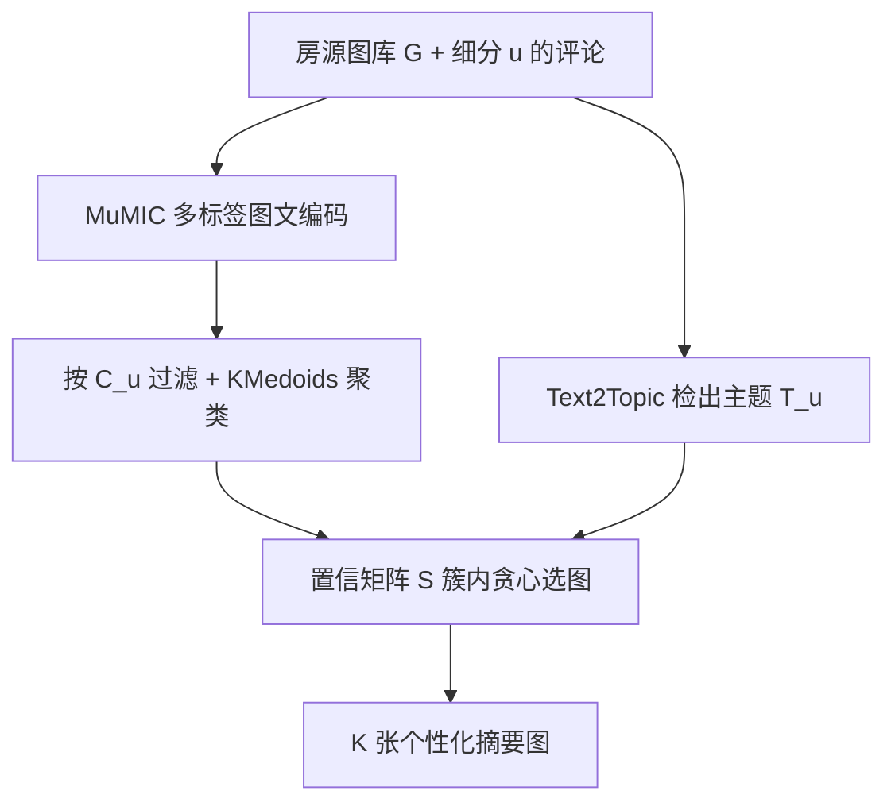
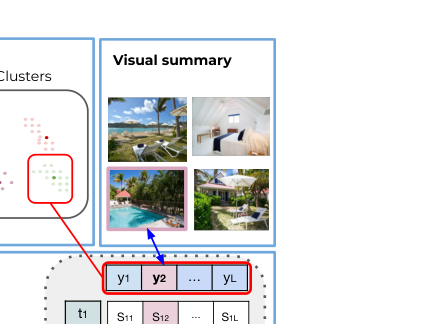

# Tell Me What Is Good About This Property: Leveraging Reviews For Segment-Personalized Image Collection Summarization (从评论中挖掘房源卖点：面向用户细分的图库个性化摘要)

- **会议/期刊**: AAAI 2024 (IAAI track)
- **作者与机构**: Monika Wysoczańska (Warsaw University of Technology)、Moran Beladev 等 (Booking.com)
- **推荐链路定位**: 展示素材选择（图库摘要，位于召回/展示前的离线内容生产环节）
- **研究方向**: 多模态推荐与内容理解
- **论文原文**: [论文原文链接](https://arxiv.org/abs/2310.19743v1)
- **开源代码**: [KMedoids 依赖实现](https://github.com/scikit-learn-contrib/scikit-learn-extra)（本文自研部分暂未开源）

## TL;DR (1分钟核心速览)

Booking.com 房源图库动辄数百张，用户难以快速定位与自己出行意图相关的视觉内容。本文提出 CrossSummarizer：MuMIC 多标签 CLIP 抽图像表征并按细分过滤，KMedoids 聚类保多样性，Text2Topic 从评论抽主题，用 $S_{ij}=\sigma(\exp(\gamma)\langle t_i,y_j\rangle)$跨模态匹配后按簇贪心选 Top-K。6000+ 真实房源、K=9 离线评测中 Coverage 较无个性化基线最高提升 25.5%，人类成对评测 0.66 vs 0.34（$p<5\times10^{-8}$）。

## Background & Motivation (背景与核心矛盾)

- **主流范式**: 图库摘要（image collection summarization）主流是子模最大化或聚类选代表，目标为「多样性 + 代表性」的基础稀释；近期出现 guided summarization（Kothawade et al. 2022），按显式 query 选图。
- **前人局限**: 其一，通用摘要不做个性化，同一房源对 Couple 与 Family 应展示完全不同的图；其二，guided 摘要依赖显式 query，而「我想找个能带娃放空的雪场酒店」这类意图无法转写成检索式 query，且人工标注个性化 ground-truth 成本极高。
- **核心洞察 (Key Insight)**: 评论是天然的零标注个性化信号。图 1 热力图显示，不同细分用户提及主题的排序差异显著——Family 高频出现 kids pool / babysitting，Couple 更关注 wine/champagne / spa，Business 关注 parking / private check-in，因此「细分评论主题分布」可充当隐式 query。
- **本文切入点**: 把个性化摘要等价为「文本引导的图像子集选择」，在统一多模态空间中让评论主题去挑图，全流程无监督、无人工标注。

<figure class="paper-figure" markdown="span">
  <figcaption>图1：从 Booking.com 上不同旅行者类型的评论中提取的最热门主题（x 轴）热力图。我们注意到，最常提及主题的排名在不同旅行者细分间存在差异，这使得评论成为用户细分个性化的重要信号。</figcaption>
</figure>

## Method (核心方法设计)

### 1. 整体框架 (Overall Architecture)

输入为房源图库 $G$与按细分$u$切片的评论文本。三阶段闭环：(a) MuMIC 同时输出图像 embedding$y_i\in\mathbb{R}^D$与多标签类别集合$C$，仅保留含$c\in C_u$（细分相关类）的图；(b) 对过滤后表征做余弦 KMedoids 聚类得到$K$簇；(c) Text2Topic 在细分$u$的评论上检出主题集$T_u$，计算置信矩阵$S$后在每个簇内贪心取 argmax、且一个主题只用一次，最终输出$K$ 张图。全流程离线批量预计算写入特征库存，线上仅读表。

<figure class="paper-figure" markdown="span">
  <figcaption>图2：我们的方法概览。首先，提取图像嵌入并将其聚类，得到 K 个语义分离的图像组（此处 K=4）。然后，对每个簇，计算簇内所有图像与从特定细分 u 的评论中提取的主题之间的相似度（此处 u=Couple）。最后，选出的图像是与任一主题相似度最高的图像。</figcaption>
</figure>

### 2. 关键设计拆解 (Key Designs)

1. **多标签跨模态表征 MuMIC（解决 CLIP 单标签 softmax 无法表达「一图多卖点」）**: CLIP 的 InfoNCE 强制一图对唯一文本，但房源图常同时含「大床 + 泳池 + 海景」。MuMIC 对每个候选类独立做 tempered sigmoid BCE：$\ell_{\text{BCE}}=-\frac{1}{N|C|}\sum_{i}\sum_{j}\left(p_j\hat{w}_{ij}\log\sigma(w_{ij})+(1-\hat{w}_{ij})\log(1-\sigma(w_{ij}))\right)$，其中$w_{ij}$为图像$x_i$与类文本$j$的余弦 logit，$p_j$为类$j$的正样本权重（抬高假阴性惩罚）。由此同一$y_i$ 可同时对多个主题高分，是后续「一主题挑一图」可行性的前提。
2. **簇内贪心主题匹配（解决「纯视觉聚类丢个性化」与「纯主题选择丢多样性」的两难）**: 若全局按主题 argmax 选 Top-K（TopicBased），会反复选同类特写导致 Div/Repr 崩塌；若只取簇心（Clust-W/P），则完全无视细分意图。CrossSummarizer 用 $S_{ij}=\sigma(\exp(\gamma)\cdot\langle t_i,y_j\rangle)$度量主题-图像对齐，并在每个 KMedoids 簇内独立取$\arg\max_{(i,j)\in\Omega_T\times\Omega_k}S_{ij}$ 后剔除已用主题，等价于「每簇必须贡献一张、且贡献的是该细分最关心的方面」，从而硬性保住簇间多样性。
3. **训练目标、负采样与推理效率**: 全程无监督，仅两处训练——MuMIC 的 BCE 与 Text2Topic 的 BCE（15,663 条正 (review, topic) 对 + 每对 5 个负主题，cross-encoder BERT 取 [CLS] 过 sigmoid，阈值 0.5）。选择阶段无需负采样打分，仅一次前向 + 一次 KMedoids；实测 GPU 上 MuMIC 处理 100 图约 170 ms、Text2Topic 处理 100 评论约 244 ms。

## Experimental Setup & Evaluation Protocol (实验设置与评估协议)

- **数据集与预处理**: 从 Booking.com 全站按国家、住宿类型、评分分层抽样 6000+ 真实房源，按图库/评论规模切两档：

| 数据集 | #Properties | #Images | #Reviews | 规模划分 | 说明 |
| :--- | :---: | :---: | :---: | :---: | :--- |
| Small | 3,230 | 232,560 | 251,943 | 图 50–100 张 / 评论 30–150 条 | 中小房源 |
| Big | 3,151 | 457,946 | 1,504,024 | 图 >100 张 / 评论 >150 条 | 大型房源 |

- **数据划分与防穿越**: 无用户级划分，采用**离线全量评测**（每个房源独立成样本），不存在时序穿越；评测在细分级别分层汇总。需注意这并非标准训练/测试切分，模型（MuMIC、Text2Topic）在站内全量数据上预训练后被直接用于评测样本。
- **排名评测协议**: **非检索式排名**，而是集合级摘要质量指标（$K=9$固定，对齐线上 Booking.com 展示位）：Diversity$\text{Div}=\frac{\max_{x_i,x_j\in G_s}d(x_i,x_j)}{\max_{x_l,x_m\in G}d(x_l,x_m)}$、Representativeness$\text{Repr}=\text{CosSim}(\mu_{G},\mu_{G_s})$、Coverage$\text{Cov}=\frac{1}{|C_u|}\sum_{c\in C_u}\frac{P_{G_s}(c)}{P_G(c)}$、Reviews Coverage$\text{RCov}=\frac{1}{|T_u|}\sum_{i}\frac{\max_{j\in\Omega_{G_s}}S_{ij}}{\max_{j\in\Omega}S_{ij}}$。
- **对比基线与超参**: 仅 3 个自实现基线——Default Clustering（无个性化簇心）、Clust-W/P（细分过滤 + 簇心）、TopicBased（纯主题全局 Top-K）；KMedoids 固定随机种子，主题数 45、阈值 0.5；人类评估为 210 样本、5 名标注者的成对盲测（tie 记 0.5），配对 t 检验。

## Key Experimental Results (实验关键数据)

### 1. 主实验对比 (Main Results)

| 方法 | Small Div↑ | Small Repr↑ | Small Cov↑ | Small RCov↑ | Big Div↑ | Big Repr↑ | Big Cov↑ | Big RCov↑ |
| :--- | :---: | :---: | :---: | :---: | :---: | :---: | :---: | :---: |
| Default Clustering | 0.947 | **0.931** | 0.516 | 0.581 | 0.925 | **0.929** | 0.430 | 0.488 |
| Clustering w/ Personalization | 0.903 | **0.931** | 0.578 | 0.656 | 0.932 | 0.928 | 0.487 | 0.521 |
| Topic-Based Personalization | 0.903 | 0.733 | 0.365 | 0.649 | 0.874 | 0.775 | 0.261 | **0.707** |
| **CrossSummarizer (Ours)** | **0.963** | 0.903 | **0.617** | **0.729** | **0.950** | 0.885 | **0.524** | 0.677 |
| **Improv. (vs Clust-W/P)** | +6.6% | −3.0% | +6.7% | +11.1% | +1.9% | −4.6% | +7.6% | +30.0% |

人类成对评测：CrossSummarizer 均分 $0.66\pm0.38$vs Clust-W/P$0.34\pm0.38$，配对 t 检验$t(209)=-5.537$，$p<5\times10^{-8}$；仅 Business 细分未占优。

### 2. 消融实验 (Ablation Study)

论文未单列消融表，但三个基线本身构成「逐模块增删」的等价消融（Small split）：

| 配置 | Div | Repr | Cov | RCov |
| :--- | :---: | :---: | :---: | :---: |
| 无个性化聚类（移除细分过滤 + 主题） | 0.947 | 0.931 | 0.516 | 0.581 |
| + 细分类别过滤（移除主题匹配） | 0.903 | 0.931 | 0.578 | 0.656 |
| + 主题匹配、移除聚类（纯文本驱动） | 0.903 | 0.733 | 0.365 | 0.649 |
| **完整 CrossSummarizer（两者兼得）** | **0.963** | 0.903 | **0.617** | **0.729** |

### 3. 关键实验发现 (Key Findings)

1. **细分类别过滤是 Coverage 的主引擎，且几乎零代价**: Small 上 $0.516\to0.578$（+12.0%）、Big 上$0.430\to0.487$（+13.3%），而 Repr 完全没变（0.931→0.931），说明 MuMIC 的类映射只剔除与细分无关的图（如 Business 房源删掉的儿童设施图），不扰动整体表征分布。
2. **纯文本驱动把 RCov 顶到最高却牺牲了视觉覆盖面**: TopicBased 在 Big 上 RCov 0.707 最高（因为该指标分子正是它直接优化的量），但 Repr 从 0.929 崩到 0.775、Cov 从 0.487 掉到 0.261；CrossSummarizer 用聚类硬约束把 Repr 拉回 0.885、Cov 拉到 0.524，仅让出 0.030 的 RCov，是全局最优折中。
3. **Div–Repr 存在明确 tradeoff，本文踩在甜点上**: 最高 Div（0.963 / 0.950）来自「每簇一图 + 过滤同质房型图」的双重硬约束；Repr 相对最优值仅降 2–5 个百分点，而人类评估证明用户更认可这种偏置（0.66 vs 0.34，$p<10^{-7}$），即视觉代表性略降换来的个性化收益被真实用户感知到。

## Highlights & Limitations (亮点、对比与审稿批判)

- **与代表作对比**: 相对 Tschiatschek et al. 2014 / Kothawade et al. 2022 的通用或 guided 摘要，本文首次把个性化落到**用户细分级**且用评论主题替代显式 query，彻底免标注；相对 CLIP 零样本匹配，MuMIC 的多标签 BCE 允许「一图对多主题」，这是能在一簇内做主题竞争的结构性前提。
- **可迁移亮点**: (1) 「聚类硬约束 + 跨模态主题打分」的组合可直接搬到电商商品主图优选、短视频封面选帧，兼顾多样性与意图对齐；(2) 用「评论主题分布的细分间差异」作为无需用户 ID 的个性化信号，对冷启动场景（无行为日志、仅有文本）尤其友好。
- **审稿级局限批判**: (1) 评测外部效度弱——数据集与自研模型均不公开，仅复用第三方 KMedoids，且核心指标 Cov/RCov 的分子与方法的优化目标同源，存在「指标迎合自身损失」的风险；线上 CTR A/B 尚未完成（作者自述 under experimentation），工业收益未被证实。(2) 细分粒度粗（5×5 类型），对新房源或评论稀疏样本存在冷启动，作者仅提出「借相似房源迁移」的设想而未验证；$K=9$、主题数 45、阈值 0.5 均固定，缺超参敏感性分析。

## Rating (四维评分)

- **方法创新性 (Novelty)**: ⭐⭐⭐ （把「细分个性化图库摘要」形式化为无监督文本引导子集选择，任务定义有新意；但方法论是 MuMIC + KMedoids + Text2Topic 的工程组合，缺少新学习范式或理论分析）
- **评估协议与实验扎实度 (Protocol & Experiments)**: ⭐⭐⭐ （6000+ 真实房源、两档规模分层、4 个自定义指标 + 210 样本人类成对评测与 t 检验较完整；但仅 3 个基线、无线上 A/B、指标与优化目标同源）
- **写作与数学规范度 (Clarity & Rigor)**: ⭐⭐⭐⭐ （算法伪代码与四个指标定义清楚，MuMIC/Text2Topic 均给出公式与训练细节；$w_{ij}$与$p_j$ 的符号在正文略简，需回查原文献）
- **工业落地与复现价值 (Industrial & Practical Value)**: ⭐⭐⭐⭐ （已落地 Booking.com CIP/Flink 流式流水线，离线预计算 + 线上零额外延迟，窗口聚合设计有工程参考价值；但数据与自研模型未开源，复现门槛高）

