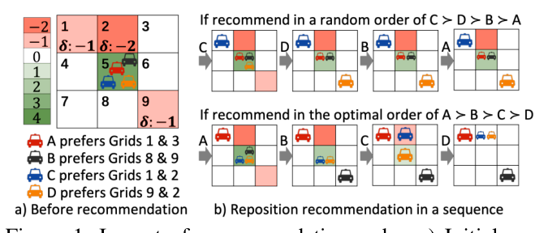
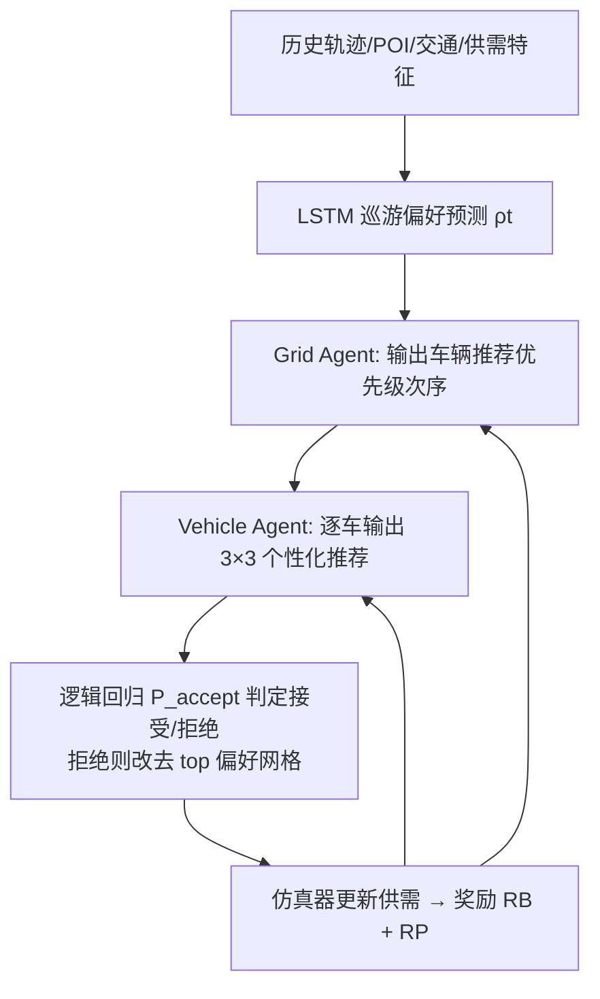
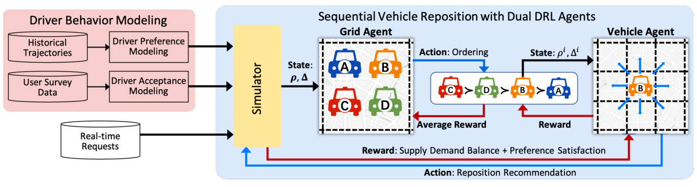

# i-Rebalance: Personalized Vehicle Repositioning for Supply Demand Balance (面向供需平衡的个性化车辆再定位推荐)

- **会议/期刊**: AAAI 2024
- **作者与机构**: Haoyang Chen, Peiyan Sun, Qiyuan Song, Wanyuan Wang, Weiwei Wu, Wencan Zhang, Guanyu Gao, Yan Lyu（东南大学、新加坡国立大学、南京理工大学）
- **推荐链路定位**: 端到端策略决策（空闲车辆再定位调度，处于派单匹配的上游）
- **研究方向**: 时空轨迹与 POI 本地生活推荐 / 强化学习与动态探索推荐
- **论文原文**: [https://arxiv.org/abs/2401.04429v2](https://arxiv.org/abs/2401.04429v2)
- **开源代码**: [https://github.com/Haoyang-Chen/i-Rebalance](https://github.com/Haoyang-Chen/i-Rebalance)

## TL;DR (1分钟核心速览)

现有网约车再定位（vehicle reposition）方法把司机当作**同质的、必然服从指令**的智能体，忽视了司机各自独特的巡游偏好与"可拒绝推荐"这一现实约束。本文提出 i-Rebalance：先用 99 名真实司机的实地问卷拟合出接单概率逻辑回归模型，再用轻量 LSTM 预测个体 3×3 邻域巡游偏好；核心是一个**顺序化双 DRL 框架**——Grid Agent 先学"本网格内空闲车辆的推荐先后次序"，Vehicle Agent 再按该次序逐车给出个性化推荐，把 $9^n$的联合动作空间压成$n+1$。在成都真实出租车轨迹仿真（500 车 / 243,679 单）上，司机接受率由 66.48%（最强基线）升至 84.43%，总收入相对无调度提升 9.97%。

## Background & Motivation (背景与核心矛盾)

- **主流范式**: 用 DRL 集中式或分散式地为空闲车辆分配再定位目的地（Contextual DDQN、比例重分配、Min-Cost-Flow、层次 RL 等），目标函数几乎只写"供需缺口最小化"。
- **前人局限**: 其一，所有方法假设司机**无条件执行**推荐，一旦司机拒绝，策略环境模型就此失真；其二，即便考虑偏好（By Collective Preference），也只统计**群体**历史访问热度，无法刻画"同一网格内四个司机各有各的偏好网格"这种个体差异。
- **核心洞察 (Key Insight)**: 作者用图 1 给出关键现象——在司机可拒绝的前提下，**推荐的先后顺序本身就会改变最终供需均衡**：先推荐偏好匹配度高的司机（A≻B≻C≻D），四车都落到各自满意的稀缺网格；顺序反过来（C≻D≻B≻A），则后面的 B、A 直接拒单原地不动，缺口 δ 无法填补。顺序是被前人完全忽略的决策变量。
- **本文切入点**: 把"派谁去哪"的联合动作拆成"先定序、再逐车个性化推荐"的两级顺序决策，让动作空间从指数级降到线性级，同时用真实问卷把"接受/拒绝"显式建进仿真器。

<figure class="paper-figure" markdown="span">
  <figcaption>图 1：推荐顺序的影响。a) 初始场景：在 Grid 5 中推荐四辆空闲车辆。每辆车偏好两个相邻网格，拒绝非偏好选项以停留在当前网格。供需缺口 δ 用颜色编码：红色表示短缺，绿色表示空闲车辆过剩。b) 两种推荐顺序 C ≻D ≻B ≻A（上排）和 A ≻B ≻C ≻D（下排）由于驾驶员偏好多样，导致不同的供需平衡。</figcaption>
</figure>

## Method (核心方法设计)

### 1. 整体框架 (Overall Architecture)

模型分两阶段闭环。**阶段一（司机行为建模）**: 以司机自身工作时长、收入、到 POI 距离、交通与供需特征的历史窗口为输入，两层 LSTM 输出其访问 3×3 邻域九宫格的概率向量 $\rho_t$；接单决策则由问卷拟合的二项逻辑回归给出接受概率$P_{\text{accept}}$，二者共同构成"可拒绝"的仿真司机。**阶段二（顺序再定位）**: 每个时间步按径向顺序遍历网格，Grid Agent 观测邻域供需缺口$\Delta_{t+1}$与本网格全部司机偏好，输出优先级打分从而排出推荐次序；Vehicle Agent 按序逐车观测"已被前序司机决策更新过的实时缺口$\Delta^i_{t+1}$"与该车偏好$\rho^i_t$，输出九宫格之一的推荐；司机依$P_{\text{accept}}$ 决定执行或改去自己最偏好的网格。两智能体共用 A2C 网络结构，分别从各自回放池更新。

<figure class="paper-figure" markdown="span">
  <figcaption>图 2：i-Rebalance 概览。i-Rebalance 包括两个阶段：1）驾驶员行为建模通过预测驾驶员的巡游偏好和重新定位接受概率，模拟真实的驾驶员决策；2）双 DRL 智能体的顺序车辆再定位与模拟器交互。网格智能体观察附近的供需缺口 ∆ 和驾驶员偏好 ρ，并确定网格内空闲车辆的重新定位顺序，例如 C ≻D ≻B ≻A。按此顺序，车辆智能体观察驾驶员 i 的个体偏好 ρi 和实时更新的供需缺口 ∆i，并推荐……</figcaption>
</figure>

### 2. 关键设计拆解 (Key Designs)

1. **问卷驱动的接单概率模型（把"人"写进仿真器）**: 前人直接假设服从，环境模型与真实世界脱节。作者招募 99 名滴滴司机（11 个地点，工作年限 0.1–8 年）做 3×10 道决策题，得到显著三因子模型
 $P_{\text{accept}} = 1/(1+\exp(-(b + w_r r + w_m m + w_o o)))$，
 其中 $r$为推荐目的地在司机自评偏好中的排名、$m$为预期收入、$o$为固有服从度，拟合值$b=-1.31, w_r=-0.44, w_m=0.29, w_o=2.17$（$R^2=0.379$，AUC$=0.8266$）。直觉很清楚：**推荐排名越靠后越易被拒**（$w_r<0$），这直接解释了为什么"个性化"能换来真实服从。
2. **双智能体顺序再定位（用定序换取小动作空间）**: 联合动作 $\vec a\in 9^n$无法训练，逐车决策又因司机可拒绝而使次序影响结果。于是 Grid Agent 的动作定义为优先级向量$A_G=(a_1,\dots,a_n)$，按分数降序决定处理顺序；Vehicle Agent 的状态为$S^i_V=\langle \Delta^i_{t+1}, \rho^i_t\rangle$，动作$a^i_V$ 为九宫格之一。奖励拆成两项：
 $R^i_B = -(\delta^{a^i_V}_{t+1}-\mu_g)/\sigma_g,\quad R^i_V=\alpha_B R^i_B + \alpha_P R^i_P$，
 即"缺口标准化负值"+"偏好排名的 min-max 归一化"，$\alpha_B=2,\alpha_P=1$。Grid Agent 领取全部车辆奖励的均值$R_G$，从而"为承接能力强的司机优先派单"这一行为被自动学出来。作者还给出 **Theorem 1**：给定网格状态，顺序策略可达到与最优联合动作相同的期望即时奖励，为拆分提供了理论正当性。
3. **训练目标、负采样与推理效率**: 两个 A2C actor-critic（各两层 64 维全连接 + ReLU，Grid 用 softmax、Vehicle 用 sigmoid），熵系数 0.01、$\gamma=0.98$、batch 10、Adam；无负采样概念（非排序检索任务），探索靠策略熵。推理时每网格只需一次定序 +$n$次前向，动作空间由$9^n$降为$9n$ 量级，可实时在线执行。

## Experimental Setup & Evaluation Protocol (实验设置与评估协议)

- **数据集与预处理**: 成都真实出租车轨迹（原始 14,865 车 / 10,710,949 单，一月），为效率采样 500 车 / 243,679 需求；路网取自 OpenStreetMap，市中心纬度 30.62–30.69、经度 107.01–107.11。

| 数据集 | #Drivers | #Grids(1.2km²) | #Requests | 时间粒度 | 特征/场景说明 |
| :--- | :---: | :---: | :---: | :---: | :--- |
| Chengdu Taxi (Lyu et al. 2019) | 500 | 市中心网格化 | 243,679 | 10 min/步 | 司机状态、POI 距离、交通、供需缺口；接单按最近空闲车派单，Dijkstra 最短路 |

- **数据划分与防穿越 (Splitting Strategy)**: 非传统 train/test 划分，而是**"一天 = 一个 episode"的仿真回放**：需求序列按原始时间戳采样，司机起点与上线时间按数据初始化，避免用未来需求预测当期（需求预测由 RGC 网络给出 $t+1$ 估计）。
- **排名评测协议 (Ranking Protocol)**: 不使用 Full-Ranking / Sampled Ranking；评测为**全城仿真级指标**——TDI（归一化总司机收入）、RI/TDI（再定位贡献占比）、RRR（请求响应率）、Acceptance Rate（接受推荐比例）、#Repos（实际发生的跨格再定位次数，衡量调度成本）。
- **对比基线与超参设置**: 8 个基线覆盖非学习（No Reposition / Random / Demand Greedy / Reward Greedy / Min Cost Flow）与学习式（Contextual DDQN / Proportional Reposition / By Collective Preference）；仿真器基于 Liu et al. 2020 开源框架扩展。未报告显著性检验，结果为多次仿真的点估计。

## Key Experimental Results (实验关键数据)

### 1. 主实验对比 (Main Results)

| 方法 | Norm. TDI | RI/TDI | RRR | Accept. Rate | #Repos |
| :--- | :---: | :---: | :---: | :---: | :---: |
| No Reposition | 100.00% | N/A | 72.15% | N/A | 10,733 |
| Random | 103.02% | 88.85% | 73.60% | 48.39% | 9,691 |
| Demand Greedy | 101.81% | 85.73% | 73.11% | 45.44% | 11,061 |
| Reward Greedy | 102.03% | 87.36% | 73.27% | 50.50% | 10,828 |
| Min Cost Flow | 103.00% | 87.48% | 73.46% | 44.68% | 7,700 |
| Contextual DDQN | 102.46% | 87.44% | 73.33% | 46.07% | 10,866 |
| Proportional Reposition | 102.59% | 88.20% | 73.60% | 22.96% | 6,749 |
| By Collective Preference | 109.00% | 95.28% | 77.29% | 66.48% | 6,803 |
| **i-Rebalance** | **109.97%** | **98.70%** | **78.35%** | **84.43%** | **6,625** |
| Improv. (vs 最强基线) | +0.97pp | +3.42pp | +1.06pp | **+17.95pp** | −178 |

### 2. 消融实验 (Ablation Study)

| 变体 | Norm. TDI | RI/TDI | Accept. Rate | 说明 |
| :--- | :---: | :---: | :---: | :--- |
| Fixed-Order | 109.89% | 98.50% | 83.40% | 按偏好-缺口 Pearson 相关定序 |
| Random-Order | 109.77% | 98.44% | 83.31% | 随机次序 |
| Joint-Action | 103.15% | 90.18% | 52.53% | 单智能体联合动作 |
| **i-Rebalance** | **109.97%** | **98.70%** | **84.43%** | 学到的定序 |
| RNP-SNP | 109.37% | 95.69% | 67.95% | Vehicle 端无偏好状态、无偏好奖励 |
| RP-SNP | 109.40% | 95.75% | 68.11% | 仅有偏好奖励 |
| RNP-SP | 109.73% | 98.29% | 81.65% | 仅有偏好状态 |
| **RP-SP (完整)** | **109.97%** | **98.70%** | **84.43%** | 状态+奖励双通道 |

### 3. 关键实验发现 (Key Findings)

1. **收益主要落在"接受率"而非"总收入"**: 相对无调度，TDI 提升 9.97%；但相对最强基线 By Collective Preference 仅 +0.97pp，真正的跃迁在接受率 66.48%→84.43%（+17.95pp）与 RI/TDI 95.28%→98.70%，且 #Repos 反而更少（6,803→6,625），说明方法把"无效硬派"换成了"高命中推荐"。
2. **顺序学习是主要增益来源之一，联合动作是最差设计**: 换成 Joint-Action 后 TDI 骤降至 103.15%、接受率跌到 52.53%（−31.9pp），直接印证 $9^n$ 动作空间下策略根本训不动；而 Fixed-Order/Random-Order 仅比完整模型低约 0.1–1.0pp，说明**只要保住了逐车个性化，"定序"本身的精细程度影响有限**——这是对被 Greedy 强调的"顺序关键论"的一次温和修正。
3. **偏好信息放在"状态"里远比放在"奖励"里有效**: RNP-SP（仅观测偏好）接受率 81.65%，RP-SNP（仅奖励偏好）只有 68.11%，差 13.5pp；两者同时缺失则跌到 67.95%。即偏好必须作为策略的**条件输入**参与决策，而非仅靠奖励项事后激励，否则策略学到的是"平均最优"而非"因人而异"。

## Highlights & Limitations (亮点、对比与审稿批判)

- **与代表作对比 (vs. Prior Work)**: 与 Contextual DDQN（把前序决策编码进后继观测，仍假设服从）本质不同在于**显式引入"拒绝"这一动作**；与 Proportional Reposition（按比例分配同质车辆，动作空间小但抹平个体）不同在于**以顺序化换维度**；与 By Collective Preference（群体热度偏好、接受率 66.48%）不同在于**个体级偏好条件化**，接受率高出近 18pp。
- **可迁移亮点**: ①"先定序、再逐项个性化决策"是缓解组合动作爆炸的通用范式，可迁移到列表级重排、多物品捆绑推荐与多智能体资源分配；②用低成本实地问卷把"用户服从概率"拟合成轻量逻辑回归并接入仿真环境，比纯假设服从的离线 RL 更接近线上分布，值得任何"推荐—反馈"闭环借鉴。
- **审稿级局限批判**: ①**离线仿真闭环验证**——问卷只有 99 人、单一城市（成都）、逻辑回归 $R^2$ 仅 0.379，且司机拒绝后"随机去 top-4 偏好网格"的仿真假设未经检验，真实上线收益存疑；②对最强基线 TDI 仅 +0.97pp、RRR 仅 +1.06pp，改进幅度在无显著性检验的多次仿真点估计下是否稳定不明；③调度收益与再定位成本、司机绕路油耗未纳入奖励，且 LSTM 偏好预测在无历史冷启动司机上的退化未讨论。

## Rating (四维评分)

- **方法创新性 (Novelty)**: ⭐⭐⭐⭐ （把"推荐顺序"提炼为被忽视的决策变量，并以 Theorem 1 证明顺序策略不劣于联合动作，问题建模新颖；双 A2C 结构本身较常规）
- **评估协议与实验扎实度 (Protocol & Experiments)**: ⭐⭐⭐ （真实轨迹 + 99 人实地问卷是难得的真实数据支撑，8 个基线覆盖充分、两组消融设计到位，但仅有单城市离线仿真、无线上 A/B、无显著性检验）
- **写作与数学规范度 (Clarity & Rigor)**: ⭐⭐⭐⭐ （问题定义—行为建模—奖励设计—算法—定理链条完整，公式符号自洽，代价是偏好预测网络与特征工程细节被推入附录）
- **工业落地与复现价值 (Industrial & Practical Value)**: ⭐⭐⭐⭐ （动作空间从指数降为线性、代码已开源、推理仅需两次小网络前向，具备实时上线条件；但收益依赖问卷本地化与司机服从性建模，跨平台迁移需重新标定）

