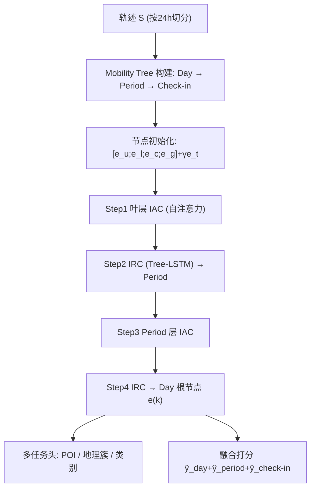
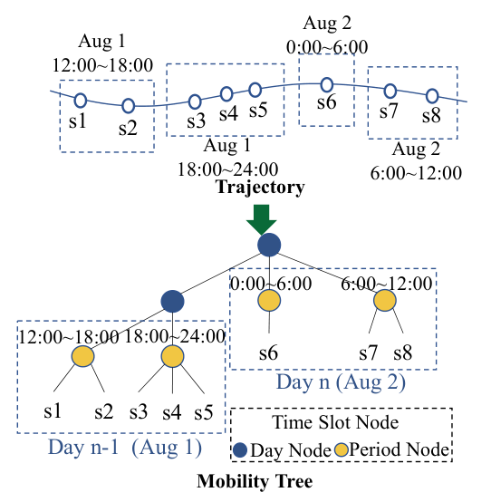
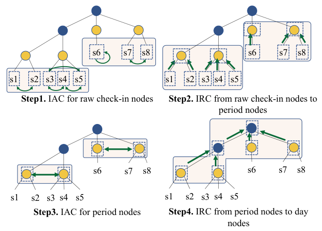

# Learning Time Slot Preferences via Mobility Tree for Next POI Recommendation (基于移动树学习时段偏好的下一兴趣点推荐)

- **会议/期刊**: AAAI 2024
- **作者与机构**: Tianhao Huang, Xuan Pan, Xiangrui Cai, Ying Zhang, Xiaojie Yuan（南开大学计算机学院、网络安全学院等）
- **推荐链路定位**: 端到端召回（Next-POI 全库排序）
- **研究方向**: 时空轨迹与 POI 本地生活推荐 / 序列与会话推荐
- **论文原文**: [https://arxiv.org/abs/2403.12100v1](https://arxiv.org/abs/2403.12100v1)
- **开源代码**: [https://github.com/Skyyyy0920/MTNet](https://github.com/Skyyyy0920/MTNet)

## TL;DR (1分钟核心速览)

现有 Next-POI 模型只用"签到先后顺序"或"全局转移图"建模，无法区分用户在同一天内不同时段（午间/午后/夜间）的差异化偏好，也对"休息日 vs 工作日"轨迹崩塌无能为力。本文把轨迹重构成 **Mobility Tree**（日节点→时段节点→签到叶节点），用四步 IAC/IRC 节点交互自底向上传播信息，并以不确定性加权多任务学习联合预测 POI/类别/地理簇。在 NYC/TKY/CA 三个 LBSN 数据集上（80/10/10 时序划分、全库排序） Acc@1 相对最强基线 GETNext 提升 7.60%/14.24%/9.45%，CA 上 MRR 提升 12.55%。

## Background & Motivation (背景与核心矛盾)

- **主流范式**: 以 RNN/LSTM（ST-RNN、STGN、CFPRec）、自注意力（STAN、PLSPL）或全局转移图（GETNext、Graph-Flashback）编码签到序列的先后依赖与时空转移关系。
- **前人局限一**: 偏好被建模为"时间点"的函数而非"时间段"的函数；图 1 中 Mary 在 14:00–18:00 逛商场/影院，Peter 在同一窗口逛书店，同一时刻不同用户偏好截然不同，序列模型无法解耦。
- **前人局限二**: 日粒度不足以刻画行为漂移。同一用户休息日轨迹为"影院–商场–超市–餐厅"，工作日为"公司–咖啡–超市–公寓"；以"超市"为尾节点时，休息日下一跳为餐厅、工作日为公寓，纯序列结构无法区分。
- **核心洞察 (Key Insight)**: 用户对同一 POI 的到访时间窗集中在约 2 小时（TKY 数据实证），因此"时段"才是偏好的自然粒度，且该粒度应与签到时间戳密度匹配（TKY/CA 取 12 段、NYC 取 4 段最优）。
- **本文切入点**: 用一棵多粒度时段节点构成的树替代序列/图，把"日–时段–签到"三层语义显式编码进结构先验。

## Method (核心方法设计)

### 1. 整体框架 (Overall Architecture)

对用户 $u$的轨迹$S^u_m=\{s_1,\dots,s_k\}$（按 24 小时切分），先按"日节点→时段节点→签到叶节点"构树：日内 24 小时被均匀划为$N$段，每段一个 period 节点承载该时段的签到，其父节点为该日 day 节点。节点初始化后进入四步交互：叶层 IAC 做同父兄弟自注意力 → IRC 用 N 元 Tree-LSTM 聚合到 period 节点 → period 层 IAC → IRC 聚合到唯一的根（day 节点）。根表征$e^{(k)}$ 同时送入 POI/地理簇/类别三头预测，并做多任务联合优化。推理时把根节点、当前时段节点、最近签到的打分加权融合输出全库排序。

<figure class="paper-figure" markdown="span">
  <figcaption>图2：Mobility Tree构建示意图。</figcaption>
</figure>

### 2. 关键设计拆解 (Key Designs)

1. **Mobility Tree 与多粒度时段节点**：痛点是用"时间点+顺序"无法表达"时段专属偏好"。做法是把时段抽象为**可学习的层级节点**而非特征拼接：叶节点为原始签到，中间层为固定长度时段槽位，根为整天。这样同一 POI 在不同 period 节点下会获得**不同的上下文表征**，物理直觉是"时段节点充当了软性的行为聚类中心"，把稀疏的个体签到按时间语义对齐到共享偏好空间。

2. **四步 IAC/IRC 节点交互**：传统 GNN 只有同质邻居聚合，无法处理"父节点需聚合变长子节点"的树拓扑。本文定义两种算子：IAC（层内通信）在同父兄弟间跑多头自注意力以捕捉同段内的 POI 共现；IRC（层间通信）用 N 元 Tree-LSTM 门控融合子节点：

$$c = i \odot u + \sum_{\ell=1}^{N} f_\ell \odot c_\ell,\qquad e'' = o \odot \tanh(c)$$

其中遗忘门 $f_\ell$ 对每个子节点单独参数化，使模型能对不同时段槽位做差异化加权；四步交替执行即完成"签到→时段→日"的自底向上信息汇聚。之所以有效：IAC 解决段内共现歧义，IRC 解决段间与日间的重要性分配。

<figure class="paper-figure" markdown="span">
  <figcaption>图4：四步节点交互。</figcaption>
</figure>

3. **多任务不确定性加权 + 分层打分融合**：辅助任务（地理簇 k-means 60 类、POI 类别）作为归纳偏置缓解长尾 POI 稀疏；采用可学习同方差不确定性加权而非手工调权：

$$\mathcal{L}=\frac{1}{2\sigma_l^2}\mathcal{L}_l+\frac{1}{2\sigma_g^2}\mathcal{L}_g+\frac{1}{2\sigma_c^2}\mathcal{L}_c+\log\sigma_l\sigma_g\sigma_c$$

推理端融合三源偏好 $\hat{y}^{rec}_l=\eta\hat{y}^{day}_l+\delta\hat{y}^{period}_l+\hat{y}^{check\text{-}in}_l$（$\eta=\delta=1$），分别对应长期日程、当前时段、即时转移。**训练负采样**：全库 softmax 交叉熵（无显式负采样），batch=1024，Adam lr=$1\times10^{-3}$，embedding$d=128$（类别/地理 32，Tree-LSTM 隐藏 512），50 epochs；推理仅需一次前向，无图检索开销。

## Experimental Setup & Evaluation Protocol (实验设置与评估协议)

| 数据集 | #Users | #Items(POI) | #Interactions | 密度 | 特征/场景说明 |
| :--- | :---: | :---: | :---: | :---: | :--- |
| NYC | 1,075 | 5,099 | 104,074 | 1.90% | Foursquare，单城密集、14,160 条轨迹 |
| TKY | 2,281 | 7,844 | 361,430 | 2.02% | Foursquare 东京，签到量最大、44,692 轨迹 |
| CA | 4,318 | 9,923 | 250,780 | 0.59% | Gowalla 加州+内华达，跨州大范围、最稀疏 |

- **过滤与划分**: 剔除签到 <10 的用户与被访问 <10 次的 POI；按 24 小时切分为轨迹并丢弃长度 <2 的轨迹；训练/验证/测试 = **按时间顺序 80%/10%/10% 比例划分**（严格防穿越）。
- **排名评测协议**: **Full-Ranking**——模型对全部 $|\mathcal{L}|$ 个候选 POI 输出概率并取 Top-k，指标 Acc@1/5/10 与 MRR。
- **对比基线**: 共 10 个 SOTA，覆盖 MF-Markov（FPMC）、度量嵌入（PRME）、RNN 系（LSTM、ST-RNN、STGN、STGCN）、注意力系（PLSPL、STAN）、多偏好/图系（CFPRec、GETNext）。
- **超参**: 时段节点数 TKY/CA=12、NYC=4（验证集选择）；Transformer 2 层 2 头；dropout 0.4/0.6。

## Key Experimental Results (实验关键数据)

### 1. 主实验对比 (Main Results)

| Model | NYC Acc@1 | NYC MRR | TKY Acc@1 | TKY MRR | CA Acc@1 | CA MRR |
| :--- | :---: | :---: | :---: | :---: | :---: | :---: |
| ST-RNN | 0.1483 | 0.2198 | 0.1409 | 0.2212 | 0.0799 | 0.1429 |
| STGN | 0.1716 | 0.2598 | 0.1689 | 0.2422 | 0.0810 | 0.1675 |
| STGCN | 0.1799 | 0.2788 | 0.1716 | 0.2504 | 0.0961 | 0.1712 |
| PLSPL | 0.1917 | 0.2806 | 0.1889 | 0.2542 | 0.1072 | 0.1847 |
| CFPRec | 0.1692 | 0.2680 | 0.2052 | 0.2963 | 0.0473 | 0.0911 |
| STAN | 0.2231 | 0.3253 | 0.1963 | 0.2852 | 0.1104 | 0.1869 |
| GETNext | 0.2435 | 0.3621 | 0.2254 | 0.3262 | 0.1357 | 0.2103 |
| **MTNet** | **0.2620** | **0.3855** | **0.2575** | **0.3659** | **0.1453** | **0.2367** |
| **Improv.** | +7.60% | +6.46% | +14.24% | +12.17% | +9.45% | +12.55% |

（Acc@10 亦全面领先：NYC 0.6321 / TKY 0.5848 / CA 0.4163，相对 GETNext 分别 +2.90%/+10.61%/+15.96%。）

### 2. 消融实验 (Ablation Study)

| 变体 (TKY) | Acc@1 | Acc@5 | Acc@10 | MRR |
| :--- | :---: | :---: | :---: | :---: |
| Full Model | **0.2575** | **0.4977** | **0.5848** | **0.3659** |
| w/o multitask（损失直接求和） | 0.2410 | 0.4770 | 0.5631 | 0.3499 |
| w/o coo（去地理簇预测） | 0.2353 | 0.4766 | 0.5595 | 0.3453 |
| w/o cat（去类别预测） | 0.2398 | 0.4799 | 0.5659 | 0.3484 |
| w/o coo&cat（去双辅助任务） | 0.2377 | 0.4791 | 0.5669 | 0.3474 |
| w/o IAC（去层内通信） | 0.2353 | 0.4757 | 0.5631 | 0.3469 |
| w/o IRC（去层间通信） | 0.2391 | 0.4713 | 0.5504 | 0.3453 |
| w/o node（去 period/check-in 打分） | 0.2478 | 0.4806 | 0.5686 | 0.3567 |

### 3. 关键实验发现 (Key Findings)

1. **时段交互算子是绝对主力**：移除 IAC / IRC 使 Acc@1 分别下跌 8.63% / 7.14%，远超辅助任务模块的 4.52% 平均跌幅，说明性能增益主要来自树结构的信息传播而非多任务正则。
2. **数据越稀、轨迹越长，树结构收益越大**：CA 密度仅 0.59%、平均训练轨迹长 8.68（NYC 7.55、TKY 8.22），MTNet 在 CA 上 Acc@1/Acc@10/MRR 相对提升 9.45%/15.96%/12.55%，为三数据集最高，验证了"多粒度时段切分可提升稀疏场景下的样本利用率"。
3. **时段数是强敏感超参且可与数据统计对齐**：TKY 上 12 段（2 小时/段）时 Acc@1 达 0.2575 峰值，而 2/3 段或 20/24 段均显著下降；该最优值与"用户访问同一 POI 的时间窗约 2 小时"的实证统计吻合，说明时段粒度应按签到时间戳密度而非固定先验设定。

## Highlights & Limitations (亮点、对比与审稿批判)

- **与代表作对比**: 相比 STAN/PLSPL 的注意力加权与 GETNext 的轨迹流图，MTNet 的本质差异是把"时间"从**特征**升格为**结构节点**，使偏好表征按时段解耦；相比 LSTPM 的长短期分离，本文用树层级天然实现"日=长期、时段=中期、签到=短期"的三级分解，无需额外设计双通道。
- **可迁移亮点**: (i) 把连续时间戳离散化为可学习层级节点，可迁移到电商"大促时段/工作日 vs 周末"或短视频"早高峰/深夜"的时段偏好解耦；(ii) 不确定性加权多任务损失 $\sum \frac{1}{2\sigma_i^2}\mathcal{L}_i+\log\prod\sigma_i$ 可低成本替换手工调权的辅助任务。
- **审稿级局限批判**: (i) 树结构**按固定时间槽硬划分**，跨槽位的长时间停留（如 3 小时逛商场横跨两个 period）会被切断，且时段数需针对每个数据集调参（NYC=4 vs TKY=12），冷启动新城市缺乏自动定参机制；(ii) 只做离线 Full-Ranking，未报告训练/推理时延与 Tree-LSTM 递归构建开销，也未验证"同日多日聚合窗口长度"的敏感性，工业部署（在线请求需实时构树）成本不明。

## Rating (四维评分)

- **方法创新性 (Novelty)**: ⭐⭐⭐⭐ （将时段偏好由特征工程升格为树结构先验，IAC/IRC 双算子设计贴合树拓扑，但自注意力与 Tree-LSTM 均为成熟组件重组）
- **评估协议与实验扎实度 (Protocol & Experiments)**: ⭐⭐⭐⭐ （三数据集 + 10 个 SOTA + 全库 Full-Ranking + 严格时序划分，消融覆盖 7 个变体，但缺少显著性检验与效率对比）
- **写作与数学规范度 (Clarity & Rigor)**: ⭐⭐⭐⭐ （四步交互图示清晰、公式完整，但 IRC 中 Tree-LSTM 与 IAC 的组合缺少复杂度分析与收敛性讨论）
- **工业落地与复现价值 (Industrial & Practical Value)**: ⭐⭐⭐⭐ （代码已开源、结构轻量、无图检索依赖，但逐请求动态构树与时段数调参对线上工程仍有一定改造成本）

