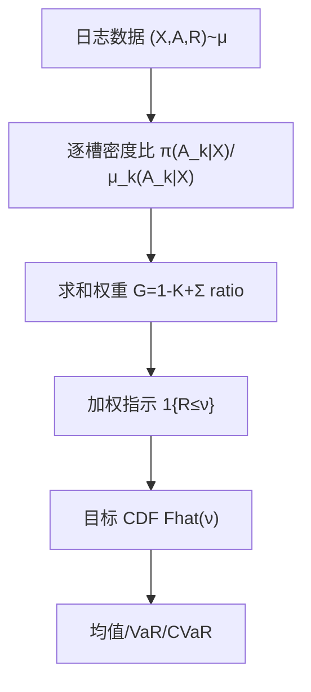

# Distributional Off-Policy Evaluation for Slate Recommendations（面向 Slate 推荐的分布型离线策略评估）

- **会议/期刊**: AAAI 2024
- **作者与机构**: Shreyas Chaudhari (UMass Amherst)；David Arbour, Georgios Theocharous, Nikos Vlassis (Adobe Research)
- **推荐链路定位**: 重排/列表推荐的离线策略评估（非在线排序模型）
- **研究方向**: 强化学习与动态探索推荐
- **论文原文**: [arXiv:2308.14165v2](https://arxiv.org/abs/2308.14165v2)
- **开源代码**: [shreyasc-13/suno](https://github.com/shreyasc-13/suno)

## TL;DR (1分钟核心速览)

针对 slate 推荐组合动作空间下现有 OPE 只能估期望、难以估完整风险分布的问题，本文提出 SUnO：用槽级密度比之和替代整条 slate 的乘积重要性权重，在可加 CDF 假设下得到目标策略奖励分布的无偏一致估计。合成数据与 MovieLens-20M/OBP 模拟器上，KS 与均值 MSE 相比 UnO 降低约 40%–60%，方差更小、样本效率更高。

## Background & Motivation (背景与核心矛盾)

- **主流范式**: 将 slate 推荐建模为组合动作 contextual bandit，用 IPS/DR 或结构化奖励估计器评估目标策略的期望奖励。
- **前人局限**: 组合动作空间使整条 slate 的 IPS 权重方差极高；UnO 虽能估完整奖励分布，但仍用槽级密度比乘积，方差随槽数指数增长。仅估期望无法支撑 VaR、CVaR 等风险/公平性指标。
- **核心洞察 (Key Insight)**: 若 slate 奖励的条件 CDF 可对槽位可加分解，则可用“槽级密度比之和”代替“乘积”，在保持无偏性的同时把方差从指数级压到线性级。
- **本文切入点**: 将 UnO 的分布型 OPE 框架与 slate 奖励可加结构结合，提出 SUnO 估计器。

## Method (核心方法设计)

### 1. 整体框架 (Overall Architecture)

输入为日志策略 $\mu$采集的$n$条$(X,A,R)$，$A$由$K$个槽位动作组成。SUnO 不训练新排序模型，而是对每个样本计算槽级密度比之和$G$，再用$G$对指示函数$\mathbb{I}\{R\le\nu\}$加权，得到目标策略$\pi$下奖励 CDF 在阈值$\nu$的估计；对$\nu$的离散网格重复即可得完整 CDF，再计算均值、VaR、CVaR。全过程无梯度更新，单阈值复杂度$O(nK)$，适合上线前离线风控评估。

### 2. 关键设计拆解 (Key Designs)

1. **槽级和权重替代乘积权重**: 痛点在于整条 slate 的 $\rho=\prod_k \pi(A_k|X)/\mu_k(A_k|X)$会因任一槽概率过小而使权重爆炸。SUnO 假设$F_R(\nu)=\sum_{k=1}^{K}\psi_k(A_k,X,\nu)$，构造
   $G=1-K+\sum_{k=1}^{K}\frac{\pi(A_k|X)}{\mu_k(A_k|X)}$。
   因 $\mathbb{E}_\mu[G]=1$，故$\mathbb{E}_\mu[G\mathbb{I}\{R\le\nu\}]=F^\pi(\nu)$。直觉是把整条 slate 的联合重要性拆成 K 个槽位边缘贡献之和，避免“一槽为 0、整条样本失效”。

2. **m-slot 分解推广**: 若 CDF 可分解为 m 个槽的联合项，权重推广为
   $G_m=\sum_{1\le k_1<\cdots<k_m\le K}\left(\prod_{i=1}^{m}\frac{\pi(A_{k_i}|X)}{\mu_{k_i}(A_{k_i}|X)}-1\right)+1$。
   $m=1$是主用情形；$m=K$ 退化为 UnO 的乘积权重，说明 SUnO 是 UnO 在结构化奖励上的泛化。

3. **估计目标与推理效率**: 无训练损失、无负采样；每个 $\nu$ 只需一遍日志加权计数：
   $\hat F_n^\pi(\nu)=\frac{1}{n}\sum_{i=1}^{n}G_i\mathbb{I}\{R_i\le\nu\}$。
   对 CDF 线性泛函（均值）无偏，对 VaR/CVaR 等非线性泛函仅一致但样本估计有偏。最坏方差 $\mathrm{Var}(\mathrm{SUnO})=O(K/\epsilon)$，UnO 为$O(\epsilon^{-K})$；离线评估开销随$nK$ 线性增长。

## Experimental Setup & Evaluation Protocol (实验设置与评估协议)

| 数据集/模拟器 | #Users | #Items/动作 | #Interactions/样本 | 稀疏度/说明 |
| :--- | :---: | :---: | :---: | :--- |
| Synthetic | N/A | 每槽 $N=3$，$K=3$|$0.5k$–$10k$ | 满足 Assumption 2；1000 trials |
| MovieLens-20M | ~10k（截断） | 原始 27,278；模拟器每用户 top-20 | 原始 20M；日志 $0.5M$–$10M$| 原始密度 ~0.53%；$K=5$，$\epsilon=0.01$，50 trials |
| OBP | N/A | $K=3$，$N=10$|$0.05M,1M,5M$ | cascade 非可加奖励；10 trials |

- **数据划分与防穿越**: 无监督训练/测试划分；直接使用 i.i.d. 日志样本，日志策略为 factored uniform-random；目标策略在合成实验为确定性策略，MovieLens 为 $\epsilon$-greedy，OBP 为预设策略。
- **排名评测协议**: 不是 Full-Ranking 排序评测；以 CDF 的 KS 统计量、均值 MSE、VaR0.3/CVaR0.3 衡量估计误差与风险泛函质量。
- **对比基线与超参设置**: 原文主对比仅 UnO（结构无关估计器），未报告 IPS/DR 的可复现数值；无神经网络 embedding，超参见上表；误差棒为 1 SE，未做显著性检验。

## Key Experimental Results (实验关键数据)

### 1. 主实验对比 (Main Results)

原文仅与 UnO 对比，故不虚构其他基线；下表保留核心 KS 与 MSE。加粗为更优值。

| 设置 | 样本量 | SUnO KS↓ | UnO KS↓ | Improv. |
| :--- | :---: | :---: | :---: | :---: |
| Synthetic | $0.5k$ | **0.131** | 0.256 | 48.8% |
| Synthetic | $1k$ | **0.102** | 0.191 | 46.6% |
| Synthetic | $5k$ | **0.059** | 0.098 | 39.8% |
| Synthetic | $10k$ | **0.049** | 0.077 | 36.4% |
| MovieLens | $0.5M$ | **0.169** | 0.441 | 61.7% |
| MovieLens | $1M$ | **0.173** | 0.410 | 57.8% |
| MovieLens | $5M$ | **0.181** | 0.319 | 43.3% |
| MovieLens | $10M$ | **0.184** | 0.252 | 27.0% |

| 非可加设置（OBP） | SUnO MSE↓ | UnO MSE↓ | Improv. |
| :--- | :---: | :---: | :---: |
| $0.5\times10^5$ | **0.253** | 0.543 | 53.4% |
| $1\times10^6$ | **0.257** | 0.541 | 52.5% |
| $5\times10^6$ | **0.269** | 0.567 | 52.6% |

### 2. 消融实验 (Ablation Study)

原文未提供组件消融；以下为结构性检验（Assumption 2 是否成立）的紧凑汇总。

| 检验设置 | 满足 Assumption 2 | 关键结果 |
| :--- | :---: | :--- |
| 合成 additive CDF | 是 | $10k$ 样本 KS：SUnO 0.049 vs UnO 0.077 |
| MovieLens 仅可加奖励 | 否（CDF 不可加） | $0.5M$ 样本 KS：0.169 vs 0.441 |
| OBP cascade 非可加 | 否 | $0.5\times10^5$ 样本 MSE：0.253 vs 0.543 |

### 3. 关键实验发现 (Key Findings)

1. 合成数据满足 Assumption 2 时，SUnO 在 $10k$ 样本的 KS 为 0.049，比 UnO 的 0.077 低 36.4%，且 CVaR0.3/VaR0.3 误差棒更窄，验证槽级和权重的方差优势。
2. MovieLens 仅满足可加奖励、不满足加法 CDF 时，SUnO 用 $0.5M$样本达到 KS 0.169，已低于 UnO 用$10M$ 样本的 0.252，样本效率提升近一个数量级。
3. OBP 非可加结构下，SUnO 的均值 MSE 稳定在 0.253–0.269，较 UnO 的 0.541–0.567 降低约 52%，说明假设不成立时仍有鲁棒性，但理论无偏性不再保证。

## Highlights & Limitations (亮点、对比与审稿批判)

- **与代表作对比 (vs. Prior Work)**: IPS/DR 与 Swaminathan 2017、Vlassis 2021 只估期望奖励，且依赖整条 slate 或可加奖励；UnO 能估分布但用乘积权重，方差指数爆炸。本文首次在可加 CDF 下给出 slate 完整奖励分布的无偏一致估计。
- **可迁移亮点**: 槽级密度比之和可直接用于风险感知的 slate OPE；离散 CDF 网格可复用到 VaR/CVaR 等风险指标评估。
- **审稿级局限批判**: Assumption 2 较强且实际数据中不可验证；实验仅对比 UnO，缺少 IPS/DR 与更多 SOTA 结构化估计器；仅离线模拟器，无线上 A/B；VaR/CVaR 等非线性泛函的样本估计仍有偏。

## Rating (四维评分)

- **方法创新性 (Novelty)**: ⭐⭐⭐⭐ （首次将分布型 OPE 与 slate 可加 CDF 结合，槽级和权重设计简洁且有理论保证）
- **评估协议与实验扎实度 (Protocol & Experiments)**: ⭐⭐⭐⭐ （合成+MovieLens+OBP 多结构验证充分，但基线仅 UnO、无显著性检验）
- **写作与数学规范度 (Clarity & Rigor)**: ⭐⭐⭐⭐ （假设、定理、方差界清晰，m-slot 推广完整；离散化实现细节略简）
- **工业落地与复现价值 (Industrial & Practical Value)**: ⭐⭐⭐ （$O(nK)$ 离线评估易部署且有开源代码，但强假设与非线性指标偏差限制生产置信度）

