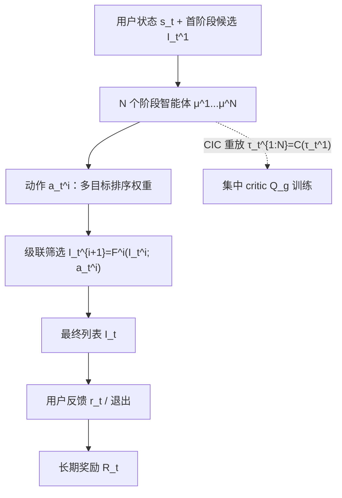
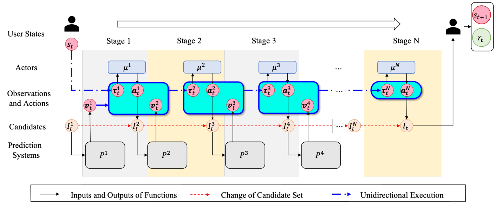
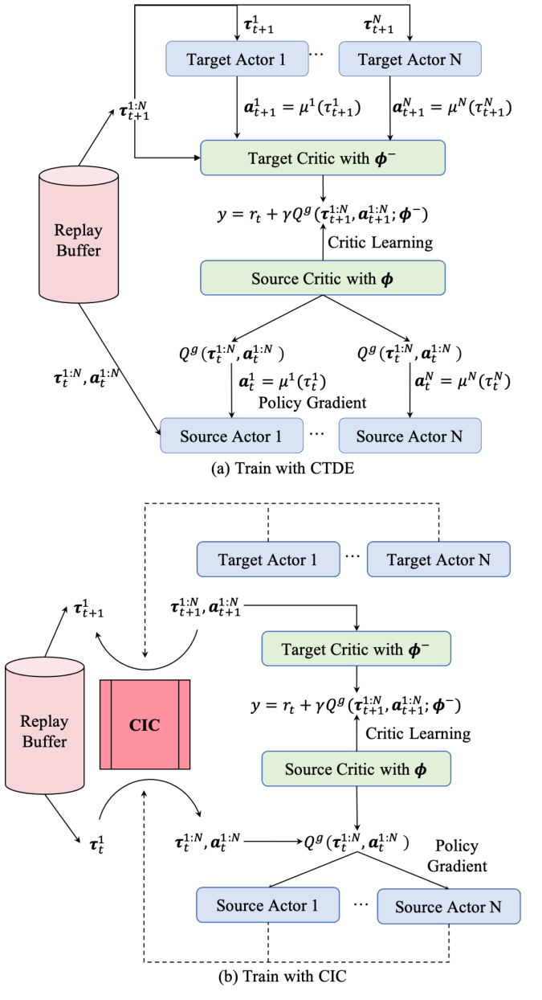

# UNEX-RL: Reinforcing Long-Term Rewards in Multi-Stage Recommender Systems with UNidirectional EXecution（单向执行约束下的多阶段推荐长期奖励强化）

- **会议/期刊**: AAAI 2024
- **作者与机构**: Gengrui Zhang, Yao Wang, Xiaoshuang Chen, Hongyi Qian, Kaiqiao Zhan, Ben Wang；快手科技、北京航空航天大学
- **推荐链路定位**: 粗排/精排/多阶段级联排序
- **研究方向**: 强化学习与动态探索推荐 / 工业级多阶段推荐架构
- **论文原文**: [https://arxiv.org/abs/2401.06470v1](https://arxiv.org/abs/2401.06470v1)
- **开源代码**: 暂未开源

## TL;DR (1分钟核心速览)

针对工业多阶段推荐中单智能体 RL 观测空间不一致、CTDE 训练与“上游动作改变下游候选”相矛盾的问题，本文把各阶段建模为单向执行的多智能体，提出 CIC 从首阶段观测重放全链观测，并用 SG/CQR 降方差。KuaiRand 模拟器与 Kwai 在线 A/B 显示长期观看时长显著提升。

## Background & Motivation (背景与核心矛盾)

- **主流范式**: 现有 RL4Rec 多采用单智能体 DDPG/TD3，将用户交互建模为 MDP，在最终排序或重排阶段优化观看时长、会话长度等长期奖励。
- **前人局限**: 工业系统由召回、粗排、精排、重排多阶段级联构成，各阶段观测空间不同，单智能体难以联合优化；传统 CTDE 又假设各智能体观测可同时从 replay buffer 采样，但上游动作会改变下游候选集与观测，产生 **OD（观测依赖）** 与 **CE（级联效应）**。
- **核心洞察 (Key Insight)**: 单向执行中，下游观测并非独立随机变量；给定首阶段观测、上游动作与各阶段固定信息抽取器 $P^i$，即可重放整条推荐链。
- **本文切入点**: 用多智能体分别控制各阶段排序权重，并以 CIC 在训练期重放全链观测/动作，替代 CTDE 对 replay buffer 的独立性假设。

## Method (核心方法设计)

### 1. 整体框架 (Overall Architecture)

系统在 $t$时刻接收用户状态$s_t$与首阶段候选集$I_t^1$；$N$个阶段对应$N$个智能体，智能体$i$基于观测$\tau_t^i$输出动作$\boldsymbol{a}_t^i$（如多目标排序权重），阶段函数据此筛出$I_t^{i+1}=F^i(I_t^i;\boldsymbol{a}_t^i)$。最终列表$I_t$返回用户后获得反馈$r_t$，并决定是否继续会话。训练期用集中 critic$Q_g$ 与 CIC 重放链路联合更新各阶段 actor；在线仅需各阶段 actor 前向一次，CIC 不增加线上延迟。

<figure class="paper-figure" markdown="span">
  <figcaption>图3：UNEX-RL 的整体框架。</figcaption>
</figure>

### 2. 关键设计拆解 (Key Designs)

1. **单向执行的多智能体建模**：单智能体无法吸收各阶段异构观测，本文将阶段 $i$的观测写成$\tau_t^1=[s_t,v_t^1]$、$\tau_t^{i+1}=[\tau_t^i,\boldsymbol{a}_t^i,v_t^{i+1}]$，其中$v_t^i=P^i(I_t^i;\boldsymbol{P}^i)$为本阶段新信息。该递归结构显式刻画了上游动作如何进入下游观测，是 OD/CE 的根源。排序动作可具体为$\boldsymbol{q}_t^i=\boldsymbol{p}_t^i\boldsymbol{a}_t^i$，即对点击、长播、观看时长等预测做线性加权。

2. **CIC 级联信息链**：CTDE 从 replay buffer 取 $\tau_{t+1}^{1:N}$计算 target，但目标 actor 的新动作会改变下游观测；CIC 只取$\tau_{t+1}^1$，按$\big[\tau_t^{1:N},\boldsymbol{a}_t^{1:N}\big]=C(\tau_t^1;\theta^{1:N},P^{1:N})$重放全链。Critic 目标改为$y_t^g=r_t+\gamma Q_g(C(\tau_{t+1}^1;\theta^{1:N-},P^{1:N});\phi^-)$，actor 梯度也穿过 CIC：$\nabla_{\theta^i}J_i=\mathbb{E}_D[\nabla_{\theta^i}\mu^i\nabla_{\mu^i}Q_g(C(\tau_t^1;\theta^{1:N},P^{1:N}))]$。这样 OD 被“可重放观测”替代，CE 被“下游动作随上游策略变化”显式建模。

<figure class="paper-figure" markdown="span">
  <figcaption>图4：使用 CTDE 和 CIC 训练。</figcaption>
</figure>

3. **SG 与 CQR 降方差**：CIC 给 $Q_g\to\mu^i$引入多条反传路径，SG 切断$\mu^{i+1:N}\to\mu^i$的间接梯度，只保留直接路径，避免梯度失控。CQR 将原始奖励按相似用户组$G_u$、相似物品组$G_i$做条件分位变换：$\tilde{r}_{t,u,i}=\Phi(r_{t,u,i}\mid G_u,G_i)$，使重整形奖励近似均匀分布，压缩用户/物品偏置造成的奖励跨度。训练损失为$\mathcal{L}(\phi)=\mathbb{E}_D[(y_t^g-Q_g(\tau_t^{1:N},\boldsymbol{a}_t^{1:N};\phi))^2]$；无显式负采样，依赖 off-policy replay。

## Experimental Setup & Evaluation Protocol (实验设置与评估协议)

- **数据集与预处理**: 离线使用 KuaiRand，并构建带“满意度耗尽即退出”机制的用户模拟器。原文未报告 5-core 等过滤；统计口径中“items=32,038,725”疑似为交互数，需谨慎复现。

| 数据集 | #Users | #Items | #Interactions | 稀疏度/密度 | 特征/场景说明 |
| :--- | :---: | :---: | :---: | :---: | :--- |
| KuaiRand | 27,285 | 32,038,725（原文口径） | 未披露 | 未披露 | 用户画像、行为历史、请求上下文；like/long-view/watch-time 三类反馈；模拟器会话退出 |

- **数据划分与防穿越 (Splitting Strategy)**: 原文未明确 `Leave-One-Out`、比例划分或全局时间戳切分；离线按用户 session 从 replay buffer 回放，需注意模拟器与候选集构造带来的穿越风险。
- **排名评测协议 (Ranking Protocol)**: 非静态 `Full-Ranking` 或 `Sampled Ranking`，而是用户模拟器滚动会话评测，指标为累计 `WatchTime` 与 `Session Length`；未报告 NDCG/HR 等排序指标。
- **对比基线与超参设置**: 对比 CEM、DDPG、TD3、UNEX-RL-CTDE 及 UNEX-RL-CIC 变体；actor/critic 均为 5 层 MLP，嵌入维度正文未给出（见附录）。在线以 0.1% 提升为统计显著阈值。

## Key Experimental Results (实验关键数据)

### 1. 主实验对比 (Main Results)

| 方法 | WatchTime | Session Length | Δ WatchTime vs TD3 |
| :--- | ---: | ---: | ---: |
| CEM | 654.0 | 15.3 | -14.3% |
| DDPG | 732.6 | 18.2 | -4.0% |
| TD3 | 763.2 | 18.9 | 0.0% |
| UNEX-RL-CTDE w/o CQR | 782.5 | 19.7 | +2.5% |
| UNEX-RL-CTDE | 887.2 | 21.6 | +16.2% |
| UNEX-RL-CIC w/o CQR | 974.3 | 22.7 | +27.7% |
| UNEX-RL-CIC w/o SG | 752.1 | 18.4 | -1.5% |
| **UNEX-RL-CIC** | **1056.2** | **24.2** | **+38.4%** |

在线 A/B（Kwai，>1 亿用户）中，UNEX-RL-CIC 相对 CEM 取得 **Session WatchTime +0.970%**、**Daily WatchTime +0.953%**；相对 TD3 的 Daily WatchTime 提升 **+0.558%**。

### 2. 消融实验 (Ablation Study)

| 变体 | WatchTime | Δ vs Full CIC | Session Length |
| :--- | ---: | ---: | ---: |
| **UNEX-RL-CIC** | **1056.2** | — | **24.2** |
| w/o CQR | 974.3 | -7.8% | 22.7 |
| w/o SG | 752.1 | -28.8% | 18.4 |
| CTDE（含 CQR） | 887.2 | -16.0% | 21.6 |
| CTDE w/o CQR | 782.5 | -25.9% | 19.7 |

### 3. 关键实验发现 (Key Findings)

1. **多阶段合作收益显著**：CIC 的 1056.2 较单智能体 TD3 的 763.2 提升 **38.4%**，较 CTDE 的 887.2 提升 **19.0%**；说明把各阶段拆成智能体后，关键在于训练范式而非简单堆叠 agent。
2. **CIC 解决 OD/CE 是主要增益源**：CIC 相对 CTDE 的 WatchTime 提升 **19.0%**、Session Length 提升 **12.0%**；而去掉 SG 后从 1056.2 跌至 752.1（**-28.8%**），说明 CIC 多路径梯度若不受控，反而破坏训练。
3. **CQR 对奖励方差抑制明显**：CIC 去掉 CQR 后下降 **7.8%**，CTDE 去掉 CQR 后由 887.2 降至 782.5（**-11.8%**）；在线 CIC 相对 CEM 的 Daily WatchTime **+0.953%**、相对 TD3 **+0.558%**，验证了离线结论的工业价值。

## Highlights & Limitations (亮点、对比与审稿批判)

- **与代表作对比 (vs. Prior Work)**: DDPG/TD3 只在最终排序用单智能体，无法吸收多阶段异构观测；CTDE 假设 replay 中观测独立可采样，忽略上游动作对下游候选的重构；CEM 只做黑箱权重搜索，缺少长期回报建模。本文用 CIC 把“单向执行”变成可训练约束。
- **可迁移亮点**: 将阶段动作定义为多目标排序权重 $\boldsymbol{q}_t^i=\boldsymbol{p}_t^i\boldsymbol{a}_t^i$，可直接迁移到多目标精排/粗排；CQR 作为奖励重整形方法，可迁移到任何存在用户/物品偏置的 RL4Rec。
- **审稿级局限批判**: 离线仅 KuaiRand + 自建模拟器，未报告切分、过滤与全库排序协议，且无开源代码，复现风险较高；CIC 依赖各阶段 $P^i$ 与候选集可重放，训练需重构 N 阶段链路，工程耦合和训练开销高于 CTDE；在线收益 0.558%–0.97% 虽显著但绝对幅度小，长期 150 天实验未给置信区间。

## Rating (四维评分)

- **方法创新性 (Novelty)**: ⭐⭐⭐⭐ （首次把工业多阶段推荐的“单向执行”形式化为 OD/CE，并用 CIC 重放链路训练 MARL，问题切口新颖）
- **评估协议与实验扎实度 (Protocol & Experiments)**: ⭐⭐⭐ （离线模拟器 + Kwai 在线 A/B 有说服力，但缺标准排序协议、切分细节与开源复现）
- **写作与数学规范度 (Clarity & Rigor)**: ⭐⭐⭐⭐ （OD/CE 定义、Theorem 4.1、CIC 算法与梯度公式清晰，部分实现细节依赖附录）
- **工业落地与复现价值 (Industrial & Practical Value)**: ⭐⭐⭐⭐⭐ （已在亿级用户 Kwai 上线，在线长期实验显著，CIC 训练与 SG/CQR 对工业多阶段系统可直接借鉴）

