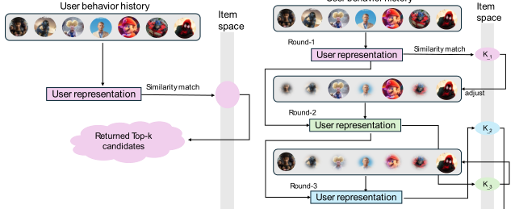
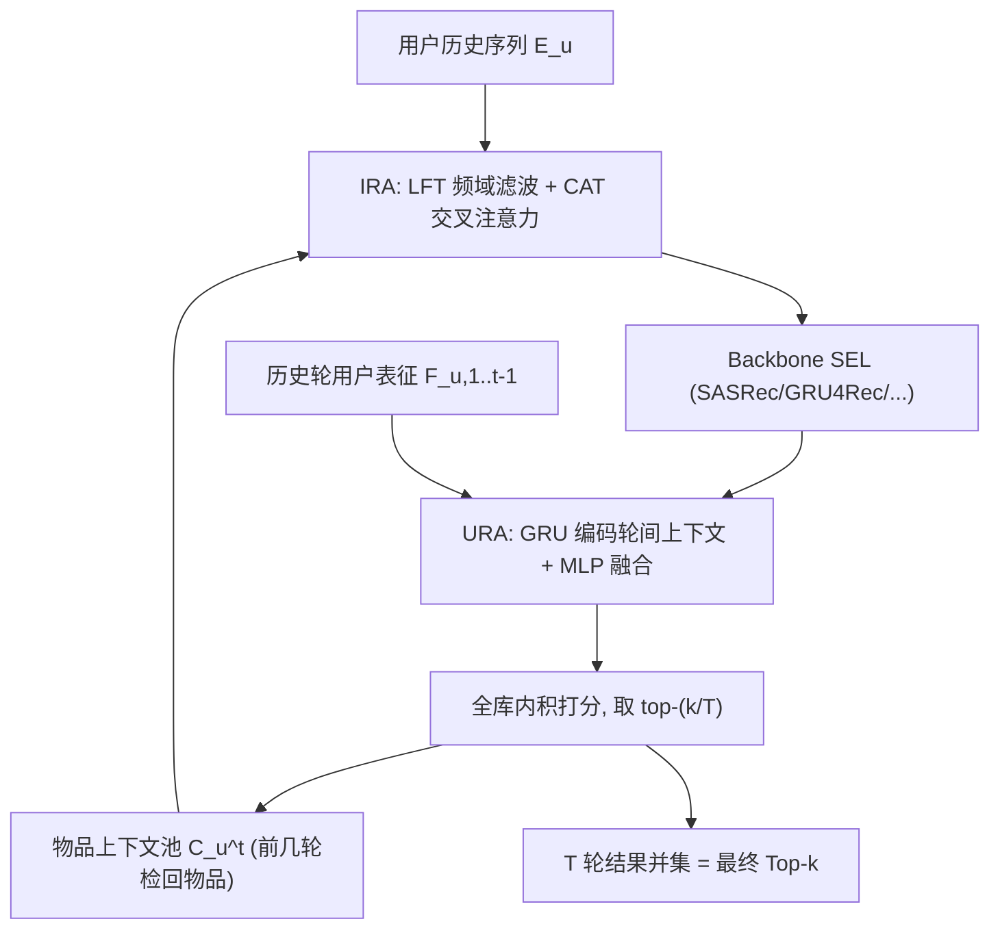
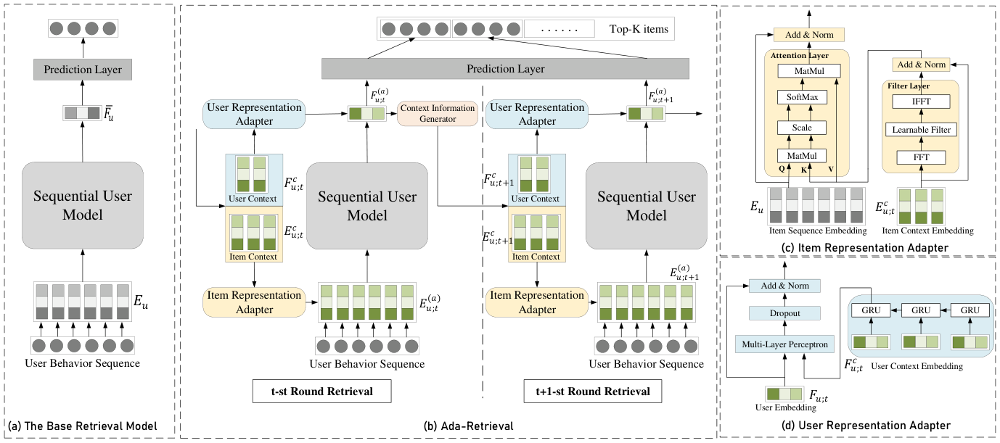

# Ada-Retrieval: An Adaptive Multi-Round Retrieval Paradigm for Sequential Recommendations (自适应多轮检索范式)

- **会议/期刊**: AAAI 2024
- **作者与机构**: Lei Li, Jianxun Lian, Xiao Zhou, Xing Xie（中国人民大学高瓴人工智能学院 & 微软亚洲研究院）
- **推荐链路定位**: 召回（单轮 Top-k 检索 → 多轮迭代式候选生成）
- **研究方向**: 序列与会话推荐 / 协同过滤与双塔召回
- **论文原文**: [https://arxiv.org/abs/2401.06633v2](https://arxiv.org/abs/2401.06633v2)
- **开源代码**: [https://github.com/ll0ruc/Ada-Retrieval](https://github.com/ll0ruc/Ada-Retrieval)

## TL;DR (1分钟核心速览)

现有序列推荐召回几乎都是"单轮推理"：backbone 编码用户历史得到唯一一个用户向量 $F_u$，再与全库做内积取 Top-k，检索区域被一次性锁死。本文提出 Ada-Retrieval，把$k$个名额拆成$T$轮（每轮$k/T$），用**物品表征适配器 (IRA)** 把已检回的物品作为上下文反馈去重加权历史序列、用**用户表征适配器 (URA)** 依历史轮次的用户向量修正当前 query。在 Beauty/Sports/Yelp 三数据集、5 种 backbone、`Full-Ranking` 协议下，NDCG@50 最高提升 9.67%、HR@50 最高提升 14.20%，且 SASRec/GRU4Rec 平均 NDCG@50 分别 +5.57%/+8.37%。

## Background & Motivation (背景与核心矛盾)

- **主流范式**: 序列召回（GRU4Rec/SASRec/NextItNet/SRGNN/FMLPRec）统一为 `EMB → SEL → PRED`：一次前向产出用户向量 $F_u$，以点积/余弦在物品空间做单轮全库匹配。
- **前人局限 1**: 单轮范式下 $F_u$ 固定不可改，若初始表征偏置或用户近未来兴趣多元，检索永远落在物品空间的同一静态区域，**没有任何纠错回路**。
- **前人局限 2**: 多兴趣召回（MIND/ComiRec/SINE）虽产出多向量，但兴趣个数靠聚类/路由等启发式预设，且所有向量由同一次前向并行导出，仍缺少"依据已检索结果再修正"的反馈闭环。
- **核心洞察 (Key Insight)**: 类比搜索引擎的 query rewrite —— 首屏不满意就改写查询词。前几轮检回（含误检）的物品 + 上一轮用户向量本身就是最有价值的反馈信号，可用于逐步精化 query。
- **本文切入点**: 不动 backbone 结构与参数语义，仅在 `SEL` 的输入/输出两端插入两个轻量适配器，实现"即插即用"的多轮召回。

<figure class="paper-figure" markdown="span">
  <figcaption>图 1：(a) 传统单轮检索范式与 (b) 本文提出的自适应多轮检索范式示意图，其中最终检索结果为各次单独检索 Ki 的并集。</figcaption>
</figure>

## Method (核心方法设计)

### 1. 整体框架 (Overall Architecture)

第 $t$轮：历史序列$E_u$与累积物品上下文$E_u^c$送入 IRA，输出被上下文重标定的序列表征$E_u^{(a)}$；backbone `SEL` 编码得到$F_{u;t}$；URA 融合此前$t-1$轮的用户向量得到自适应表征$F_{u;t}^{(a)}$；用$F_{u;t}^{(a)}$对全库打分，取前$k/T$个物品并入物品上下文池，并作为本轮召回结果；$T$ 轮结果取并集即最终 Top-k。训练采用"先预训练 base、后联合微调适配器与 base"的两阶段策略。

<figure class="paper-figure" markdown="span">
  <figcaption>图 2：传统检索模型 (a) 与本文提出的 Ada-Retrieval 范式 (b) 概览，该范式包含两个关键部分：物品表示适配器 (c) 与用户表示适配器 (d)。彩色元素表示 Ada-Retrieval 中的新增组件。</figcaption>
</figure>

### 2. 关键设计拆解 (Key Designs)

1. **物品表征适配器 IRA（频域去噪 + 上下文交叉注意力）**：痛点在于上下文池里的物品是"检索结果"而非真实正反馈，噪声极大，直接拼进序列会污染编码。先用可学习滤波在频域压制噪声：$X_u^c=\mathcal{F}(E_u^c)$，$\tilde{E}_u^c=\mathcal{F}^{-1}(W\odot X_u^c)$，$H_u^c=\mathrm{LN}(E_u^c+\mathrm{Dropout}(\tilde{E}_u^c))$；再用 **Q 取自历史序列、K/V 取自上下文** 的交叉注意力挑出关键反馈物品：$E_u^{(a)}=\mathrm{LN}\big(E_u+\mathrm{Dropout}(\mathrm{Attn}(E_u,H_u^c,H_u^c))\big)$。直觉：滤波器负责"哪些反馈可信"，注意力负责"哪一条反馈对下一次预测更有信息量"。
2. **用户表征适配器 URA（轮间记忆 + 门控融合）**：$F_{u;t}$只是本轮观测，缺少跨轮一致性。用 GRU 以"取最后隐状态"的方式编码$\{F_{u;1}^{(a)},\dots,F_{u;t-1}^{(a)}\}$得$\tilde{F}_u^c$，再与当前表征拼接后过两层 MLP：$F_{u;t}^{(a)}=W_2\,\mathrm{ReLU}(W_1[\tilde{F}_u^c;F_{u;t}]+b_1)+b_2$，并加残差与 LayerNorm。GRU 的递归结构天然实现"轮次越远、影响越衰减"，与"用户兴趣漂移"的物理假设吻合。
3. **训练目标、上下文生成与推理开销**：上下文池按 $\mathcal{C}_u^t=\mathcal{C}_u^{t-1}\cup \mathrm{top}(k/T)\arg\max_{i\in\mathcal{I}}\langle F_{u;t-1}^{(a)},E_i\rangle$累积；每轮独立算交叉熵$\mathcal{L}_t=-\sum_{u,i}\big[y_{ui;t}\log\sigma(\hat{y}_{ui;t})+(1-y_{ui;t})\log(1-\sigma(\hat{y}_{ui;t}))\big]$，并用衰减因子压制后轮权重：$\mathcal{L}=\sum_{t=1}^{T}\lambda^{t}\mathcal{L}_t$（$\lambda<1$时更信任早期轮次）。原文未显式构造负采样器，损失在物品全集上定义（依赖全库打分）；两阶段训练中$\Theta$（适配器）与$\Phi$（base）同步更新。在线代价为$T$次适配器前向 +$T$次全库打分，约为原单轮召回的$T$倍（$T$ 最优 5–8），工程上需靠共享物品矩阵 + 早停式轮次截断控制。

## Experimental Setup & Evaluation Protocol (实验设置与评估协议)

- **数据集与预处理**: 三个公开集均执行 `5-core` 过滤（用户/物品交互数 $<5$ 剔除），按时间戳排序：

| 数据集 | #Users/#Seq | #Items | #Interactions | 稀疏度 | 场景说明 |
| :--- | :---: | :---: | :---: | :---: | :--- |
| Beauty | 22,363 | 12,101 | 198,502 | 99.93% | Amazon 美妆评论序列 |
| Sports | 25,598 | 18,357 | 296,337 | 99.95% | Amazon 运动户外 |
| Yelp | 30,431 | 20,033 | 316,354 | 99.95% | 本地商户（仅 2019-01-01 后交易） |

- **数据划分与防穿越**: `Leave-One-Out` —— 每用户最后一项为 test、倒数第二项为 validation、其余为 train，严格按时间戳排序。
- **排名评测协议**: 无偏 `Full-Ranking`（全库未交互物品均为候选，不做负采样），指标 HR@50 / NDCG@50；实验重复 5 次、报告均值（附标准差）。
- **对比基线与超参设置**: backbone 覆盖 RNN/Transformer/CNN/GNN/MLP 五类（GRU4Rec、SASRec、NextItNet、SRGNN、FMLPRec），并与 DNN、MIND、ComiRec、SINE 多兴趣模型对比；$d=64$、最大序列长 50、batch 1024、Adam$\text{lr}=10^{-3}$、至多 200 epoch、验证集 HR@50 连续 10 轮不升即早停；$T\in[3,8]$（步长 1）、$\lambda\in[0.1,0.9]$（步长 0.2）网格搜索。

## Key Experimental Results (实验关键数据)

### 1. 主实验对比 (Main Results)

下表为各 backbone 在 Ada-Retrieval 加持前后的 `HR@50 / NDCG@50`（百分数省略 %，括号为相对提升，加粗为全局最优）：

| Backbone | Beauty | Sports | Yelp |
| :--- | :---: | :---: | :---: |
| GRU4Rec Base | 13.126 / 4.574 | 7.644 / 2.447 | 9.252 / 2.765 |
| + Ada-Retrieval | 14.175 / 4.915 (↑7.99 / ↑7.46) | 8.226 / 2.683 (↑7.61 / ↑9.67) | 10.415 / 2.985 (↑12.57 / ↑7.98) |
| SASRec Base | 17.110 / 6.506 | 10.924 / 4.046 | 12.062 / 3.770 |
| + Ada-Retrieval | 17.741 / 7.062 (↑3.69 / ↑8.55) | 11.352 / 4.234 (↑3.92 / ↑4.65) | 12.637 / 3.852 (↑4.77 / ↑2.19) |
| NextItNet Base | 12.539 / 4.064 | 7.939 / 2.563 | 9.828 / 2.971 |
| + Ada-Retrieval | 12.948 / 4.288 (↑3.27 / ↑5.50) | 8.425 / 2.663 (↑6.12 / ↑3.90) | 11.224 / 3.316 (↑14.20 / ↑11.60) |
| SRGNN Base | 12.411 / 4.242 | 7.704 / 2.504 | 10.501 / 3.141 |
| + Ada-Retrieval | 13.274 / 4.375 (↑6.96 / ↑3.12) | 8.551 / 2.731 (↑11.00 / ↑9.07) | 11.688 / 3.454 (↑11.31 / ↑9.96) |
| FMLPRec Base | **17.935 / 6.876** | **11.607 / 4.238** | **13.013 / 4.029** |
| + Ada-Retrieval | **18.531 / 7.265** (↑3.32 / ↑5.66) | **11.903 / 4.444** (↑2.55 / ↑4.85) | **13.430 / 4.157** (↑3.20 / ↑3.18) |

多兴趣类对比（以 SASRec 为 backbone，Beauty/Sports/Yelp 的 HR@50）：DNN 13.705/8.798/11.241，MIND 14.045/8.888/11.320，ComiRec 14.394/9.270/11.479，SINE 13.191/9.087/12.091，**Ada-Retrieval 17.741/11.352/12.637** 全面领先（Beauty NDCG@50 7.062 vs ComiRec 5.232）。

### 2. 消融实验 (Ablation Study)

以 SASRec 为 backbone，`HR@50 / NDCG@50`：

| 变体 | Beauty | Sports | Yelp |
| :--- | :---: | :---: | :---: |
| Base（单轮） | 17.110 / 6.506 | 10.924 / 4.046 | 12.062 / 3.770 |
| w/o LFT（去频域滤波） | 17.549 / 6.945 | 11.287 / 4.186 | 12.474 / 3.834 |
| w/o CAT（注意力换均值） | 17.536 / 6.948 | 11.141 / 4.182 | 12.566 / 3.826 |
| w/o IRA（整块移除） | 17.209 / 6.670 | 10.980 / 4.101 | 12.331 / 3.815 |
| w/o GRU | 17.348 / 6.845 | 11.020 / 4.137 | 12.464 / 3.817 |
| w/o MLP（直接拼上下文） | 17.227 / 6.716 | 10.692 / 3.963 | 12.026 / 3.691 |
| w/o URA（整块移除） | 17.308 / 6.793 | 10.782 / 4.017 | 12.147 / 3.720 |
| w/o PT（去掉两阶段预训练） | 17.200 / 6.553 | 10.739 / 3.969 | 12.008 / 3.692 |
| **Ada-Retrieval (full)** | **17.741 / 7.062** | **11.352 / 4.234** | **12.637 / 3.852** |

### 3. 关键实验发现 (Key Findings)

1. **增益与被增强 backbone 的强弱反相关**：Yelp 上 NextItNet 拿到 +14.20% HR / +11.60% NDCG、Sports 上 SRGNN +11.00% / +9.07%，而本就最强的 FMLPRec 仅 +2.55%~3.32%。说明多轮范式补的是"召回覆盖与表征纠错"，而非 backbone 的拟合容量——越弱的编码器越受益。
2. **适配器的"融合方式"比"是否使用上下文"更关键**：`w/o MLP`（Beauty NDCG 6.716）竟低于 `w/o URA`（6.793），即把用户上下文向量硬拼回当前表征会引入噪声，必须用 MLP 做门控式融合；反过来 `w/o IRA` 仍高于 Base（6.670 vs 6.506），说明多轮迭代机制本身即产生收益，IRA 是叠加增量；`w/o PT` 在 Yelp 掉到 3.692（−4.15%），说明预训练 base 提供的"干净上下文"是稳定训练的前提。
3. **收益集中在前几轮，且超参强依赖数据分布**：逐轮对比显示前几轮相对 SASRec 的 HR@100 提升达 Beauty +7.5%、Sports +15%，后期收敛至约 +3%，Beauty 末轮甚至 −2.5%——即多轮主要"抢救"base 漏排/低排的难样本；对应最优 $T$为 5/8/6、最优$\lambda$为 0.3/0.5/0.7，序列越长、兴趣越分散的数据集越需要靠后轮次与更大的$\lambda$提供监督，$T$ 超过最优点后反而因过度漂移而下滑。

## Highlights & Limitations (亮点、对比与审稿批判)

- **与代表作对比 (vs. Prior Work)**: 与 SASRec/GRU4Rec 等单轮 backbone 的本质区别是"推理过程可迭代"，不改网络只改输入输出边界；与 MIND/ComiRec 等多兴趣模型的区别是兴趣粒度**由反馈自适应决定、串行生成**，无需预设兴趣个数，故 Beauty 上 NDCG@50 比 ComiRec 高 34.9%；与 TDM/JTM 等树索引方法的区别是不依赖层次索引结构，可直接复用任意双塔/内积检索栈。
- **可迁移亮点**: ① "已召回物品作为伪反馈上下文 + 频域可学习滤波去噪"这一组合，可直接搬到多路召回融合与多样性打散；② "适配器 + 两阶段训练"是低成本升级存量召回模型的通用模板（保留原 backbone、仅加轻量旁路）。
- **审稿级局限批判**: ① 推理成本随 $T$线性增长（$T$次适配器前向 +$T$次全库打分），论文只在万级物品的 `Full-Ranking` 上验证，缺少与 ANN 索引/工业亿级库结合的延迟-收益分析；② 损失在物品全集上定义、负采样策略交代模糊，且$T$与$\lambda$ 的最优值跨数据集差异大（0.3 vs 0.7），调参成本与理论解释（为何多轮一定有效）均缺失，作者亦将"理论基础"列为 future work。

## Rating (四维评分)

- **方法创新性 (Novelty)**: ⭐⭐⭐⭐ （把"检索"从一次性映射改造为带反馈闭环的迭代过程，范式层面新颖；但 IRA/URA 内部组件均为 FFT 滤波、交叉注意力、GRU-MLP 的成熟组合，缺理论刻画）
- **评估协议与实验扎实度 (Protocol & Experiments)**: ⭐⭐⭐⭐ （三数据集 × 五类 backbone + 多兴趣基线 + 完整消融与逐轮分析，`Full-Ranking` 协议无偏；扣分在于仅中小规模数据集、无显著性检验与线上 A/B）
- **写作与数学规范度 (Clarity & Rigor)**: ⭐⭐⭐⭐ （框架图与四个子模块图示清晰、公式与符号一致，损失与上下文累积定义明确；负采样与"每轮独立监督"的实现细节略显含混）
- **工业落地与复现价值 (Industrial & Practical Value)**: ⭐⭐⭐⭐ （代码开源、模型无关即插即用、不改 backbone 十分友好；但 $T$倍推理开销与$T,\lambda$ 敏感性要求在工业部署前做充分的延迟预算与轮次截断设计）

