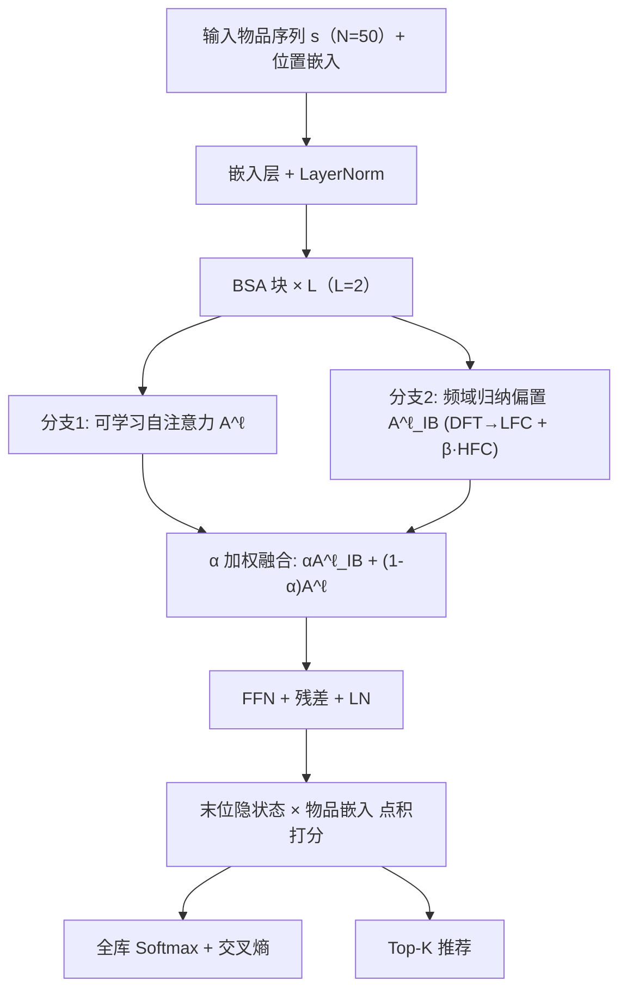

# An Attentive Inductive Bias for Sequential Recommendation beyond the Self-Attention (超越自注意力：面向序列推荐的注意力归纳偏置)

- **会议/期刊**: AAAI 2024
- **作者与机构**: Yehjin Shin*、Jeongwhan Choi*、Hyowon Wi、Noseong Park（延世大学，* 共同一作）
- **推荐链路定位**: 召回 / 序列建模
- **研究方向**: 序列与会话推荐 / 图与知识感知推荐（谱域视角）
- **论文原文**: [https://arxiv.org/abs/2312.10325v2](https://arxiv.org/abs/2312.10325v2)
- **开源代码**: [https://github.com/yehjin-shin/BSARec](https://github.com/yehjin-shin/BSARec)

## TL;DR (1分钟核心速览)

本文针对 Transformer 序列推荐两大痛点——一是自注意力缺乏归纳偏置，二是自注意力本质上是一种低通滤波器，深层堆叠会导致表征过平滑（短期突变兴趣对应的高频信号被持续抹除）。作者提出 BSARec：把 DFT（等价于环图上的 GFT）作为免训练注意力归纳偏置，并用频率重缩放器自适应放大高频分量，再与可学习自注意力按系数 $\alpha$ 加权折中。在 6 个基准数据集、无偏全库排序协议下，HR@20 平均提升约 6.1%，LastFM 上 HR@10 提升 27.49%，且训练耗时比 FEARec 低一个数量级。

## Background & Motivation (背景与核心矛盾)

- **主流范式**: SASRec、BERT4Rec、DuoRec 等 Transformer 自注意力模型已主导序列推荐，靠缩放点积注意力捕获长程依赖。
- **前人局限**: ① 纯自注意力严重依赖数据驱动，缺乏结构化归纳偏置，长尾稀疏场景泛化弱、易过拟合；② 自注意力矩阵本质是低通滤波器，层层堆叠后高频分量被反复抹除，表征趋于相似，造成过平滑。
- **核心洞察 (Key Insight)**: 定理 1 用 Perron-Frobenius 定理证明自注意力满足 $\lim_{t\to\infty}\|\text{HFC}[A^t(x)]\|_2 / \|\text{LFC}[A^t(x)]\|_2 = 0$，即无论 Q/K 如何取值，它都必然收敛为低通滤波。作者首次在 SR 域实证：深度增加时奇异值迅速衰减、余弦相似度上升（图 3）。用户长期持续品味对应低频信号，短期突变兴趣对应高频信号（图 1）；FMLPRec 虽引入可学习全局滤波器，但其权重仍不可逆地坍缩为低通。
- **本文切入点**: 以朴素 DFT（环图 GFT 特例）作为“相邻物品互相影响”的免训练先验，并把低频、高频分量拆开、用可学习 $\beta$重缩放高频，与可学习自注意力按$\alpha$ 折中，兼顾先验与数据驱动。

## Method (核心方法设计)

### 1. 整体框架 (Overall Architecture)

BSARec 输入长度截断/补齐到 $N=50$的物品序列，经嵌入层（物品嵌入 + 可学习位置嵌入，加 Dropout 与 LayerNorm）后堆叠$L$个 BSA（Beyond Self-Attention）块。每个 BSA 块内并行两条分支：可学习自注意力$A^\ell$捕捉序列中的非显式关联；免训练频域归纳偏置$A^\ell_{IB}$由环图 DFT 基构造，先做 LFC/HFC 分离、再用可学习向量$\beta$重缩放高频后重组。两分支按$\alpha$ 加权融合，经 FFN、残差与 LN 输出。最终取序列末位隐状态与物品嵌入做点积打分，用交叉熵损失在全库 softmax 上训练，推理时直接全库排序。

### 2. 关键设计拆解 (Key Designs)

1. **Beyond Self-Attention 层（归纳偏置与可学习注意力折中）**：目的是让模型既有环图先验又不失自注意力刻画非显式关联的能力。核心算子是
$$\tilde{A}^\ell X^\ell = \alpha A^\ell_{IB} X^\ell + (1-\alpha) A^\ell X^\ell,$$
其中固定 $A^\ell_{IB}$由 DFT 基构造、不需要训练，$\alpha\in(0,1)$控制先验强度，$\alpha=0$ 即退化为 SASRec。直觉：自注意力专注捕捉“非显式”注意，环图先验提供稳定结构正则，缓解过拟合。

2. **频率重缩放器（Frequency Rescaler）**：用于避免 FMLPRec 那种不可逆低通坍缩。算子为
$$A^\ell_{IB} X^\ell = \text{LFC}[X^\ell] + \beta \cdot \text{HFC}[X^\ell],$$
其中 LFC 取 DFT 后最低的 $c$个分量、HFC 取其余$N-c$个，$\beta$可学习且用$D$维向量优于标量。当$\beta>1$时放大高频、保留短期突变兴趣；实验发现学到的$\beta$ 在第一层权重更高（图 7a），说明“浅层重点保留高频”是有效的物理直觉。

3. **训练目标、负采样与推理效率**：采用全库 softmax 交叉熵（而非 SASRec 的 BCE）：
$$\mathcal{L} = -\log \frac{\exp(\hat{y}_g)}{\sum_{i\in|\mathcal{V}|}\exp(\hat{y}_i)},$$
全程免负采样、免对比学习。相比 SASRec 仅多约 384 个参数；相比 DuoRec、FEARec 分别快约 1.5–2× 与 10–13×（表 4，Beauty 上 12.75s vs 19.26s / 156.83s）。

## Experimental Setup & Evaluation Protocol (实验设置与评估协议)

- **数据集与预处理**: 采用隐式反馈，遵循 Zhou 等工作截断/补齐为定长 $N=50$。

| 数据集 | #Users | #Items | #Interactions | 平均长度 | 稀疏度 |
| :--- | ---: | ---: | ---: | ---: | ---: |
| Beauty | 22,363 | 12,101 | 198,502 | 8.9 | 99.93% |
| Sports | 25,598 | 18,357 | 296,337 | 8.3 | 99.95% |
| Toys | 19,412 | 11,924 | 167,597 | 8.6 | 99.93% |
| Yelp | 30,431 | 20,033 | 316,354 | 10.4 | 99.95% |
| LastFM | 1,090 | 3,646 | 52,551 | 48.2 | 98.68% |
| ML-1M | 6,041 | 3,417 | 999,611 | 165.5 | 95.16% |

- **数据划分与防穿越**: 遵循 SR 标准按时间顺序的 Leave-One-Out 划分（最后一项为测试、倒数第二项为验证）。
- **排名评测协议**: 主协议为无偏 **Full-Ranking（全库未交互项排序，不采样负例）**，与 DuoRec/FEARec 对齐；补充实验另做 99 负采样协议（表 9）以对齐 SASRec/FMLPRec 原设定，两种协议下结论一致。
- **对比基线与超参**: 7 个基线（Caser、GRU4Rec、SASRec、BERT4Rec、FMLPRec、DuoRec、FEARec）；$D=64$，$L=2$，$h\in\{1,2,4\}$，$\alpha\in\{0.1,\ldots,0.9\}$，$c\in\{1,3,5,7,9\}$，学习率$\{5\times10^{-4},10^{-3}\}$，批大小 256。

## Key Experimental Results (实验关键数据)

### 1. 主实验对比 (Main Results)

下表取全库排序协议下的 HR@20 与 NDCG@20（原文含 @5/@10/@20 完整指标）：

| 数据集 | 指标 | SASRec | BERT4Rec | FMLPRec | DuoRec | FEARec | **BSARec** | Improv. |
| :--- | :--- | ---: | ---: | ---: | ---: | ---: | ---: | ---: |
| Beauty | HR@20 | 0.0823 | 0.1073 | 0.0869 | 0.1313 | 0.1352 | **0.1373** | +1.55% |
| | NDCG@20 | 0.0356 | 0.0480 | 0.0369 | 0.0671 | 0.0694 | **0.0703** | +1.30% |
| Sports | HR@20 | 0.0459 | 0.0649 | 0.0525 | 0.0791 | 0.0836 | **0.0858** | +2.63% |
| | NDCG@20 | 0.0200 | 0.0284 | 0.0231 | 0.0387 | 0.0405 | **0.0422** | +4.20% |
| Toys | HR@20 | 0.0929 | 0.0939 | 0.0974 | 0.1369 | 0.1397 | **0.1435** | +2.72% |
| | NDCG@20 | 0.0435 | 0.0430 | 0.0441 | 0.0737 | 0.0747 | **0.0768** | +2.81% |
| Yelp | HR@20 | 0.0424 | 0.0717 | 0.0490 | 0.0717 | 0.0691 | **0.0746** | +4.04% |
| | NDCG@20 | 0.0167 | 0.0287 | 0.0192 | 0.0294 | 0.0285 | **0.0302** | +2.72% |
| LastFM | HR@20 | 0.0927 | 0.0596 | 0.0826 | 0.0963 | 0.0826 | **0.1174** | +21.91% |
| | NDCG@20 | 0.0429 | 0.0286 | 0.0372 | 0.0446 | 0.0414 | **0.0526** | +17.94% |
| ML-1M | HR@20 | 0.3245 | 0.3440 | 0.3137 | 0.3738 | 0.3714 | **0.3884** | +3.91% |
| | NDCG@20 | 0.1395 | 0.1564 | 0.1356 | 0.1790 | 0.1771 | **0.1851** | +3.41% |

### 2. 消融实验 (Ablation Study)

| 方法 | Beauty HR@20 | Sports HR@20 | Toys HR@20 | LastFM HR@20 | LastFM NDCG@20 |
| :--- | ---: | ---: | ---: | ---: | ---: |
| BSARec（完整） | **0.1373** | **0.0858** | **0.1435** | **0.1174** | **0.0526** |
| 仅 A（纯自注意力，即 SASRec 化） | 0.1265 | 0.0779 | 0.1320 | 0.0899 | 0.0430 |
| 仅 AIB（纯频域先验） | 0.1338 | 0.0857 | 0.1402 | 0.1009 | 0.0455 |
| 标量 $\beta$替代向量$\beta$ | 0.1333 | 0.0838 | 0.1435 | 0.1092 | 0.0497 |

### 3. 关键实验发现 (Key Findings)

1. **两支缺一不可，且频域先验互补性强**：LastFM 上“仅 A”HR@20 = 0.0899，加入 AIB 后升至 0.1009，二者融合到 0.1174，说明可学习注意力擅长非显式关联、环图先验提供结构正则，单独任一分支均短缺。
2. **向量 $\beta$带来实质增益**：把$\beta$从标量升级为$D$维向量后，LastFM HR@20 由 0.1092 升至 0.1174（+7.5%）、Beauty 由 0.1333 升至 0.1373，证明不同频率维度必须差异化重缩放；且学到的$\beta$ 在浅层权重更高，符合“浅层保留高频”的物理直觉。
3. **序列越长收益越大**：序列最长的 LastFM（平均 48.2）HR@20 提升 21.91%，而短序列 Beauty 仅 1.55%，印证过平滑在深层长序列上更严重、高频信号边际价值更高；同时 BSARec 无需对比学习即超过 DuoRec/FEARec，挑战了“复杂增广=更强”的惯例。

## Highlights & Limitations (亮点、对比与审稿批判)

- **与代表作对比 (vs. Prior Work)**: ① SASRec/BERT4Rec 纯自注意力、无归纳偏置，且为不可避免的低通；② FMLPRec 引入可学习滤波器，但权重不可逆坍缩为低通；③ FEARec 在频域分离低/高频但结构复杂、需对比学习与频率归一化。BSARec 仅用“频域先验 + 重缩放”即超越，且训练比 FEARec 快约 10–13×。
- **可迁移亮点**: ① 频率重缩放器 $A_{IB} = \text{LFC} + \beta\cdot\text{HFC}$ 可即插即用地嵌入任意注意力层以缓解过平滑；② 把环图拉普拉斯谱/DFT 基当“免训练注意力先验”的思路，可迁移至其他序列建模任务。
- **审稿级局限批判**: ① $\alpha$与$c$的跨数据集最优值差异大（$\alpha$从 0.3 到 0.9、$c$从 3 到 9），需逐数据集网格搜索，超参敏感度偏高；② 仅在 6 个公开数据集验证，未覆盖大规模工业级/在线 A/B 与 LTV 场景，也未讨论超长序列（$N\gg 50$）下的计算开销；③ 评测聚焦 Top-K 排序，未涉及重排与多样性。

## Rating (四维评分)

- **方法创新性 (Novelty)**: ⭐⭐⭐⭐ （首次在 SR 域揭示自注意力低通导致过平滑，频域重缩放与归纳偏置折中设计新颖，并有 Perron-Frobenius 定理支撑）
- **评估协议与实验扎实度 (Protocol & Experiments)**: ⭐⭐⭐⭐ （6 数据集 + 全库排序与 99 负采样双协议 + 7 基线 + 完整消融/敏感性/复杂度，缺显著性检验是短板）
- **写作与数学规范度 (Clarity & Rigor)**: ⭐⭐⭐⭐ （DFT↔GFT 关系讲透、定理证明完整，但部分符号在主文与附录间切换略绕）
- **工业落地与复现价值 (Industrial & Practical Value)**: ⭐⭐⭐⭐⭐ （开源代码、仅多 ~400 参数、训练比 FEARec 快一个数量级，可低成本集成进现有 Transformer SR 栈）

