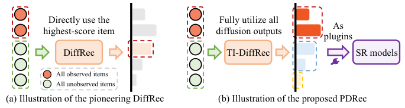
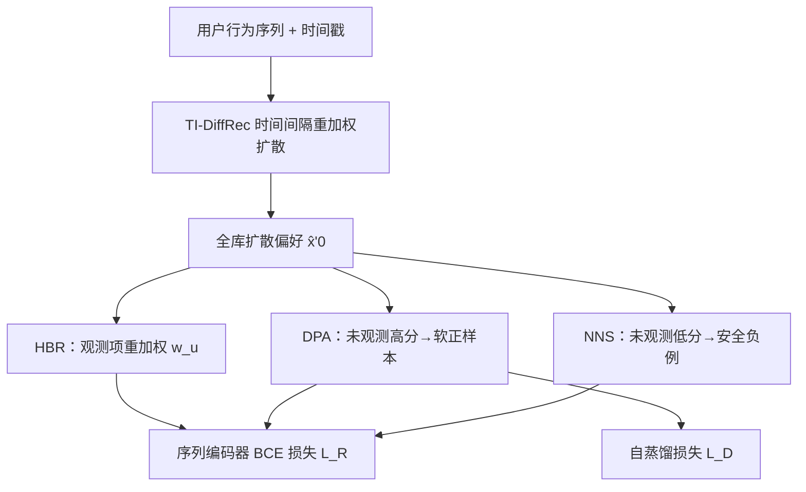
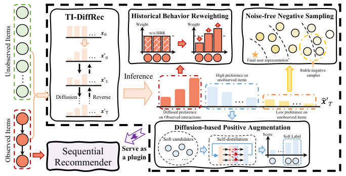

# Plug-in Diffusion Model for Sequential Recommendation (面向序列推荐的插件式扩散模型)

- **会议/期刊**: AAAI 2024
- **作者与机构**: Haokai Ma, Lei Meng (山东大学软件学院/山东省工业技术研究院), Ruobing Xie, Xin Chen, Xu Zhang, Leyu Lin, Zhanhui Kang (腾讯)
- **推荐链路定位**: 排序（Next-Item 精排打分）/ 可插拔训练期增强
- **研究方向**: 序列与会话推荐 / 生成式推荐（扩散模型）
- **论文原文**: [https://arxiv.org/abs/2401.02913v1](https://arxiv.org/abs/2401.02913v1)
- **开源代码**: [https://github.com/hulkima/PDRec](https://github.com/hulkima/PDRec)

## TL;DR (1分钟核心速览)

现有扩散推荐（DiffRec/T-DiffRec）只取全库**最高分那一个**物品作预测，丢弃了扩散过程在**其余物品**上蕴含的泛化偏好，且与时间感知序列建模脱节。PDRec 把时间间隔扩散模型 TI-DiffRec 当作**预训练插件**：用全库偏好向量同时驱动历史行为重加权（HBR）、未观测高分物品作软正样本自蒸馏（DPA）、未观测低分物品作安全负样本（NNS）。在 4 个 Amazon/Douban 数据集、3 个基础序列编码器、1:99 采样排序协议下，SASRec 上 N@10 相对提升 1.9%–13.2%（稀疏集最高 13.9%），跨域混合设定下相对 T-DiffRec 最高 +38.3%。

## Background & Motivation (背景与核心矛盾)

- **主流范式**: 序列推荐（GRU4Rec / SASRec / CL4SRec）用 RNN 或 Transformer 编码历史行为做 Next-Item 打分；近期 DiffRec、T-DiffRec 把扩散模型用于协同过滤，靠"加噪—去噪"重建用户偏好。
- **前人局限 1（偏好浪费）**: 扩散模型输出的是全库 $|\mathcal{I}|$ 维偏好分布，但推理时只取 argmax 一个物品，其余物品上的泛化知识被整体丢弃，对稀疏交互矩阵依旧无解。
- **前人局限 2（与 SR 结构错配）**: DM-based 方法主要为 CF 设计，不建模时间戳信息；T-DiffRec 虽引入行为顺序，却忽略**相邻行为的时间间隔**，导致兴趣漂移（preference drift）被误当作稳定偏好。
- **核心洞察 (Key Insight)**: 扩散偏好在**已观测物品**上是"质量分"（可做去噪重加权），在**未观测物品**上是"潜力分"（高分可当软正样本、低分可当安全负样本）——三种用法可同时榨取。
- **本文切入点**: 不训练新的扩散推荐器，而是把预训练 TI-DiffRec 当**模型无关的可拆卸插件**，仅用其推理输出重塑下游 SR 模型的损失。

<figure class="paper-figure" markdown="span">
  <figcaption>图1：开创性的DiffRec与PDRec之间差异的示意图，其中每个矩形表示用户对相应物品的基于扩散的偏好。</figcaption>
</figure>

## Method (核心方法设计)

### 1. 整体框架 (Overall Architecture)

两阶段流水线：**离线阶段**先在用户全库交互向量 $x_0$上做时间间隔重加权得到$x'_0$，训练 TI-DiffRec，并对每个用户一次性推理出全库偏好$\hat{x}'_0\in\mathbb{R}^{|\mathcal{I}|}$（正/负/未观测三部分）；**下游阶段**把$\hat{x}'_0$拆成三路信号注入任意序列编码器——已观测偏好$\to$HBR 生成逐样本权重$w_u$缩放 BCE 损失；未观测高分$\to$DPA 生成软正样本做自蒸馏；未观测低分$\to$NNS 采样安全负例。最终以$\mathcal{L}=\mathcal{L}_R+\omega_d\mathcal{L}_D$ 联合训练，推理时插件完全移除，线上开销与原生 SASRec 相同。

<figure class="paper-figure" markdown="span">
  <figcaption>图3：所提出PDRec的整体结构。</figcaption>
</figure>

### 2. 关键设计拆解 (Key Designs)

1. **时间间隔重加权扩散 TI-DiffRec（治兴趣漂移）**：T-DiffRec 只按行为次序构向量，无法区分"昨天刚看"与"半年前看过"。TI-DiffRec 在扩散前把交互位改成时间感知初值 $x'_{i^u_j}=w^u_k$，其中
$w^u_j = w_{\min} + \frac{t^u_j - t^u_1}{t^u_p - t^u_1}(w_{\max}-w_{\min})$，
越近的行为初值越大，使反向去噪时"近期兴趣"被更强地还原；$w_{\min},w_{\max}$ 控制衰减幅度，避免退化为 0/1 指示矩阵。

2. **HBR + DPA + NNS 三路偏好蒸馏（治稀疏与假负例）**：HBR 把观测项扩散偏好 $o_u$与其内部排名$r_u$ 混合成权重
$\hat{w}_u=(1-\omega_r)\,\omega_s\frac{o_u-\min o_u}{\max o_u-\min o_u}+\omega_r\frac{1+\max r_u-r_u}{\max r_u}$，
再经截断 $c_w$与缩放$\omega_f$得$w_u$：$\omega_s$做长度归一防止长序列主导，$\omega_r$保留原始先验、避免完全被扩散输出带偏。DPA 取未观测偏好 top-$m$作粗筛，再用用户末位行为表示$h_u$与候选内积$(h_u)^\top t_i$精排取 top-$n$作软正样本，自蒸馏损失$\mathcal{L}_D=-\sum y_{u,i}\log\hat{y}_{u,i}$（只对正样本项，等价于把扩散排序当 teacher）。NNS 在未观测偏好升序表$K_u$的尾部区间$K_u[\omega_m l_u:l_u]$内均匀采样，$P^{NNS}(j|\mathcal{I}^-_u)=\frac{1}{(1-\omega_m)l_u}$，把"扩散也认为极不相关"的物品当负例，绕开假负例。

3. **训练目标与推理效率**：$\mathcal{L}=\mathcal{L}_R+\omega_d\mathcal{L}_D$，其中$\mathcal{L}_R$为带权 BCE：$\mathcal{L}_R=-\sum_{(u,i)\in\mathcal{R}}\left[w_u y_{u,i}\log\hat{y}_{u,i}+(1-y_{u,i})\log(1-\hat{y}_{u,i})\right]$。负例混合了均匀随机负例与 NNS 安全负例，**无额外难负例挖掘**；扩散推理仅在下游训练前执行一次（缓存），故训练/在线成本几乎不增加，这是其"插件"属性的关键。

## Experimental Setup & Evaluation Protocol (实验设置与评估协议)

- **数据集与预处理**: Amazon "Toys and Games"/"Video Games" 与 Douban "Books"/"Musics" 组成的 4 个数据集：

| 数据集 | #Users | #Items | #Interactions | 密度 | 说明 |
| :--- | :---: | :---: | :---: | :---: | :--- |
| Toy | 7,996 | 37,868 | 114,487 | 0.0378% | Amazon 极稀疏 |
| Game | 7,996 | 11,735 | 82,871 | 0.0883% | Amazon |
| Book | 12,170 | 33,697 | 514,015 | 0.1253% | Douban 较稠密 |
| Music | 12,170 | 30,707 | 558,352 | 0.1494% | Douban |

- **数据划分与防穿越 (Splitting Strategy)**: 沿用 SASRec 的 `Leave-One-Out` 逐用户划分（末位作测试、倒数第二作验证、其余训练），时间信息同时用于 TI-DiffRec 初值构造。
- **排名评测协议 (Ranking Protocol)**: `Sampled Ranking`，每正例随机采 **99 个负例**（1:99）计算 NDCG@{1,5,10}、HR@{1,5,10} 与 AUC；显著性用 paired t-test，$p<0.05$，五次随机种子取均值，平均误差 ≤ 0.004。
- **对比基线与超参**: 基线为 T-DiffRec（SOTA 扩散推荐）与 GRU4Rec / SASRec / CL4SRec 三族骨干，PDRec 分别挂载三者；学习率 5e-3，最大序列长 200；$\omega_m$=0.5（Amazon）/0.8（Douban），$(m,n,\omega_d)$=(50,5,0.3) 与 (100,1,0.01)；HBR 的$(\omega_r,c_w,\omega_f)$ 依数据集在 (0.1,3,2)~(0.3,5,4) 间微调。

## Key Experimental Results (实验关键数据)

### 1. 主实验对比 (Main Results)

| 数据集 | 指标 | T-DiffRec | TI-DiffRec | GRU4Rec→+PDRec | SASRec→+PDRec | Improv. | CL4SRec→+PDRec |
| :--- | :---: | :---: | :---: | :---: | :---: | :---: | :---: |
| Toy | N@10 | 0.1758 | 0.1823 | 0.1755→0.1879 | 0.2020→**0.2286** | +13.17% | 0.2046→0.2305 |
| Toy | HR@10 | 0.2657 | 0.2787 | 0.2874→0.3112 | 0.3169→**0.3568** | +12.59% | 0.3195→0.3595 |
| Game | N@10 | 0.2895 | 0.3040 | 0.3199→0.3380 | 0.3682→**0.3753** | +1.93% | 0.3682→0.3750 |
| Game | HR@10 | 0.4469 | 0.4600 | 0.5071→0.5282 | 0.5559→**0.5626** | +1.21% | 0.5584→0.5638 |
| Book | N@10 | 0.4671 | 0.4776 | 0.4765→0.5091 | 0.5272→**0.5393** | +2.30% | 0.5276→0.5376 |
| Book | HR@10 | 0.6300 | 0.6435 | 0.6667→0.7033 | 0.7150→**0.7323** | +2.42% | 0.7197→0.7317 |
| Music | N@10 | 0.4987 | 0.5049 | 0.5069→0.5348 | 0.5503→**0.5620** | +2.13% | 0.5435→0.5558 |
| Music | HR@10 | 0.6706 | 0.6738 | 0.7048→0.7361 | 0.7447→**0.7612** | +2.22% | 0.7400→0.7573 |

### 2. 消融实验 (Ablation Study)

同域消融见原文图 4（趋势一致），下表为**跨域混合设定**（原文 Table 3，SASRec(M) 为骨干）的逐组件增量：

| 版本 | Toy→Game HR@10 | Toy→Game N@10 | Game→Toy HR@10 | Game→Toy N@10 | Game→Toy AUC |
| :--- | :---: | :---: | :---: | :---: | :---: |
| TI-DiffRec(M) | 0.2759 | 0.1806 | 0.4773 | 0.3096 | 0.7407 |
| SASRec(M) | 0.3472 | 0.2261 | 0.5826 | 0.3905 | 0.8007 |
| +HBR | 0.3558 | 0.2311 | 0.5872 | 0.3963 | 0.8145 |
| +HBR+NNS | 0.3606 | 0.2323 | 0.5890 | 0.3975 | 0.8138 |
| +HBR+NNS+DPA | **0.3616** | **0.2348** | **0.5904** | **0.3992** | **0.8153** |

### 3. 关键实验发现 (Key Findings)

1. **HBR 是绝对主力，NNS/DPA 是稳健小加成**：SASRec→+HBR 在 Toy→Game 上 HR@10 一次拿到 0.3472→0.3558（+2.5%），后续叠加 NNS、DPA 仅再各贡献约 +1.3%、+0.3%；说明"去噪重加权"是扩散偏好最直接的收益来源，而增广/负采样主要起稳定与补充作用。
2. **收益与数据稀疏度强负相关**：最稀疏的 Toy 上 SASRec+PDRec 的 N@1/N@10 分别提升 **13.88%/13.17%**，而稠密 Music 仅 **1.95%/2.13%**；GRU4Rec 同样呈 7.07%(Toy)→5.50%(Music) 递减，直接验证插件补充的是稀疏矩阵的泛化信号。
3. **"扩散当插件"胜过"扩散当推荐器"**：纯扩散 T-DiffRec/TI-DiffRec 在全部 4 个数据集上均低于 SASRec（如 Game HR@10 0.4600 vs 0.5559），而 PDRec 挂载后反超；跨域混合下相对 T-DiffRec 最高 **+38.3%**，说明扩散的价值在于提供全局偏好先验而非直接输出推荐。

## Highlights & Limitations (亮点、对比与审稿批判)

- **与代表作对比 (vs. Prior Work)**: vs. DiffRec/T-DiffRec——后者把扩散输出压成单一 argmax 且面向 CF 静态矩阵，PDRec 用全库偏好重塑 SR 损失并支持时间间隔；vs. DiffuRec/DiffRec*——后者把扩散塞进表示层、与 SR 管线强耦合，PDRec 完全外挂、骨干可换（GRU4Rec/SASRec/CL4SRec 全验证）。
- **可迁移亮点**: ① 用预训练生成模型的**全库排序**同时构造"样本权重 + 软正样本 + 安全负例"三分支，可平移至对比学习去噪（SGL/SimGCL）与 CTR 假负例处理；② DPA 的"粗筛 $m$→ 末位行为内积精排$n$"两段式筛选，兼顾召回多样性与相关性，成本极低。
- **审稿级局限批判**: ① HBR 的 $(\omega_r,c_w,\omega_f)$与 NNS 的$\omega_m$逐数据集手工调参（4 个数据集 4 套配置），超参敏感度与自动定标未讨论；② 评测为 1:99 采样排序而非 Full-Ranking，且扩散偏好离线推理一次后固定，不随骨干训练更新，存在 teacher 滞后；③ 稠密场景增益仅 1%–2%，且需先训练一个$|\mathcal{I}|$ 维扩散模型，工程链路偏重，"插件"的净成本收益在工业规模下仍待验证。

## Rating (四维评分)

- **方法创新性 (Novelty)**: ⭐⭐⭐⭐ （把扩散输出从"取 argmax"重构为"三分支监督信号"，思路简洁且首次实现 DM 作为跨骨干、跨任务插件）
- **评估协议与实验扎实度 (Protocol & Experiments)**: ⭐⭐⭐⭐ （4 数据集 × 3 骨干 × 2 任务 + 显著性检验，但仅 1:99 采样排序、缺少 Full-Ranking 与冷启动分桶）
- **写作与数学规范度 (Clarity & Rigor)**: ⭐⭐⭐ （框架清晰、公式齐全，但 HBR 公式与截断式书写略显堆叠，$\omega_s/\omega_r/\omega_f/c_w$ 的交互作用缺乏理论分析）
- **工业落地与复现价值 (Industrial & Practical Value)**: ⭐⭐⭐⭐ （代码开源、插件可拆卸、推理期零额外开销，只需一次离线扩散推理，易嵌入现有 SR 训练管线）

