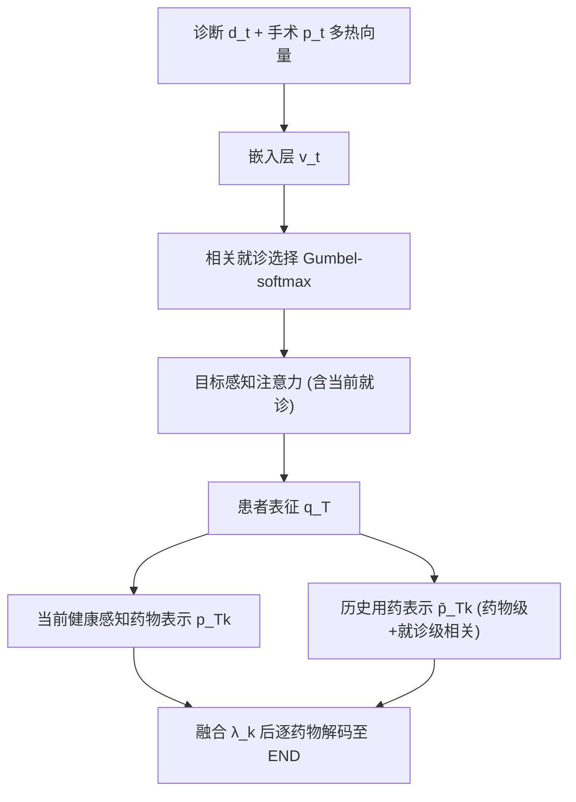
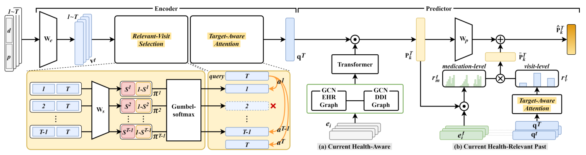

# VITA: 'Carefully Chosen and Weighted Less' Is Better in Medication Recommendation (VITA：精心挑选、低权重聚合在用药推荐中更优)

- **会议/期刊**: AAAI 2024
- **作者与机构**: Taeri Kim, Jiho Heo, Hongil Kim, Kijung Shin (KAIST), Sang-Wook Kim (Hanyang University)
- **推荐链路定位**: 端到端生成式（多标签集合预测，逐药物自回归解码）
- **研究方向**: 序列与会话推荐 / 图神经网络与知识图谱推荐
- **论文原文**: [https://arxiv.org/abs/2312.12100v1](https://arxiv.org/abs/2312.12100v1)
- **开源代码**: [https://github.com/jhheo0123/VITA](https://github.com/jhheo0123/VITA)

## TL;DR (1分钟核心速览)

本文针对「用药推荐」中患者表征构建的核心痛点：既有纵向模型要么仅靠 RNN 的顺序信息隐式刻画历史就诊相关性，要么干脆完全不用历史（COGNet）。作者先用探针实验证明「只用最相似的那次历史就诊」反而优于「用全部历史」，且不相似历史会带来负收益，据此提出 VITA：可微的**相关就诊选择**（Gumbel-softmax 硬选择，每患者选 0~n 条）+ **目标感知注意力**（把当前就诊本身也放进 softmax 分母）。在 MIMIC-III/IV 的患者级随机划分、Jaccard/PRAUC/F1 全标签评测下，相对最强基线 COGNet，Jaccard 分别提升 3.83% 与 5.56%。

## Background & Motivation (背景与核心矛盾)

- **主流范式**: 纵向（longitudinal）方法 = RNN 编码器聚合当前+历史就诊得到患者表征 $q_T$，再由记忆网络/Transformer 预测药物组合（GAMENet、MRSC、SafeDrug、COGNet）。
- **前人局限**: (1) RNN 编码器只能用「就诊顺序」隐式近似相关性，把远近历史一视同仁地压进隐状态；(2) COGNet 走向另一极端，编码器只用当前就诊，完全不建模历史；(3) 两者都无法回答「这条历史与我今天有多相关」。
- **核心洞察 (Key Insight)**: 探针实验（图 1）显示，GAMENet 只用**最相似**的 1 条历史（0.439 Jaccard）> 用全部历史（0.431）> 只用当前就诊（0.425）> 用最不相似历史（0.421）。即「不相关历史是噪声甚至毒药，应被彻底剔除而非降权」。
- **本文切入点**: 把「选哪些历史」变成可微的离散选择问题，再对选中历史做相关性加权（"carefully chosen and weighted less"）。

## Method (核心方法设计)

### 1. 整体框架 (Overall Architecture)

每次就诊 $t$的诊断为$d_t$与手术为$p_t$拼接后过嵌入层得$v_t$；编码器先用相关就诊选择模块对历史$\{v_1,...,v_{T-1}\}$做逐条二值选择，得到子集$\mathcal{V}^{rel}$，再用目标感知注意力把$\mathcal{V}^{rel}\cup\{v_T\}$软加权求和为患者表征$q_T$。预测器是一个逐药物自回归解码器：每一步融合 (a) 当前健康感知的药物表示$p_{T,k}$（对已推荐药物的 Transformer 序列建模，保证组合内相容）与 (b) 当前健康相关的历史用药表示$\bar{p}_{T,k}$（药物级 + 就诊级两层相关性），输出第$k$ 个药物，直到生成 `<END>`。全程交叉熵训练，无需负采样。

<figure class="paper-figure" markdown="span">
  <figcaption>图2：VITA概览，由两个组件组成：基于相关就诊选择和目标感知注意力的编码器；基于(a)当前健康感知和(b)当前健康相关既往用药表示的预测器。</figcaption>
</figure>

### 2. 关键设计拆解 (Key Designs)

1. **相关就诊选择 (Relevant-Visit Selection)**：痛点是为每个患者选的条数应自适应（可能 0 条），固定 Top-1 会强行引入无关历史。做法是把 $[v_t;v_T]$过 MLP 得选择概率$s_t=\sigma([v_t;v_T]\mathbf{W}_s+b_s)$，再用 Gumbel-softmax 重参数化采样得到可回传梯度的硬掩码$o_t=\lfloor \hat{o}_t+0.5 \rfloor$。直觉：以「当前就诊」为条件做选择，等价于学一个数据驱动的软 Jaccard 相关性判别器，比手工相似度更宽容（见 Key Findings 第 4 条）。

2. **目标感知注意力 (Target-aware Attention)**：痛点在于常规注意力把历史的 softmax 权重归一为 1，**即使所有历史都弱相关，也必然要摊派全部权重**，患者的当前表征会被无关历史污染。VITA 把当前就诊 $v_T$ 同时作为 query、并作为 key/value 的一员放进分母：

$$\alpha_t=\frac{\exp(v_T\mathbf{W}_\alpha v_t^{\top}/\sqrt{dim})}{\sum_{v_f\in\mathcal{V}^{rel}\cup\{v_T\}}\exp(v_T\mathbf{W}_\alpha v_f^{\top}/\sqrt{dim})},\qquad q_T=\sum_{v_t\in\mathcal{V}^{rel}\cup\{v_T\}}\alpha_t v_t$$

由此 $\sum_{t\in\mathcal{V}^{rel}}\alpha_t$可远小于 1，形成对历史整体相关性的**收缩（shrinkage）**：历史越弱相关，$q_T$越向$v_T$ 回退——这正是「weighted less」的数学落地。

3. **训练目标、负采样与推理效率**：损失为逐步的多标签交叉熵（无负采样，全 $|\mathcal{M}|$ 药物空间做 softmax 类分类）：

$$\mathcal{L}=-\sum_{t=1}^{T}\sum_{i=1}^{|\mathcal{M}|}m_{t,i}\log \hat{p}_{t,k,i}$$

药物嵌入由 EHR 图和 DDI 图各跑两层 GCN 后融合（沿用 GAMENet）。推理为逐药物自回归，每步一次 Transformer 前向，开销为 $O(|\hat{M}_T|)$ 倍单次打分；Gumbel 采样仅训练期存在，推理用确定性阈值，不额外增加线上延迟。

## Experimental Setup & Evaluation Protocol (实验设置与评估协议)

- **数据集与预处理**: 沿用 GAMENet/COGNet 的 MIMIC 预处理，**剔除仅就诊过一次的患者**及其记录（正文未给出绝对统计量，详见附录）：

| 数据集 | 患者规模 | 平均就诊数/人 | 就诊总量 | 说明 |
| :--- | :---: | :---: | :---: | :--- |
| MIMIC-III | 基准 (1×) | 2.59 | 基准 (1×) | ICU EHR，诊断+手术+药物多热编码 |
| MIMIC-IV | ≈2.15× | 3.05 | ≈2.53× | 后续版本，序列更长、更适合检验选择性聚合 |

- **数据划分与防穿越 (Splitting Strategy)**: **患者级随机划分** 4/6 : 1/6 : 1/6（train/valid/test），同一患者全部就诊落在同一折 —— 评估的是「新患者」泛化，而非同一患者的未来就诊外推，**未使用全局时间戳切分**。
- **排名评测协议 (Ranking Protocol)**: 非排序式检索，而是**多标签集合预测**：每步在全药物库 $|\mathcal{M}|$ 上做一次全库 softmax（等价 Full-Ranking、无负采样），最终取 argmax 序列成集合；指标为 Jaccard、PRAUC、F1（正文）+ DDI rate（附录）。
- **对比基线与超参设置**: 1 个非学习基线 Nearest + 5 个 SOTA：LEAP(KDD'17)、GAMENet(AAAI'19)、MRSC(CIKM'21)、SafeDrug(IJCAI'21)、COGNet(WWW'22)；所有方法均调参，报告 5 次独立运行的均值，改进显著性 $p \le 0.001$。

## Key Experimental Results (实验关键数据)

### 1. 主实验对比 (Main Results)

| 数据集 | \multicolumn{3}{c}{MIMIC-III} | \multicolumn{3}{c}{MIMIC-IV} |
| :--- | :---: | :---: | :---: | :---: | :---: | :---: |
| 指标 | Jaccard | PRAUC | F1 | Jaccard | PRAUC | F1 |
| Nearest | 0.3917 | 0.3813 | 0.5474 | 0.4523 | 0.4461 | 0.6045 |
| LEAP (KDD'17) | 0.4306 | 0.6379 | 0.5941 | 0.4273 | 0.5949 | 0.5836 |
| GAMENet (AAAI'19) | 0.4350 | 0.6754 | 0.5902 | 0.4600 | 0.7029 | 0.6106 |
| MRSC (CIKM'21) | 0.4856 | 0.7413 | 0.6451 | 0.4487 | 0.6907 | 0.6063 |
| SafeDrug (IJCAI'21) | 0.5060 | 0.7537 | 0.6630 | 0.4731 | 0.6976 | 0.6251 |
| COGNet (WWW'22) | 0.5087 | 0.7567 | 0.6666 | 0.4943 | 0.7069 | 0.6473 |
| **VITA** | **0.5282** | **0.7673** | **0.6815** | **0.5218** | **0.7148** | **0.6685** |
| Improv. vs COGNet | +3.83% | +1.40% | +2.24% | +5.56% | +1.12% | +3.28% |

### 2. 消融实验 (Ablation Study)

| 变体 | III Jaccard | III PRAUC | III F1 | IV Jaccard | IV PRAUC | IV F1 |
| :--- | :---: | :---: | :---: | :---: | :---: | :---: |
| **VITA (完整)** | **0.5282** | **0.7673** | **0.6815** | **0.5218** | **0.7148** | **0.6685** |
| w/o selection (VITA-RS) | 0.5163 | 0.7558 | 0.6708 | 0.5197 | 0.7088 | 0.6590 |
| 固定 Top-1 相似历史 (VITA-RS$_{Top\text{-}1}$) | 0.5140 | 0.7413 | 0.6702 | 0.4803 | 0.6943 | 0.6352 |
| 注意力锐化替代选择 (VITA-RS$_{sharp}$) | 0.5188 | 0.7622 | 0.6718 | 0.5199 | 0.7090 | 0.6639 |
| 均值池化替代 (VITA-TA$_{avg}$) | 0.5119 | 0.7505 | 0.6650 | 0.5130 | 0.7069 | 0.6596 |
| GRU 替代 (VITA-TA$_{RNN}$) | 0.5152 | 0.7538 | 0.6682 | 0.5167 | 0.7012 | 0.6633 |
| 常规注意力 (VITA-TA$_{attn}$) | 0.5181 | 0.7587 | 0.6699 | 0.5196 | 0.7094 | 0.6622 |

### 3. 关键实验发现 (Key Findings)

1. **增益随历史长度放大**：MIMIC-III→IV 患者数 ×2.15、平均就诊数 2.59→3.05，VITA 相对 COGNet 的 Jaccard 增益由 +3.83% 升至 +5.56%，说明「选对历史」在长序列下才是主要矛盾；而既有 SOTA 间相互超越平均仅 ~1.71%，本文增益属量级突破。
2. **硬选择不可被软锐化替代**：VITA-RS 掉 2.3%（0.5282→0.5163，III），但把注意力温度压到 0.2 的 VITA-RS$_{sharp}$ 仍只 0.5188；固定 Top-1 在 IV 上崩至 0.4803（−7.9%），证明「每患者自适应选 0~n 条」优于任何固定的 Top-k 或软近似。
3. **目标感知是关键增量**：常规注意力 VITA-TA$_{attn}$ 已达 0.5181（仍超 COGNet），但仍低于 VITA 0.5282；均值池化最差（0.5119），GRU 次差（0.5152）→ 相关性既不能省（vs avg）也不等价于顺序（vs RNN），而把当前就诊放进分母带来的「收缩」额外贡献约 2% 相对增益。
4. **选出的是「内在相关」而非「表面相似」**：选择模块挑中的历史与当前就诊的平均 Jaccard 相似度 0.2164，比未选中的 0.1762 高 22.81%，但并非总是最相似者 —— 存在表面不相似、语义上却相关（如同一慢性病不同表现）的就诊。此外两模块可正交外挂：GAMENet/MRSC/SafeDrug/COGNet 装配后 Jaccard 全部上升（图 3）。

## Highlights & Limitations (亮点、对比与审稿批判)

- **与代表作对比 (vs. Prior Work)**: GAMENet 用记忆网络 + RNN 隐状态近似历史重要性；COGNet 完全舍弃历史、只用当前就诊内诊-术关系；MRSC/SafeDrug 侧重安全性与药物分子结构约束。VITA 的差异在于**把「历史该不该用」显式建模为离散选择**，并用一个不归一为 1 的注意力实现软回退，二者均与主干模型解耦，可直接外挂。
- **可迁移亮点**: (1) 「把当前 target 也放进 softmax 分母」这一收缩式注意力可移植到序列推荐/会话推荐中的长历史聚合；(2) Gumbel-softmax 硬选择 + 变长子集，适用于任意「历史条目质量参差」的场景（如用户长期行为去噪、跨域行为筛选）。
- **审稿级局限批判**: (1) 采用患者级**随机划分**而非全局时间戳切分，评估的是新患者冷启场景，缺少「同一患者未来就诊」的在线外推验证；(2) 逐药物自回归解码 + Gumbel 采样使训练/推理开销随 $|\hat{M}_T|$ 线性增长，论文仅在附录报告训练时间，未给出线上延迟；(3) 安全性指标 DDI rate 被置于附录，正文未讨论精度提升是否以安全性为代价（对医疗场景是硬约束）；(4) 仅在两个同源 MIMIC 数据集验证，跨机构 EHR 泛化性未知。

## Rating (四维评分)

- **方法创新性 (Novelty)**: ⭐⭐⭐⭐ （两个模块均非全新算子，但「不相关历史应剔除而非降权」的实证发现 + 分母含 target 的收缩注意力，是扎实且有解释力的增量）
- **评估协议与实验扎实度 (Protocol & Experiments)**: ⭐⭐⭐⭐ （6 基线 × 2 数据集 × 3 指标 + 6 变体消融 + 可插拔性验证 + 选择行为统计，$p\le0.001$；扣分在随机划分与安全性指标缺位）
- **写作与数学规范度 (Clarity & Rigor)**: ⭐⭐⭐⭐ （公式与符号与 GAMENet 体系对齐、Gumbel 采样与注意力分母的动机解释清楚，复杂度分析置于附录略显不足）
- **工业落地与复现价值 (Industrial & Practical Value)**: ⭐⭐⭐⭐ （代码开源、两模块可正交外挂到既有纵向模型、无需负采样；但自回归解码与 Gumbel 训练在真实 HIS 高并发下的延迟仍需工程折衷）

