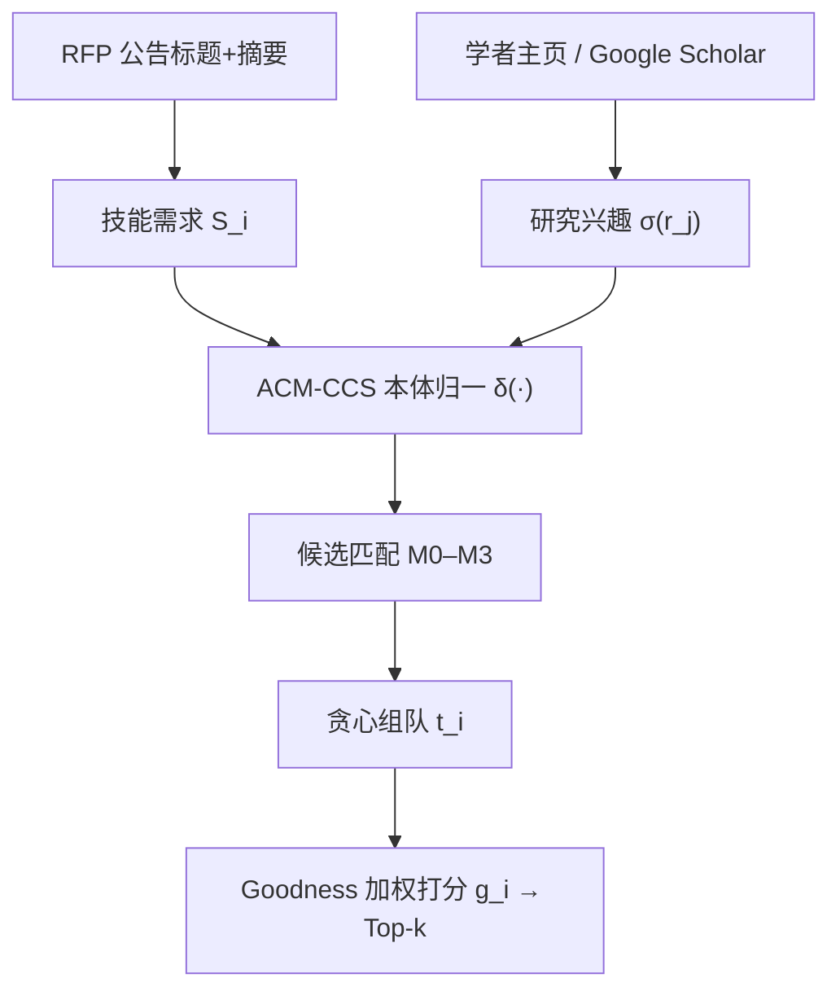
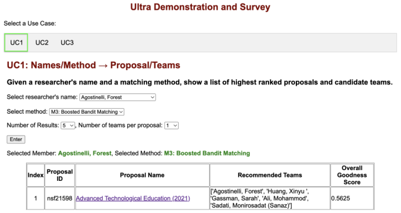

# Promoting Research Collaboration with Open Data Driven Team Recommendation in Response to Call for Proposals (面向基金申请征集的开放数据驱动团队推荐)

- **会议/期刊**: AAAI 2024 (IAAI 应用创新轨道)
- **作者与机构**: Siva Likitha Valluru, Biplav Srivastava, Sai Teja Paladi (University of South Carolina AI Institute); Siwen Yan, Sriraam Natarajan (UT Dallas, StARLinG Lab)
- **推荐链路定位**: 召回（候选团队生成与排序），端到端部署系统 ULTRA
- **研究方向**: 社交与群组推荐 / 强化学习与 Bandit 探索
- **论文原文**: [https://arxiv.org/abs/2309.09404v5](https://arxiv.org/abs/2309.09404v5)
- **开源代码**: [https://github.com/ai4society/Ultra-Metric](https://github.com/ai4society/Ultra-Metric)（goodness 度量工具；系统本体未完全开源）

## TL;DR (1分钟核心速览)

针对"研究者响应基金征集（TeamingForFunding）时难以快速组建跨学科技能互补团队"的痛点，本文把该任务形式化为 **群体推荐问题**：从 RFP 公告（需求）与学者主页/Google Scholar（供给）抽取技能，用 ACM-CCS 本体归一后做供需匹配，并提出可配置的四指标加权 **goodness** 度量与四级递进算法（随机 → 字符串匹配 → 分类法匹配 → 关系型 Boosted Bandit）。在 434 个 RFP × 200 位研究者的 USC 数据上，M3 的 goodness 达 0.5295，较随机基线 0.0879 提升 **+502%**，并在 IIT-R（100 RFP × 46 人）复现同一趋势；212 份问卷中 90.09% 认为结果相关、97.64% 认为有用。

## Background & Motivation (背景与核心矛盾)

- **主流范式**: 组队问题长期由 Hedonic Games 联盟博弈与多目标进化优化（如 NSGA-II 选板球队）主导；推荐侧则普遍是面向个体的 Top-$k$ 单物品推荐。
- **前人局限**: (1) 作者前作 ULTRA 原型本质是**顺序单物品推荐**，受冷启动与流行度偏置制约，无法表达"团队整体能力"这一群体效用；(2) 最接近的 Machado & Stefanidis 用暴力/启发式增量选人，但**不做任何量化效果评估**，且假设"一人可完全满足一项技能需求"，与跨学科 RFP 的现实不符；(3) 穷举团队排列评估 goodness 是 NP-hard，规模一大即不可行。
- **核心洞察 (Key Insight)**: 在学术场景中，需求（RFP 文本）与供给（研究者公开画像）**都是开放数据**，可零成本获取；二者的技能表述差异主要是"同义不同词"，可用层级化本体（ACM-CCS，2000+ 主题、四层结构）弥合，从而把组队转化为"技能集合覆盖 + 负载均衡"的匹配问题。
- **本文切入点**: 用**可配置 goodness 度量**把"短期技能满足 vs. 长期人才池健康"统一为一个标量目标，再用信息量逐级递增的四种匹配器去优化它，并接受"质量换数量"的取舍。

## Method (核心方法设计)

### 1. 整体框架 (Overall Architecture)

系统分三阶段闭环：**（i）供需抽取**——从 NSF/DST 的 RFP 标题与摘要中经去停用词 + 关键词抽取得到技能需求集 $S_i$，从研究者主页与 Google Scholar 抽取研究兴趣$\sigma(r_j)$；**（ii）语义归一**——用 n-gram 匹配把两侧技能映射到 ACM-CCS 概念码$\delta(S_i)$、$\delta(\sigma(r_j))$；**（iii）匹配与组队**——按 M0–M3 四级方法生成候选池，以贪心策略按匹配强度优先填充成员形成团队$t_i$，计算 goodness$g_i$后降序返回 Top-$k$（每 RFP 上限 10 队）。部署形态为三层架构（数据存储检索 / 团队匹配 / 结果分析），RFP 与院系名录定期刷新；推理时对每个 (RFP, 研究者) 对做谓词打分，复杂度随$|C|\times|R|$ 线性增长。

<figure class="paper-figure" markdown="span">
  <figcaption>图 1：演示用例 UC1，展示 ULTRA 的团队参与者视图。</figcaption>
</figure>

### 2. 关键设计拆解 (Key Designs)

1. **Goodness 四指标可配置度量（本文核心增量）**：传统推荐用 MRR/Top-$k$评价"唯一正确结果"，但组队是**多个都对的解**，且需兼顾短期交付与长期生态。本文定义覆盖率$\mathrm{cov}(t_i)=\left|\left(\bigcup_{r\in t_i}\sigma(r)\right)\cap S_i\right|/|S_i|$、$k$-鲁棒性$\mathrm{rob}_k(t_i)$（任意剔除$k$名成员后仍满足约束）、冗余度$\mathrm{red}(t_i)$（被多人重复持有的需求技能占比）与团队规模$|t_i|$，各自 min-max 归一为$\tilde{\cdot}$后取加权均值：$g_i=\frac{1}{4}\left(+\tilde{\mathrm{cov}}+\tilde{\mathrm{rob}}_k-\tilde{\mathrm{red}}-\widetilde{|t|}\right)$。给覆盖/鲁棒正权重、冗余/规模负权重，是因为大队伍虽提升鲁棒性却摊薄人均经费并拖慢决策——把"团队越大越好"的直觉显式惩罚掉，是本度量区别于普通集合覆盖的关键物理直觉。
2. **ACM-CCS 本体对齐（M1 → M2）**：字符串匹配把 "natural language processing" 与 "knowledge representation" 判为无关（M1 失效点），M2 改判二者同属 ACM-CCS 的 "artificial intelligence" 分支：$\delta(S_i)\cap\delta(\sigma(r_j))\neq\varnothing$ 即视为可合作。这一步把匹配从**词面**抬到**概念层**，用现成公共本体零成本缓解了技能表述的词汇鸿沟（vocabulary gap）。
3. **关系型 Boosted Bandit（M3）与训练目标**：前三级全靠人工规则，M3 把"研究者 $r_j$是否为 RFP$c_i$的合适候选"写成二值谓词$y=\mathrm{candidate}(r_j,c_i)$，用 softmax 势函数建模$P(y\mid\mathbf{x})=\frac{\exp\psi(y\mid\mathbf{x})}{\sum_{y'}\exp\psi(y'\mid\mathbf{x})}$，其中势函数由$I$棵回归树对函数梯度逐轮累加$\psi_I=\psi_0+\sum_{i=1}^{I}\Delta_i(p)$。由于数据天然是关系型（RFP–技能、研究者–兴趣、RFP–团队三元关系），采用**关系提升（relational boosting）**在谓词 grounding 上生成样本，无需负采样即可从数据自动学出比人工规则更复杂的组合规则；推理仅需树遍历，代价极低。

## Experimental Setup & Evaluation Protocol (实验设置与评估协议)

- **数据集与预处理**:

| 数据集 | #Users | #Items | #Interactions | 稀疏度/密度 | 特征/场景说明 |
| :--- | :---: | :---: | :---: | :---: | :--- |
| USC (主) | 200 | 434 RFP | 每人每 RFP ≤ 10 个候选团队 | 论文未报告（非隐式反馈矩阵） | NSF 公告 + 本校院系名录，英文 |
| IIT-R (泛化) | 46 | 100 RFP | 同上 | 论文未报告 | 印度 DST 公告 + IIT-R 教师画像，跨机构跨语种 |

- **数据划分与防穿越 (Splitting Strategy)**: **无训练/验证/测试划分**。工作流为"给定 RFP 与全量研究者池 → 生成团队 → 立即用 goodness 打分"，属于纯离线生成式评估，M3 的学习信号来自谓词 grounding 而非留出标签。
- **排名评测协议 (Ranking Protocol)**: 既非 Full-Ranking 也非 Sampled Ranking，而是**代理指标评估**——对每方法取候选团队 goodness 的均值 $\bar{G}$与标准差，同时报告团队**数量**$\#T$ 作为"精度-召回"权衡的另一轴；无 ground-truth 相关性标注。
- **对比基线与超参设置**: 四个方法互为递进基线（M0 随机 / M1 字符串匹配阈值 $th_{M1}$/ M2 n-gram+ACM-CCS 阈值$th_{M2}$/ M3 提升树$m$轮迭代）；goodness 权重默认$+1,+1,-1,-1$；**未做显著性检验**，仅以 mean±STD 呈现。

## Key Experimental Results (实验关键数据)

### 1. 主实验对比 (Main Results)

| 方法 | USC $\bar{G}$↑ | USC$\#T$↓ | IIT-R$\bar{G}$↑ | IIT-R$\#T$ ↓ |
| :--- | :---: | :---: | :---: | :---: |
| M0 随机 | 0.0879 ± 0.0290 | 10 | 0.0896 ± 0.0006 | 10 |
| M1 字符串匹配 | 0.3673 ± 0.1569 | 10 | 0.4218 ± 0.0011 | 8 |
| M2 + ACM-CCS 本体 | 0.4097 ± 0.1313 | 9 | 0.4292 ± 0.0017 | 7 |
| **M3 Boosted Bandit** | **0.5295 ± 0.0816** | **6** | **0.5835 ± 0.0203** | **1** |
| Improv. (M3 vs 最强基线) | **+29.2%** (vs M2) / +502% (vs M0) | — | **+35.9%** (vs M2) / +551% (vs M0) | — |

人评（USC 全院 28 天，212 份有效回答）：相关性 157 份"非常相关" + 34 份"较相关" = **90.09%**；有用性 172 份"非常有用" + 35 份"较有用" = **97.64%**。

### 2. 消融实验 (Ablation Study)

原文未提供标准消融，此处以"方法阶梯"作组件剥离的近似消融：

| 配置 | 剥离的组件 | USC $\bar{G}$ | Δ vs 完整 M3 |
| :--- | :--- | :---: | :---: |
| w/o 一切（M0） | 技能匹配 + 本体 + 学习 | 0.0879 | −83.4% |
| w/o 语义+学习（M1） | ACM-CCS 本体、Boosted Bandit | 0.3673 | −30.6% |
| w/o 学习（M2） | 仅 Boosted Bandit | 0.4097 | −22.6% |
| Full（M3） | — | **0.5295** | — |

### 3. 关键实验发现 (Key Findings)

1. **质量与数量呈系统性反向权衡**：从 M0 到 M3，USC 的 goodness 由 0.0879 升至 0.5295（6.0×），但人均候选团队数由 10 降至 6；IIT-R 更极端，M3 只给出 **1** 个团队却拿到 0.5835 的分数。说明信息量越大，匹配器越"自信地收敛"，可用结果被精度换走了。
2. **增益主要来自"从人工规则到关系学习"，而非本体归一**：M1→M2 仅 +11.5%（USC）/+1.8%（IIT-R），而 M2→M3 达 **+29.2%/+35.9%**，且 M3 的标准差最小（0.0816 vs M1 的 0.1569），说明人工设计的覆盖规则很快触顶，自动学出的关系谓词组合才是主要贡献。
3. **跨机构泛化与度量稳定性均被验证但人评存在偏差**：两站点四种方法的 goodness 排序完全一致（0.0879<0.3673<0.4097<0.5295 与 0.0896<0.4218<0.4292<0.5835），支持方法可迁移；但人评中部分用户把随机团队 M0 也评为"非常有用"（因能"扩展新连接"），提示用"是否相关/有用"作主观标签会混入探索性偏好，不宜直接当作方法优劣的判据。

## Highlights & Limitations (亮点、对比与审稿批判)

- **与代表作对比 (vs. Prior Work)**: 相比 Srivastava et al. 2022 的 ULTRA 原型（单物品顺序推荐、只输出匹配百分比），本文升级为群体推荐并给出可解释的 goodness 标量；相比 Machado & Stefanidis 2019 的启发式增量选人（无度量、假设一人满足一技能），本文既提供量化评估又允许技能由多人拼合覆盖；相比 Hedonic Games 需每个玩家给出对其他人的完整估值，本文完全依赖开放数据自动构造供需。
- **可迁移亮点**: (1) 用**正/负双极性权重**的加权均值把"越大越差"的指标（团队规模、冗余）纳入统一目标，可直接搬到审稿人分配、众包任务分派、面试小组组建；(2) 用公共层级本体做概念码对齐，是低成本缓解跨文本词汇鸿沟的通用技巧。
- **审稿级局限批判**: (1) **评估循环性**——goodness 由作者自定，而 M3 又直接优化该度量的相关谓词，缺少"提案是否中标/用户是否采纳"这类外部标签（作者亦承认该反馈延迟数月到数年），因此 0.5295 的可信度有限；(2) **无划分、无显著性检验、单次运行**，M3 的谓词正例来源与过拟合风险未交代；(3) 规模仅 200 人与 46 人，扩展到万级院校时 $|C|\times|R|$ 的谓词推断与数据清洗成本未评估；(4) 人评为非受控观察式调查，用户未强制体验全部四种方法，方法间不具备可比的主观评分。

## Rating (四维评分)

- **方法创新性 (Novelty)**: ⭐⭐⭐ （把组队形式化为群体推荐并提出四指标可配置 goodness 有新意，但 M1/M2 为规则工程，M3 的关系提升 Bandit 属已有框架的迁移应用）
- **评估协议与实验扎实度 (Protocol & Experiments)**: ⭐⭐⭐ （双机构 434+100 个 RFP 的跨站点一致性 + 212 份人评是加分项，但缺划分、缺显著性检验、指标为自定义代理量）
- **写作与数学规范度 (Clarity & Rigor)**: ⭐⭐⭐ （三份伪代码与度量定义清晰，但 goodness 归一的 min-max 参照集未定义，M3 训练细节与超参缺失）
- **工业落地与复现价值 (Industrial & Practical Value)**: ⭐⭐⭐⭐ （已在 US 主要高校上线运行 28 天以上并开源度量工具，架构轻、推理廉价，是少见的真实部署型组队推荐系统）

