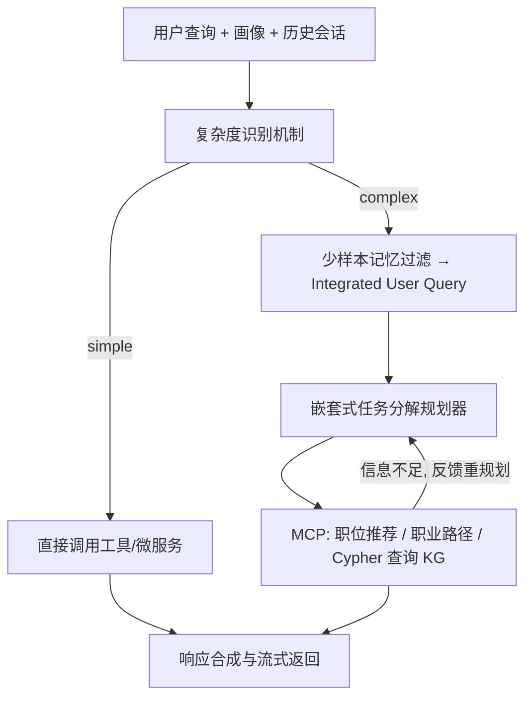
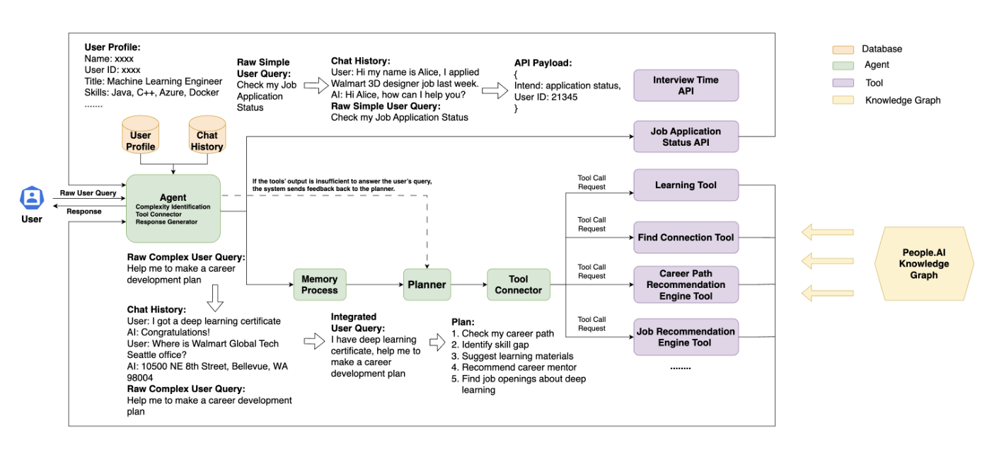

# AdaptJobRec: Enhancing Conversational Career Recommendation through an LLM-Powered Agentic System (面向求职对话推荐的自适应智能体系统)

- **会议/期刊**: AAAI 2026
- **作者与机构**: Qixin Wang, Dawei Wang, Kun Chen, Yaowei Hu, Han Li 等（Walmart Global Tech；University of Arkansas）
- **推荐链路定位**: 端到端生成式（Agent 编排工具调用 + 个性化召回工具）
- **研究方向**: 对话推荐与智能体仿真 / 大语言模型推荐
- **论文原文**: [论文原文链接](https://arxiv.org/abs/2508.13423v2)
- **开源代码**: 暂未开源

## TL;DR (1分钟核心速览)

面向沃尔玛求职场景，现有 Agentic CRS（ReAct、Plan & Execute、MACRS）依赖 CoT 规划 + 记忆 + 重规划，导致响应延迟远高于用户对"查申请状态"这类简单查询的容忍度。论文提出 AdaptJobRec：先用**复杂度识别机制**把查询二分为 simple/complex 两条路径，simple 直接调工具，complex 走**少样本记忆过滤**（从冗长对话中只抽取相关片段生成 Integrated User Query）再送入**可输出嵌套列表的异步任务分解规划器**，底层挂接基于 People.AI 知识图谱（160 万节点 / 8300 万边）的个性化推荐工具。在沃尔玛真实数据上，Hit@10 达 0.3176（vs. Plan & Execute 0.3127），试点 A/B 中平均对话轮次 3.32、响应延迟 498 ms，相对 RAG 基线分别降低 53.2% 与 53.3%。

## Background & Motivation (背景与核心矛盾)

- **主流范式**: 对话推荐已从 RAG 式生成演进到 Agentic 架构——ReAct 的 CoT 逐步推理、Plan & Execute 的独立 replan 模块、RecMind 的 ToT 自启发规划、MACRS 的主动追问 Agent、InteRecAgent 的 memory bus。
- **前人局限**: 其一，规划/记忆/重规划模块虽然提升了复杂问题求解能力，却把延迟成本强加给**所有**查询，而求职场景中大量用户只关心"我的申请进度如何"这类秒级诉求；其二，窗口截断、摘要、VectorDB 等历史压缩手段会丢失关键细节或保留无关内容，误导规划器的子任务分解与工具选择。
- **核心洞察 (Key Insight)**: 延迟不是"首个 token 时延"问题，而是**整条响应链路**的问题；并且查询复杂度呈现强二象分布，绝大多数请求根本不需要规划。
- **本文切入点**: 用"按需付费"的路由思想——只有 complex 查询才启动完整的记忆 + 规划管线，同时把可并行的子任务显式并行化。

## Method (核心方法设计)

### 1. 整体框架 (Overall Architecture)

用户查询经 Kafka 进入 AdaptJobRec Server，服务端并行拉取 User Profile Service 的用户画像与 Cassandra 中的历史会话，Redis 担当 Cache Augmented Generation 缓存高频问答。Agent 首先执行复杂度判定：simple 查询合并历史后直接调 Job Application Microservice（如申请状态、面试时间）；complex 查询先经少样本记忆处理模块裁剪出相关历史片段，拼接为 Integrated User Query，再交由规划器拆分（并分组）子任务，通过 MCP Server 调用个性化职位推荐引擎、职业路径推荐引擎或 Text-to-Cypher 查询 People.AI 知识图谱；若工具返回信息不足，则回传反馈触发新一轮规划（图 1 虚线）。最终由 Agent 综合各工具结果流式返回。

<figure class="paper-figure" markdown="span">
  <figcaption>图 1：AdaptJobRec 智能体系统架构</figcaption>
</figure>

### 2. 关键设计拆解 (Key Designs)

1. **复杂度识别机制（按需路由的延迟闸门）**：痛点是把 planner + memory 施加到全部请求上，简单查询被无谓拖慢。作者用定制 system prompt 让 LLM 输出一个二值判定 $\pi(q, h_{1:t}, u) \in \{\text{simple}, \text{complex}\}$，从而期望延迟变为$\mathbb{E}[T] = p_s T_{\text{tool}} + (1-p_s)T_{\text{full}}$；由于真实流量中$p_s$很高而$T_{\text{full}} \gg T_{\text{tool}}$，整体延迟被显著压低，而复杂查询仍保有完整推理能力。这是纯提示词级的改动，不需要微调，工程上可即插即用。

2. **少样本记忆处理模块（精准上下文而非粗暴压缩）**：痛点是滑动窗口/摘要/VectorDB 检索要么丢关键信息、要么塞入噪声，污染规划器的分解质量。模块用多场景 few-shot 提示让 LLM 从历史 $h_{1:t}$中抽取与当前查询相关的片段集合$\mathcal{S}$，产出增强查询$q' = \text{Mem}_\phi(q, \mathcal{S})$，且显式覆盖"历史中无相关内容"的情形。直觉上它把规划器的输入信噪比拉高，等价于在不增加 token 预算的前提下减少了误分解与误选工具。

3. **嵌套式异步规划器与训练/推理开销**：已有规划器（Plan & Execute、RecMind）输出严格有序的子任务序列并串行调用工具，延迟为 $\sum_i \tau_i$；本文改为输出嵌套列表$P=[[t_1,t_2],[t_3]]$，同组可并行，延迟降为$\sum_k \max_{i \in g_k}\tau_i$。例如"西雅图 vs. Sunnyvale 哪边 ML 工程师岗位多"可先并行两次检索再比较。工具侧无梯度训练：职位推荐工具以画像实体（技能/学历/地点）匹配分归一化后叠加实时兴趣函数，权重由贝叶斯优化在点击数据上以 CTR 为目标调参，返回 Top-20 交 Agent 生成回答；系统无负采样与离线损失函数，全部依赖提示词与工具打分。

## Experimental Setup & Evaluation Protocol (实验设置与评估协议)

- **数据集与预处理**（均为沃尔玛内部真实数据，未公开）：

| 数据集 | 规模 | 说明 |
| :--- | :---: | :--- |
| Job Recommendation | 10,014 用户 | 用户画像 + 浏览历史 + 点击日志（2024） |
| Career Path Prediction | 932,854 条转岗记录（2022–2023 训练）/ 471,495 条（2024 测试） | 用于微调 Llama-Capa、DeepSeek-Capa |
| Pilot Group Study | 30 用户 / 150 会话 | 每会话随机分配 4 种方法之一 |

- **数据划分与防穿越**: 职业路径任务采用**全局时间戳切分**（2022–2023 训练、2024 测试），避免未来转岗信息泄漏；职位推荐未报告划分细节。
- **排名评测协议**: 未声明 Full-Ranking；实为推荐工具先召回 Top-20 候选再由 Agent 排序，指标 Hit@10 / NDCG@10 / MAP@10，属于**截断候选池排序**，且未报告负采样比例，这是评估可复现性的主要弱点。
- **对比基线与超参**: 基线含 RAG、ReAct、Plan & Execute、MACRS，以及微调 Llama-3.1-8B / DeepSeek-R1-Distill-Qwen-7B 得到的 Llama-Capa、DeepSeek-Capa，另有 Frequency 频率基线。显著性检验统一使用 Welch's $t$-test（$p<0.05$）。

## Key Experimental Results (实验关键数据)

### 1. 主实验对比 (Main Results)

| 方法 | Hit@10↑ | NDCG@10↑ | MAP@10↑ | 转岗命中率↑ | 延迟(s)↓ |
| :--- | :---: | :---: | :---: | :---: | :---: |
| RAG | 0.2000 | 0.0391 | 0.0136 | – | – |
| ReAct | 0.2789 | 0.0747 | 0.0342 | – | – |
| MACRS | 0.3120 | 0.0775 | 0.0350 | – | – |
| Plan & Execute | 0.3127 | 0.0799 | 0.0364 | – | – |
| Frequency | – | – | – | 8.12% | 0.32 |
| Llama-Capa | – | – | – | 8.35% | 0.67 |
| DeepSeek-Capa | – | – | – | 11.24% | 0.81 |
| **AdaptJobRec** | **0.3176** | **0.0810** | **0.0371** | **12.82%** | **0.36** |
| Improv. (vs. 最强基线) | +1.6% | +1.4% | +1.9% | +14.1% | −55.6% |

试点 A/B（150 会话）：平均对话轮次 **3.32** vs. RAG 7.10 / MACRS 3.68（−53.2% / −9.8%），响应延迟 **498 ms** vs. RAG 1065 ms / MACRS 552 ms（−53.3% / −9.8%），全部 $p<0.01$。

### 2. 消融实验 (Ablation Study)

原文**未提供标准组件消融**，以下为用代理基线近似拆解的间接证据（作者自述而非受控实验）：

| 配置（近似移除的组件） | Hit@10 | NDCG@10 | 对话轮次 | 延迟(ms) |
| :--- | :---: | :---: | :---: | :---: |
| w/o memory + w/o planner（RAG） | 0.2000 | 0.0391 | 7.10 | 1065 |
| w/o 复杂度路由（全查询走 CoT 规划，ReAct） | 0.2789 | 0.0747 | 3.86 | 579 |
| w/o 异步嵌套分组（Plan & Execute） | 0.3127 | 0.0799 | 6.38 | 957 |
| w/o 记忆过滤（MACRS 式追问） | 0.3120 | 0.0775 | 3.68 | 552 |
| Full AdaptJobRec | **0.3176** | **0.0810** | **3.32** | **498** |

### 3. 关键实验发现 (Key Findings)

1. **延迟收益主要来自路由而非模型瘦身**：相较 ReAct 的 579 ms，AdaptJobRec 降至 498 ms（−14.0%），而相较 RAG 的 1065 ms 则降 53.3%——说明简单的"合并历史直接调工具"路径本身就吃掉了一半以上开销，规划链路才是延迟大头。
2. **精度增益幅度有限但统计显著**：相对最强基线 Plan & Execute，Hit@10 仅 +1.6%（0.3127→0.3176），但 Welch's $t$-test 显示$p=0.001$；这说明个性化知识图谱工具与记忆过滤主要修正的是尾部长尾查询，而非整体排序范式。
3. **记忆过滤直接压缩交互成本**：在用户刻意把复杂查询占比推到 95% 以上的试点中，轮次仍从 MACRS 的 3.68 降到 3.32（−9.8%），即更准的上下文使一次问对率上升；作者据此推断真实流量（简单查询占多数）下延迟优势会更明显。

## Highlights & Limitations (亮点、对比与审稿批判)

- **与代表作对比 (vs. Prior Work)**: 相较 ReAct / Plan & Execute 的"全量规划"与 MACRS 的"多轮追问补全意图"，本文的核心差异是**把计算预算做成查询自适应的**，并用嵌套列表把并行性显式写进规划输出；相较 JD 提出的 first-token latency 优化，本文优化的是端到端总时延而非首字时延。
- **可迁移亮点**: ①"复杂度二分类 + 快慢双通道"这一路由范式可零成本套用到任何 Agent 化推荐/客服系统；②把规划器输出从线性序列改为嵌套并发组，是低成本榨取并行加速的通用技巧。
- **审稿级局限批判**: ① 实验完全基于沃尔玛内部数据且无开源代码、无数据统计表、无划分细节与候选池构造说明，可复现性弱；② 缺失受控消融，各模块贡献无法被干净归因，且延迟数字受试点流量分布（简单查询 <5%）严重扭曲，53.3% 的提升更接近"上限展示"而非真实均值；③ 复杂度判别仅靠提示词，路由误判（把复杂查询判为 simple）会直接损害回答质量，但论文未报告误判率与代价分析。

## Rating (四维评分)

- **方法创新性 (Novelty)**: ⭐⭐⭐ （复杂度路由与异步嵌套规划都是务实但偏工程的组合式创新，缺少理论刻画与新学习范式）
- **评估协议与实验扎实度 (Protocol & Experiments)**: ⭐⭐ （真实工业数据与 Welch 检验是加分项，但无 Full-Ranking 声明、无受控消融、候选池与划分不透明）
- **写作与数学规范度 (Clarity & Rigor)**: ⭐⭐⭐ （系统链路与部署描述清晰，但几乎无形式化定义，模块有效性靠叙事而非推导）
- **工业落地与复现价值 (Industrial & Practical Value)**: ⭐⭐⭐⭐ （Kafka + Redis CAG + MCP + 知识图谱的完整上线架构极具参考价值，唯代码未开源削弱复现性）

