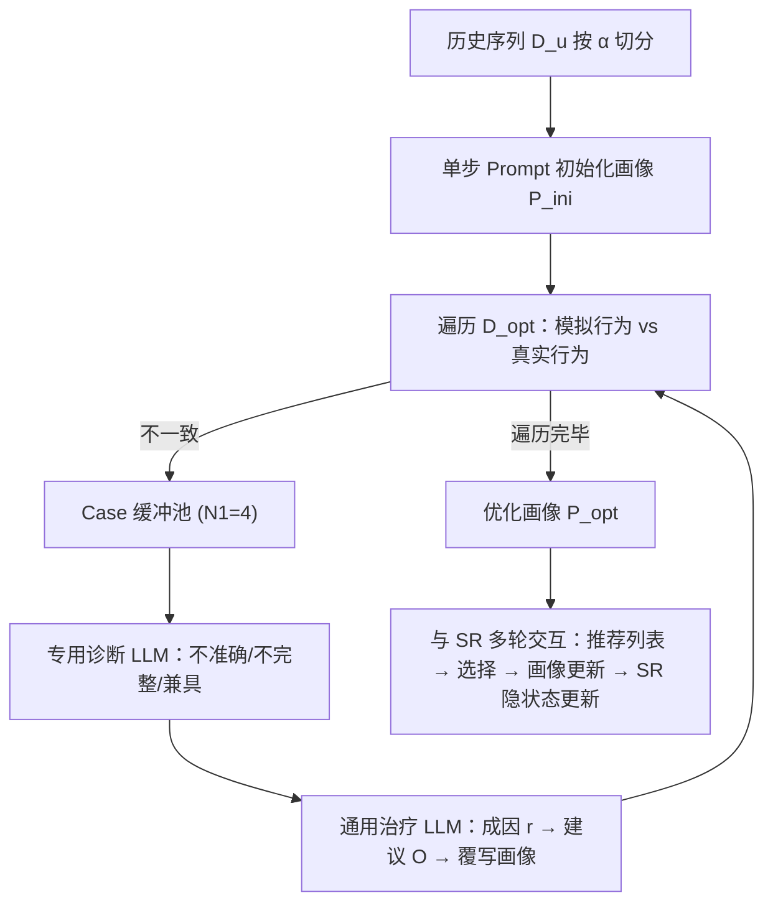
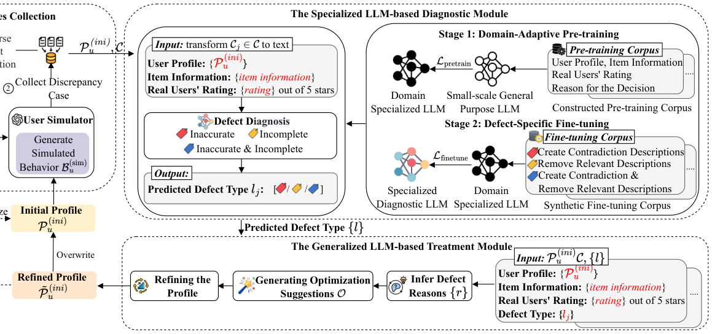

# Diagnostic-Guided Dynamic Profile Optimization for LLM-based User Simulators in Sequential Recommendation (诊断引导的动态画像优化：面向序列推荐的 LLM 用户模拟器)

- **会议/期刊**: AAAI 2026
- **作者与机构**: Hongyang Liu, Zhu Sun, Tianjun Wei, Yan Wang, Jiajie Zhu, Xinghua Qu（Macquarie University / SUTD / NTU / ByteDance Seed）
- **推荐链路定位**: 仿真评测（作为序列推荐器的离线评估环境，服务于召回/重排策略的迭代）
- **研究方向**: 对话推荐与智能体仿真 / 大语言模型推荐
- **论文原文**: [arXiv:2508.12645v5](https://arxiv.org/abs/2508.12645v5)
- **开源代码**: [hyllll/DGDPO](https://github.com/hyllll/DGDPO)

## TL;DR (1分钟核心速览)

现有 LLM 用户模拟器只在初始化时用单步 Prompt 生成一次画像，且仅与静态推荐器做"分页式"单轮交互，导致画像错误永久固化、模拟行为随轮次漂移。DGDPO 把画像构建改造为**"诊断—施治"闭环**：专用小模型（Qwen3-0.6B，经领域自适应预训练 + 缺陷定向微调）判定缺陷类型（不准确／不完整／兼具），通用 LLM 据此生成定向修改建议并覆写画像；同时首次把模拟器接入序列推荐器，实现多轮双向演化。在三数据集、每集采样 1000 用户的候选集（1 正 + 19 负）评测下，Precision/Recall/Acc/F1 平均相对提升 16.87%／18.82%／14.63%。

## Background & Motivation (背景与核心矛盾)

- **主流范式**: Agent4Rec、RecAgent、AgentCF 等以 LLM Agent 框架（Profile + Memory + Action）模拟用户，凭画像与物品信息决定是否点击并给出理由，用作推荐系统的低成本评估沙盒。
- **前人局限**: (1) 画像仅在初始化时一次性生成，任何错误都无从纠正，随交互轮次误差累积放大；(2) 主流做法依赖 GPT-4o-mini 等通用 LLM 做 self-reflection 式反思，缺乏推荐领域知识、易幻觉——图 1 显示通用 LLM 直接 Prompt 的缺陷识别准确率仅 **62.78%**；(3) 只与 MF 等静态推荐器做单轮"翻页"交互，无法反映用户偏好与推荐策略互为因果的真实闭环。
- **核心洞察 (Key Insight)**: 画像优化的瓶颈不在"生成能力"而在**"诊断信号的可靠性"**——只要缺陷类型判得准，通用大模型的改写能力足以完成修复；因此应把"诊断"与"施治"解耦，前者用小模型专业化，后者用大模型泛化。
- **本文切入点**: 以"模拟行为 vs. 真实行为"的不一致样本作为触发器，构建迭代式诊断-治疗优化链，并把优化后的模拟器嵌入序列推荐器的多轮交互。

## Method (核心方法设计)

### 1. 整体框架 (Overall Architecture)

将用户历史序列 $D_u$按比例$\alpha$切为$D_u^{(ini)}$与$D_u^{(opt)}$：前者单步 Prompt 生成初始画像$P_u^{(ini)}$；后者被逐条遍历，模拟器对每个物品输出是否交互及理由，与真实行为不符即记为一条 discrepancy case，累积$N_1=4$条后触发一次完整优化：专用诊断模块给出缺陷标签$l$，通用治疗模块先推断缺陷成因$r$、再生成优化建议集合$O$、最终在"保持画像整体风格、不得出现具体物品名"的约束下覆写画像；随后继续遍历，直至$D_u^{(opt)}$耗尽，得到$P_u^{(opt)}$。该画像再与序列推荐器做最多 10 轮推荐-反馈循环，支持 profile 增量更新与推荐器隐状态更新。

<figure class="paper-figure" markdown="span">
  <figcaption>图2：我们提出的DGDPO的总体框架。</figcaption>
</figure>

### 2. 关键设计拆解 (Key Designs)

1. **专用缺陷诊断模块（把"判缺陷"做成受控分类任务）**：通用 LLM 的反思不可靠（62.78%），本文将其形式化为 $l = f_{diag}(P_u, C_j)$，$l \in \{\text{Inaccurate}, \text{Incomplete}, \text{Both}\}$。两阶段训练：先在与真实行为一致且评分 ≥3 的高质量交互文本上做领域自适应预训练$\mathcal{L}_{pretrain} = -\sum_{t=1}^{T_{Pre}} \log P(x_t \mid x_{<t}, \theta)$，注入"画像-物品属性-交互决策"的推理范式；再构造合成缺陷语料微调——用情感反转制造"不准确"、随机删除相关描述制造"不完整"、两者叠加制造复合缺陷；微调损失**仅在 Output 字段的 token 上计算**：$\mathcal{L}_{finetune} = -\sum_{t \in \mathcal{T}_{Output}} \log P(x_t \mid x_{<t}, \theta)$。直觉：诊断是细粒度判别任务，0.6B 小模型 + 掩码式指令微调即可专业化（准确率升至 **92.20%**），更大模型反而无益（表 5）。
2. **治疗模块与迭代式画像演化**：治疗模块不负责"判断对不对"，只负责"解释为什么 + 怎么改"。给定 $P_u^{(ini)}$、case 与标签$l$，先推成因$r$（如"画像缺失 Politics & Social Sciences 偏好，而真实用户给该书 5 分"），再生成定向建议$O$（补该偏好／纠正矛盾偏好），最后施加硬约束覆写。迭代而非一次性优化是关键：每批 case 只改一小步，避免 LLM 一次性重写造成的风格崩塌与过拟合单条样本。
3. **多轮双向演化与画像更新策略**：序列推荐器给候选集 $X=20$（1 ground-truth + 19 随机负样本），模拟器每轮至多选 1 个物品；选后按两种策略更新画像：`w/o GT`（用模拟器实际所选物品更新，贴近真实部署）与 `w/ GT`（用真实正样本更新，理想上界）；推荐器同步更新隐状态。全程无监督训练，成本集中在 GPT-4o-mini 的调用次数（每用户约$\lceil |D_u^{(opt)}|/N_1 \rceil$ 次优化 + 10 轮交互）。

## Experimental Setup & Evaluation Protocol (实验设置与评估协议)

- **数据集与预处理**: ML-1M 按 5-core 过滤，两个 Amazon 数据集按 20-core 过滤；序列按时间戳排序，ML-1M 截断至 200、Amazon 截断至 50。每集**随机采样 1000 名用户**作为被模拟用户。

| 数据集 | #Users | #Items | #Interactions | 稀疏度 | 特征/场景说明 |
| :--- | :---: | :---: | :---: | :---: | :--- |
| ML-1M | 6,040 | 3,416 | 999,611 | 95.16% | 电影评分 + 用户人口属性 |
| Amazon Books | 208,864 | 241,725 | 10,865,527 | 99.98% | 图书类目 + 评论文本 |
| Amazon Movies & TV | 23,969 | 25,830 | 1,053,194 | 99.83% | 影视类目，高稀疏 |

- **数据划分与防穿越 (Splitting Strategy)**: 每位用户**最后 10 个物品作测试、倒数第 11 个作验证**、其余为训练序列 $D_u$；$D_u$再按$\alpha=0.6$切为初始化段$D_u^{(ini)}$与优化段$D_u^{(opt)}$，严格按时间戳，优化段不参与初始化，杜绝穿越。
- **排名评测协议 (Ranking Protocol)**: 属 **Sampled Candidate Ranking**——候选池 $X=20$（1 正 + 19 随机负），模拟器每轮最多选 1 个；与真实用户行为比对后统计 Precision / Recall / Accuracy / F1 作为**模拟保真度**指标（非推荐准确率）。
- **对比基线与超参设置**: 传统方法 KuaiSim；LLM 方法 Agent4Rec（单步 Prompt）、LLM-US（评论文本解释）、RAH（自反思）、AgentCF（协同反思），全部以 GPT-4o-mini 为骨架以保证公平。超参 $N_1=4$、$\alpha=0.6$、$X=20$、10 轮交互；KuaiSim 与 SR 基线用 Optuna 调 50 次；显著性用 paired t-test（$p<0.01$）。序列推荐器接入 FPMC / NARM / SASRec / LRURec 四种。

## Key Experimental Results (实验关键数据)

### 1. 主实验对比 (Main Results)

| 数据集 | 方法 | Prec | Recall | Acc | F1 |
| :--- | :--- | :---: | :---: | :---: | :---: |
| ML-1M | KuaiSim | 0.1067 | 0.6304 | 0.6651 | 0.1825 |
| | Agent4Rec | 0.1031 | 0.6250 | 0.6600 | 0.1770 |
| | LLM-US | 0.0978 | 0.6208 | 0.6702 | 0.1690 |
| | RAH | 0.1104 | 0.6413 | 0.6557 | 0.1884 |
| | AgentCF (runner-up) | 0.1157 | 0.6424 | 0.6652 | 0.1961 |
| | **DGDPO** | **0.1430** | **0.7365** | **0.7174** | **0.2395** |
| | Improv. | +23.60% | +14.65% | +7.04% | +22.13% |
| Books | Agent4Rec | 0.1521 | 0.6431 | 0.6920 | 0.2460 |
| | RAH | 0.1565 | 0.6348 | 0.6874 | 0.2511 |
| | AgentCF (runner-up) | 0.1598 | 0.6581 | 0.6953 | 0.2572 |
| | **DGDPO** | **0.2058** | **0.7556** | **0.7570** | **0.3235** |
| | Improv. | +28.78% | +14.81% | +8.87% | +25.82% |
| Movies & TV | Agent4Rec | 0.0823 | 0.6013 | 0.6322 | 0.1448 |
| | AgentCF (runner-up) | 0.0871 | 0.6105 | 0.6394 | 0.1524 |
| | **DGDPO** | **0.1038** | **0.6913** | **0.6884** | **0.1805** |
| | Improv. | +19.17% | +13.24% | +7.66% | +18.44% |

### 2. 消融实验 (Ablation Study)

| 变体 (Books) | Prec | Recall | Acc | F1 |
| :--- | :---: | :---: | :---: | :---: |
| w/o iteration（仅优化一次） | 0.1702 | 0.7204 | 0.7262 | 0.2753 |
| w/o specialized LLM（换 GPT-4o-mini） | 0.1711 | 0.7219 | 0.7348 | 0.2760 |
| w/o fine-tuning | 0.1803 | 0.7220 | 0.7404 | 0.2885 |
| w/o pre-training | 0.2027 | 0.7411 | 0.7419 | 0.3183 |
| **DGDPO** | **0.2058** | **0.7556** | **0.7570** | **0.3235** |

### 3. 关键实验发现 (Key Findings)

1. **收益高度集中在 Precision**：三数据集 Precision 相对提升 23.60%/28.78%/19.17%，远超 Recall（13%–15%）与 Acc（7%–9%）。说明画像缺陷主要导致模拟器"误点"（假阳性），诊断-修复链条精准压低了无效交互，而"漏点"改善空间受限于候选池本身。
2. **"专业化"比"迭代"更值钱，微调又比预训练更关键**：换回通用 LLM 做诊断 F1 掉至 0.2760（−14.7%），去掉迭代掉至 0.2753（−14.9%），二者几乎等价；而 w/o fine-tuning（0.2885）比 w/o pre-training（0.3183）损失更大，佐证缺陷识别主要靠缺陷定向微调注入的判别能力，预训练只是打底。此外 $N_1$、$\alpha$敏感：$\alpha=0.8$（优化数据不足）F1 降至 0.3001，$\alpha=0.5$（初始化偏弱）降至 0.3212；0.6B 模型 F1 0.3235 反超 1.7B 的 0.3170，细粒度任务上"小而专"优于"大而泛"。
3. **多轮中保真度被推荐器排序质量"带节奏"**：`w/o Update` 十轮内几乎无波动且始终最差；`w/ GT`（理想上界）最优但实际不可得；`w/o GT` 在 SASRec/LRURec 等强排序器上稳定爬升，在 FPMC 上反而下滑——因为 LLM 模拟器存在位置敏感性，弱推荐器把真实正样本排低，模拟器便点不中，偏差被写入画像。这揭示建模"推理"与"位置偏差"是模拟器走向可用的下一道坎。

## Highlights & Limitations (亮点、对比与审稿批判)

- **与代表作对比 (vs. Prior Work)**: 相比 Agent4Rec（单步 Prompt、静态画像、静态推荐器）与 AgentCF/RAH（通用 LLM 做协同/自反思、无缺陷类型约束），DGDPO 的本质差异是**把"反思"降维成受监督的三分类诊断 + 定向治疗**，并用合成缺陷语料绕开人工标注；相比 KuaiSim 等传统模拟器，其优势来自 LLM 的语义画像而非行为序列拟合。
- **可迁移亮点**: (1) "小模型诊断 + 大模型施治"的职责分离范式，可直接迁移到 LLM 数据增广质量审核、画像补全、对话推荐中的偏好澄清；(2) 用情感反转/随机删除合成缺陷标签的 pipeline，是低成本构造"错误画像-正确标签"训练对的通用配方。
- **审稿级局限批判**: (1) **成本与可扩展性**：每用户需多次 GPT-4o-mini 调用（迭代优化 + 10 轮交互），而评测目标恰恰是降低真实用户实验成本，二者存在张力；论文未给延迟/token 开销数据。(2) **评估与设定的理想化**：合成缺陷语料与治疗建议的监督信号均依赖真实评分（≥3 分筛选），在无评分/隐式反馈场景退化；评测仅取 1000 用户子集、仅覆盖 Books 的多轮曲线，绝对指标（Prec≈0.2）偏低且缺乏下游"用模拟数据训练推荐器后真实性能是否提升"的闭环验证。

## Rating (四维评分)

- **方法创新性 (Novelty)**: ⭐⭐⭐⭐ （"诊断-治疗"解耦 + 合成缺陷微调 + 首次与 SR 多轮双向演化，思路清晰但组件均为已有技术的巧妙组合）
- **评估协议与实验扎实度 (Protocol & Experiments)**: ⭐⭐⭐⭐ （三数据集 × 四种 SR、5 个基线 + 完整消融与超参分析、$p<0.01$ 显著性检验；扣分在仅部分数据集展示多轮曲线与候选池偏小）
- **写作与数学规范度 (Clarity & Rigor)**: ⭐⭐⭐⭐ （算法 1 与三阶段流程交代完备，公式简洁；但 §Method 的符号重复出现 $P^{(ini)}$ 更新后仍复用同符号，略有歧义）
- **工业落地与复现价值 (Industrial & Practical Value)**: ⭐⭐⭐⭐ （代码已开源、诊断端仅 0.6B 可本地部署；但治疗端强依赖商用 API 且每用户多次调用，线上大规模仿真成本需进一步压降）

