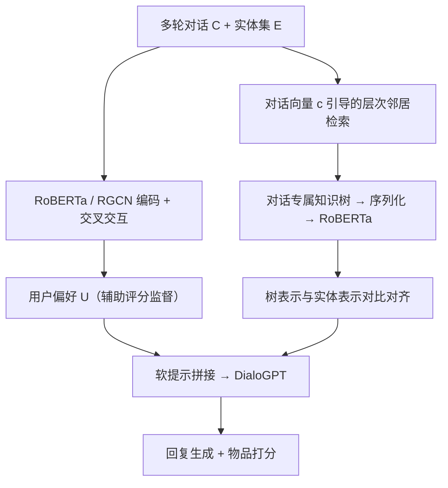
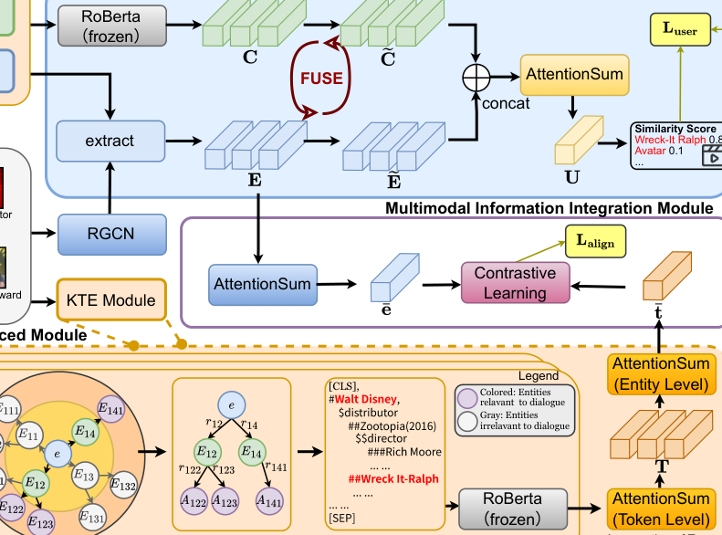
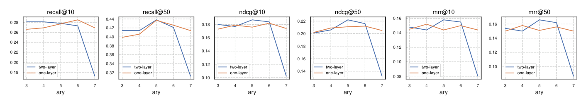

# Enhancing Conversational Recommender Systems with Tree-Structured Knowledge and Pretrained Language Models (树结构知识与预训练语言模型增强的对话推荐系统)

- **会议/期刊**: AAAI 2026
- **作者与机构**: Yongwen Ren, Chao Wang, Peng Du, Chuan Qin, Dazhong Shen, Hui Xiong（中国科大 / 科大讯飞 AI 研究院 / 北京大学 / 中科院 / 南航 / 港科大（广州））
- **推荐链路定位**: 端到端生成式（对话推荐 + 回复生成）
- **研究方向**: 对话推荐与智能体仿真 / 大语言模型推荐
- **论文原文**: [论文原文链接](https://arxiv.org/abs/2511.12579v1)
- **开源代码**: [开源代码仓库链接](https://github.com/YovRen/PCRS-TKA)

## TL;DR (1分钟核心速览)

针对 KG 增强对话推荐的三处不足——GCN 编码器无法让 PLM 直接对图关系做推理、检索到的 KG 事实被无差别塞进模型引入噪声、多轮对话中的协同偏好被当作纯文本忽略——本文提出 PCRS-TKA：按对话上下文从 DBpedia 动态裁剪出对话专属知识树，序列化为带层级标记的文本后送入冻结的 DialoGPT 做结构感知推理；同时用辅助评分任务将协同信号编码进提示，并以对比学习对齐实体与树两种表示。在 INSPIRED / ReDial 上 Recall@10、NDCG@10、MRR@10 全面领先，INSPIRED 的 MRR@10 相对最强基线 DCRS 提升 19.70%。

## Background & Motivation (背景与核心矛盾)

- **主流范式**: 由 KBRD/KGSF 的 RGCN 建模，演进到 UniCRS/DCRS 的"RGCN 图嵌入 + 软提示"注入 PLM，把 KG 当作静态隐向量拼接进 prompt。
- **前人局限**: ① 静态全局图嵌入与当前对话无关，噪声与幻觉并存；② GNN 消息传递把多跳结构压成定长向量，PLM 无法对 $(e_1,r,e_2)$ 链式关系做显式推理。
- **另一处盲区**: 对话文本仅作为上下文输入，其中隐含的用户协同偏好（喜欢什么、拒绝什么）未被显式监督，个性化不足。
- **核心洞察 (Key Insight)**: 既然 PLM 擅长对自然语言序列推理，就应把"子图"翻译成 PLM 能读的"文本结构"（树 + 虚拟关系节点），而非压成向量。
- **本文切入点**: 用 RAG 思路构造对话级知识树并序列化，辅以协同偏好辅助任务与跨模态对比对齐。

## Method (核心方法设计)

### 1. 整体框架 (Overall Architecture)

输入为多轮对话 $C$与提及实体集$E$。RoBERTa 编码对话、RGCN 编码全图并取回$E$的实体嵌入；两者经交叉交互与自注意力得到用户偏好向量$\mathbf{U}$，由辅助评分任务监督。并行地，以对话池化向量$\mathbf{c}$为查询，对每个实体做逐层 Top-N 邻居检索，构建深度$L$的对话专属知识树，深度优先序列化为 `#Entity/$Relation` 文本后用 RoBERTa 编码并做 token/实体两级注意力聚合得 $\mathbf{P}_{tree}$。实体级与树级表示经对比学习对齐后，与 RGCN 提示$\mathbf{P}_{rgcn}$、偏好提示$\mathbf{P}_{user}$、可学习软提示$\mathbf{P}_{prompt}$ 拼接送入冻结的 DialoGPT，同时输出回复与候选物品打分。训练分两阶段：先自监督预训练偏好与树模块，再联合优化软提示。

<figure class="paper-figure" markdown="span">
  <figcaption>图1：PCRS-TKA 框架的网络架构。</figcaption>
</figure>

### 2. 关键设计拆解 (Key Designs)

1. **对话专属知识树（RAG 式动态裁剪 + 序列化）**：全局 RGCN 嵌入与对话无关，故以 $\mathbf{c}$为查询逐层挑选邻居：$\mathcal{N}^{l+1}_v=\mathrm{TopN}\big(\mathcal{M}(v),\ \cos(\mathbf{c},\mathbf{E}_m),\ N\big)$，并插入虚拟关系节点保证父子边可读，最终$\mathcal{T}_e=\mathrm{RoBERTa}(\text{DFS}(\mathcal{G}^{tree}_e))$。直觉：树上每个实体都经过"与当前对话的相关性"过滤，PLM 读到的是带推理路径的干净子图，而非全图噪声。
2. **协同偏好显式建模**：把对话与实体的对齐表示拼接后自注意力聚合为 $\mathbf{U}$，与物品嵌入做双线性打分$\mathbf{R}=\mathrm{softmax}(\mathbf{U}\mathbf{I}^{\top})$，用交叉熵$\mathcal{L}_{user}$ 监督。理由是评分信号把"用户真实偏好"而非仅语言流畅度写入提示，弥补纯生成目标的个性化缺失。
3. **异构表示对齐**：树表示与实体表示同源不同形，用批内对比损失拉近同一实体、推远不同实体，$\mathcal{L}_{align}=\sum_{i,j}-\log\frac{e^{(\mathbf{e}_{E_i}\cdot\mathbf{t}_{E_j})/\tau}\cdot\mathbb{I}[E_i=E_j]}{\sum_k e^{(\mathbf{e}_{E_i}\cdot\mathbf{t}_{E_k})/\tau}\cdot(1-\mathbb{I}[E_i=E_k])}$，降低两种知识通道的语义漂移。
4. **训练目标、负采样与推理开销**：$\mathcal{L}=\mathcal{L}_{rec}+\alpha\mathcal{L}_{user}+\beta\mathcal{L}_{align}$（最优$\alpha\approx0.02$、$\beta\approx0.002$）。推荐与对比损失均为批内构造负例（对比学习以批内其他对话为负），评分任务对全部候选物品做 softmax、无额外负采样。骨干 PLM 全程冻结，仅训练适配模块，但每轮需对每个提及实体做多跳检索与序列化，推理开销随实体数与树度线性增长。

## Experimental Setup & Evaluation Protocol (实验设置与评估协议)

- **数据集与预处理**: 均出自 Amazon Mechanical Turk；ReDial 6,281 部电影、平均 18.2 轮；INSPIRED 1,472 部电影、平均 35.7 轮。外部 KG 用 DBpedia，经 TagMe 标注实体后仅保留一跳三元组构成子图（原始 DBpedia 含 504 万实体、927 种关系、2,426 万三元组）。

| 数据集 | #Dialogues | #Items | 平均轮数/句长 | 划分 | 场景说明 |
| :--- | :---: | :---: | :---: | :---: | :--- |
| ReDial | 10,006 | 6,281 | 18.2 / 14.5 | 8:1:1 | 电影对话推荐 |
| INSPIRED | 1,001 | 1,472 | 35.7 / 19 | 8:1:1 | 长对话、偏好推荐 |

- **数据划分与防穿越 (Splitting Strategy)**: 随机 `8:1:1` 比例划分为训练/验证/测试，并对每条对话做"前缀增量扩充"（从第 1 轮起逐轮增加 utterance 生成新样本）以扩充数据；**未采用时间戳切分**，同一对话的前缀样本可能跨划分，存在轻度泄漏风险。
- **排名评测协议 (Ranking Protocol)**: 从 $\hat{\mathbf{R}}=\mathrm{softmax}(\mathbf{O}\mathbf{I}^{\top})$ 对候选物品集打分输出 Top-K，属**候选集内排序（sampled-style）**，原文未声明 Full-Ranking 全库排序，负例比例亦未说明——这是复现对齐的关键缺口。
- **对话评测协议**: 自动指标 word-level distinct-2/3/4；人工评测随机抽 100 条对话、10 名标注员对 Fluency / Informativeness / Consistency / Accuracy 打 0–5 分。
- **对比基线与超参**: 对比 ReDial、KBRD、KGSF、TG-ReDial、UniCRS、KERL、DCRS；AdamW，一阶段 lr=5e-4、二阶段 lr=1e-4，推荐任务 batch=64、软提示长度 10（对话任务 20），单卡 V100；所有基线网格搜索调参。

## Key Experimental Results (实验关键数据)

### 1. 主实验对比 (Main Results)

| 模型 | INSPIRED R@10 | INSPIRED N@10 | INSPIRED M@10 | INSPIRED M@50 | ReDial R@10 | ReDial N@10 | ReDial M@10 | ReDial M@50 |
| :--- | :---: | :---: | :---: | :---: | :---: | :---: | :---: | :---: |
| ReDial | 0.106 | 0.049 | 0.031 | 0.037 | 0.050 | 0.024 | 0.015 | 0.021 |
| KBRD | 0.151 | 0.102 | 0.086 | 0.091 | 0.189 | 0.101 | 0.074 | 0.082 |
| KGSF | 0.178 | 0.109 | 0.088 | 0.093 | 0.177 | 0.094 | 0.069 | 0.078 |
| UniCRS | 0.262 | 0.159 | 0.131 | 0.138 | 0.213 | 0.119 | 0.090 | 0.100 |
| KERL | 0.206 | 0.128 | 0.113 | 0.117 | 0.216 | 0.122 | 0.087 | 0.097 |
| DCRS | 0.267 | 0.162 | 0.132 | 0.139 | 0.217 | 0.119 | 0.090 | 0.101 |
| **PCRS-TKA** | **0.278** | **0.187** | **0.158** | **0.166** | **0.221** | **0.123** | **0.093** | **0.103** |
| Improv.% | +4.12% | +15.43% | **+19.70%** | +19.42% | +1.84% | +3.36% | +3.33% | +1.98% |

（完整 R@50/N@50 见原文表 1；`*` 表示 $p<0.05$ 显著性。）

对话质量：Distinct-2 在 INSPIRED 上由 DCRS 的 4.383 升至 **6.805**（+55.23%），ReDial 上 +26.02%；人工评测 Fluency 4.18、Inform. 3.94、Consistency 3.77、Accuracy 3.27，相对 DCRS 分别 +6.36% / +14.53% / +3.01% / **+1.24%**。

### 2. 消融实验 (Ablation Study)

| 配置 (INSPIRED) | R@10 | R@50 | N@10 | N@50 | M@10 | M@50 |
| :--- | :---: | :---: | :---: | :---: | :---: | :---: |
| PCRS-TKA (RoBERTa+DialoGPT) | **0.278** | **0.438** | **0.187** | **0.222** | **0.158** | **0.166** |
| −all（去除树/偏好/对齐） | 0.262 | 0.406 | 0.159 | 0.193 | 0.131 | 0.138 |
| PCRS-TKA (BERT+GPT-2) | 0.258 | 0.430 | 0.162 | 0.204 | 0.140 | 0.147 |
| −all (BERT+GPT-2) | 0.230 | 0.422 | 0.153 | 0.196 | 0.129 | 0.138 |

逐组件移除（图2）显示 w/o user、w/o tree、w/o align 三档均下降，其中"树→无序三元组 (w/ triples)"与"关闭上下文过滤 (w/ unfilter tree)"降幅最明显。

<figure class="paper-figure" markdown="span">
  <figcaption>图3：INSPIRED 数据集上随知识树度数与深度变化的模型性能比较。</figcaption>
</figure>

### 3. 关键实验发现 (Key Findings)

1. **收益与对话长度强相关**：INSPIRED（35.7 轮）MRR@10 相对提升 19.70%，而 ReDial（18.2 轮）仅 3.33%——长对话提供更多偏好证据，协同偏好辅助任务与树过滤的边际价值随之放大；ReDial 上 DCRS 已达 0.217/0.090，榜单接近饱和。
2. **树"深而宽"反而有害**：单层与两层最优性能接近，说明两跳（movie→starring→actor）已足够；但两层树随 degree 增大性能急剧下滑，印证无关多跳实体稀释一阶信号，RAG 式过滤是必要而非装饰。
3. **生成多样性 ≠ 事实准确性**：Distinct-2 暴涨 55.23%，但人工 Accuracy 仅从 3.07 升到 3.27（+1.24%），说明知识树主要改善表达丰富度，幻觉抑制的收益仍有限；同时 $\alpha\approx0.02$、$\beta\approx0.002$ 在两个数据集上稳定，调参成本低。

## Highlights & Limitations (亮点、对比与审稿批判)

- **与代表作对比 (vs. Prior Work)**: UniCRS 将静态 RGCN 图嵌入拼进 prompt，图结构对 PLM 不可见；DCRS 用知识感知检索器取对话历史类比样本，但检索对象是话语而非结构化子图；KERL 依赖 Wikipedia 实体描述文本，丢失关系路径。本文的核心差异是把"子图"变成"可读的树序列"，让 PLM 首次在 CRS 中对 KG 关系做显式链式推理。
- **可迁移亮点**: ① `#Entity/$Relation` 的层级序列化模板可零成本迁移到任意 KG 增强任务（电商类目树、POI 空间树）；② 用辅助评分任务把协同信号"写进提示"的做法，可复用到 LLM 冷启动偏好注入。
- **审稿级局限批判**: ① 评测为候选集内 softmax 排序，未声明 Full-Ranking 与负例构造，与 KBRD/UniCRS 主流的全库排序协议不严格可比，提升幅度可能被高估；② 8:1:1 随机划分 + 对话前缀扩充会造成训练/测试同源泄漏；③ 每轮对每个实体做多跳检索与长文本序列化，DialoGPT 输入显著变长，在线延迟与显存开销缺量化；④ 仅在电影单域验证，跨域（电商、POI）泛化未知。

## Rating (四维评分)

- **方法创新性 (Novelty)**: ⭐⭐⭐⭐ （把 RAG 式对话级子图裁剪 + 树序列化引入 CRS，思路清晰且与"PLM 擅长序列推理"的直觉高度自洽，但组件多为已有技术的巧妙重组）
- **评估协议与实验扎实度 (Protocol & Experiments)**: ⭐⭐⭐ （覆盖推荐/对话/人工三类评测与跨 PLM 泛化，但排序协议未声明全库、划分存在泄漏、消融仅给柱状趋势缺具体数值）
- **写作与数学规范度 (Clarity & Rigor)**: ⭐⭐⭐⭐ （四模块流水线叙述清楚、公式完整，但部分符号（$\mathbf{C}$与$C$、$\mathbf{E}$与$E$）复用易混，缺复杂度分析）
- **工业落地与复现价值 (Industrial & Practical Value)**: ⭐⭐⭐⭐ （代码已开源、PLM 冻结训练成本可控，树检索与序列化的线上延迟是主要落地门槛）

