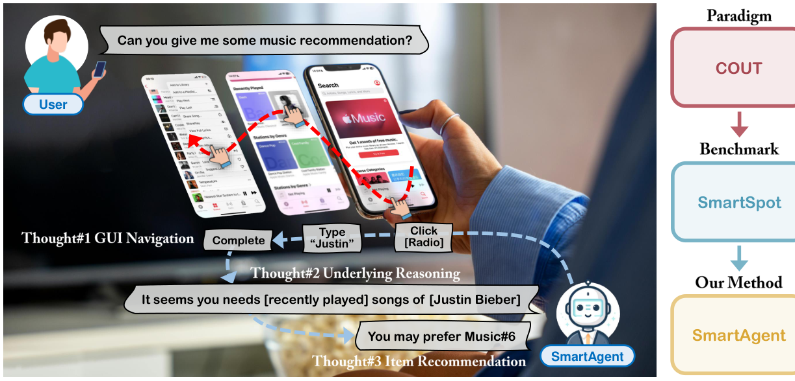
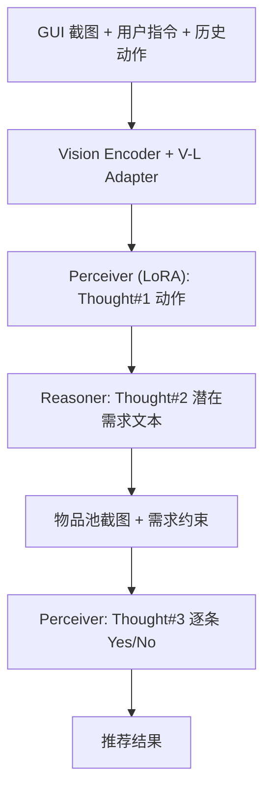

# SmartAgent: Chain-of-User-Thought for Embodied Personalized Agent in Cyber World (面向赛博世界的具身个性化智能体：用户思维链)

- **会议/期刊**: AAAI 2026
- **作者与机构**: Jiaqi Zhang, Chen Gao, Liyuan Zhang, Yong Li*（清华大学）, Hongzhi Yin*（昆士兰大学）
- **推荐链路定位**: 端到端生成式（GUI 操作 + 候选池内二分类推荐）
- **研究方向**: 对话推荐与智能体仿真 / 多模态推荐
- **论文原文**: [论文原文链接](https://arxiv.org/abs/2412.07472v3)
- **开源代码**: [开源代码仓库链接](https://github.com/tsinghua-fib-lab/SmartAgent)

## TL;DR (1分钟核心速览)

现有具身智能体依赖"黄金动作轨迹"或确定性任务目标训练，只会机械完成任务，无法从模糊指令与操作习惯中读出用户偏好。本文提出 **Chain-of-User-Thought (COUT)** 三阶思维范式（GUI 操作 → 显式潜在需求归纳 → 隐式物品推荐），并实现两阶段训练的 **SmartAgent**；同时构建含 7 场景、144 条 episode、1400+ 步的首个具身个性化基准 SmartSpot。在全库无采样协议下，SmartAgent 取得 Ele.Acc 0.64、Exp.Acc 0.71、Imp.Acc 0.24，并在未见 MEDICINE 通道零样本 Exp.Acc 反超微调至 0.77。

## Background & Motivation (背景与核心矛盾)

- **主流范式**: 基于 LVLM 的具身智能体（SeeClick、CogAgent、CRADLE 等）在 GUI/3D 环境中按指令执行点击、输入等动作，优化目标是复现人工标注的动作序列。
- **前人局限**: ① 训练信号是"唯一正解"的 action trajectory，无法表达"多条路径同样合理"的用户导向差异；② 面向确定性任务目标，当用户指令本身模糊（"推荐点音乐"）时，模型只能完成操作而无法推断偏好。
- **核心洞察 (Key Insight)**: GUI 操作序列本身是**用户偏好的隐式观测**——用户点了 "[recently played]" 而非 "[热门]"，这一动作就把模糊指令收敛成了具体约束（如 Justin Bieber）。因此"操作→需求归纳→推荐"应当是一条可监督的递进思维链，而非黑箱端到端映射。
- **本文切入点**: 把具身个性化任务显式定义为 $A_{\text{COUT}}=\{\text{Action}_i \mid \text{Task goal},\ \text{User preference}\}$，用三阶思维把偏好建模插入动作空间，并以中间需求文本作为两阶段训练的连接件。

<figure class="paper-figure" markdown="span">
  <figcaption>图1. 用户思维链（COUT）推理范式。红线表示一串 GUI 操作，蓝线表示我们的三步思考过程。在思考#1中，智能体根据用户指令执行 GUI 操作以搜索物品池。在思考#2中，智能体看到物品池后，推理原始指令背后、由先前操作所隐含的潜在需求。在思考#3中，智能体基于潜在思考，从物品池中推荐物品以完成用户指令。通过利用面向用户的思考，这一 CO</figcaption>
</figure>

## Method (核心方法设计)

### 1. 整体框架 (Overall Architecture)

输入为高分辨率 GUI 截图 $o_t$、用户指令$i$与历史动作$h_{t-1}$，全部序列化为统一 token 串，由 Qwen-VL 自回归生成。智能体在同一 backbone 上分饰两角：**Perceiver**（LoRA 微调）负责输出具身动作与 Yes/No 推荐判定，**Reasoner**（冻结原 LVLM）负责生成自然语言需求摘要。训练分两阶段：具身阶段先学会在 GUI 中操作并搜索出物品池，并产出 Thought#2 潜在需求；个性化阶段复用同一 Perceiver，把候选物品逐条判定 Yes/No，输出 Thought#3。推理时 Thought#2 作为"中间瓶颈"将下一阶段的决策空间从开放词表压缩到池内$|\mathcal{P}|$ 个二分类。

### 2. 关键设计拆解 (Key Designs)

1. **COUT 三阶思维与任务重定义**：把以往 $A=\{\text{Action}_i\mid \text{Task goal}\}$ 的单目标条件扩展为双条件动作空间，并将思维链拆为"表层操作—显式约束—隐式偏好"三层。其价值在于把不可监督的主观偏好转化为**可监督的中间文本**（Thought#2 有 ground-truth 需求描述），从而让个性化成为可训练目标而非提示工程。
2. **Thought#2 作为跨阶段瓶颈（Two-Stage Bottleneck）**：个性化阶段的输入不是原始长历史，而是 Thought#2 摘要 $r=\text{Reasoner}(o_{1:t},i)$，推荐决策写作$p(y_j\mid r,o^{\text{item}}_j),\ y_j\in\{\text{Yes},\text{No}\}$。直觉上，需求文本把$|V|$级别的生成式物品检索降维成$|\mathcal{P}|$ 次二分类，既避免生成物品名带来的幻觉，又让推荐结果可解释、可追溯到某一步 GUI 操作。
3. **训练目标、负采样与推理开销**：总损失为动作/推荐交叉熵与需求语义相似度的加权和
$\mathcal{L}=\mathcal{L}_{\text{CE}}(\hat{a}_t,a_t)+\lambda\mathcal{L}_{\text{CE}}(\hat{y}^{\text{rec}},y^{\text{rec}})+\mu\big(1-\text{sim}(\hat{r},r)\big)$。
推荐阶段**无需负采样**：池内全部物品天然构成"1 正 + $|\mathcal{P}|-1$ 负"的点式监督（每 episode 池内 4–7 个物品）。推理时每步一次前向，历史仅保留 8 步以控显存，整体为线性于步数的串行开销。

## Experimental Setup & Evaluation Protocol (实验设置与评估协议)

- **数据集与预处理**: 自建 SmartSpot，源自美团真实 App 界面，含 5 个单通道 + 2 个跨通道场景（Flight+Food、Flight+Hotel），共 144 episodes / 1400+ steps；每步含截图、动作（含 bbox）、历史动作、指令与潜在需求标注。

| 场景 | #Episodes | GUI 步数 | 池内物品数 | 推荐步数 | 指令长度 | 需求长度 |
| :--- | :---: | :---: | :---: | :---: | :---: | :---: |
| FOOD | 20 | 7.00 | 1.00 | 4.00 | 12.90 | 27.50 |
| HOTEL | 20 | 11.00 | 1.00 | 4.00 | 14.80 | 35.45 |
| FLIGHT | 20 | 9.20 | 1.00 | 4.50 | 19.95 | 24.25 |
| MOVIE | 20 | 8.00 | 1.00 | 7.00 | 13.45 | 34.15 |
| MEDICINE | 20 | 6.55 | 1.00 | 4.20 | 13.15 | 19.00 |
| TRAVEL1 | 12 | 17.30 | 1.00 | 4.00 | 23.10 | 48.30 |
| TRAVEL2 | 10 | 21.33 | 1.00 | 4.00 | 23.67 | 55.25 |

- **数据划分与防穿越 (Splitting Strategy)**: episode 级划分；**MEDICINE 通道整体留出**作为冷启动/零样本通道（其训练数据完全不参与），构成严格 unseen-channel 划分。
- **排名评测协议 (Ranking Protocol)**: 池内 **Full-Ranking**——对物品池中每个候选逐一判定 Yes/No，不做负采样，Imp.Acc 即全池二分类准确率；具身侧沿用 Mind2Web 的 Ele.Acc / SSR 逐步评测。
- **对比基线与超参设置**: GUI 专家（SeeClick）与通用 LVLM（Qwen-VL、Qwen2-VL、GPT-4V、Fuyu、CogAgent）；backbone 为 Qwen-VL（448×448），LoRA 微调视觉编码器与 LLM，lr=3e-5，batch=14，两阶段各 15 epoch，2×A100。

## Key Experimental Results (实验关键数据)

### 1. 主实验对比 (Main Results)

| 方法 | Ele.Acc | SSR | Exp.Acc | Imp.Acc | ScreenSpot Avg |
| :--- | :---: | :---: | :---: | :---: | :---: |
| GPT-4V | / | / | / | / | 16.2 |
| Fuyu | / | / | / | / | 19.5 |
| CogAgent | / | / | / | / | 47.4 |
| Qwen2-VL | 0.04 | 0.03 | / | / | / |
| Qwen-VL | 0.61 | **0.64** | / | / | 5.2 |
| SeeClick | 0.61 | 0.40 | / | / | **53.4** |
| **SmartAgent** | **0.64** | 0.50 | **0.71** | **0.24** | 52.4 |

### 2. 消融实验 (Ablation Study)

| 配置 | Ele.Acc | SSR | Exp.Acc | Imp.Acc |
| :--- | :---: | :---: | :---: | :---: |
| 两阶段训练（完整 COUT） | 0.64 | 0.50 | **0.71** | 0.24 |
| 端到端训练（无 Thought#2 生成） | **0.67** | **0.53** | 0.66 | **0.31** |
| 零样本迁移（MEDICINE 全留出） | 0.04 | 0.08 | **0.77** | 0.14 |

### 3. 关键实验发现 (Key Findings)

1. **中间思维链是"以具身换个性化"的杠杆**：端到端训练在 Ele.Acc/SSR 上反超（0.67/0.53 vs 0.64/0.50），Imp.Acc 甚至升到 0.31，但 Exp.Acc 从 0.71 掉到 0.66——说明去掉 Thought#2 后模型能"猜中答案"却失去可解释的偏好归纳，长动作序列会累积误差并过拟合需求描述。
2. **个性化微调未造成灾难性遗忘**：在 ScreenSpot 上 SmartAgent 平均 52.4，与 GUI 专家 SeeClick（53.4）基本持平，且在 Desktop-Icon/Widget 子项以 32.1 反超 SeeClick 的 30.0，证明 COUT 训练保留了基础 grounding 能力。
3. **零样本在冷启动通道反而更准**：MEDICINE 未参与训练时 Exp.Acc 达 0.77，高于全量微调平均的 0.71，但 Imp.Acc 仅 0.14（不足 0.24 的六成），说明"读懂需求"可迁移、"选中物品"仍强依赖池内监督。

## Highlights & Limitations (亮点、对比与审稿批判)

- **与代表作对比 (vs. Prior Work)**: 与 SeeClick/CogAgent 等纯 GUI grounding 模型相比，本文把输出从"坐标预测"扩展到"需求文本 + 推荐判定"；与 Mind2Web/AITZ 类任务导向基准相比，SmartSpot 首次给出显式个性化评测；与 LLM4Rec 的纯文本推荐相比，本文的偏好证据来自可观测的界面操作而非历史 item ID 序列。
- **可迁移亮点**: ① "池内逐条 Yes/No"把生成式推荐转成可解释的二分类，可直接迁移到电商/内容场景的候选重排；② 用中间自然语言需求作为两阶段训练的瓶颈接口，是低成本注入用户意图的通用范式。
- **审稿级局限批判**: ① 数据规模仅 144 episodes、每通道 20 条，且由少数标注者按个人习惯操作，Imp.Acc 0.24 的绝对水平偏低，统计显著性存疑；② 推理需逐步串行前向 + 每件物品一次判定，实时性与真实 App 动态界面（弹窗、改版）的鲁棒性均未评估。

## Rating (四维评分)

- **方法创新性 (Novelty)**: ⭐⭐⭐⭐ （首次把"用户思维链"形式化为可监督的三阶动作空间，Thought#2 瓶颈设计有新意）
- **评估协议与实验扎实度 (Protocol & Experiments)**: ⭐⭐⭐ （池内 Full-Ranking 与留出通道设计合理，但 144 条样本、无显著性检验、部分基线指标缺失）
- **写作与数学规范度 (Clarity & Rigor)**: ⭐⭐⭐⭐ （范式定义与 token 序列化清晰，公式偏少但符号一致，缺复杂度分析）
- **工业落地与复现价值 (Industrial & Practical Value)**: ⭐⭐⭐⭐ （代码与基准开源，LoRA 两阶段在 2×A100 可复现，但线上串行推理成本与界面漂移是落地门槛）

