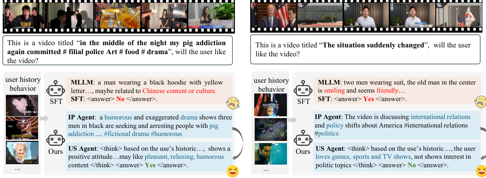
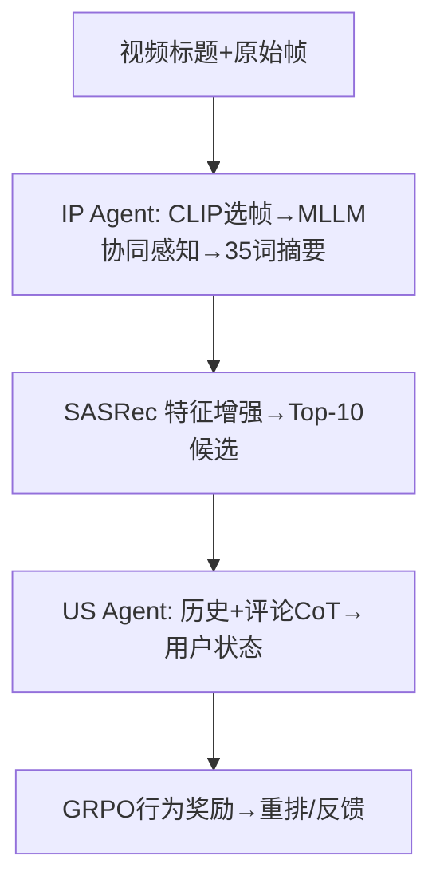
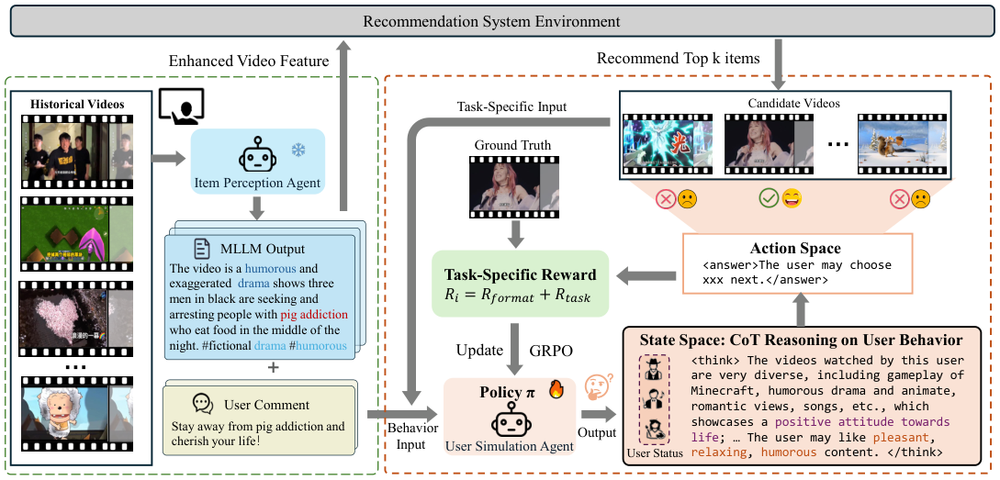

# VRAgent-R1: Boosting Video Recommendation with MLLM-based Agents via Reinforcement Learning (基于多模态大模型智能体与强化学习的视频推荐增强)

- **会议/期刊**: AAAI 2026（under review；arXiv 2025-07-03）
- **作者与机构**: Chen Siran 等；腾讯 PCG、SIAT@MMLab、中山大学、上海 AI Lab
- **推荐链路定位**: 重排 / 端到端用户模拟（物品理解 + 候选重排）
- **研究方向**: 对话推荐与智能体仿真 / 多模态推荐
- **论文原文**: [论文原文链接](https://arxiv.org/abs/2507.02626v1)
- **开源代码**: 暂未开源

## TL;DR (1分钟核心速览)

针对视频推荐中“多模态内容理解浅”与“冻结 LLM 用户模拟无反馈”两大痛点，本文提出双智能体 VRAgent-R1：IP Agent 用 CLIP 选关键帧并让 MLLM 生成面向推荐的 35 词摘要，增强 SASRec 物品表征；US Agent 基于历史与评论做 CoT 用户状态推理，并用 GRPO 以真实行为奖励对齐用户决策、重排候选。在 MicroLens-100K 全库排序下，NDCG@10 相对 SASRecF 提升 6.0%；用户模拟选择准确率相对 SFT 提升约 45%。

## Background & Motivation (背景与核心矛盾)

- **主流范式**: 多模态推荐多采用 ID/文本/图像/视频特征晚融合；LLM 用户模拟多依赖冻结 LLM 的 prompt engineering。
- **前人局限**: 视频帧冗余且模态竞争，MLLM-MSR 仅用首帧/封面图，难以捕捉分钟级视频的高层语义；Agent4Rec 等冻结 LLM 无下游反馈，SFT 只学 Yes/No，缺乏 CoT 与可优化策略。
- **核心洞察 (Key Insight)**: 人类理解视频是“检索关键帧→跨模态协同→面向推荐摘要”，用户决策则需“分析历史与评论→归纳当前状态→选择行动”。
- **本文切入点**: 用 IP Agent 生成推荐导向视频摘要以增强召回表征，用 US Agent 的 RFT 模拟真实用户并反馈重排。

<figure class="paper-figure" markdown="span">
  <figcaption>图1：VRAgent-R1 在视频推荐中的定性示例。相较于以往对 MLLM 进行监督微调的方法，VRAgent-R1 表现突出；后者因缺乏对视频项的理解和对用户状态的深入思考而无法给出正确预测。</figcaption>
</figure>
*图1：定性对比——SFT 式 MLLM 仅输出 Yes/No，VRAgent-R1 能结合视频语义与用户状态推理。*

## Method (核心方法设计)

### 1. 整体框架 (Overall Architecture)

输入视频标题与原始帧，IP Agent 离线完成关键帧检索、跨模态协同感知与推荐相关分析，输出约 35 词摘要并注入 SASRec 文本/物品表征，生成 Top-10 候选；US Agent 读取用户历史视频与评论，先 CoT 归纳用户状态，再在“偏好判断”和“下一视频选择”两个任务上行动。训练采用先易后难的渐进 GRPO：偏好判断奖励格式与判断正确性，下一视频选择奖励格式与命中正样本；推理时 US Agent 对候选集重排，模拟正反馈可回注推荐系统。整体流程见图2。

<figure class="paper-figure" markdown="span">
  <figcaption>图2：VRAgent-R1 框架概览。我们提出一个包含两个新颖智能体的框架，以提升视频推荐效果。IP Agent 进行协同多模态理解，为推荐系统与 US Agent 获得增强的视频特征。同时，US Agent 基于用户状态通过深度 CoT 推理模拟用户行为。通过以实际行为奖励进行强化学习，VRAgent-R1 实现了更优的模拟性能，并有助于提升推荐准确率。</figcaption>
</figure>
*图2：VRAgent-R1 双智能体框架：IP Agent 增强物品表征，US Agent 以 GRPO 模拟用户并重排候选。*

### 2. 关键设计拆解 (Key Designs)

1. **IP Agent 渐进视频理解（KFR+CMP+RRA）**：痛点随机帧/首帧与晚融合丢语义；先均匀采样 10 帧，用 CLIP 与标题相似度取 Top-3 关键帧，再让 MLLM 联合标题与帧做协同感知，最后压缩为 35 词推荐摘要。核心算子：
$F^{*}=\operatorname{TopK}_{f\in\mathcal{F}}\cos(E_v(f),E_t(T)),\ |F^{*}|=3$
其直觉是用“标题-视觉”相关性过滤冗余帧，再用 MLLM 世界知识补足标题隐喻，RRA 去噪后更适合推荐。

2. **US Agent 的 CoT + 双任务 GRPO**：痛点冻结 LLM 无反馈、SFT 只记答案；US Agent 先输出用户状态与理由，再给行动，奖励拆为格式与任务正确性：
$R_1=R_{\text{format}}+R_{\text{jud}},\quad R_2=R_{\text{format}}+R_{\text{sel}}$GRPO 用组内相对优势更新，不需 critic：$\hat A_i=(r_i-\operatorname{mean}(r))/\operatorname{std}(r)$
这样模型学会“先分析再决策”，比二分类 SFT 更接近真实用户。

3. **训练目标、负采样与推理效率**：总目标为
$\mathcal{L}_{\text{GRPO}}=\mathbb{E}_{q,\{o_i\}}\left[\frac{1}{G}\sum_i\min(\rho_i\hat A_i,\operatorname{clip}(\rho_i,1-\epsilon,1+\epsilon)\hat A_i)-\beta D_{\mathrm{KL}}(\pi_\theta\|\pi_{\mathrm{ref}})\right]$其中$\rho_i=\pi_\theta(o_i|q)/\pi_{\theta_{\mathrm{old}}}(o_i|q)$。US 任务以真实第 N 个行为为正样本，SASRec Top-10 中随机取$m=3/4$个负样本构成$1+m$ 候选；视频推荐沿用官方 SASRec 训练负采。推理需 7B MLLM 做摘要与重排，离线可缓存摘要，在线主要增加 US Agent 推理开销。

## Experimental Setup & Evaluation Protocol (实验设置与评估协议)

- **数据集与预处理**:

| 数据集 | #Users | #Items | #Interactions | 稀疏度/密度 | 特征/场景说明 |
| :--- | :---: | :---: | :---: | :---: | :--- |
| MicroLens-100K | 100,000 | 19,738 | 719,405 | 99.96% 稀疏 | 真实短视频，平均 161s；主实验+冷启动 |
| MovieLens-1M | 6,000 | 4,000 | 1,000,000 ratings | — | 文本为主；评分>3 为正，验证 US Agent 泛化 |

- **数据划分与防穿越 (Splitting Strategy)**: 视频推荐采用 Leave-One-Out（last-item）：前 $N-1$个行为为历史，第$N$ 个为目标；用户模拟在 1000 名冷启动用户（≤5 交互）上 3 次重复平均；MovieLens 按 Agent4Rec 设置随机分配 20 物品，1:1 与 1:3 正负比。
- **排名评测协议 (Ranking Protocol)**: 主实验遵循 MicroLens 官方 Full-Ranking（全库未交互排序），报告 HR/NDCG@10/20；用户模拟不是全库排序，而是 SASRec Top-10 + $m$随机负样本的候选排序，$m=3/4$，正样本为真实下一项。
- **对比基线与超参设置**: 视频推荐覆盖 CF（DSSM/LightGCN）、ID 序列（GRU4Rec/NextItNet/SASRec）、多模态（SASRecF）与 MLLM 增强（MLLM-MSR）；用户模拟对比 GPT-4o、DeepSeek-R1、Qwen2.5-7B、Agent4Rec、TALLREC/MLLM-MSR SFT。两 Agent 均用 Qwen2.5-7B；batch=16、16 rollouts、KL=0.001、max token=2048、4 epochs，4×A100 80G 约 10h；$d$未明示，沿用官方 SASRec；配对 t 检验$p<0.002$。

## Key Experimental Results (实验关键数据)

### 1. 主实验对比 (Main Results)

表1 视频推荐主结果（相对 SASRecF 标 Improv.）：

| 模型 | HR@10 | NDCG@10 | HR@20 | NDCG@20 |
| :--- | :---: | :---: | :---: | :---: |
| DSSM | 0.0394 | 0.0193 | 0.0654 | 0.0258 |
| LightGCN | 0.0372 | 0.0177 | 0.0618 | 0.0239 |
| NextItNet | 0.0805 | 0.0442 | 0.1175 | 0.0535 |
| GRU4Rec | 0.0782 | 0.0432 | 0.1147 | 0.0515 |
| SASRec | 0.0909 | 0.0517 | 0.1278 | 0.0610 |
| SASRecF | 0.0953 | 0.0517 | 0.1362 | 0.0623 |
| SASRec+MLLM-MSR | 0.0606 | 0.0351 | 0.0911 | 0.0446 |
| SASRec+Ours | **0.0994** (+4.30%) | **0.0548** (+6.00%) | **0.1418** (+3.96%) | **0.0655** (+5.14%) |

表2 用户模拟主结果：

| 方法 | Acc | Recall | Pre | F1 | Acc$_{m=3}$| Acc$_{m=4}$ |
| :--- | :---: | :---: | :---: | :---: | :---: | :---: |
| GPT-4o | 0.535 | 0.480 | 0.533 | 0.505 | 0.307 | 0.269 |
| DeepSeek-R1 | 0.528 | 0.556 | 0.526 | 0.541 | 0.264 | 0.231 |
| Qwen2.5-7B | 0.491 | 0.512 | 0.490 | 0.500 | 0.245 | 0.197 |
| LLM_Simulator | 0.523 | 0.539 | 0.519 | 0.529 | — | — |
| Agent4Rec | 0.528 | 0.482 | 0.520 | 0.501 | — | — |
| MLLM-MSR (SFT) | 0.585 | 0.882 | 0.553 | 0.679 | 0.442 | 0.381 |
| VRAgent-R1 | **0.715** (+22.2%) | 0.760 | **0.697** | **0.727** | **0.641** (+45.0%) | **0.602** |

### 2. 消融实验 (Ablation Study)

表3 关键组件消融（IP Agent 与 US Agent 分块）：

| 设置 | HR@10 | NDCG@10 | Acc | F1 | Acc$_{m=3}$ |
| :--- | :---: | :---: | :---: | :---: | :---: |
| IP: Baseline (SASRec) | 0.0916 | 0.0490 | — | — | — |
| IP: w/o KFR | 0.0980 | 0.0542 | — | — | — |
| IP: w/o CMP | 0.0960 | 0.0519 | — | — | — |
| IP: w/o RRA | 0.0816 | 0.0466 | — | — | — |
| IP: Full | **0.0994** | **0.0548** | — | — | — |
| US: Baseline | — | — | 0.491 | 0.500 | 0.245 |
| US: SFT | — | — | 0.585 | 0.679 | 0.442 |
| US: w/o CoT | — | — | 0.580 | 0.592 | 0.324 |
| US: w/o Comment | — | — | 0.695 | 0.705 | 0.618 |
| US: w/o IP Agent | — | — | 0.680 | 0.686 | 0.609 |
| US: Full | — | — | **0.715** | **0.727** | **0.646** |

**归因发现**：
- IP Agent 带来 HR@10 0.0953→0.0994、NDCG@10 0.0517→0.0548；去掉 RRA 后 HR@10 跌至 0.0816（低于 SASRec 0.0916），说明“35 词推荐摘要”的去噪比堆叠长描述更关键。
- US Agent 的 Acc 0.715 比 SFT 0.585 高 22.2%，$Acc_{m=3}$0.641 比 0.442 高 45.0%；去掉 CoT 后$Acc_{m=3}$ 降至 0.324，证明推理链是提分核心。
- 模拟正反馈可增强冷启动：+US like 的 HR@10 0.0678 高于 +IP 的 0.0663，而 +US dislike 仅 0.0654，提示应优先回注正向模拟行为。

## Highlights & Limitations (亮点、对比与审稿批判)

- **与代表作对比 (vs. Prior Work)**: 相比 MLLM-MSR 仅用首帧/封面且晚融合，IP Agent 用关键帧+MLLM 协同摘要；相比 Agent4Rec/LLM_Simulator 冻结 LLM 无反馈，US Agent 用真实行为奖励做 GRPO；相比 TALLREC 只学 Yes/No，本文保留 CoT 并支持下一视频选择。
- **可迁移亮点**: “检索关键帧→协同感知→推荐导向摘要”可迁移到短视频/图文电商；用可验证行为奖励做轻量 RFT，比大规模 SFT 更省标注。
- **审稿级局限批判**: 7B MLLM 在线重排延迟与成本高；用户动作空间仅 like/dislike/next-select，缺点击、停留、留存等真实反馈；主实验集中于 MicroLens-100K，MovieLens 仅验证 US Agent，且未开源代码。

## Rating (四维评分)

- **方法创新性 (Novelty)**: ⭐⭐⭐⭐ （双 Agent 分工+GRPO 用户模拟较新颖，但 IP Agent 流程工程化明显）
- **评估协议与实验扎实度 (Protocol & Experiments)**: ⭐⭐⭐ （Full-Ranking+冷启动+3 seeds/p<0.002 较好，但视频数据集单一、主表缺误差条）
- **写作与数学规范度 (Clarity & Rigor)**: ⭐⭐⭐⭐ （框架与奖励公式清晰，超参较全；负采样与部分实现细节略简）
- **工业落地与复现价值 (Industrial & Practical Value)**: ⭐⭐⭐ （离线摘要可缓存，但在线 7B 重排开销大，且代码暂未开源）

