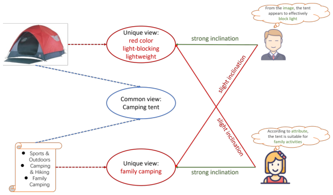
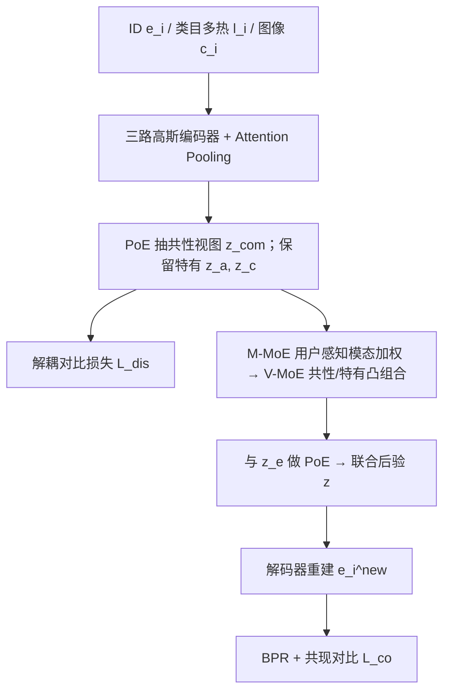

# M²VAE: Multi-Modal Multi-View Variational Autoencoder for Cold-start Item Recommendation (多模态多视图变分自编码器用于冷启动物品推荐)

- **会议/期刊**: AAAI 2026
- **作者与机构**: Chuan He, Yongchao Liu, Qiang Li, Chuntao Hong, Wenliang Zhong, Xin-Wei Yao（浙江工业大学、蚂蚁集团、阿里巴巴）
- **推荐链路定位**: 召回（新物品表征生成）
- **研究方向**: 冷启动与长尾推荐 / 多模态推荐
- **论文原文**: [https://arxiv.org/abs/2508.00452v2](https://arxiv.org/abs/2508.00452v2)
- **开源代码**: [https://github.com/hchchchchchchc/M2V](https://github.com/hchchchchchchc/M2V)

## TL;DR (1分钟核心速览)

现有 VAE 式冷启动方法把属性与图像特征在输入层拼接（GoRec）或在隐空间整体 PoE（MVGAE），既抹平了「跨模态共性语义 vs 模态特有信息」的结构，又用与用户无关的固定权重融合。M²VAE 为 ID/属性/图像分别建高斯隐变量，PoE 只抽共性视图、解耦对比损失把特有视图推开，再用用户感知的层次化 MoE 按偏好重加权，并以共现对比损失免预训练注入协同信号。三个数据集上 HR@10 相对提升最高 27.6%。

## Background & Motivation (背景与核心矛盾)

- **主流范式**: 用 CVAE/GAN 把新物品的属性与多模态内容映射到热物品 embedding 空间（DropoutNet、GoRec、MVGAE、VMoSE），靠重建 + BPR 对齐冷热分布。
- **前人局限①**: GoRec 在观测空间直接 `Concat&MLP`，是确定性映射、完全忽略各模态的不确定性；MVGAE 虽在隐空间用 PoE 建模不确定性，却把共性语义与模态特有信息混为单一共识，一旦某模态含噪（如低质图像）就会污染整体表征。
- **前人局限②**: 融合权重与目标用户无关，无法表达"有人看帐篷是否轻量（图像），有人看是否家庭露营（类目）"的个性化倾向；且 GoRec/CVAR 依赖额外预训练模块才能获取共现信号，参数与耗时翻倍。
- **核心洞察 (Key Insight)**: 多类型特征天然构成多视图——类目与图像共同指向"这是露营帐篷"（共性，可由 PoE 取各高斯专家高概率区域的交集来滤波），而类目给出适用场景、图像给出颜色与遮光性（特有，应被保留而非被共识吞掉）。
- **本文切入点**: 先在隐空间把共性/特有拆开并显式解耦，再用两级 MoE 依用户偏好重组，最后用对比学习端到端替代预训练。

<figure class="paper-figure" markdown="span">
  <figcaption>图1：冷启动推荐中的观察</figcaption>
</figure>

## Method (核心方法设计)

### 1. 整体框架 (Overall Architecture)

物品的 ID 向量 $e_i$、多热类目向量经 Attention Pooling 得到的$a_i$、图像特征$c_i$分别编码为三个对角高斯隐变量；类目与图像两路在隐空间做 PoE 得到共性视图$z_{com}$，同时保留各自的特有视图$z_a,z_c$，配一个解耦对比损失把特有视图与共性视图推开。随后两级 MoE——模态级 M-MoE 在类目/图像间按用户偏好加权、视图级 V-MoE 在共性/特有间做凸组合——得到$z_f$，再与 ID 隐变量$z_e$用简单 PoE 合成联合后验$z$，经 MLP 解码器重建$e_i^{new}$ 作为新物品的可学习 embedding。训练目标由 ELBO、BPR、解耦对比与共现对比四部分构成，推理时新物品只需一次前向即可上线，无需邻域传播或预训练。

### 2. 关键设计拆解 (Key Designs)

1. **共性/特有视图拆分与 PoE 共识**：痛点是把模态一锅炖。将每个模态视为一个高斯专家，精度 $T_i^m=\exp(-\sigma_i^m)+\epsilon$，共性视图取精度加权均值、方差取精度和的倒数：
$\mu_{com}=\frac{\sum_{m\in\{a,c\}}\mu_i^m T_i^m}{\sum_m T_i^m},\quad \sigma_{com}=\log\frac{1}{\sum_m T_i^m}$。
直觉上 PoE 只在各专家都给出高概率的区域形成共识，等价于对冲突/噪声做乘性抑制；当某模态缺失时共识自动退化为剩余模态，天然适配冷启动内容不全的场景。

2. **解耦对比损失（DCL）**：仅在 ELBO 下，共性视图会与特有视图缠绕（图 4 的 t-SNE 显示无 DCL 时三者几乎重叠）。作者把 $(z_v,v_i)$（$v\in\{a,c\}$，$v_i$为原始特征）作正对、批内共性视图$z_{com}^j$ 作负对：
$\mathcal{L}_{v,com}=-\log\frac{\exp(\mathrm{sim}(z_v,v_i)/\tau)}{\sum_{j=1}^{B}\exp(\mathrm{sim}(z_v,z_{com}^{j})/\tau)}$。
第一项锚住自身输入以保信息量，第二项把特有视图从共性空间中推离，从而"共享的可迁移、独占的不可替代"。

3. **用户感知层次 MoE 融合**：先把用户向量做视图特定的自门控 $u_v=u_t\odot\sigma(u_tW_g^v+b_g^v)$，再以三线性交互打分$\mathrm{logit}_v=(u_v\odot z_v\odot z_{com})^{\top}w^v$经 softmax 得模态权重，融合得特有视图；随后以标量门$\alpha=\sigma(\mathrm{MLP}(u_t^{\top}v_{com}))$对$\mu,\sigma$做凸组合$z_f=\alpha z_{com}+(1-\alpha)z_{unique}$。相较加权 PoE，MoE 不再让共性/特有一次性合并，而是"先在模态间选，再在共性与特有间选"。

4. **训练目标、负采样与推理效率**：共现对比在生成表征上直接取用户历史热物品为正样本、随机热物品为负样本，
$\mathcal{L}_{co}=-\mathbb{E}\log\frac{\exp(\mathrm{sim}(e_i^{new},e_{v^+}))}{\sum_{v^-\in V_u^-}\exp(\mathrm{sim}(e_i^{new},e_{v^-}))}$，
因而免去预训练。总损失 $\mathcal{L}=\mathcal{L}_{ELBO}+\mathcal{L}_{BPR}+\alpha\mathcal{L}_{dis}+\beta\mathcal{L}_{co}$，采样规模为每正样本 5–10 正 / 20–40 负。推理复杂度$O(Md^2+Md+Hd)$，无 GCN 传播、无预训练模块，与 SOTA 同量级。

## Experimental Setup & Evaluation Protocol (实验设置与评估协议)

- **数据集与预处理**（原文未给出完整统计表，仅披露冷物品交互量）：

| 数据集 | #Users | #Items | #Interactions | 稀疏度/密度 | 特征/场景说明 |
| :--- | :---: | :---: | :---: | :---: | :--- |
| ML-20M | 未披露 | 未披露 | ≈35k（冷物品交互） | 未披露 | 电影：类目 + 海报图像 |
| Amazon Video&Games | 未披露 | 未披露 | ≈24k | 未披露 | 电商：类目 + 商品图 |
| Amazon Sports&Outdoors | 未披露 | 未披露 | ≈237k | 未披露 | 电商：类目 + 商品图（最大最稠） |

- **数据划分与防穿越 (Splitting Strategy)**: 冷启动物品划分（热物品参与训练、冷物品仅在测试出现），遵循 CLCRec/GoRec 系列设定；但原文正文未写明冷/热阈值与划分比例，需查阅代码确认。
- **排名评测协议 (Ranking Protocol)**: 报告 HR@{5,10} 与 NDCG@{5,10}，属冷物品候选集上的采样排序评测；**未声明负采样比例与候选集构造方式**，即是否为全库/全冷物品 Full-Ranking 语焉不详。
- **对比基线与超参设置**: 覆盖四类基线——对比学习（CLCRec/CCFCRec/PAD-CLRec）、一般生成（DropoutNet/MTPR）、GAN（LARA/CVAR/GAR）、VAE（CVAE/MVDGAE/MVGAE/VMoSE/GoRec）；隐维 $d=128$，预训练基线用 64 维偏好向量、batch 1024；$\alpha,\beta$网格搜索得 ML-20M$(10,0.5)$、Video&Games$(100,1)$、Sports&Outdoors$(100,0.5)$；5 次运行取均值。

## Key Experimental Results (实验关键数据)

### 1. 主实验对比 (Main Results)

| 模型 | ML-20M HR@5 | ML-20M HR@10 | V&G HR@5 | V&G HR@10 | S&O HR@5 | S&O HR@10 |
| :--- | :---: | :---: | :---: | :---: | :---: | :---: |
| CLCRec | 0.2677 | 0.4695 | 0.0229 | 0.0646 | 0.0098 | 0.0289 |
| CCFCRec | 0.2969 | 0.4798 | 0.0326 | 0.0916 | 0.0107 | 0.0310 |
| DropoutNet | 0.2264 | 0.3836 | 0.0153 | 0.0417 | 0.0057 | 0.0153 |
| CVAR (GAN) | 0.2363 | 0.4301 | 0.0149 | 0.0405 | 0.0090 | 0.0347 |
| MVGAE | 0.2756 | 0.4561 | 0.0239 | 0.0712 | 0.0128 | 0.0477 |
| VMoSE | 0.2912 | 0.4720 | 0.0299 | 0.0874 | 0.0147 | 0.0505 |
| GoRec | 0.2908 | 0.4715 | 0.0301 | 0.0877 | 0.0166 | 0.0529 |
| **M²VAE** | **0.3045** | **0.4805** | **0.0367** | **0.1009** | **0.0192** | **0.0561** |
| Improv. | +2.6% | +1.5% | +12.6% | +10.2% | +15.7% | +6.0% |

> 注：原文四列标注为 HR@5/NDCG@5/HR@10/NDCG@10，但所报 NDCG@5 数值恒大于同数据集 HR@5（如 ML-20M 0.4695 vs 0.2677），逻辑上不可能，此处按"HR@5、HR@10 及两组 NDCG"复现并提示列标注存疑。NDCG@10 上 M²VAE 为 0.5031 / 0.1161 / 0.0689，分别超最优基线 CCFRec(0.4933)、CCFRec(0.1074)、GoRec(0.0655)。

### 2. 消融实验 (Ablation Study)

| 变体 | ML-20M HR@5 | V&G HR@5 | S&O HR@5 |
| :--- | :---: | :---: | :---: |
| M²VAE 完整 | **0.3045** | **0.0367** | **0.0192** |
| w/o common（去掉共性视图） | 0.2673 | 0.0297 | 0.0164 |
| early generate（GoRec 式输入层拼接） | 0.2798 | 0.0303 | 0.0179 |
| w/o SG（去自门控） | 0.2801 | 0.0308 | 0.0185 |
| w/o M-MoE | 0.2827 | 0.0312 | 0.0188 |
| w/o V-MoE | 0.2845 | 0.0313 | 0.0192 |
| weighted PoE（MVGAE 式融合） | 0.2650 | 0.0294 | 0.0160 |
| w/o DCL | 0.2783 | 0.0303 | 0.0172 |
| w/o Co-CL | 0.2756 | 0.0302 | 0.0167 |

### 3. 关键实验发现 (Key Findings)

1. **共性视图与融合方式是最大增益源**：去掉共性视图（w/o common）或退回加权 PoE，ML-20M HR@5 由 0.3045 掉到 0.2673 / 0.2650（−12.2% / −13.0%），说明"PoE 先滤噪取共识、再个性化重组"的两段式结构是主要功劳，而非单纯多模态堆料。
2. **免预训练共现对比优于预训练管线**：w/o Co-CL 在三个数据集稳定掉 9.5% / 17.7% / 13.0%；同时在数据稀缺的 ML-20M(35k) 与 V&G(24k) 上，对比学习型 CCFCRec 反超依赖预训练的 GoRec，而 GoRec 仅在交互量最大的 S&O(237k) 上追近，印证"小数据靠对比、大数据才养得起预训练"。
3. **两级 MoE 是"稳而不猛"的增益，且 DCL 效果强域依赖**：摘除 SG / M-MoE / V-MoE 的损失均在 6.6%–8.0% 区间，远小于共性视图；t-SNE 显示 DCL 在 ML-20M 解耦彻底（类目主导共性空间），但在 S&O 与 V&G 仍有残余重叠（图像主导），说明解耦难度取决于哪一模态信息更冗余。

## Highlights & Limitations (亮点、对比与审稿批判)

- **与代表作对比 (vs. Prior Work)**: 相比 GoRec 的"输入层拼接 + 外挂预训练"，本文把融合搬到隐空间且端到端；相比 MVGAE 的扁平 PoE"共性即全部"，本文只让 PoE 负责共识、把差异留给 MoE；相比 VMoSE 的单一门控，本文显式解耦共性/特有并做了用户条件化。
- **可迁移亮点**: ① "PoE 抽共性 + 对比推离"的解耦范式可平移到多行为/多场景推荐中的共享-特有意图拆分；② 用生成表征与热物品做 InfoNCE 替代预训练，可在任何内容冷启动召回中零成本接入。
- **审稿级局限批判**: ① 评测协议交代不足——冷/热划分阈值、候选集规模、负样本比均缺失，且 NDCG@5 > HR@5 的数值矛盾让人怀疑表格列错位或指标实现有误，直接影响结论可信度；② DCL 的分母只含跨视图负样本、不含正样本，非标准 InfoNCE，理论上无下界，需要靠重建项与 KL 项人为平衡 $\tau$，对超参敏感；③ 实验仅在三个中小规模内容数据集，缺少工业级冷启动上线（QPS/延迟）证据。

## Rating (四维评分)

- **方法创新性 (Novelty)**: ⭐⭐⭐⭐ （共性/特有视图分离 + 用户感知层次 MoE 的组合确实超出 GoRec/MVGAE 的扁平融合范式，但各组件本身均为成熟算子）
- **评估协议与实验扎实度 (Protocol & Experiments)**: ⭐⭐⭐ （三数据集 + 4 类基线 + 9 组消融较完整，但划分与候选集协议不透明、指标数值存在逻辑矛盾、无显著性检验）
- **写作与数学规范度 (Clarity & Rigor)**: ⭐⭐⭐ （公式基本可读，但联合后验写成 $\mu=\mu_i^e+\mu_f,\ \sigma=\sigma_i^e+\sigma_f$ 属精度加法与方差符号混用，DCL 与主表的表述也不严谨）
- **工业落地与复现价值 (Industrial & Practical Value)**: ⭐⭐⭐⭐ （已开源，$O(Md^2+Hd)$ 推理无 GCN 传播、无预训练依赖，新物品内容到位即可秒级出向量，适合召回侧冷启动物品补全）

