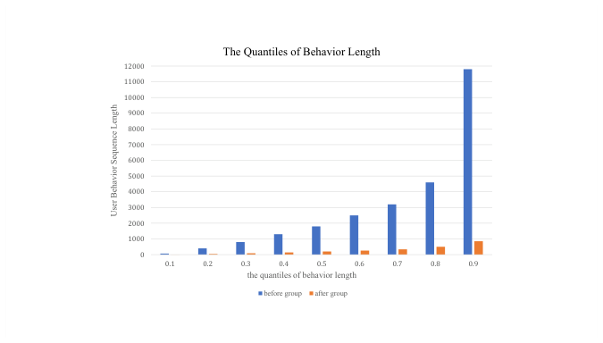
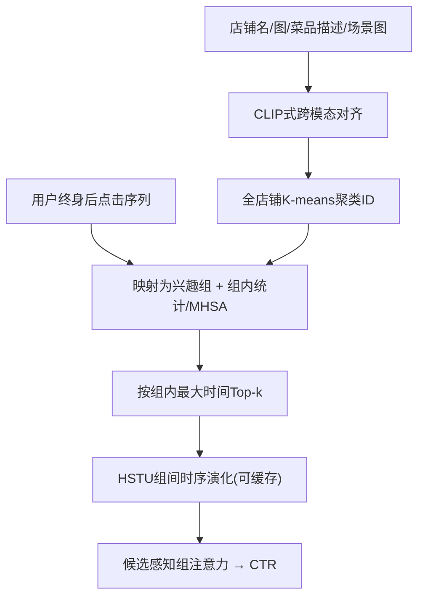
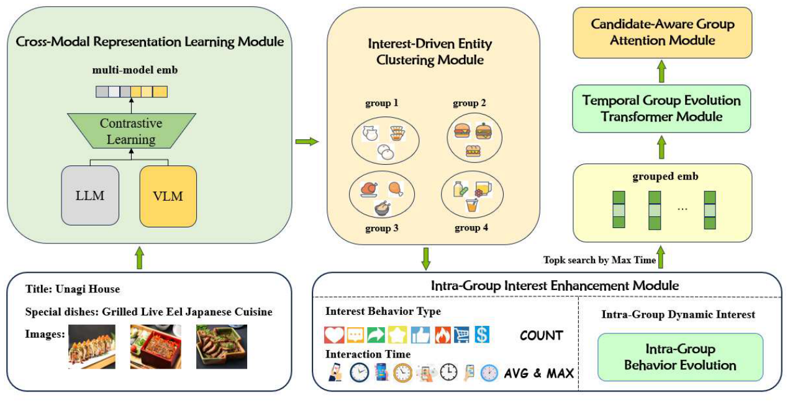

# DMGIN: How Multimodal LLMs Enhance Large Recommendation Models for Lifelong User Post-click Behaviors（多模态LLM如何增强面向终身用户后点击行为的大推荐模型）

- **会议/期刊**: AAAI 2026
- **作者与机构**: Zhuoxing Wei、Qingchen Xie、Qi Liu（美团核心本地商业、北京大学、清华大学、中国科学技术大学）
- **推荐链路定位**: 精排（CTR预估）
- **研究方向**: CTR/CVR预估与特征交叉 / 多模态推荐、序列推荐
- **论文原文**: [论文原文链接](https://arxiv.org/abs/2508.21801v1)
- **开源代码**: 暂未开源

## TL;DR (1分钟核心速览)

针对终身后点击序列过长、两阶段检索丢失全序列上下文、多模态嵌入直连LRM开销大且架构不匹配，DMGIN用MLLM离线聚类店铺，把万级行为压到百级兴趣组，再以组内统计+Transformer和组间HSTU保留兴趣演化；工业与Amazon上AUC/GAUC均超强基线，线上CTR+4.7%、RPM+2.3%。

## Background & Motivation (背景与核心矛盾)

- **主流范式**: 长序列CTR常走“两阶段检索—精排”，如SIM按类目检索、TWIN共享目标注意力、TWIN V2层次聚类；或直接截断/去重后喂入DIN、DSIN类模型。
- **前人局限**: 一是两阶段只利用候选相关子序列，完整终身上下文不完整；二是直接引入多模态embedding会放大计算量并与LRM结构错配。若简单去重压缩序列，又会丢失行为类型与时间信息。
- **核心洞察 (Key Insight)**: 用户后点击序列中存在大量重复或语义相关店铺，店铺名与图片可稳定识别同一实体；用户对店铺的兴趣由多模态内容塑造，因此可在“店铺实体”层而非“每次行为”层做语义聚类。图1显示按item id分组后，序列长度分位数显著左移，说明重复店铺是压缩主因。

<figure class="paper-figure" markdown="span">
  <figcaption>图1：按 item id 分组影响下的行为长度分布。按行为长度升序排列样本。左半部分展示不同分位数下对应行为的长度。右半部分展示各分组的行为数量分布。</figcaption>
</figure>

- **本文切入点**: 用MLLM只对全库唯一店铺生成多模态向量并K-means分组，把用户终身行为重排为兴趣组序列；再用组内统计、组内Transformer与组间HSTU补偿压缩损失。

## Method (核心方法设计)

### 1. 整体框架 (Overall Architecture)

DMGIN将CTR精排拆为离线语义压缩与在线兴趣抽取：先以CLIP式双塔对齐店铺名/图、菜品/描述、商业关键词/场景图，得到唯一店铺多模态向量；对所有店铺做K-means，把每个用户全量后点击序列映射为兴趣组ID。在线侧，每组用兴趣统计+组内MHSA保留数量、时间、金额与行为演化，按组内最大时间top-k激活组；再以多层HSTU建模组间时序演化，最后用候选感知注意力汇聚长期兴趣。TGETM输出与候选无关，可离线缓存Redis，仅候选注意力在线计算。

<figure class="paper-figure" markdown="span">
  <figcaption>图2：Deep Multimodal Group Interest Network（DMGIN）的整体框架。DMGIN 由跨模态表示学习模块（CMRLM）、兴趣驱动实体聚类模块（IDECM）、组内兴趣增强模块（IGIEM）、时序组演化 Transformer（TGET）和候选感知组注意力模块（CAGAM）组成。</figcaption>
</figure>

### 2. 关键设计拆解 (Key Designs)

1. **离线MLLM店铺聚类（CMRLM+IDECM）**：痛点是为每次行为算多模态embedding会造成十亿级日交互的计算爆炸。本文只对唯一店铺编码，预训练目标为匹配图文对相似度最大化、非匹配最小化；再对店铺向量做K-means：$c_i=\arg\min_k\|e_i^{mm}-\mu_k\|_2^2$。由于聚类只发生一次并全局复用，序列长度可从万级降到百级，且几乎不增加在线开销；论文还用簇负载均衡检查与t-SNE人工复核保证语义一致。
2. **组内双通道兴趣增强（IGIEM）**：分组会破坏原始顺序，故每组同时保留“强度”和“演化”。统计通道聚合行为类型计数、组内最大/平均时间与平均金额：$\mathbf{stats}_s=[\mathrm{counts},\mathrm{max\_time},\mathrm{avg\_price}]$；演化通道把时间戳、地点、行为类型拼入行为表示，经MHSA后均值池化：$g_s=[\mathrm{MeanPool}(\mathrm{MHSA}(e_b));\mathbf{stats}_s]$。统计补足兴趣强度，MHSA补足组内细粒度顺序，二者互补。
3. **组间时序演化与候选注意力（TGETM+CAGAM）**：按组内最大时间做top-k索引，$G=\sigma_{\mathrm{topk}}(\{g_s\},\max\_time)$，优先激活近期兴趣组；多层HSTU以相对簇偏置建模组间演化。候选侧用目标物品与组表示做注意力：$r_{long}=\mathrm{softmax}_s(\mathrm{sim}(W_te_t,W_gg'_s))$。训练目标为CTR交叉熵：$\mathcal{L}=-\frac1N\sum_i[y_i\log\hat y_i+(1-y_i)\log(1-\hat y_i)]$；负采样未见额外采样器，工业侧沿用曝光日志正负样本，Amazon细节原文未披露。

## Experimental Setup & Evaluation Protocol (实验设置与评估协议)

- **数据集与预处理**:

| 数据集 | #Users | #Items | #Interactions | #Fields | 特征/场景说明 |
| :--- | :---: | :---: | :---: | :---: | :--- |
| Amazon | 1357K | 474K | 72.17M | 19 | Grocery & Gourmet Food；最大历史100，近10短序列+近90长序列 |
| Industry | 400M | 5M | 6.6B | 317 | 美团LBS广告；近2年日志，最大长度10000，76类行为 |

- **数据划分与防穿越 (Splitting Strategy)**: 工业集用最后30天训练、次日测试，属于全局时间切分；Amazon按用户序列截取近10/90构造样本，原文未完整披露全局时间戳或Leave-One-Out细节，需审稿追问。
- **排名评测协议 (Ranking Protocol)**: CTR二分类评估，直接在曝光样本上计算AUC与GAUC，非全库Full-Ranking召回协议；GAUC按用户组内排序消除用户偏置。
- **对比基线与超参设置**: 短序列DIN/DIEN/DSIN；两阶段SIM/ETA/SDIM/TWIN；全序列DIN Full/DSIN Full/TWIN V2。SIM等检索top-50；embedding维度工业16、Amazon18；K-means簇数10000；Adam，学习率5e-4/1e-3；5次平均；0.01显著性。

## Key Experimental Results (实验关键数据)

### 1. 主实验对比 (Main Results)

| 方法 | Industry AUC | Industry GAUC | Amazon AUC | Amazon GAUC |
| :--- | :---: | :---: | :---: | :---: |
| DIN | 0.7011 | 0.6391 | 0.7245 | 0.6753 |
| DIEN | 0.7035 | 0.6406 | 0.7303 | 0.6796 |
| SIM | 0.7043 | 0.6412 | 0.7468 | 0.6832 |
| SDIM | 0.7073 | 0.6409 | 0.7497 | 0.6844 |
| TWIN V2 | 0.7078 | 0.6421 | 0.7526 | 0.6878 |
| DIN Full | 0.7087 | 0.6421 | 0.7634 | 0.6934 |
| DSIN Full | 0.7121 | 0.6421 | 0.7663 | 0.6955 |
| **DMGIN** | **0.7161** | **0.6458** | **0.7747** | **0.7022** |

相对最强基线DSIN Full，DMGIN的AUC/GAUC提升：Industry +0.56%/+0.58%，Amazon +1.10%/+0.96%。

### 2. 消融实验 (Ablation Study)

| 变体 | Industry AUC | Industry GAUC | Amazon AUC | Amazon GAUC |
| :--- | :---: | :---: | :---: | :---: |
| DMGIN-simple（含IGIEM，无TGETM） | 0.7134 | 0.6440 | 0.7701 | 0.6986 |
| w/o Interest Statistics | 0.7129 | 0.6435 | 0.7679 | 0.6977 |
| w/o Behavior Evolution | 0.7110 | 0.6435 | 0.7685 | 0.6984 |
| Full DMGIN | **0.7161** | **0.6458** | **0.7747** | **0.7022** |

### 3. 关键实验发现 (Key Findings)

- 全终身序列+语义分组优于两阶段检索：DMGIN在Industry AUC达0.7161，高于TWIN V2的0.7078与DSIN Full的0.7121；Amazon AUC 0.7747亦高于DSIN Full的0.7663，说明保留完整上下文比候选检索更有效。
- 组内“行为演化”是工业收益主驱动：去掉后Industry AUC从0.7134降至0.7110，降幅约0.0024；去掉统计分支仅降0.0005，前者约为后者4.8倍。Amazon上去统计分支降0.0022，说明跨域下统计与演化互补。
- TGETM存在明显缩放律：HSTU从1层增至6层，Amazon AUC单调提升约0.3%–0.5%且未饱和；线上A/B相对两阶段基线CTR+4.7%、RPM+2.3%，延迟仅4–5ms升至7–8ms，参数2.8GB升至4.0GB，性价比可接受。

## Highlights & Limitations (亮点、对比与审稿批判)

- **与代表作对比 (vs. Prior Work)**: 与SIM/TWIN/TWIN V2的“候选检索—精排”不同，DMGIN不截断全序列，而在店铺实体层做离线语义分组，保留完整终身上下文；与QARM/BBQRec等直接注入多模态embedding不同，它只对唯一店铺编码一次，避免逐行为多模态开销与LRM错配。
- **可迁移亮点**: “离线实体语义聚类+ID映射”可迁移到电商、本地生活等重复实体密集场景，实现近乎零在线开销的序列压缩；TGETM与候选无关可缓存Redis，是长序列精排降延迟的通用工程技巧。
- **审稿级局限批判**: 其一，所谓MLLM实为CLIP式双塔预训练+K-means，并非生成式LLM推理；聚类质量依赖K值、店铺覆盖与图文质量，长尾新店冷启动需增量簇分配机制。其二，Amazon仅Grocery单域，划分细节与负采样披露不足；组内压缩后的信息损失上界、K敏感度与跨场景延迟—效果帕累托曲线缺失，线上仅LBS单场景A/B。

## Rating (四维评分)

- **方法创新性 (Novelty)**: ⭐⭐⭐⭐ （将MLLM用于店铺实体聚类而非逐行为编码，压缩终身序列的思路新颖且工程感强）
- **评估协议与实验扎实度 (Protocol & Experiments)**: ⭐⭐⭐⭐ （工业+Amazon+A/B较完整，但Amazon划分与负采样披露不足，缺少Full-Ranking对照）
- **写作与数学规范度 (Clarity & Rigor)**: ⭐⭐⭐⭐ （框架与公式清晰，HSTU/注意力符号完整，但MLLM命名与模块实质存在一定包装）
- **工业落地与复现价值 (Industrial & Practical Value)**: ⭐⭐⭐⭐⭐ （已上线LBS广告，缓存设计与2–3ms延迟增量具备强落地参考，唯代码未开源）

