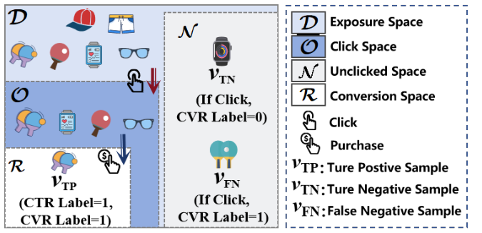
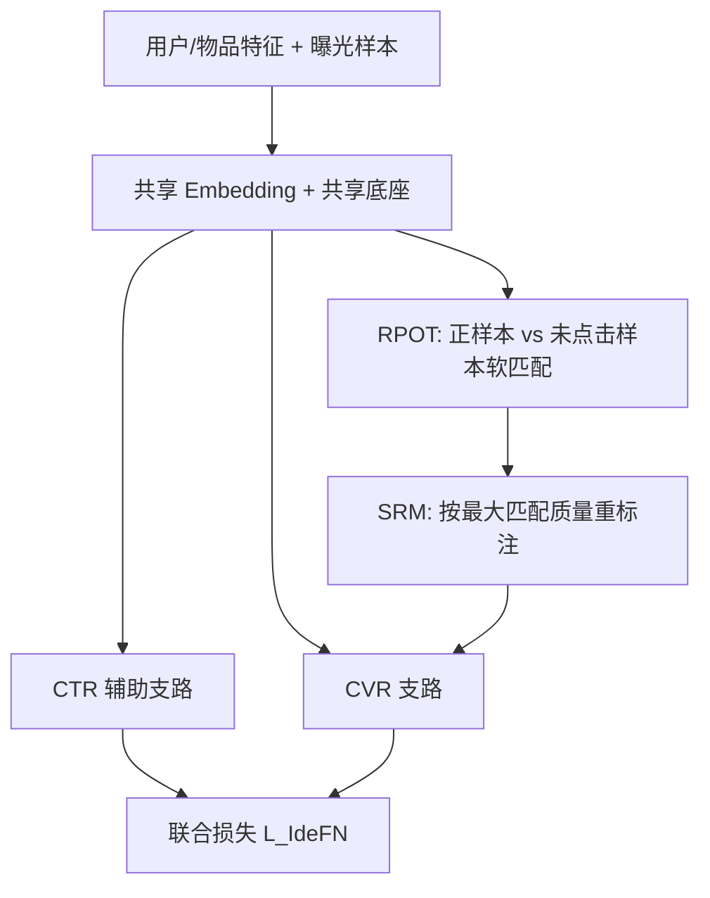
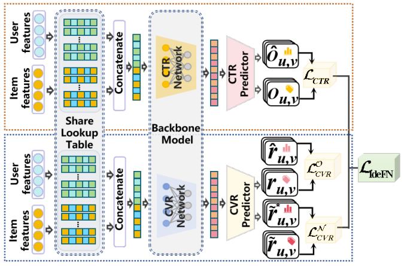

# IdeFN: Identifying Unclicked Space False Negatives via Relaxed Partial Optimal Transport for Conversion Rate Prediction (基于松弛部分最优传输识别未点击空间假负例的转化率预估)

- **会议/期刊**: AAAI 2026
- **作者与机构**: Weiyi Zhong, Weiming Liu, Lianyong Qi 等（曲阜师范大学、字节跳动、中国石油大学(华东)、南京信息工程大学、UMass Boston、Lancaster University）
- **推荐链路定位**: 精排（CVR/CTCVR 多任务预估）
- **研究方向**: CTR/CVR 预估与特征交叉 / 去偏与可信推荐
- **论文原文**: [论文原文链接](https://eprints.lancs.ac.uk/id/eprint/235609/1/AAAI_2026-IdeFN.pdf)
- **开源代码**: 暂未开源

## TL;DR (1分钟核心速览)

CTCVR 多任务框架把未点击样本一律标为转化负例，其中真正的"假负例"（因曝光位/浏览行为未点击、但本可转化）严重扭曲 CVR 表征。IdeFN 用**松弛部分最优传输 (RPOT)** 在表征空间把正样本与未点击样本做软匹配（多余质量吸收到虚拟点），再由**样本重标注机制 (SRM)** 依最大匹配质量自适应生成伪标签，使 CVR 能在完整曝光空间训练。在 Ali-CCP / KuaiRand-Pure 上，三种骨架下平均 AUC 相对提升约 1.96%/2.01%，KS 提升 6.51%/4.62%，LogLoss 降低 8.45%/2.14%。

## Background & Motivation (背景与核心矛盾)

- **主流范式**: ESMM/ESM²/DCMT 用 CTCVR + CTR 多任务共享底座，把训练空间从点击空间 $\mathcal{O}$扩展到曝光空间$\mathcal{D}$，以缓解样本选择偏差 (SSB) 与转化数据稀疏 (DS)。
- **前人局限**: ① CTCVR 标签构造 $c_{u,v}=1 \Leftrightarrow o_{u,v}=1 \wedge r_{u,v}=1$，等价于强制令所有未点击样本的 CVR 标签为 0，把$v^{FN}$与$v^{TN}$ 混为一谈；② NISE 式半监督把模型自身预测当伪标签，阈值静态/启发式，且继承原始偏差，反而放大噪声。
- **核心洞察 (Key Insight)**: 未点击但具转化潜力的样本，其用户—物品表征应与已转化正样本高度接近；因此"正样本 ↔ 未点击样本"可视为一个**质量不守恒的部分匹配**问题。
- **本文切入点**: 放弃阈值判定，改用带虚拟点的松弛部分最优传输求解软耦合强度，再据此重标注。

<figure class="paper-figure" markdown="span">
  <figcaption>图1：CVR预测中的关键挑战示意图</figcaption>
</figure>

## Method (核心方法设计)

### 1. 整体框架 (Overall Architecture)

用户/物品稀疏特征经共享 Embedding 表拼接后，送入 CTR 与 CVR 共享的底座（MLP / DeepFM / DCNV2），上支路做曝光空间 CTR 二分类辅助任务，下支路做 CVR。训练前先在表征空间运行 RPOT：以正样本集 $Z^P$为源、未点击集$Z^U$为目标，在单边质量约束与虚拟点机制下求得匹配矩阵$\tilde{\pi}^{*}$；SRM 再按每列最大匹配质量将未点击样本重标为伪正/伪负，把 CVR 损失扩展到整个曝光空间并与点击空间损失加权联合优化；推理阶段彻底丢弃 RPOT，仅保留与 ESMM 同构的双塔前向。

<figure class="paper-figure" markdown="span">
  <figcaption>图2：IdeFN的整体架构</figcaption>
</figure>

### 2. 关键设计拆解 (Key Designs)

1. **RPOT：带虚拟点的松弛部分最优传输**：经典 Kantorovich OT 要求源/目标总质量相等且全量传输，但未点击集合混有真负例，全量传输会把噪声硬塞给正样本。本文改两点：单边约束 $\pi\mathbf{1}_{N^U}=\frac{1}{N^P}$、$\pi^{\top}\mathbf{1}_{N^P}\le \kappa N^U$，并扩展出一行虚拟点使$\tilde{\pi}\in\mathbb{R}^{(N^P+1)\times N^U}$，边缘配额$b=(\kappa N^U,\;1-\kappa N^P N^U)$，虚拟点代价$\xi=0$。加 KL/熵正则后用拉格朗日乘子得闭式解

$$\tilde{\pi}^{(\ell+1)}_{ij}=\exp\!\Big(\frac{f_i}{\epsilon}\Big)\exp\!\Big(\frac{g_j}{\epsilon}\Big)\exp\!\Big(-\frac{\tilde{M}_{ij}}{\epsilon}\Big),\quad \tilde{M}_{ij}=\|z^P_i-z^U_j\|_2^2$$

直觉上"匹配不上的质量流向虚拟点"，从而把无转化潜力的样本自然隔离，$\kappa$直接控制假负例先验比例。定理 1 证明该迭代具线性收敛率；实践中仿 Greenkhorn 算法每轮只更新行列误差较大一侧的缩放因子，复杂度$O(\ell_{max}N^PN^U)$，因$N^P\ll N^U$ 开销可控。

2. **SRM：无阈值自适应重标注**：给定 $\tilde{\pi}^{*}$，取$\delta_j=\arg\max_i \tilde{\pi}^{*}_{ij}$；若$\delta_j\le N^P$则$\tilde{r}_{u,v}=1$（伪正，判为假负例），若$\delta_j=N^P+1$则$\tilde{r}_{u,v}=0$（匹配到虚拟点，判为真负）。这一"argmax 归属 + 虚拟点兜底"取代了静态阈值，使伪标签随训练动态校准，避免正负比例失衡下的阈值漂移。

3. **训练目标、负采样与推理效率**：总损失

$$\mathcal{L}_{IdeFN}=\mathcal{L}_{CTR}+\gamma\big(\alpha\mathcal{L}^{O}_{CVR}+(1-\alpha)\mathcal{L}^{N}_{CVR}\big)$$

其中 CTR 项在全体曝光样本上计算，CVR 项分别作用于点击空间与重标注后的未点击空间。**无需显式负采样**——未点击空间即是天然的弱监督负例池；CTR 辅助任务（$\gamma=30$）承担稳定表征与正则作用，$\alpha=0.8$ 偏向可靠的真实点击转化信号。在线推理只走共享底座双塔，与 ESMM 同阶延迟，RPOT 仅为离线训练期一次性求解。

## Experimental Setup & Evaluation Protocol (实验设置与评估协议)

- **数据集与预处理**（原文统计见附录 C.1，正文未列表）：

| 数据集 | #Users | #Items | #Interactions | 稀疏度/密度 | 特征/场景说明 |
| :--- | :---: | :---: | :---: | :---: | :--- |
| Ali-CCP | 见附录 C.1 | 见附录 C.1 | 多日电商曝光日志 | 转化极稀疏 | 阿里电商 曝光→点击→转化 三级标签 |
| KuaiRand-Pure | 见附录 C.1 | 见附录 C.1 | 短视频纯随机曝光 | 转化稀疏 | 快手短视频，随机曝光子集，抗流行度偏差 |

- **数据划分与防穿越 (Splitting Strategy)**: 沿用数据集官方设定，按天（全局时间戳）切分训练/验证/测试，保证曝光与转化日志不跨期泄漏。
- **排名评测协议 (Ranking Protocol)**: 本文属 CTR/CVR **预估校准**任务，非 Top-K 排序；在测试集曝光样本上直接计算 AUC、KS（区分度，越高越好）与 LogLoss（校准度，越低越好），未采用负采样排序或 Full-Ranking 协议。
- **对比基线与超参设置**: 基线含 ESMM、MMOE、ESM²-IPW、ESM²-DR、DCMT、NISE；骨架为 MLP / DeepFM / DCNV2；Embedding 维数 $d=16$，Adam + early stopping，batch=2048，lr=$1\times10^{-3}$，$\alpha=0.8$、$\gamma=30$、$\kappa=2\times10^{-2}$（交叉验证选取），五次运行取均值；**原文未报告显著性检验**。

## Key Experimental Results (实验关键数据)

### 1. 主实验对比 (Main Results)

MLP 骨架（其余骨架趋势一致）：

| 数据集 | Ali-CCP | | | KuaiRand-Pure | | |
| :--- | :---: | :---: | :---: | :---: | :---: | :---: |
| 方法 | AUC | KS | LogLoss | AUC | KS | LogLoss |
| ESMM | 0.6313 | 0.1827 | 0.0106 | 0.8444 | 0.5593 | 0.0703 |
| MMOE | 0.6241 | 0.1720 | 0.0099 | 0.8310 | 0.5447 | 0.0720 |
| ESM²-IPS | 0.6439 | 0.1865 | 0.0091 | 0.8460 | 0.5452 | 0.0645 |
| ESM²-DR | 0.6110 | 0.1945 | 0.0104 | 0.7826 | 0.4591 | 0.1132 |
| DCMT | 0.6434 | 0.1950 | 0.0100 | 0.8498 | 0.5535 | 0.0681 |
| NISE | _0.6515_ | _0.2075_ | _0.0024_ | _0.8569_ | _0.5584_ | _0.0649_ |
| **IdeFN** | **0.6656** | **0.2238** | **0.0022** | **0.8739** | **0.5866** | **0.0632** |
| Improv.% (vs. runner-up) | +2.17% | +7.86% | -8.33% | +1.98% | +5.05% | -2.62% |

跨骨架稳健性：Ali-CCP 上 IdeFN 在 MLP/DeepFM/DCNV2 的 AUC 为 0.6656/0.6622/0.6674，而同表 ESM²-DR 在 KuaiRand-Pure + DCNV2 上崩塌至 AUC 0.6442、LogLoss 0.5690。

### 2. 消融实验 (Ablation Study)

| 变体 (Ali-CCP) | AUC | KS | 归因 |
| :--- | :---: | :---: | :--- |
| IdeFN (完整) | 最优 | 最优 | CTR 辅助 + 未点击空间重标注 |
| IdeFN-T（去 CTR 辅助任务） | 下降 | 下降 | 失去辅助监督，表征与 CVR 训练不稳定 |
| IdeFN-R（去 RPOT，仅点击空间） | 下降更明显 | 下降更明显 | 松弛匹配与虚拟点失效，无法挖掘未点击高价值信号 |
| ESMM + IdeFN（表 2） | 0.6313→0.6656 (+5.43%) | 0.1827→0.2238 (+22.49%) | 框架可插拔 |
| MMoE + IdeFN（表 2） | 0.6241→0.6641 (+6.41%) | 0.1720→0.2240 (+30.23%) | 专家模型同样受益 |

### 3. 关键实验发现 (Key Findings)

1. **校准收益大于排序收益**：Ali-CCP 上 AUC 仅 +2.17% 而 LogLoss 相对降低 8.33%（0.0024→0.0022），说明 RPOT 重标注主要修正了预测概率的绝对偏差，而非整体排序结构——这正是 CVR 出价场景最敏感的量纲。
2. **区分度提升显著且跨骨架一致**：KS 相对提升 7.86%（Ali-CCP）、5.05%（KuaiRand-Pure），且在 DCNV2 上 IdeFN 仍达 KS 0.2243/0.5883；对比 ESM²-DR 在 KuaiRand-Pure+DCNV2 的 AUC 0.6442，证明部分质量约束带来的鲁棒性优于 IPW/DR 类因果加权。
3. **假负例比例 $\kappa$呈倒 U 型**：$\kappa$在$10^{-3}\sim3\times10^{-2}$内取值时，$\kappa=2\times10^{-2}$最优，过大导致过度匹配、标签噪声反噬，过小则漏检假负例；$\alpha=0.8$与$\gamma=30$ 分别为"可靠点击信号 vs 伪标签信号"与"CTR vs CVR"的平衡点。

## Highlights & Limitations (亮点、对比与审稿批判)

- **与代表作对比 (vs. Prior Work)**: 相比 ESMM 系（仅把训练空间扩到曝光域、标签仍二元化），IdeFN 首次显式建模未点击空间的标签不确定性；相比 DCMT（反事实视角处理未点击空间 SSB），本文不假设因果图、而是用表征空间的最优传输几何结构做匹配；相比 NISE（用模型预测当伪标签，静态阈值），SRM 由传输矩阵 argmax + 虚拟点兜底，无阈值且可随迭代自适应。
- **可迁移亮点**: ① "虚拟点吸收未匹配质量"的部分传输范式可直接迁移到弱监督/噪声标签下的样本筛选（如曝光未点击的负样本去噪、跨域伪标签对齐）；② Greenkhorn 式单边更新把 Sinkhorn 的每轮开销从行列全更新降为单元素更新，适合大批量场景。
- **审稿级局限批判**: ① 时间复杂度 $O(\ell_{max}N^PN^U)$仍需构建$N^P\times N^U$成本矩阵并逐 epoch 重算匹配，正样本量随平台规模增长时训练期开销不可忽视，且虚拟点代价设为$\xi=0$是硬编码先验；②$\kappa$ 敏感（跨一个数量级即显著影响性能）且缺乏理论指导，伪标签一旦错标无显式纠错机制，存在自我强化风险；③ 实验仅两个数据集、指标限于 AUC/KS/LogLoss，未报告显著性检验、稀疏/长尾分桶与线上 A/B，工业结论需补强。

## Rating (四维评分)

- **方法创新性 (Novelty)**: ⭐⭐⭐⭐ （把假负例识别重构为带虚拟点的松弛部分最优传输，并用线性收敛定理支撑，问题建模角度新颖）
- **评估协议与实验扎实度 (Protocol & Experiments)**: ⭐⭐⭐ （两数据集 × 三骨架 × 六基线较完整，但无显著性检验、无分桶与线上验证，消融仅以图呈现缺具体数值）
- **写作与数学规范度 (Clarity & Rigor)**: ⭐⭐⭐⭐ （RPOT 推导至闭式解与算法伪码清晰，复杂度与收敛性均有交代；部分符号如 $\Delta$、$b$ 的下标说明略含混）
- **工业落地与复现价值 (Industrial & Practical Value)**: ⭐⭐⭐⭐ （推理零额外开销、可插拔进 ESMM/MMoE，直接命中 CVR 出价校准痛点；但训练期 OT 求解与 $\kappa$ 调参成本需工程折衷）

