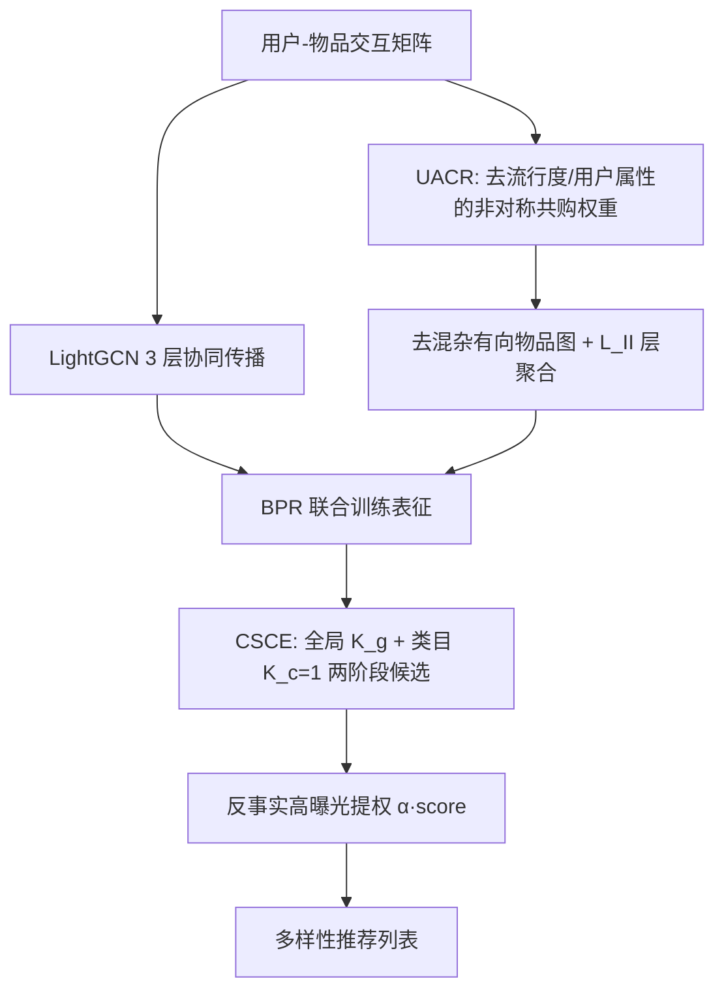
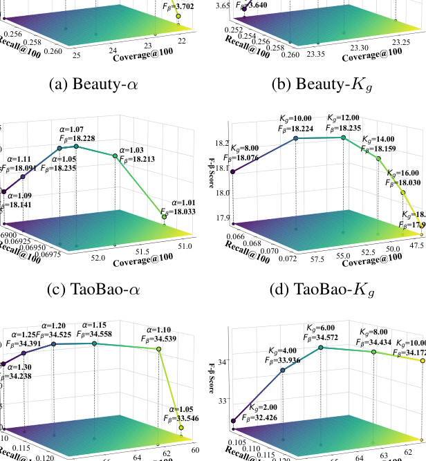

# Cadence: Diversity Recommendation via Causal Deconfounding of Co-purchase Relations and Counterfactual Exposure (共购关系因果去混杂与反事实曝光驱动的多样性推荐)

- **会议/期刊**: AAAI 2026
- **作者与机构**: Jingmao Zhang, Zhiting Zhao, Yunqi Lin, Jianghong Ma 等（哈尔滨工业大学(深圳)；南洋理工大学）
- **推荐链路定位**: 召回（图协同过滤表征）+ 列表后处理（候选选择与重排）
- **研究方向**: 去偏公平、可信隐私与工业架构 / 图神经网络推荐
- **论文原文**: [arXiv:2512.17733v1](https://arxiv.org/abs/2512.17733v1)
- **开源代码**: [匿名仓库](https://anonymous.4open.science/status/AAAI-BF40)

## TL;DR (1分钟核心速览)

现有 item-to-item 推荐把「共现」当作相关性，导致物品流行度与用户属性作为混杂因子污染表征、推荐结果同质化；多样性方法又普遍缺乏因果理论支撑。本文提出 Cadence：以 LightGCN 为骨干，先用剔除流行度与属性的**非对称共购关系 UACR** 构建去混杂有向物品图并加一层聚合，再由 **UACR 引导的两阶段候选选择 + 反事实高曝光提权**（缩放因子 $\alpha$）注入未曝光但因果相关的类目。在 Beauty/TaoBao/Toy 上，Recall@100 与 Coverage@100 的$F_\beta$全面超越 SOTA 多样性模型（Wilcoxon$p=0.0312$），训练收敛时间仅比 LightGCN 高约 12%。

## Background & Motivation (背景与核心矛盾)

- **主流范式**: 多样性推荐分两条线——重排类（MMR、DPP）在给定列表上做去冗余；图类（DGCN、DGRec、DivGCL）用类别感知采样或嵌入扰动生成多元表征；另一支则用共购/KG 边（CPGRec、KG-Diverse）增强物品侧语义。
- **前人局限**: ① 共现概率被**物品流行度**与**用户属性**双重混杂，热门商品与共现边绑定，学到的“相似”实为“都热”；② 多样性方法多为启发式重排或采样，缺乏可证明的因果基础，只能牺牲准确率换覆盖。
- **核心洞察 (Key Insight)**: 作者给出**范数–流行度相关性定理**——在 LightGCN 的线性传播 $M=\sum_k\alpha_k A^k$与均匀负采样（$\Pr[i]=n_i/|\mathcal{D}|$）下，BPR 梯度的法向分量使物品嵌入范数收敛到不动点
  $\mu_i \approx \dfrac{\bar{\kappa}\, n_i/|\mathcal{D}|}{2\lambda+\beta\, n_i/|\mathcal{D}|}$，即$\|e_i\|_2=\Theta(n_i)$，且$\Pr(\|e_i\|>\|e_j\|)\ge 1-e^{-\Omega(1)}$。这说明**内积打分本身就编码了流行度**，共现图的偏差不是偶然而是结构性必然。
- **本文切入点**: 既然偏差来自混杂与曝光机制，就用后门调整构造去混杂边权，再用“反事实地把用户置于高曝光情景”来反向补偿低曝光物品。

## Method (核心方法设计)

### 1. 整体框架 (Overall Architecture)

输入用户-物品交互矩阵，LightGCN 做 3 层协同传播得到基础表征；并行地离线统计物品对共购，用后门调整剔除流行度与用户属性的混杂，得到非对称、带符号方向性的 UACR 权重，截断稀疏化后构成**去混杂有向物品图**，再经 2 层 item-item 卷积把物品表征精炼；两路表征拼接进入 BPR 训练。推理由 CSCE 模块接管：先按 UACR 做全局与类目两级筛选，找出与用户历史有强因果关联但从未交互的物品集合，对其施加高曝光反事实干预（$\alpha>1$ 提权）后与常规打分融合输出列表。

### 2. 关键设计拆解 (Key Designs)

1. **UACR-Guided Causal Inference & Graph Refinement (CIGR)**：痛点是共现强度 $\frac{|\mathcal{U}_i\cap\mathcal{U}_j|}{|\mathcal{U}_i\cup\mathcal{U}_j|}$同时被$P(j)$（流行度）与$U$（用户属性）混杂。本文对边权做后门调整估计因果强度$\text{UACR}(i\to j)\propto \frac{P(j\mid do(i))}{P(j)}$，分母除以目标物品边际流行度以抵消热门偏置，并保留**方向性**（买 i 后买 j 与反向不等价），同时对用户属性分布做重加权。这样冷门但因果相关的边得以保留，热门共现边被压平，物理直觉是“把‘因为大家都买所以一起买’从‘因为需要所以一起买’中剥离”。
2. **CSCE 两阶段候选选择 + 反事实曝光**：痛点是去混杂图只是“不偏”，并不主动提升多样性。做法是先用 UACR 取全局 Top-$K_g$、再在每类目取 Top-$K_c=1$（强制类目铺开），得到“强因果相关但未交互”集合$\mathcal{C}_u^{cf}$，然后在$do(\text{Exposure}=1)$ 的反事实世界里重算打分：
   $s_{ui}=\langle e_u,e_i\rangle\cdot\big(\alpha\big)^{\mathbb{I}(i\in\mathcal{C}_u^{cf})}$，$\alpha>1$ 为曝光强度。直觉上这不是随机探索，而是“若该物品被充分曝光，用户本会喜欢”的因果补偿，因此可在保相关性前提下把低曝光类目顶上来。
3. **训练目标、负采样与推理效率**：损失为 BPR 加 $\ell_2$正则，$\mathcal{L}=\sum_{(u,i,j)\in\mathcal{D}_S}-\ln\sigma(s_{ui}-s_{uj})+\lambda\|\theta\|^2$，负采样沿用**均匀采样**（正是定理所刻画的偏差来源，本文靠图侧去偏而非改采样）；$d=32$、$\eta=0.001$、batch 2048。UACR 仅对共购边（$\gamma$条）离线算一次$O(\gamma)$，截断至$\beta$条后复杂度$O(L_{II}\beta d)$，由于$\beta\ll\gamma,E$，整体训练复杂度与 LightGCN 同阶；CSCE 仅在训练后离线执行一次，$O(U)$ 可忽略。

## Experimental Setup & Evaluation Protocol (实验设置与评估协议)

- **数据集与预处理**: 采用 Beauty、TaoBao、Toy 三个公开基准；原文未给出用户/物品/交互量级统计与 $k$-core 过滤细节，需参照其引用的 DGRec/DivGCL 数据处理流程。

| 数据集 | #Users | #Items | #Interactions | 特征/场景说明 |
| :--- | :---: | :---: | :---: | :--- |
| Beauty | 原文未报 | 原文未报 | 原文未报 | Amazon 美妆，稠密小规模，含类目层级 |
| TaoBao | 原文未报 | 原文未报 | 原文未报 | 电商大规模、稀疏，类目体系丰富 |
| Toy | 原文未报 | 原文未报 | 原文未报 | Amazon 玩具，中等规模 |

- **数据划分与防穿越 (Splitting Strategy)**: 原文未明确说明；据其基线谱系（DGRec/DivGCL/CPGRec 一致设置）推断为**用户级留一划分**，但本文未复述，属评估交代不足。
- **排名评测协议 (Ranking Protocol)**: 报告 Recall@100、Coverage@100、HIT Ratio@100、Entropy@100；未注明候选集为全库 `Full-Ranking` 还是采样排序，隐式反馈训练使用均匀负采样。
- **综合指标与超参**: 以 $F_\beta=\frac{(1+\beta^2)\cdot\text{Cov@100}\cdot\text{Rec@100}}{\beta^2\cdot\text{Rec@100}+\text{Cov@100}}$平衡准确率与多样性，$\beta$取 Beauty=4、TaoBao=20、Toy=15；$K_g$=4/12/6，$K_c=1$，$\alpha$=1.15/1.05/1.15；$d=32$，5 个随机种子（2021–2025）取均值±方差，Wilcoxon 符号秩检验$p=0.0312<0.05$。

## Key Experimental Results (实验关键数据)

### 1. 主实验对比 (Main Results)

原文指定各数据集最强基线为 CPGRec（Beauty）、DGRec（TaoBao）、DivGCL（Toy），Cadence 全面超越；下表的 $F_\beta$ 为原文报告的最优值，基线的绝对指标数值未在正文表格中完整给出。

| 数据集 | $\beta$| 最强基线 | Cadence 最优$F_\beta$ | 最优配置 | 显著性 |
| :--- | :---: | :--- | :---: | :--- | :---: |
| Beauty | 4 | CPGRec | **3.760** | $\alpha$=1.15,$K_g$=4 |$p=0.0312$ |
| TaoBao | 20 | DGRec | **18.235** | $\alpha$=1.05,$K_g$=12 |$p=0.0312$ |
| Toy | 15 | DivGCL | **34.572** | $\alpha$=1.15,$K_g$=6 |$p=0.0312$ |

训练收敛时间（秒，Early Stopping 基于 Recall@100）：

| 方法 | Beauty | TaoBao | Toy |
| :--- | ---: | ---: | ---: |
| EDUA | 4958.06 | 83792.67 | 117801.37 |
| DGRec | 201.05 | 6018.00 | 8617.46 |
| DGCN | 127.90 | 3443.70 | 5594.52 |
| CPGRec | 130.63 | 5168.63 | 7989.39 |
| KG-Diverse | 2018.96 | 49538.62 | 8430.42 |
| DivGCL | 2331.08 | 54355.19 | 53799.64 |
| **Cadence** | **97.57** | **2308.63** | **2756.34** |
| LightGCN | 87.10 | 2218.00 | 2357.42 |

### 2. 消融实验 (Ablation Study)

由于 $K_g=0$或$\alpha\approx1$ 即等价于关闭 CSCE 的反事实曝光分支，参数扫描本身构成天然消融（图 1）：

| 变体 | Beauty $F_\beta$| TaoBao$F_\beta$| Toy$F_\beta$ |
| :--- | ---: | ---: | ---: |
| 完整 Cadence | **3.760** | **18.235** | **34.572** |
| w/o 全局候选（$K_g\to0$ 或 2） | 3.640 | 18.076 | 32.426 |
| w/o 曝光提权（$\alpha\to$ 最小） | 3.702 | 18.033 | 33.546 |

<figure class="paper-figure" markdown="span">
  <figcaption>图1：α 和 Kg 的参数敏感性</figcaption>
</figure>

### 3. 关键实验发现 (Key Findings)

1. **曝光强度 $\alpha$呈倒 U 型**：Beauty 上$\alpha$由 1.05→1.15 使$F_\beta$ 从 3.702 升到 3.760，再增至 1.25 回落到 3.721；说明“反事实补偿”必须适度，过度提权会用不相关物品换覆盖率，直接印证“去混杂 ≠ 无脑多样化”。
2. **$K_g$的最优值随数据规模单调增大**：Toy 从$K_g=2$的 32.426 提升到$K_g=6$的 34.572（+6.6%），TaoBao 在$K_g=12$达峰；而 Beauty（稠密小规模）在$K_g=8$ 反而降到 3.712——稀疏大数据靠更多候选缓解稀缺，稠密小数据则被噪声反噬。
3. **因果去偏几乎零成本**：Cadence 在 Beauty 上收敛仅 97.57s，比 LightGCN 的 87.10s 高 12%，而 DivGCL 需 2331.08s、KG-Diverse 需 2018.96s（约 20–24 倍）；原因在于 UACR 只对稀疏共购边离线算一次且图被截断到 $\beta\ll E$，在线推理只多一次静态提权查表。

## Highlights & Limitations (亮点、对比与审稿批判)

- **与代表作对比 (vs. Prior Work)**: 相比 DGCN/DivGCL 这类“扰动表征或类别采样”的多样性方法，本文给出了范数–流行度的闭式不动点分析，把多样性提升建立在可证明的混杂剥离上；相比 CPGRec/KG-Diverse 直接用共现边或 KG 边，本文显式对边权做后门调整并保留方向性；相比 UCRS 的“用户可控反事实”，本文的反事实作用于**曝光机制**而非用户特征，目标明确锁定多样性。
- **可迁移亮点**: ① UACR 的“共现除以目标边际流行度 + 保留方向性”可直接替换任意 item-item 图的边权，作为通用去偏预处理；② $\alpha$ 提权本质是打分侧的一次静态乘法，可无缝移植到任意召回/重排模型的输出层，做低曝光类目扶持与冷启动物品打捞。
- **审稿级局限批判**: ① 划分方式、候选打分协议（全库 vs 采样）与数据集统计均未交代，主结果表也只给 $F_\beta$而非 Recall/Coverage 绝对值，复现与横向比较成本高；②$K_c=1$依赖平台类目体系且$\alpha,K_g$需逐数据集手调（1.05–1.15、4–12），跨域迁移与自动定参缺方法；③ 定理建立在均匀负采样与线性传播假设上，若换用 Hard Negative 或非线性聚合，$\Theta(n_i)$ 结论的适用性未被讨论。

## Rating (四维评分)

- **方法创新性 (Novelty)**: ⭐⭐⭐⭐ （把“范数随流行度线性增长”的定理与 UACR 去混杂、反事实曝光干预串成闭环，因果视角在多样性推荐中较新）
- **评估协议与实验扎实度 (Protocol & Experiments)**: ⭐⭐⭐ （5 种子均值±方差 + Wilcoxon 检验到位，但划分/打分协议与数据集统计缺失，主表未给完整绝对指标）
- **写作与数学规范度 (Clarity & Rigor)**: ⭐⭐⭐⭐ （不动点推导与 Azuma–Hoeffding 上界完整，UACR 权重的具体闭式与超参敏感性解释略简）
- **工业落地与复现价值 (Industrial & Practical Value)**: ⭐⭐⭐⭐⭐ （LightGCN 插件式、训练开销仅 +12%、推理为静态查表，且有匿名开源代码，工程部署门槛极低）

