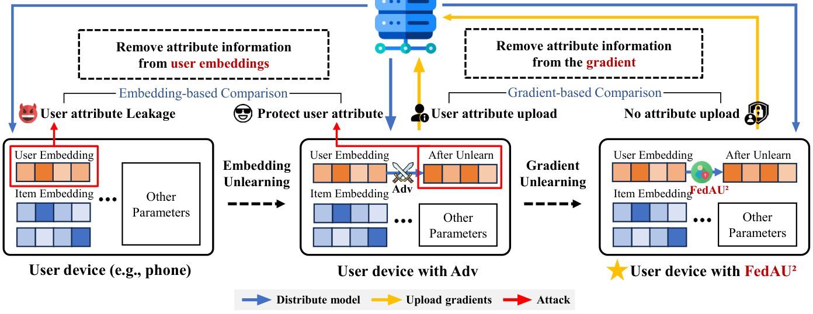
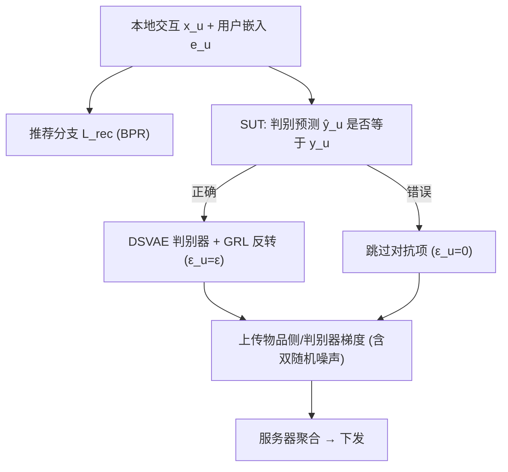

# FedAU2: Attribute Unlearning for User-Level Federated Recommender Systems with Adaptive and Robust Adversarial Training (面向用户级联邦推荐系统的自适应鲁棒对抗属性遗忘)

- **会议/期刊**: AAAI 2026
- **作者与机构**: Yuyuan Li, Junjie Fang, Fengyuan Yu, Chaochao Chen 等（杭州电子科技大学、浙江大学、澳门理工大学、蚂蚁集团）
- **推荐链路定位**: 联邦训练阶段（用户/物品嵌入）+ 训练后隐私遗忘
- **研究方向**: 去偏公平、可信隐私与工业架构
- **论文原文**: [https://arxiv.org/abs/2511.22872v1](https://arxiv.org/abs/2511.22872v1)
- **开源代码**: 暂未开源

## TL;DR (1分钟核心速览)

用户级联邦推荐中，用户嵌入会隐式编码性别/年龄等敏感属性，既有属性遗忘方法（分布对齐、后处理微调）依赖群组级跨用户聚合数据，在“单设备单用户”场景失效；差分隐私扰动又缺乏属性特异性。本文提出 FedAU2：客户端本地用 **SUT** 按对抗器预测正误动态开关反传的扰动预算（解决对抗冷启动不稳定），并把对抗器末层换成 **DSVAE**，在 $\boldsymbol{\mu}$ 路额外乘高斯噪声（解决梯度重构泄漏）。在 ML-100K/ML-1M/LastFM-360K 上，FedNCF/FedVAE 的属性攻击 BAcc 平均下降 **26.42%**（DP 基线 APM 仅 11.5%），NDCG@10 仅损失 **4.51%**（APM 损失 20.05%）。

## Background & Motivation (背景与核心矛盾)

- **主流范式**: 联邦推荐（FedRecs）把用户嵌入留在本地、只上传物品侧参数与梯度；属性遗忘则用对抗训练（GRL）从嵌入中“抹去”敏感属性，或用分布对齐/后处理微调在服务器侧对齐属性分布。
- **前人局限**: ① 分布对齐与后处理方法（Hu & Song 2024、Aegis）需要**群组级**跨用户聚合数据，而用户级 FedRecs 数据严格隔离、极度稀疏非 IID，直接不可用；② DP 类方法（APM）对参数均匀加噪，**缺乏属性特异性**（不能选择遗忘某一属性），且效用损失巨大。
- **核心洞察 (Key Insight)**: 对抗训练是唯一可行的用户级方案，但存在两个被忽视的漏洞——数据异构 + 客户端随机采样使对抗器无法全局预训练，导致扰动预算失控（冷启动不稳定）；而即使嵌入已去属性，**对抗器末层梯度仍可被 DLG/iDLG 反演出真实标签**。
- **本文切入点**: 将扰动预算的控制权下放到单用户（SUT），并把对抗器改造成双随机生成模型（DSVAE），从“嵌入侧 + 梯度侧”双重封堵。

<figure class="paper-figure" markdown="span">
  <figcaption>图1：联邦推荐中三种用户设备类型的比较。i) 左侧，标准客户端在嵌入中暴露属性信息；ii) 中间，对抗客户端可防止嵌入泄漏，但仍遭受梯度泄漏；iii) 右侧，我们提出的 FedAU2 同时消除嵌入和梯度中的信息泄漏。</figcaption>
</figure>

## Method (核心方法设计)

### 1. 整体框架 (Overall Architecture)

每轮服务器下发全局物品嵌入与模型参数；客户端本地用 BPR 训练推荐任务，同时在用户嵌入 $\boldsymbol{e}_u$上挂 GRL 与属性判别器$h_\omega$做对抗遗忘。SUT 在每个 batch 观察$h_\omega$是否预测正确，决定本次反传是否施加梯度反转（错误的样本直接跳过对抗项）；DSVAE 位于$h_\omega$末层，把$\boldsymbol{\mu}$与$\boldsymbol{\sigma}$两路都随机化，使上传的梯度中标签偏好被乘性噪声掩盖。服务器仅聚合同构的物品侧与$h_\omega$ 参数，用户嵌入永不出端。

### 2. 关键设计拆解 (Key Designs)

1. **SUT 选择性遗忘触发器（解决 CH1 训练不稳定）**：理论上最优扰动预算应由样本到判别边界的距离决定，即 $\varepsilon_u=\tau\|\nabla_{\boldsymbol{e}_u}\mathcal{L}(h_\omega(\boldsymbol{e}_u),y_u)\|_2$，但逐轮求梯度开销过大。作者利用“预测正确 ⇔ 梯度范数小 ⇔ 已靠近局部最优、属性信息已被捕获”的经验规律，简化为二值开关：$\varepsilon_u=\varepsilon$当$\hat{y}_u=y_u$，否则$\varepsilon_u=0$。直觉是只对“已泄露属性”的用户施加遗忘，既避免过度扰动抹掉推荐信号，又免除全局预训练，且无需额外内存/通信。
2. **DSVAE 双随机变分自编码器（解决 CH2 梯度泄漏）**：由定理 1，DLG 的最优伪造标签有闭式解 $y_i^{*}=\hat{y}_i'-\delta_i$，$\delta_i=G(\nabla W_i)$——攻击同时利用“重构嵌入的预测$\hat{y}_i'$”与“梯度偏好项$\delta_i$”。原始 MLP 下$\delta_i=\frac{(\boldsymbol{h}')^{\top}\nabla W_i}{\|\boldsymbol{h}'\|^2}$，符号即泄露真标签；标准 VAE 只在$\boldsymbol{\sigma}$路加噪，$\boldsymbol{\mu}$路仍确定，故$\delta_i=\frac{(\boldsymbol{z}')^{\top}\nabla W^{\mu}_i}{\|\boldsymbol{z}'\|^2}$依旧可被利用。DSVAE 令$\boldsymbol{u}=\boldsymbol{\mu}\odot\boldsymbol{\epsilon}_1'+\boldsymbol{\sigma}\odot\boldsymbol{\epsilon}_2',\ \boldsymbol{\epsilon}_1'\sim\mathcal{N}(\mathbf{1},\lambda),\ \boldsymbol{\epsilon}_2'\sim\mathcal{N}(\mathbf{0},\mathbf{I})$，于是
$$\delta_i=\frac{(\boldsymbol{\epsilon}_1'\!\odot\!\boldsymbol{z}')^{\top}\nabla W^{\mu}_i}{\|\boldsymbol{z}'\odot\boldsymbol{\epsilon}_1'\|^2}=\frac{(\boldsymbol{\epsilon}_1^{\top}\boldsymbol{\epsilon}_1')\odot(\hat{y}_i-y_i)(\boldsymbol{z}^{\top}\boldsymbol{z}')}{\|\boldsymbol{z}'\odot\boldsymbol{\epsilon}_1'\|^2},$$
多出的乘性项 $\boldsymbol{\epsilon}_1^{\top}\boldsymbol{\epsilon}_1'$同时扰动$\hat{y}_i'$与$\delta_i$，并使 iDLG 依赖的梯度符号判据失效。
3. **训练目标与开销**：总目标为 $\min_{\Theta,\omega}\ \mathcal{L}_{rec}+\lambda\sum_u \mathrm{CE}\big(h_\omega(\mathrm{GRL}(\boldsymbol{e}_u;\varepsilon_u)),y_u\big)$，本地 1 epoch、每轮采样 10% 用户，负采样沿用 BPR 的均匀负采样，无额外负样本设计。开销上 SUT 使反向传播 5.536 ms → 5.112 ms，DSVAE 因末层双投影略增，二者组合后总耗时 8.489 → 8.081 ms（**-4.8%**）。

## Experimental Setup & Evaluation Protocol (实验设置与评估协议)

- **数据集与预处理**: 用户/物品均做 `5-core` 过滤（LastFM 为 23/51），并按性别均衡用户数，以排除类别不平衡对 BAcc 的干扰。

| 数据集 | #Users | #Items | #Interactions | 稀疏度/密度 | 特征/场景说明 |
| :--- | :---: | :---: | :---: | :---: | :--- |
| ML-100K | 1,000 | 1,700 | 100K | 5.9% | 电影评分；性别/年龄/职业 |
| ML-1M | 6,040 | 3,706 | 1M | 4.5% | 电影评分；性别/年龄 |
| LastFM-360K | — | — | ≈360K | — | 用户-歌手；性别/年龄/国家 |

- **数据划分与防穿越 (Splitting Strategy)**: `Leave-One-Out`，按时间戳保留每个用户最后一次交互作测试，其余训练；属性标签（性别二分、年龄三分桶）仅用于对抗器监督，不参与推荐前向。
- **排名评测协议 (Ranking Protocol)**: LOO 单正例 + 全体未交互物品的全库排序（Full-Ranking 语义），报告 HR@{5,10,15,20} 与 NDCG@{5,10,15,20}；原文未显式声明训练/评测负采样比例，属隐含设置。隐私侧用微平均 F1、BAcc（嵌入级属性推断）与 Acc（梯度级 DLG 重构）。
- **对比基线与超参设置**: 推荐骨干为 FedNCF / FedVAE / FedRAP；遗忘基线仅 **Original（不遗忘）** 与 **APM（DP 参数扰动）**。嵌入维度 32 / 200 / 32，本地 lr 0.1/0.01/0.01，全局轮数 800/400/200，对抗器为 100 隐层单元的双层 MLP，GRL 缩放 400，$\lambda=4$。原文未报告显著性检验。

## Key Experimental Results (实验关键数据)

### 1. 主实验对比 (Main Results)

| 数据集/骨干 | 方法 | HR@10↑ | NDCG@10↑ | F1↓ | BAcc↓ |
| :--- | :--- | :---: | :---: | :---: | :---: |
| ML-1M / FedNCF (Gender) | Original | 0.6662 | 0.3897 | 0.7024 | 0.7032 |
| | APM | 0.5530 | 0.3079 | 0.6162 | 0.6179 |
| | **FedAU2** | **0.6232** | **0.3519** | **0.5176** | **0.5136** |
| ML-1M / FedVAE (Gender) | Original | 0.6896 | 0.4169 | 0.7189 | 0.7204 |
| | APM | 0.5366 | 0.3005 | 0.6654 | 0.6666 |
| | **FedAU2** | **0.6697** | **0.3994** | **0.4191** | **0.5536** |
| ML-1M / FedRAP (Gender) | Original | 0.4365 | 0.2381 | 0.7069 | 0.7089 |
| | APM | 0.4114 | 0.2268 | 0.6575 | 0.6621 |
| | **FedAU2** | **0.4429** | **0.2437** | **0.6285** | **0.6283** |
| LastFM / FedVAE (Age) | Original | 0.7407 | 0.4648 | 0.5329 | 0.5391 |
| | APM | 0.5818 | 0.3285 | 0.4677 | 0.4682 |
| | **FedAU2** | **0.7358** | **0.4610** | **0.2033** | **0.3556** |

平均而言（FedNCF/FedVAE）：BAcc 下降 **26.42%** vs. APM 的 11.5%（`Improv.` 约 2.3×）；NDCG@10 损失 **4.51%** vs. APM 的 20.05%。

### 2. 消融实验 (Ablation Study)

| 配置 | 关键指标 | 结果 |
| :--- | :--- | :--- |
| w/o DSVAE（原始 MLP 对抗器） | 梯度攻击 Acc（FedVAE） | 90%（近乎完全泄露） |
| w/ VAE（单随机） | 梯度攻击 Acc | 89%（$\delta_i$ 未被扰动） |
| **w/ DSVAE（完整）** | 梯度攻击 Acc | **58%**（逼近随机猜测 50%） |
| w/o SUT（Global 全程对抗） | NDCG@10 | 三者中最差（过度扰动） |
| w/o SUT（Pretrain 预训练） | BAcc | 三者中最差（判别器泛化不足） |
| w/ SUT（完整） | NDCG@10 / BAcc | 推荐最优、遗忘与 Global 持平 |
| SUT+DSVAE 组合开销 | Forward/Backward/Total | 2.964 / 5.117 / **8.081 ms**（vs. Adv 8.489 ms） |

### 3. 关键实验发现 (Key Findings)

1. **DP 的均匀噪声与属性信息“不共线”**：APM 把 BAcc 从 0.7032 压到 0.6179 的同时把 NDCG@10 从 0.3897 拉到 0.3079（-21%），而 FedAU2 以 -9.7% 的 NDCG 换来 -27% 的 BAcc——对抗式遗忘的“噪声方向”与属性子空间对齐，效用-隐私前沿显著更优。
2. **单随机性不足，必须扰动 $\boldsymbol{\mu}$路**：VAE 仅把$\hat{y}_i'$打到随机水平，攻击 Acc 仍达 89%；只有 DSVAE 的乘性项$\boldsymbol{\epsilon}_1^{\top}\boldsymbol{\epsilon}_1'$同时压制$\delta_i$，才把 Acc 拉到 58%，证明式 (7) 的两项须联合遮蔽。
3. **$\lambda$存在三方权衡，SUT 是稳定性的必要条件**：$\lambda$ 增大 → 梯度隐私更强、推荐更好，但对抗器泛化变差导致遗忘（BAcc）变差；而 Pretrain 在联邦随机采样下判别器泛化不足，遗忘效果劣于 SUT，验证了“去全局预训练”的必要性。此外 FedRAP 遗忘幅度仅 14.09%，因其残差式用户嵌入需降维聚合，难以改写。

## Highlights & Limitations (亮点、对比与审稿批判)

- **与代表作对比 (vs. Prior Work)**: 相比 Hu & Song (2024) 与 Aegis 的群组级分布对齐，本文是**唯一不依赖跨用户聚合**的用户级方案；相比 APM 的 DP 加噪，本文做**属性特异性**遗忘而非全参数扰动；相比集中式 GRL 对抗训练（Ganhőr 等），本文去掉了全局预训练并首次把防御推到**梯度侧**（label-side）。
- **可迁移亮点**: ① SUT 的“判别器预测正确才反传对抗项”是一个**零参数、零通信**的样本级课程筛选器，可迁移到任何 GRL 类去偏/去属性任务；② DSVAE 的 $\boldsymbol{\mu}$ 路加噪可作为通用 label-side 防御，抵御 DLG 类梯度反演。
- **审稿级局限批判**: ① **基线过少**（仅 Original 与 APM），缺少把群组级方法强行改写的对照，也缺少更强攻击（white-box、多轮 iDLG、标签恢复率）的评估，58% Acc 只能说“逼近随机”而非“不可反演”；② **协议透明度不足**：未声明评测负采样方式与显著性检验，且以 LOO 单正例评估稀疏场景下的 HR/NDCG 方差较大，未见多次运行的标准差；③ DSVAE 使对抗器末层参数翻倍，$\lambda$ 同时牵动隐私-效用-遗忘三方，超参敏感度高，工业部署需额外调参成本。

## Rating (四维评分)

- **方法创新性 (Novelty)**: ⭐⭐⭐⭐ （首次把用户级联邦属性遗忘拆成“训练不稳定 + 梯度泄漏”两个正交问题，SUT 的二值预算与 DSVAE 的乘性噪声均有闭式理论支撑）
- **评估协议与实验扎实度 (Protocol & Experiments)**: ⭐⭐⭐ （三数据集 × 三骨干 × 双属性较全面，含梯度攻击与开销分析，但基线仅 2 个、无显著性检验与负采样说明）
- **写作与数学规范度 (Clarity & Rigor)**: ⭐⭐⭐⭐ （定理 1 + 三个推论逐步收紧 $\delta_i$ 的可利用性，推导链条清晰，符号统一）
- **工业落地与复现价值 (Industrial & Practical Value)**: ⭐⭐⭐⭐ （客户端侧即插即用、SUT 反而降 4.8% 训练开销，与蚂蚁集团场景契合；但代码未开源、DSVAE 增参）

