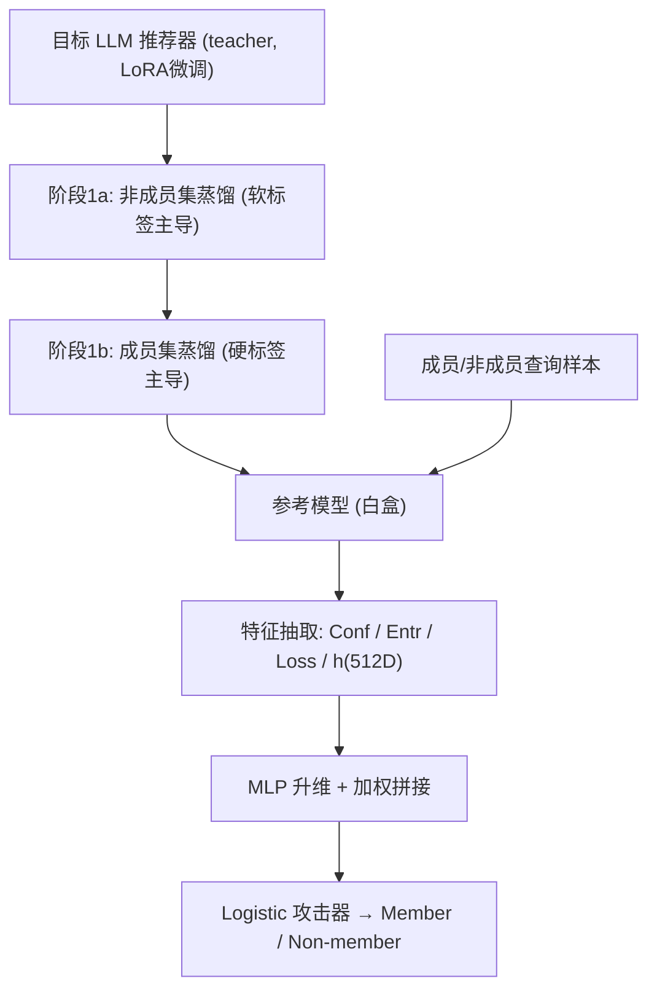
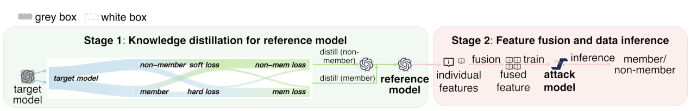

# Membership Inference Attack against Large Language Model-based Recommendation Systems: A New Distillation-based Paradigm (面向大语言模型推荐系统的成员推断攻击：一种基于蒸馏的新范式)

- **会议/期刊**: AAAI 2026
- **作者与机构**: Cuihong Li, Xiaowen Huang, Chuanhuan Yin, Jitao Sang（北京交通大学）
- **推荐链路定位**: 精排（LLM 微调推荐器的训练数据隐私审计，非推荐精度建模）
- **研究方向**: 去偏公平、可信隐私与工业架构 / 大语言模型推荐 (LLM4Rec)
- **论文原文**: [https://arxiv.org/abs/2511.14763v3](https://arxiv.org/abs/2511.14763v3)
- **开源代码**: [https://github.com/Cherie212/MIA4LLMRS](https://github.com/Cherie212/MIA4LLMRS)

## TL;DR (1分钟核心速览)

LLM 推荐器（LoRA 微调 T5/GPT-2/LLaMA3）体量巨大且数据来源庞杂，传统影子模型 MIA 的攻击力已退化到随机猜测水平（AUC≈50%）。本文提出蒸馏式 MIA：把目标模型当 teacher，先对非成员数据以软标签为主蒸馏、再对成员数据以硬标签为主蒸馏，得到一个"成员会、非成员不会"的参考模型，从中抽取置信度/熵/损失/倒数第二层隐向量并 MLP 对齐加权拼接，训练 logistic 攻击器。灰盒设定、20% 非成员协议下，MovieLens 上 Acc 85.00%、AUC 90.14%，较最优基线相对提升 36.4%/4.8%，较影子模型提升 41.7%。

## Background & Motivation (背景与核心矛盾)

- **主流范式**: 推荐 MIA 沿用 Shokri 式影子模型——训练若干模仿目标行为的影子模型，用其输出差异训练攻击分类器；LLM 场景则多用 PPL、min-k%、Zlib 等单特征阈值法。
- **前人局限**: ①影子模型以 KL 最小化"逼近"目标，能力上限即目标本身，而多数 LLM 推荐器本身微调不充分、性能平庸，模仿得越像越无区分度；②参考式 MIA（Mattern et al. 2023）虽有效，但要求掌握目标训练数据分布，现实中不可得。
- **核心洞察 (Key Insight)**: 参考模型的目标不该是"像目标"，而应是"最大化成员/非成员的行为分歧"。作者在 KDE 分布图上验证：原始模型与影子模型的成员/非成员特征分布几乎重合，而蒸馏后的参考模型呈现明显双峰分离。
- **本文切入点**: 用非对称蒸馏损失把参考模型"推"成一台成员/非成员判别放大器，再用多维融合特征替代单特征阈值。

## Method (核心方法设计)

### 1. 整体框架 (Overall Architecture)

攻击者仅持有：目标模型类型（灰盒，可见 logits 与隐层）、少量泄露成员样本（占成员集 5%）与公开渠道可构造的非成员样本（占全量 20%）。阶段一以目标模型为 teacher 做两轮蒸馏——先在非成员集上学"目标在陌生数据上的行为"，再在成员集上学"目标记住数据后的行为"，两轮刻意采用互补的硬/软损失权重，使参考模型在成员上强、在非成员上近似噪声；阶段二从参考模型抽取置信度、熵、损失与倒数第二层 512 维隐向量，低维特征经 MLP 升维加权拼接为融合特征，训练 logistic 回归攻击器完成成员判定。

<figure class="paper-figure" markdown="span">
  <figcaption>图 1：我们的范式概览。</figcaption>
</figure>

### 2. 关键设计拆解 (Key Designs)

1. **非对称双阶段蒸馏（Asymmetric Distillation）**: 影子模型的同构损失抹平了两类数据的差异。本文对成员用 $\mathcal{L}_{mem,i}=\alpha\,\mathrm{HardLoss}_i+(1-\alpha)\,\mathrm{SoftLoss}_i$，对非成员用$\mathcal{L}_{nonmem,i}=(1-\alpha)\,\mathrm{HardLoss}_i+\alpha\,\mathrm{SoftLoss}_i$。非成员阶段软损失占优 → 精确复刻 teacher 的（可能是差的）行为；成员阶段硬损失占优 → 参考模型在该批数据上被强行拉高拟合度。同一模型上"一边学会、一边学废"，直接把样本级分歧放大为可分类信号，这是它能绕开"影子模型不能超过 teacher"这一根本瓶颈的原因。

2. **融合特征与维度对齐（Fused Feature）**: 单特征（PPL/min-k%）在文本高度相似时失效——推荐样本常只差一个物品，其余 token 完全一致。本文取置信度 $c$、熵$e$、损失$\ell$与倒数第二层向量$\mathbf{h}\in\mathbb{R}^{512}$，先对三个标量特征分别施加 MLP$\phi(\cdot)$升维到 512 维再加权拼接：$\mathbf{f}_i=[w_c\phi_c(c_i),w_e\phi_e(e_i),w_l\phi_l(\ell_i),w_h\mathbf{h}_i]$。升维而非压缩（PCA/压缩拼接均被实验证伪）避免了低维标量被高维向量稀释，权重则按消融实验证得的特征重要性设定。

3. **训练目标、负采样与推理开销**: 攻击侧不做负采样，而是从非成员池随机抽取与成员等量样本以消除类别不平衡，攻击器为 logistic 回归（max_iter=1000）。推理仅需一次参考模型前向 + 一个线性分类器；Delicious 规模下训练 16.17 s、评测 0.65 s，比换用 BERT 攻击器快 40×/18×，说明收益来自特征质量而非分类器容量。

## Experimental Setup & Evaluation Protocol (实验设置与评估协议)

- **数据集与预处理**: 沿用 P5 式自然语言指令化格式，按用户历史时间顺序取最近物品构造偏好标签、其余作历史；Last.FM / Delicious 由本文自行转写。

| 数据集 | #Users | #Items | #Interactions | 稀疏度/密度 | 特征/场景说明 |
| :--- | :---: | :---: | :---: | :---: | :--- |
| Last.FM | - | - | 2k+ | - | 音乐收听，无显式正负偏好 |
| MovieLens | - | - | 8k+ | - | 电影评分，含显式偏好 |
| Book-Crossing | - | - | 19k+ | - | 图书评分，含显式偏好 |
| Delicious | - | - | 114k+ | - | 书签收藏，无显式偏好 |

- **数据划分与防穿越 (Splitting Strategy)**: 采用**冷启动式成员/非成员划分**：全量 20% 作为非成员（完全不参与目标模型构建），其余 80% 微调目标模型构成成员集；成员集中再随机取 5% 作为攻击者可见的背景知识，其余 95% 不可见——模拟真实场景下的"少量泄露 + 公开非成员"。
- **排名评测协议 (Ranking Protocol)**: 本文属隐私攻击评估，**不使用排序指标**（无 Full-Ranking / Sampled Ranking），而用二分类指标 Acc / Recall / F1 / AUC，随机攻击基线为 Acc=50%、AUC=50%。
- **对比基线与超参设置**: 基线含 PPL（Loss Attack）、min-k%、min-k%++、Zlib、Shadow（影子模型 MIA）；目标模型为 LoRA 微调的 T5-base、GPT-2-medium、LLaMA3-3B，学生模型 T5-small / GPT-2 / LLaMA3-1B，各蒸馏 5 epoch，温度 $T$调软标签，$\alpha$ 网格 0→1 步长 0.1。

## Key Experimental Results (实验关键数据)

### 1. 主实验对比 (Main Results)

T5-base 为目标模型，Acc/AUC 单位 %（Acc 最优加粗，Δ 为相对最强基线的提升）：

| 方法 | Last.FM | MovieLens | Book-Crossing | Delicious |
| :--- | :---: | :---: | :---: | :---: |
| PPL | 59.76 / 52.41 | 62.33 / 48.94 | 42.96 / 49.41 | 49.54 / 50.25 |
| min-k% | 62.85 / 52.79 | 51.46 / 49.90 | 65.64 / 49.37 | 48.05 / 50.30 |
| min-k%++ | 42.27 / 65.46 | 26.87 / 85.98 | 28.56 / 87.05 | 39.64 / 62.73 |
| Zlib | 40.37 / 45.95 | 53.21 / 51.90 | 51.25 / 46.69 | 44.64 / 49.33 |
| Shadow | 59.09 / 63.84 | 60.00 / 67.74 | 53.86 / 55.36 | 51.35 / 51.79 |
| **Ours** | **65.09 / 66.74** | **85.00 / 90.14** | **86.86 / 93.59** | **66.36 / 68.20** |
| Improv. (Acc) | +3.6% | +36.4% | +32.3% | +29.2% |

跨模型鲁棒性（MovieLens / Book-Crossing）：GPT-2 上 PPL 的 AUC 仅 39.31/47.02、min-k%++ F1 波动剧烈；LLaMA3 上 PPL 虽 Acc 91.71 但 AUC 仅 34.20，单一指标全面失效，反衬本文范式的稳定性。

### 2. 消融实验 (Ablation Study)

MovieLens / Book-Crossing，融合特征逐项剔除（Acc / AUC %）：

| 配置 | ML Acc | ML AUC | BC Acc | BC AUC |
| :--- | :---: | :---: | :---: | :---: |
| **Ours 全融合** | **80.00** | **90.84** | **86.60** | **96.71** |
| w/o Vector | 80.63 | 86.36 | 85.31 | 94.28 |
| w/o Entropy | 79.37 | 85.95 | 84.79 | 91.48 |
| w/o Confidence | 80.00 | 85.27 | 84.28 | 92.86 |
| w/o Loss | 69.37 | 75.42 | 85.57 | 93.08 |
| 仅 Confidence（单特征） | 69.37 | 74.19 | 81.19 | 94.14 |
| 仅 Loss（单特征） | 78.75 | 84.36 | 85.05 | 95.34 |

### 3. 关键实验发现 (Key Findings)

1. **影子模型已彻底失效，蒸馏是分水岭**: Shadow 在 MovieLens 上 Acc 60.00 / AUC 67.74，Delicious 上 AUC 51.79 几乎等同随机；本文同数据集达 85.00 / 90.14（相对 +41.7% / +33.1%）。KDE 图进一步显示影子模型与原模型成员/非成员分布近乎重合，只有参考模型呈双峰分离。
2. **Loss 是融合特征的主贡献项，但不可替代**: 剔除 Loss 使 MovieLens Acc 从 80.00 掉到 69.37（-10.6 pt）、AUC 从 90.84 掉到 75.42（-15.4 pt），降幅最大；剔除 Vector 仅掉 4.5 pt AUC。然而任何单特征独立训练都远逊于融合（ML：Conf 69.37 vs 80.00 Acc），证明各特征的互补性而非冗余性。
3. **攻击器容量不是瓶颈、同构蒸馏最优**: 换 BERT 攻击器在 Delicious 上仅 +1.4 pt Acc（65.27→66.71），训练时间却从 16.17 s 涨到 691.36 s（>40×）、评测从 0.65 s 涨到 11.82 s（18×）；异构蒸馏因词表截断丢信息而崩坏（T5 teacher→LLaMA3 student 在 ML 仅 45.62 Acc，同构 LLaMA3→LLaMA3 达 94.37 / 99.05 AUC）。

## Highlights & Limitations (亮点、对比与审稿批判)

- **与代表作对比 (vs. Prior Work)**: 相较 Shokri et al. 影子模型范式，本文把中间模型的目标从"行为一致"改写为"成员/非成员分歧最大"，从而摆脱 teacher 性能上限约束；相较 Mattern et al. 参考式 MIA，无需目标训练数据分布，只需 5% 泄露成员 + 公开非成员；相较 PPL / min-k% / min-k%++ 单特征法，融合特征在样本仅差一个物品的高相似场景下仍可判别。
- **可迁移亮点**: ①"对偶损失权重（$\alpha$vs$1-\alpha$）"这一技巧可直接迁移到数据溯源、版权审计、遗忘学习验证等需要放大样本级记忆差异的任务；②低维标量经 MLP 升维后再加权拼接，是异构特征融合（如 CTR 中的稠密/稀疏特征对齐）的轻量通用做法。
- **审稿级局限批判**: ①威胁模型限定灰盒（依赖 logits 与隐层），纯黑盒 API 场景下软标签与隐向量均不可得，作者也承认"black-box distillation 是未来工作"，实用性被削弱；②$\alpha$ 高度数据集敏感（MovieLens 最优 0.9、Book-Crossing/Delicious 最优 1.0、Last.FM 曲线剧烈震荡），需按数据集网格搜索，限制了即插即用性；③未评估任何防御侧（DP 噪声、输出扰动、去重）下的攻击衰减，Delicious/Last.FM 因缺少显式偏好标签，AUC 仅 68.20 / 66.74，语义稀疏数据上的有效性仍显不足。

## Rating (四维评分)

- **方法创新性 (Novelty)**: ⭐⭐⭐⭐ （把参考模型目标从"模仿 teacher"重构为"放大成员分歧"，非对称蒸馏损失虽简单但切中影子模型失效的根因，KDE 分布证据链完整）
- **评估协议与实验扎实度 (Protocol & Experiments)**: ⭐⭐⭐⭐ （4 数据集 × 3 类 LLM 架构 × 5 基线，攻击器类型、蒸馏同/异构、$\alpha$ 敏感性、融合策略均有消融；扣分在于缺少防御侧实验与多次随机种子的方差报告）
- **写作与数学规范度 (Clarity & Rigor)**: ⭐⭐⭐ （公式简洁可复现，但 Algorithm 1 与正文的成员/非成员蒸馏顺序表述略有冗余，$\alpha$ 在两式中语义相反处未给充分解释，单特征基线数字与主表存在口径差异）
- **工业落地与复现价值 (Industrial & Practical Value)**: ⭐⭐⭐⭐ （代码已开源，攻击侧仅需一次参考模型蒸馏 + logistic 回归，秒级推理，可直接嵌入 LLM 推荐系统的上线前隐私合规审计流程）

