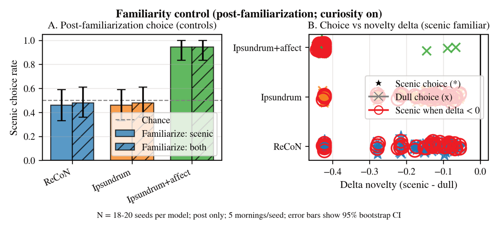
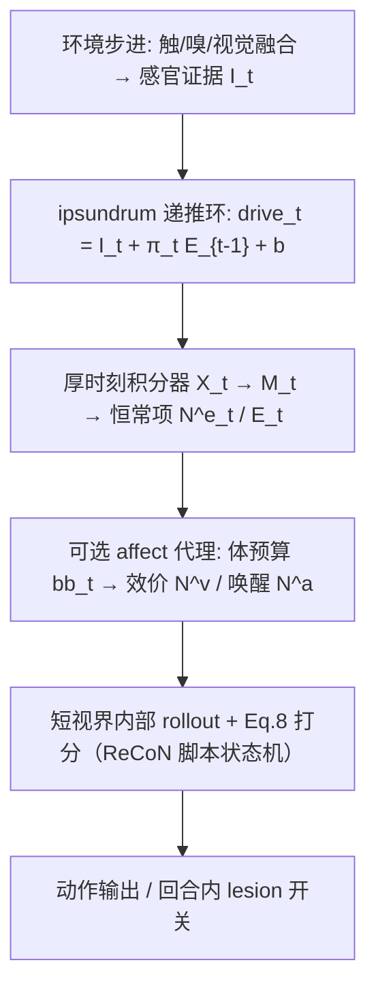
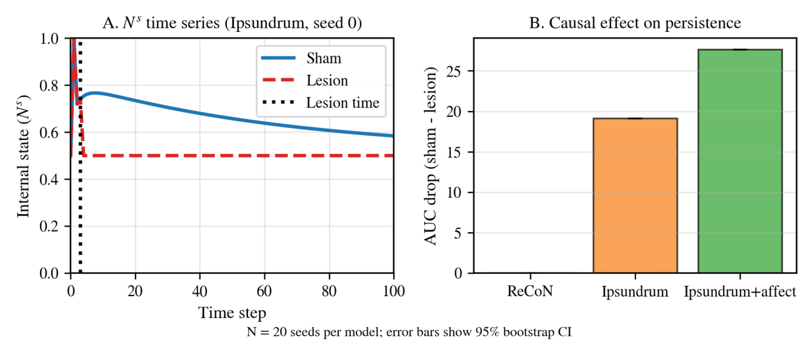

# ReCoN-Ipsundrum: An Inspectable Recurrent Persistence Loop Agent with Affect-Coupled Control and Mechanism-Linked Consciousness Indicator Assays（可检视的递推持续性环智能体：affect 耦合控制与机制挂钩的意识指标探针）

- **会议/期刊**: AAAI 2026 Spring Symposium（Proceedings of the AAAI Symposium Series, 8(1):352–360）
- **作者与机构**: Aishik Sanyal（独立研究者，xcellect）
- **推荐链路定位**: 非推荐链路；等价于序贯决策智能体的**在线打分/行为策略**层（短视界 rollout 动作打分）
- **研究方向**: 去偏公平、可信隐私与工业架构（评测方法论）/ 强化学习与动态探索
- **分类说明**: 本文属机器意识与认知架构评测，并非推荐系统工作；归入 `debias_fairness_industrial` 仅因其核心贡献是**「因果干预 + 机制检视 + 可信评测协议」**，与因果去偏/可信评测方法学同构。
- **论文原文**: [https://arxiv.org/abs/2602.23232v2](https://arxiv.org/abs/2602.23232v2)
- **开源代码**: [https://github.com/xcellect/recips](https://github.com/xcellect/recips)

## TL;DR (1分钟核心速览)

针对“仅凭行为指标判断机器意识”这一可被最小实现轻易伪造的评测痛点，作者在 ReCoN 反射式状态机上叠加感官显著性 $N^s$的**递推持续性环**与可选 **affect（效价/唤醒）代理**，把 Humphrey 的 qualiaphilia 操作化为“熟悉度控制下的风景/乏味路线二选一”。以 20 seeds、95% bootstrap CI 的固定参数消融与**回合内因果损伤**，得到干净分离：递推环$\to$刺激后持续性（损伤后 AUC 降 27.62 / 27.9%），affect 耦合$\to$偏好稳定（$\Delta$scenic-entry 0.07$\to$0.01）、结构化扫描（31.4 vs 0.9）与延长计划性谨慎（90 vs 5）。

## Background & Motivation (背景与核心矛盾)

- **主流范式**: 机器意识评测转向“指标证据累积（indicator-based）”，强调跨任务三角验证、架构可检视与因果干预，而非单一行为判据。
- **前人局限**: ①行为可被“异类机制”甚至极简可博弈实现复现，行为标记本身不携带机制信息；②现有 ReCoN 类感觉运动脚本只完成“请求—确认”式执行，缺少**被私有化、可持续自维持**的内部反馈环，因而无法生成“经验随时间变厚”的候选指标。
- **核心洞察 (Key Insight)**: Humphrey 的 sentition$\to$privatization$\to$ipsundrum 叙事可拆成**可分级实现的计算台阶**（反射$\to$efference copy$\to$递推增厚$\to$门控驻留），因此可对每个台阶做**加法与切除**，得到“哪个组件支撑哪个签名”的归因。
- **本文切入点**: 不做“是否意识”的判定，而做**可伪造性审计**：在同一策略/环境接口下固定参数，仅改变内部动力学，观察签名是否可分离。

<figure class="paper-figure" markdown="span">
  <figcaption>图1：熟悉度控制的走廊偏好。新颖性竞争下的景观进入率。当景观更具新颖性时，非情感变体增加景观寻求；情感变体在新颖性操纵下保持稳定。</figcaption>
</figure>

## Method (核心方法设计)

### 1. 整体框架 (Overall Architecture)

环境每步把触觉、嗅觉、视锥特征融合成带符号的感官证据 $I_t\in[-1,1]$（正为厌恶/危险，负为风景/有益，**注意$I_t$不是外部奖励**）。该驱动量进入 ReCoN 脚本状态机的终端传感器$N^s$；ipsundrum 变体在其上附加递推环与“厚时刻”积分器，产生持续性信号并经 efference copy$N^e$回注；affect 变体再加一个体预算代理，输出$N^v/N^a$并调制递推精度/增益。策略对所有候选动作枚举、用**与变体严格对齐**的一步前向模型做短视界内部 rollout，按内感受/认知/好奇/进度/危险惩罚的加权式打分并确定性破平，输出动作。全程无学习，仅前向仿真；损伤通过置零$E_{t-1},\pi_t$或$d=0$ 在回合内注入。

### 2. 关键设计拆解 (Key Designs)

1. **递推持续性环（把“感觉”从瞬时反射变成可自维持的驻留态）**：痛点是脚本式 ReCoN 的 $N^s$ 随刺激消失即刻归零，无法承载“经验随时间变厚”。做法是在终端上写一个纯函数单步更新，在线与规划前向模型中复用同一实现以保证消融保真：
$drive_t = I_t + \pi_t E_{t-1} + b + \epsilon_t,\quad N^s_t=\mathrm{clip}_{[0,1]}\big(F(drive_t)\big)$再经$X_t=dX_{t-1}+(1-d)N^s_t$、$M_t=\mathrm{clip}(hX_t)$、$N^e_t=d_eN^e_{t-1}+(1-d_e)M_t$、$E_t=\mathrm{clip}(g_{eff}M_t)$形成闭环。直觉：反馈把上一刻的输出当成本刻的输入，衰减系数$d$与增益$g_{eff}$决定“被动衰减”还是“主动维持”，作者用$\alpha_{eff}=d+(1-d)(g_{eff}h\pi_t)$ 作为诊断量区分二者。
2. **affect 耦合控制（让内部变量真正进入控制，而非仅作日志）**：痛点是“有持续性”并不等于“有偏好/有谨慎”。affect 层用一个 homeostatic 体预算 $bb_t$，正$I_t$记为消耗、负$I_t$记为补充，暴露$N^v$（效价=距设定点$sp$的接近度）与$N^a$（唤醒=预测误差与需求幅度），并允许其调制$\pi_t$与增益，使$\alpha_{eff}$ 变成状态相关量。
3. **动作打分、无学习设定与推理开销**：总打分不是学出来的损失，而是显式加权式
$\text{Score}=w_vN^v+w_aN^a+w_sN^s+w_{bb}|bb-sp|+w_{epi}|I_{pred}-I_{cur}|+\text{novelty}+w_{prog}\cdot\text{progress}-w_{haz}I_{touch,pred}-\text{cost}$头条配置取$(w_v,w_a,w_s,w_{bb})=(2.0,-1.2,-0.8,-0.4)$，ReCoN 基线将这些权重置零。**无梯度、无负采样**；推理开销为每步$|\mathcal{A}|\times H$次单步前向（$H\in\{1,\dots,20\}$），完全可 CPU 复现，代价是表达能力被限制在标量环上。

## Experimental Setup & Evaluation Protocol (实验设置与评估协议)

- **环境与预处理**: 无用户/物品概念，等价统计如下（全部固定参数、无训练集）：

| 环境/实验 | 关键设置 | 试次与统计 | 主要读出 |
| :--- | :--- | :---: | :--- |
| CorridorWorld | 两条同等安全路线（scenic vs dull），先做熟悉化预曝光 | 20 seeds × $H\in[1,20]$| 风景进入率、$\Delta$scenic-entry、侧偏对照 |
| GridWorld | 含危险格、稀疏目标 + 进度项、关闭好奇 | 20 seeds × $H\in[1,20]$ | 危险接触数、步数、成功率 |
| 探索性玩耍 | 无奖励中性纹理网格，200 步，开启好奇 | 20 seeds | 独特视角、scan events、极限环分、动作熵/驻留 |
| Pain-tail | 强制 1 步危险接触后**撤除危险并冻结状态** 200 步 | 20 seeds | 刺激后 $N^s$ AUC、转向率尾部时长 |
| 因果损伤 | $t=3$ 注入 lesion（置零反馈+积分）vs sham，150 步窗口 | 20 seeds | AUC 下降量与降幅 |

- **数据划分与防穿越**: 无训练/测试划分；关键在于**同回合内先跑 sham 再跑 lesion**、且规划用前向模型与在线动力学同源（`ipsundrum_step` 复用），避免“规划器偷看未损伤机制”的穿越。
- **排名/评测协议**: 非 ranking；采用 per-seed 均值 + **2000 次重采样 95% bootstrap CI**，seed 为独立单位（$N=20$）；另设侧偏诊断（`side_bias.csv`）排除“总走同侧”伪解。
- **对比基线与超参**: 三条固定参数消融 ReCoN / Ipsundrum / Ipsundrum+affect 共享策略与环境接口；未做超参敏感性扫描（作者自陈为局限）。

## Key Experimental Results (实验关键数据)

### 1. 主实验对比 (Main Results)

目标导向导航（能力/安全对照，跨 horizon 聚合，per-seed 均值 [95% CI]）：

| 模型 | Corridor 危险接触 | Corridor 步数 | Corridor 成功率 | Grid 危险接触 | Grid 步数 | Grid 成功率 |
| :--- | :---: | :---: | :---: | :---: | :---: | :---: |
| ReCoN | 3.05 [2.00, 4.25] | **50.00** [37.35, 63.20] | 0.55 [0.30, 0.75] | 14.30 [8.90, 20.05] | 171.80 [131.30, 211.10] | 0.50 [0.30, 0.70] |
| Ipsundrum | 2.90 [1.90, 4.05] | 49.73 [37.12, 62.83] | 0.58 [0.35, 0.78] | 2.45 [1.27, 3.85] | 129.77 [90.63, 168.70] | 0.72 [0.53, 0.90] |
| Ipsundrum+affect | **0.00** [0.00, 0.00] | 52.71 [47.16, 58.40] | **0.73** [0.61, 0.83] | **0.26** [0.10, 0.44] | **9.54** [4.75, 16.23] | **0.99** [0.97, 1.00] |
| Improv.（affect vs ReCoN） | 危险 −100% | 慢 5.4% | +32.7% | 危险 −98.2% | **−94.4%** | **+98.0%** |

### 2. 消融实验 (Ablation Study)

四类签名的组件分离（同一模型族的“加组件”式消融，含统一损伤实验）：

| 变体 | $\Delta$scenic-entry（越小越稳定） | 玩耍 scan events | 玩耍极限环分 | Pain-tail 尾部时长 | Lesion 后$N^s$ AUC 降幅 |
| :--- | :---: | :---: | :---: | :---: | :---: |
| ReCoN（w/o 环 + w/o affect） | 0.07 [−0.02, 0.16] | 0.9 | — | 5 | ≈0.00（0.0%） |
| w/o affect（Ipsundrum） | 0.07（同族） | ≈0.9 | — | 5 | 19.12（20.3%） |
| w/o 递推环（退化为 ReCoN） | 0.07 | 0.9 | — | 5 | 0.00 |
| 全量 Ipsundrum+affect | **0.01** [0.00, 0.03] | **31.4** [25.8, 38.2] | **7.6** [1.2, 16.7] | **90** [52, 128] | **27.62（27.9%）** |

### 3. 关键实验发现 (Key Findings)

1. **递推环是持续性的因果来源，而非副产物**：回合内 $t=3$切除反馈+积分后，两个 ipsundrum 变体的刺激后$N^s$ AUC 分别下降 19.12（20.3%）与 27.62（27.9%），而 ReCoN 降幅为 0——说明该签名由被切除的算子直接承载（作者也承认此处存在“实现保真”层面的循环性）。
2. **affect 耦合买来的是“偏好稳定性”，不是新奇偏好**：非 affect 变体对新颖性敏感（$\Delta$scenic-entry=0.07），affect 变体在**风景反而更新颖度更低**（median$\Delta$novelty$\approx-0.43$）时仍维持 0.01 的稳定选择，且分流点探针给出风景转向效价 0.91 vs 0.88、唤醒 0.24 vs 0.32。
3. **持续性单独存在不足以驱动行为**：Ipsundrum 的 $N^s$AUC$\approx$0.24 却不扫描（0.9 vs 31.4）、不延长谨慎（5 vs 90），证明“内部变量是否进入控制打分”才是行为分化的枢纽；同时 affect 变体在 GridWorld 把危险接触从 2.45 压到 0.26、成功率从 0.72 提到 0.99，代价是 Corridor 步数变长（52.71 vs 50.00）。

<figure class="paper-figure" markdown="span">
  <figcaption>图4：因果损伤。损伤反馈+整合会降低 ipsundrum 变体中刺激后持续性（N s AUC）。</figcaption>
</figure>

## Highlights & Limitations (亮点、对比与审稿批判)

- **与代表作对比 (vs. Prior Work)**: 相对 Butlin 等“指标清单”式评估，本文把每个指标落到**一个可切换的算子**并配因果损伤，强于纯行为基准；相对 Humphrey 原著的概念叙事，本文给出可运行分级台阶；相对标准 ReCoN（Bach & Herger），增量只在“私有化递推 + affect 门控”，未触及序列 por/ret 连接与神经学习。
- **可迁移亮点**: ①“同一纯函数同时供在线与规划前向模型调用”的**消融保真**技巧，可直接用于推荐系统的模拟器/规划器一致性校验；②用**熟悉度预曝光把新奇偏好与稳定偏好解耦**的实验设计，可迁移到推荐中的新颖性追求 vs 长期偏好稳定性评估。
- **审稿级局限批判**: ①**构念效度**：所谓“interoception”只是由带符号外感受标量驱动的记账抽象，走廊“qualiaphilia”因 scenic/dull 直接改变 $I_t$而天然“带价值”，故并非价值中立的感官丰富性偏好；②**无学习、标量环、玩具域**，$N=20$ 下部分 CI 仍宽（如 7.6 [1.2, 16.7]），且未做 affect 增益/积分衰减的敏感性扫描，向真实序列决策（乃至推荐策略）的外推能力未知。

## Rating (四维评分)

- **方法创新性 (Novelty)**: ⭐⭐⭐ （把理论叙事拆成可切除的计算台阶并做组件归因颇有巧思，但算子本身（低通 efference copy + 泄漏积分器 + 加权打分）均为经典组件，理论上限有限）
- **评估协议与实验扎实度 (Protocol & Experiments)**: ⭐⭐⭐⭐ （20 seeds、2000 次 bootstrap CI、同源前向模型、sham 对照、侧偏诊断齐备，并主动披露 lesion 的循环性；扣分在少量指标区间过宽与缺超参敏感性）
- **写作与数学规范度 (Clarity & Rigor)**: ⭐⭐⭐⭐ （单步更新公式、$\alpha_{eff}$ 诊断量与参数表全部导出，非主张清单写得克制清楚；但公式编号与符号表分散在代码引用中，可读性略受影响）
- **工业落地与复现价值 (Industrial & Practical Value)**: ⭐⭐ （纯 CPU 可跑、代码与 Colab 全开源，作为“可信评测方法论”模板有价值；但无学习、无规模、无真实业务场景，直接工程部署价值低）

