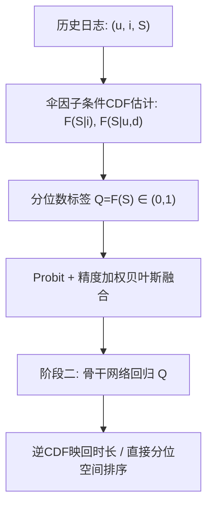
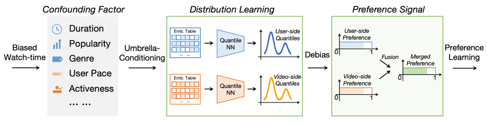

# Relative Advantage Debiasing for Watch-Time Prediction in Short-Video Recommendation (短视频推荐中观看时长预测的相对优势去偏)

- **会议/期刊**: AAAI 2026
- **作者与机构**: Emily Liu, Kuan Han, Minfeng Zhan, Bocheng Zhao, Guanyu Mu, Yang Song（ByteDance Inc.）
- **推荐链路定位**: 精排（观看时长/参与度预估目标建模）
- **研究方向**: 去偏公平、可信与工业架构 / CTR 预估与特征交叉
- **论文原文**: [https://arxiv.org/abs/2508.11086v3](https://arxiv.org/abs/2508.11086v3)
- **开源代码**: 暂未开源

## TL;DR (1分钟核心速览)

短视频推荐以原始观看时长作偏好代理，但时长、热度、用户习惯等混杂因子严重扭曲偏好信号。本文提出 RAD：以**视频 ID / 用户 ID 为"伞因子"**估计条件 CDF，把观看时长经概率积分变换为分位数标签 $Q=F_{S|G}(S)$（均匀、有界、同方差且与混杂因子统计独立），再用 probit 空间的精度加权贝叶斯融合两侧信号；两阶段解耦"分布估计"与"偏好学习"，并用可学习分布嵌入免去在线历史查表。KuaiRand-Pure 全库分组排序协议下 GDCN 骨干 MAE 由 19.808 降至 18.058（−8.8%），XAUC 0.7091→0.7181；十亿级工业集与线上 A/B（观看时长 +0.32%、完播 +1.11%、跳过率 −0.86%）一致验证。

## Background & Motivation (背景与核心矛盾)

- **主流范式**: 用 WLR、D2Q（按时长分桶的条件分位数）、CWM（反事实观看时长）、D2Co（GMM 去噪）等对观看时长做时长维度纠偏，或如 CQE/AlignPxtr 直接对 user–video 对做条件分位数回归。
- **前人局限**: (1) 只纠"时长"单一混杂，对**内容热度、创作者、用户活跃度/设备**等系统性偏差无防护；(2) CQE 类方法在**同一 user–video 条件下只有一次观测**（用户几乎不重看同一视频），条件分布估计噪声大、易过拟合，且分布拟合与推荐目标纠缠，损害偏好建模。
- **核心洞察 (Key Insight)**: 众多细粒度混杂因子都是高层 ID 的确定性函数，即 $\sigma(c^{(1)},\dots,c^{(K)})\subseteq\sigma(i)$，故"以视频 ID 为条件"即可一次性塌缩时长/类别/创作者/热度；用户 ID 同理塌缩活跃度/设备/习惯。由全方差分解$\mathrm{Var}(S)=\mathrm{Var}(\mathbb{E}[S\mid C])+\mathbb{E}[\mathrm{Var}(S\mid C)]$与方差单调性$\mathrm{Var}(\mathbb{E}[S\mid i])\ge \mathrm{Var}(\mathbb{E}[S\mid c^{(k)}])$，伞条件可最大化消去偏差方差。
- **本文切入点**: 不去拟合"绝对时长"，而是估计"**相对优势**"——把观看时长换成其在同视频/同用户参考分布中的经验分位数，天然消除组级系统偏差，只留偏好残差。

## Method (核心方法设计)

### 1. 整体框架 (Overall Architecture)

生成式假设 $S_{u,i}=C_{u,i}+P_{u,i}+\varepsilon_{u,i}$（混杂 + 真实偏好 + 噪声）。RAD 分两阶段：**阶段一**从历史日志为每个伞因子（视频 ID，或"用户 ID × 时长分桶"）估计条件 CDF，输出分位数标签；**阶段二**用任意骨干（MLP/DCN/DCNv2/GDCN）回归该标签，推理时再用训练集经验逆 CDF 映回时长域。两侧标签经 probit 变换后贝叶斯融合成统一无偏标签，也可直接以可学习分布嵌入替代经验查表上线。

<figure class="paper-figure" markdown="span">
  <figcaption>图1：RAD 框架概览。首先，从历史数据中学习用户侧和视频侧混杂因素的分布嵌入。然后，利用这些嵌入，在以用户和视频混杂变量为条件的情况下，度量有偏观看时长值的 CDF。用户侧和视频侧信号通过贝叶斯融合合并，生成用于偏好学习的单一无偏标签。</figcaption>
</figure>

### 2. 关键设计拆解 (Key Designs)

1. **伞因子条件分位数变换（RAD-V / RAD-U）**：针对"混杂维度爆炸不可逐一纠偏"，用视频 ID 与"用户 ID×时长等质量分桶"作伞条件，标签为 $Q^{(\text{video})}_{u,i}=F_{S\mid i}(S_{u,i})=\Pr_{u'}(S_{u',i}\le S_{u,i}\mid i)$、$Q^{(\text{user})}_{u,i}=F_{S\mid u,d}(S_{u,i})$。由概率积分变换可得$Q\sim\mathrm{Uniform}(0,1)$、$\mathbb{E}[Q]=\tfrac12$、$\mathrm{Var}(Q)=\tfrac1{12}$且$Q\perp\!\!\perp G$：既消去组级偏差，又把重尾时长压到**有界同方差**空间，训练更稳（用户侧额外分桶是因为用户 ID 无法吸收时长这一主导偏差，而视频 ID 已内含时长）。

2. **双侧贝叶斯证据融合**：单侧标签各纠一半偏差，先做 probit 变换 $z^{(\cdot)}_{u,i}=\Phi^{-1}(Q^{(\cdot)}_{u,i})$ 把有界分位数拉回高斯尺度，再按精度加权融合并映回分位空间：
$\hat z_{u,i}=\dfrac{\alpha z^{(\text{user})}_{u,i}+\beta z^{(\text{video})}_{u,i}}{\sqrt{\alpha^{2}+\beta^{2}}},\quad Q_{u,i}=\Phi(\hat z_{u,i})$离线取$\alpha,\beta$正比于两侧 CDF 的统计支撑样本数，线上取$\alpha=\beta=1$；冷启动时某侧支撑不足会自动被降权，故融合对$\beta/\alpha\in[0.1,10]$ 不敏感。

3. **可学习分布嵌入与训练目标**：在线查经验 CDF 需额外索引与历史存储、增加延迟；改为每个伞因子一张嵌入 + 共享 MLP 输出 $K=100$个 logit，经$\ell_k=\mathrm{ReLU}(\cdot)$累加得严格单调断点$b_k=\sum_{j\le k}\ell_j$，即参数化的分位函数。阶段一用 pinball 损失$\mathcal{L}_{\text{pin}}=\sum_{k}\rho_{\tau_k}(S_{u,i}-b_k)$对齐经验分位，阶段二用 MSE 回归分位数标签；**免负采样**（回归任务），推理仅一次前向，无外部查表开销。稀疏场景用 K-modes 对稀疏用户特征聚成$K=10$ 簇作伞因子，保证每簇样本量足以稳定学分位数。

## Experimental Setup & Evaluation Protocol (实验设置与评估协议)

- **数据集与预处理**:

| 数据集 | #Users | #Items | #Interactions | 稀疏度/密度 | 特征/场景说明 |
| :--- | :---: | :---: | :---: | :---: | :--- |
| KuaiRand-Pure | 26,592 | 7,146 | 1,384,425 | 密度 ≈ 0.73% | 公开快手基准，含用户/视频属性；验证/测试用户须在训练集出现 |
| 工业离线集 | 十亿级交互（未披露） | — | > 1e9 | 极稀疏 | 大规模短视频平台采样快照，用于高数据量验证 |

- **数据划分与防穿越 (Splitting Strategy)**: KuaiRand 用**滑动时间戳切分**（训练 79.6% / 验证 8.7% / 测试 11.6%）；工业集**前 14 天训练、第 15 天测试**的严格时间切分。观看时长**不做时长截断**（用户常回看/超播，未截断含额外偏好信号）。
- **排名评测协议 (Ranking Protocol)**: 回归指标 MAE（逆 CDF 映回时长域）；排序指标 **XAUC**（连续值成对排序）与 **XGAUC**（组内成对排序，按用户分组），以及本文推广的 User-Group / Video-Group XAUC（在分位空间直接比较 CDF 预测顺序）。属**全量日志成对评估**，非采样负例排序。
- **对比基线与超参设置**: 基线 8 个——VR、PCR、WLR、WTG、D2Co、D2Q、CWM、CQE；骨干统一 MLP / DCN / DCNv2 / GDCN，3 层隐层、维度 64、lr=1e-5、Adam、最多 50 epoch、早停 patience=5；时长分桶 $D=4$、分位点$K=100$、用户聚类$K=10$。

## Key Experimental Results (实验关键数据)

### 1. 主实验对比 (Main Results)

GDCN 骨干（各指标最优骨干之一）下的核心结果：

| Method (GDCN) | MAE ↓ | XAUC ↑ | XGAUC ↑ |
| :--- | :---: | :---: | :---: |
| VR | 23.718 | 0.6712 | 0.6578 |
| PCR | 45.899 | 0.5673 | 0.5921 |
| WLR | 21.388 | 0.3907 | 0.4671 |
| WTG | 22.820 | 0.6911 | 0.6612 |
| D2Q | 19.808 | 0.6869 | 0.6543 |
| CWM | 20.693 | 0.7091 | 0.6646 |
| CQE | 21.600 | 0.7015 | 0.6669 |
| RAD-U | 18.218 | 0.7153 | 0.6722 |
| RAD-V | 18.071 | 0.7140 | 0.6690 |
| **RAD-UV** | **18.058** | **0.7181** | **0.6739** |
| Improv.% (vs 最优基线) | **−8.8%** | **+1.3%** | **+1.1%** |

工业离线集（分布嵌入版）：User-Group XAUC CQE 0.623 → RAD-U **0.642**（RAD-UV 0.637）；Video-Group XAUC CQE 0.594 → RAD-V **0.631**（RAD-UV 0.625）。线上 A/B（相对生产基线）：RAD-UV 活跃天数 +0.0290%、观看时长 +0.3246%、观看数 +0.0744%、完播率 +1.1125%、跳过率 −0.864%；RAD-U 完播最优（+1.33%），RAD-V 观看数最优（+0.26%）。

### 2. 消融实验 (Ablation Study)

| 配置 | 分布拟合 (1-Wasserstein ↓) | User-Group XAUC (MLP) | XGAUC (MLP) |
| :--- | :---: | :---: | :---: |
| 经验分位下界（不学习） | 2.1500 | — | — |
| CQE（单阶段） | 9.3945 | 0.7050 | 0.7044 |
| MQ + RAD-U（两阶段 + 分布嵌入） | 2.2793 | 0.7101 | 0.7101 |
| RAD-U（两阶段 + 经验分位） | — | 0.7105 | **0.7131** |

### 3. 关键实验发现 (Key Findings)

1. **两阶段解耦是性能主因，而非分位数标签本身**：同为分位数建模，CQE 单阶段 XGAUC 仅 0.7044，两阶段 RAD-U 达 0.7131（+0.87pt），且分布拟合误差从 Wasserstein 9.39 降到 2.28（逼近 2.15 理论下界）——把 CDF 估计从偏好目标中剥离，避免了单观测条件下的过拟合。
2. **双侧信号互补且融合稳健**：RAD-U 在 User-Group XAUC 最优（0.7153）、RAD-V 在 Video-Group XAUC 最优（0.6803），融合后 RAD-UV 在 XAUC/XGAUC/MAE 三项同时最优；线上也呈同一分工（RAD-U 拉完播、RAD-V 拉观看数），$\beta/\alpha$ 在 0.1–10 区间 XGAUC 波动 <0.001。
3. **分布嵌入几乎无损、可上线**：MQ+RAD-U 的 XGAUC 0.7101 与经验分位 0.7131 仅差 0.3pt，却省去在线历史查表与索引服务；且在不同用户样本量四分位下（图 2）其核密度估计均贴合真值，而 CQE 在低样本组明显漏估低值区与重尾。

## Highlights & Limitations (亮点、对比与审稿批判)

- **与代表作对比 (vs. Prior Work)**: 相较 D2Q（仅按时长分桶纠偏）与 CWM（反事实标准化曝光），RAD 用 ID 级伞条件**一次性覆盖时长/热度/创作者/用户习惯**多类混杂，无需逐因子建模；相较 CQE/AlignPxtr 的"逐 user–video 条件分位数"，RAD 把条件降到 ID 层级以获取充足样本，从根上规避 single-observation 问题，并把分布估计与偏好学习显式解耦。
- **可迁移亮点**: (1) "伞因子 + 概率积分变换"可平移到任意重尾、受曝光/位置混杂的连续反馈（如停留时长、GMV、播放深度）作为多任务归一化标签；(2) 用"嵌入 + ReLU 累加 + pinball 损失"参数化单调分位函数，可替代在线分位数索引，适用于任何需低延迟分位特征的精排系统。
- **审稿级局限批判**: (1) 去偏仅以 ID 层伞条件近似，**未显式做因果识别**（无倾向性/后门调整），对 ID 未覆盖的时变混杂（如流量峰谷、活动运营）无保证；(2) 工业集与线上 A/B 细节（基线模型、流量规模、显著性检验）披露不足，线上增益幅度均在 1% 量级，缺少置信区间与多周稳定性验证；(3) 用户侧仍需 K-modes 聚类与时长分桶等人工超参，长尾（最低 10 分位用户仅 8 条样本）下分位估计可靠性存疑。

## Rating (四维评分)

- **方法创新性 (Novelty)**: ⭐⭐⭐⭐ （把"相对优势分位数 + 伞因子方差单调性"引入观看时长去偏，命题 1/2 给出方差与独立性保证，思路干净且有理论支撑，但本质仍是概率积分变换的工程化组合）
- **评估协议与实验扎实度 (Protocol & Experiments)**: ⭐⭐⭐⭐ （4 种骨干 × 8 基线 + 公开集/工业集/线上 A/B 三层验证、分组 XAUC 与 Wasserstein 双视角较完整，扣分在线上缺少显著性与方差报告）
- **写作与数学规范度 (Clarity & Rigor)**: ⭐⭐⭐⭐ （生成式分解与方差单调性推导清晰，融合公式与算法伪代码齐备；$\alpha/\beta$ 与"精度权重"的贝叶斯解释略偏启发式）
- **工业落地与复现价值 (Industrial & Practical Value)**: ⭐⭐⭐⭐ （分布嵌入免在线查表、两阶段模块可插拔、融合对超参不敏感，直接可落地；但代码未开源、工业数据不可复现）

