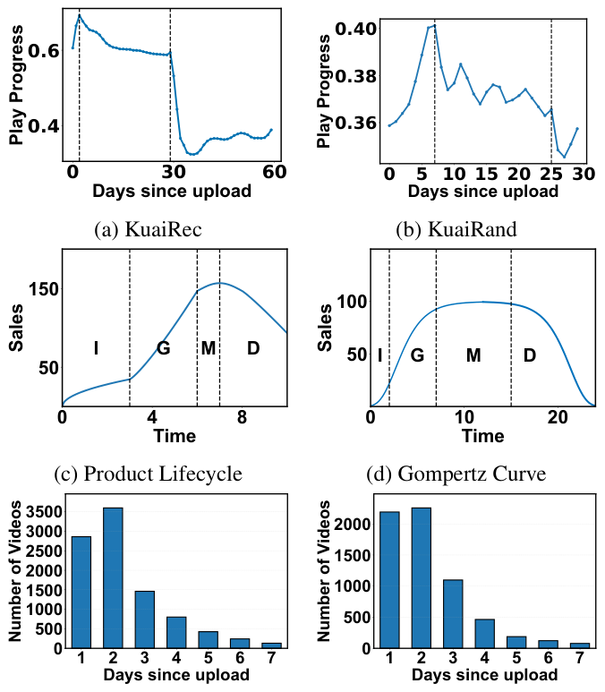
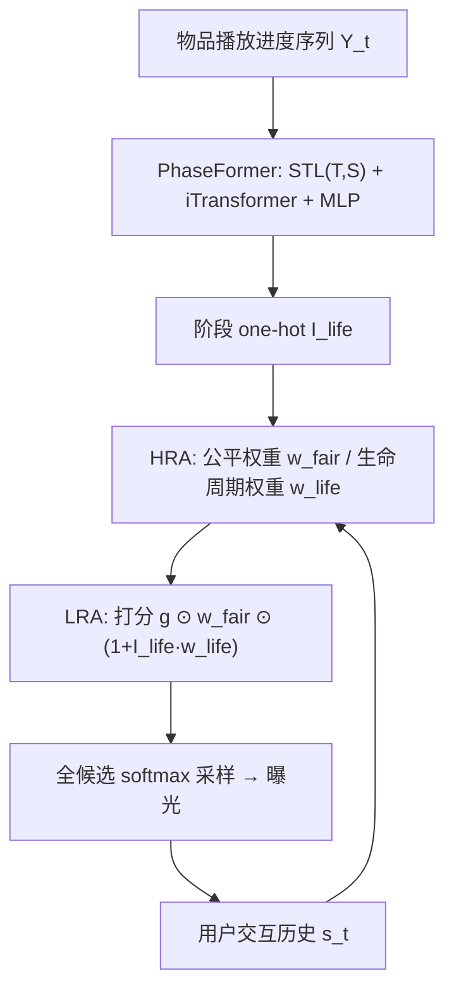
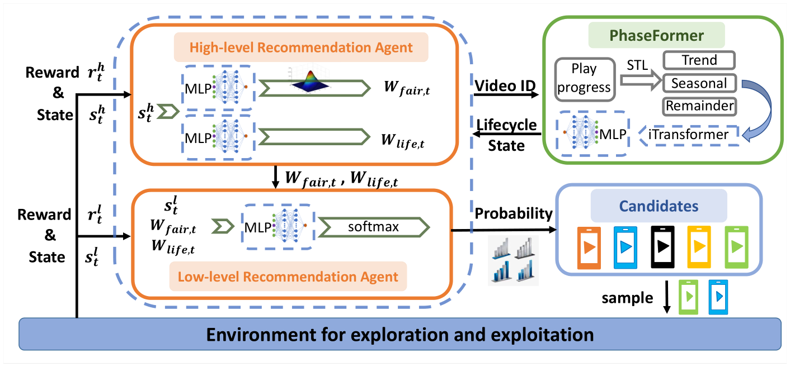

# Revisiting Fairness-aware Interactive Recommendation: Item Lifecycle as a Control Knob (重访公平感知交互式推荐：以物品生命周期作为控制旋钮)

- **会议/期刊**: AAAI 2026
- **作者与机构**: Yun Lu, Xiaoyu Shi, Hong Xie, Chongjun Xia, Zhenhui Gong, Mingsheng Shang（中科院重庆绿色智能技术研究院、国科大重庆学院、中科大附一院）
- **推荐链路定位**: 端到端交互式策略（重排/曝光决策）
- **研究方向**: 去偏公平与工业系统 / 强化学习与动态探索
- **论文原文**: [arXiv:2511.16248](https://arxiv.org/abs/2511.16248v1)
- **开源代码**: [luyunstar/LHRL](https://github.com/luyunstar/LHRL)

## TL;DR (1分钟核心速览)

公平感知推荐（静态正则/重排、RL 曝光约束）长期对所有物品施加统一约束，忽略"内容价值随时间衰减"这一时序异质性。作者先在 KuaiRec/KuaiRand 上实证短视频被压缩为**增长—短暂稳定—陡降**三段式生命周期，继而提出 LHRL：PhaseFormer 以 STL 分解 + iTransformer 实时判别阶段，双层 HRL 中高层按阶段生成公平权重、低层在约束下优化即时参与。在 KuaiSim 模拟器（会话 ≤20 步、5 seeds）上交互长度 +10.5%、累积奖励 +13.1%，同时公平性 $AD$ 降至 0.009。

## Background & Motivation (背景与核心矛盾)

- **主流范式**: 静态侧用因果解耦、公平正则与后处理重排；动态侧用 RL 做动态曝光配额、去偏奖励（SAC4IR）与多目标长期公平优化（FCPO/DNAIR/HER4IF）。
- **前人局限**: ① 把"长尾"当静态群体，统一约束导致衰退期内容被过度曝光、新内容错过早期窗口；② RL 方法虽能序贯决策，但只学"用户当前想要什么"，缺少物品侧阶段信号，公平被迫写成与准确率对立的固定折中权重。
- **核心洞察 (Key Insight)**: 短视频实证给出两条硬事实——92.9%（KuaiRec，9524/10253）与 94.5%（KuaiRand，6400/6777）的视频在发布 7 天内达参与峰值，经典四阶段 PLC 被压缩为三段式；Dunn 检验显示衰退期播放进度比增长/成熟期分别低 43.3%/38.4%（$p<0.01$），衰退期平均初始斜率约为成熟期 9.04 倍，而增长 vs 成熟无显著差异（$p>0.05$）。
- **本文切入点**: 既然"阶段"既反映内在价值又刻画剩余曝光需求，就把生命周期阶段当作公平分配的**控制旋钮**，让公平约束随阶段而非随物品固定。

<figure class="paper-figure" markdown="span">
  <figcaption>图2：KuaiRec 和 KuaiRand 上的生命周期分析：(a)–(b) 聚合播放进度曲线；(c) 经典四阶段产品生命周期（PLC）；(d) Gompertz 增长曲线；(e)–(f) 增长阶段时长分布。92.9%（9524/10253，KuaiRec）和 94.5%（6400/6777，KuaiRand）的视频在前 7 天内达到参与峰值。</figcaption>
</figure>

## Method (核心方法设计)

### 1. 整体框架 (Overall Architecture)

LHRL 由三块组成：PhaseFormer 将单个物品的播放进度序列（播放时长/视频时长，规避视频长度与误点偏差）映射为阶段性标签；高层推荐智能体 HRA 依据用户状态与环境阶段分布输出两组权重——公平权重 $\boldsymbol{w}_{fair}$与生命周期权重$\boldsymbol{w}_{life}$；低层智能体 LRA 把这两组权重乘性注入候选打分，在"不破坏相关性"的前提下完成曝光再分配。训练时两级智能体均用 PPO，环境为 KuaiSim 模拟器；推理解码只需一次前向：PhaseFormer 对目标物品序列做注意力编码，HRA/LRA 各一次 MLP 前向即可生成全候选的采样分布，无需负采样与候选重排迭代。

<figure class="paper-figure" markdown="span">
  <figcaption>图3：LHRL 的整体架构</figcaption>
</figure>

### 2. 关键设计拆解 (Key Designs)

1. **PhaseFormer：把非平稳流行度序列变成实时阶段信号**：播放进度序列弱周期、强非平稳，RNN 类编码器易被局部噪声淹没。作者先用 STL 正交解耦 $Y_t = T_t + S_t + R_t$（$T_t$趋势、$S_t$季节、$R_t$残差，无分布假设），再把$T_t,S_t$ 作为 token 送入 iTransformer 做全局注意力建模，末端 MLP+softmax 三分类：
$P(\text{Stage}) = \phi(\mathrm{MLP}(\text{iTransformer}(T_t, S_t)))$。
丢弃残差项等于显式降噪，全局注意力让阶段边界（峰值与其后拐点）的判别对缺测更鲁棒；新物品用 masked self-attention 加趋势线性外推兜底。

2. **阶段感知公平约束：把"公平"拆成流行度组 × 阶段的奖励矩阵**：HRA 不再输出单一折中系数，而是从高斯分布采样公平权重并直接预测阶段权重：
$\boldsymbol{w}_{fair,t}=[w_{pop},w_{longtail}]\sim\mathcal{N}(\boldsymbol{\mu}_t^h,\sigma^2),\ \boldsymbol{\mu}_t^h=\mathrm{MLP}_h(s_t^h)$，$\boldsymbol{w}_{life,t}=\mathrm{MLP}_{life}(s_t^h)$。
高层奖励 $r_t^h = r_t^a + \alpha r_{life,t} + \beta r_{fair,t}$，其中
$r_{life,t}=\mathbb{I}_{pop,t}\,\Lambda\,\mathbb{I}_{life,t}^{\top}$（$\Lambda\in\mathbb{R}^{2\times3}$ 为"流行/长尾 × 增长/成熟/衰退"奖励系数矩阵），
$r_{fair,t}=\gamma_t^f/(1+e_t^p)$。
用可学习矩阵而非人工规则刻画"哪一组物品在哪个阶段值得曝光"，使长尾扶持与衰退压制的意图可由数据定标；高斯采样则保留探索，避免退化为确定性配额。

3. **乘性融合与训练目标**：LRA 状态拼接高层权重 $\tilde{s}_t^l=\mathrm{concat}(s_t^l,\boldsymbol{w}_{fair,t},\boldsymbol{w}_{life,t})$，基础相关性$g=\mathrm{MLP}_l(\tilde{s}_t^l)$，最终采样分布
$P(I\mid\tilde{s}_t^l)=\phi\!\big( (g\odot(\mathbb{I}_{pop,t}\cdot\boldsymbol{w}_{fair,t})\odot(1+\mathbb{I}_{life,t}\cdot\boldsymbol{w}_{life,t}))/\tau \big)$。
关键细节是 $(1+\cdot)$：阶段权重为 0 时因子恒为 1，因此约束只做"加权偏置"而不硬性过滤，避免公平干预直接损伤相关性；温度$\tau$控制熵。低层奖励仅即时反馈$r_t^l=r_t^a$，两级均用 PPO clipped surrogate 优化，形成"高层管长期公平、低层管短期效用"的解耦。

## Experimental Setup & Evaluation Protocol (实验设置与评估协议)

- **数据集与预处理**: 沿用 KuaiRec / KuaiRand 并清洗无效条目（无互动视频 485 / 413 条）：

| 数据集 | #Items（视频） | #Play Records | 时间跨度 | 特征/场景说明 |
| :--- | :---: | :---: | :---: | :--- |
| KuaiRec | 7,262 | 102,661 | 2020-07-05 ~ 09-05 | 快手短视频，含完整曝光矩阵 |
| KuaiRand | 10,666 | 331,563 | 2022-04-10 ~ 05-08 | 随机曝光日志，用于公平性检验 |

- **数据划分与防穿越 (Splitting Strategy)**: 非传统 LOO/比例切分；采用 **KuaiSim 交互式模拟器**，会话上限 20 步，遇"不满意/不公平"提前终止，用户反馈由预训练 DeepFM 产生；离线策略先在静态数据预训练再入模拟器评估，PhaseFormer 的阶段预测严格只用以预测时刻之前的历史（避免未来信息穿越）。
- **排名评测协议 (Ranking Protocol)**: 非 Full-Ranking 静态排序，而是**序列交互式 rollout 指标**：交互长度 $Len$、单轮奖励$R_{each}$、累积奖励$R_{cum}$、公平性$AD$（Absolute Difference，越低越公平）；5 个随机种子（11/15/17/19/23）取均值并报标准差。
- **对比基线与超参设置**: 11 个基线分两类——RL 类 DORL/CQL/BCQ/SQN/DDPG/TD3；公平 RL 类 MOFIR/FCPO/DNAIR/SAC4IR/HER4IF。各基线网格搜索调参，所有方法共享相同模拟环境与种子。

## Key Experimental Results (实验关键数据)

### 1. 主实验对比 (Main Results)

| 方法 | KuaiRec $Len$| KuaiRec$R_{cum}$| KuaiRec$AD$↓ | KuaiRand$Len$| KuaiRand$R_{cum}$| KuaiRand$AD$↓ |
| :--- | :---: | :---: | :---: | :---: | :---: | :---: |
| BCQ | 13.320 | 9.221 | 0.018 | 10.040 | 7.124 | 0.473 |
| TD3 | 14.680 | 11.906 | 0.140 | 10.460 | 7.147 | 0.367 |
| DDPG | 14.200 | 11.145 | 0.186 | 11.560 | 8.379 | 0.330 |
| FCPO | 9.880 | 6.829 | 0.609 | 13.960 | 11.023 | 0.312 |
| DNAIR | 11.020 | 7.445 | 0.441 | 9.300 | 6.895 | 0.741 |
| SAC4IR | 14.960 | 11.412 | **0.012** | 9.160 | 6.779 | 0.735 |
| HER4IF | 16.075 | 13.802 | 0.010 | 13.880 | 11.126 | 0.220 |
| **LHRL** | **17.760** | **15.613** | **0.009** | **15.360** | **12.655** | **0.184** |
| **Improv.%** | +10.48% | +13.12% | +10.00% | +10.03% | +13.74% | +16.36% |

### 2. 消融实验 (Ablation Study)

| 变体 | KuaiRec $Len$| KuaiRec$R_{cum}$| KuaiRec$AD$↓ | KuaiRand$Len$| KuaiRand$R_{cum}$| KuaiRand$AD$↓ |
| :--- | :---: | :---: | :---: | :---: | :---: | :---: |
| LHRL-w/o A（纯扁平 RL） | 10.320 | 8.460 | 0.462 | 9.140 | 6.849 | 0.821 |
| LHRL-w/o H（单层 + 生命周期奖励） | 10.700 | 8.700 | 0.330 | 10.480 | 8.262 | 0.617 |
| LHRL-w/o L（双层，无生命周期奖励） | 15.300 | 13.226 | 0.037 | 12.340 | 9.712 | 0.459 |
| **LHRL（完整）** | **17.760** | **15.613** | **0.009** | **15.360** | **12.655** | **0.184** |

### 3. 关键实验发现 (Key Findings)

1. **公平与参与首次同向而非折中**：相对最强基线 HER4IF，KuaiRec 上 $R_{cum}$由 13.802 提升至 15.613（+13.1%）同时$AD$由 0.010 降至 0.009；KuaiRand 上$AD$相对下降 16.36%。这与 SAC4IR（$AD$=0.735 但$R_{cum}$ 仅 6.779）形成鲜明对比，说明收益并非"牺牲公平换点击"。
2. **层级结构与生命周期信号互补、不可替代**：去掉生命周期奖励（w/o L）使 $R_{cum}$从 15.613 掉到 13.226（−15.3%）且$AD$恶化到 0.037；去掉层级（w/o H）则$Len$ 崩至 10.700，并在约 1 万步后策略崩溃——单层智能体无法同时承载短时准确与长期公平两个时间尺度。
3. **阶段奖励是可插拔的正交信号**：把生命周期奖励注入已有公平 RL 基线后一致涨点——SAC4IR+life 在 KuaiRec 上 $R_{cum}$+8.2%，FCPO+life 在 KuaiRand 上$R_{cum}$+5.7%、$AD$0.312→0.252；策略可视化（图 5）显示 LHRL 学会逐步提高成熟期占比、削减衰退期曝光，把"曝光预算"从低价值内容迁回高价值内容，这正是$Len$/$R_{cum}$ 增益的直接来源。

## Highlights & Limitations (亮点、对比与审稿批判)

- **与代表作对比 (vs. Prior Work)**: SAC4IR 用最大熵奖励鼓励长尾发现，DNAIR 依赖多样性-新颖性度量，二者均在"物品群体"粒度上施力；HER4IF 引入层级但层级只服务长期公平、不含物品侧时序状态。本文的本质区别是把决策粒度从"群体统计"下沉到"单个物品的时序阶段"，因此约束可随物品价值演化而松弛或收紧。
- **可迁移亮点**: ① STL + iTransformer 的轻量阶段判别器可直接用于冷启动物品的价值预估、CTR 特征中的"内容新鲜度"编码；② $2\times3$ 奖励系数矩阵可自然扩展为"时段 × 品类"或"人群 × 阶段"的高层奖励表，作为任何 RL 推荐器的即插即用模块。
- **审稿级局限批判**: ① 全部实验在 KuaiSim 模拟器内完成，用户反馈由 DeepFM 代理，无线上 A/B，"公平改善"实质是对模拟器公平度量的拟合；② 公平性方差极大（HER4IF $AD$0.220±0.301、本文 0.184±0.267），$AD$的显著优势在 KuaiRand 上难以排除种子波动，且未报告显著性检验；③ 每物品依赖足够长的历史序列，冷启动物品的阶段标签本身不可验证；$\alpha/\beta$ 敏感性被推到附录并明言"留作未来工作"，弱化了方法稳健性论证。

## Rating (四维评分)

- **方法创新性 (Novelty)**: ⭐⭐⭐⭐ （把生命周期作为公平"控制旋钮"的视角新颖，$2\times3$ 阶段-流行度奖励矩阵与解耦双层设计有清晰物理直觉；但 HRL+PPO 骨架本身较常规）
- **评估协议与实验扎实度 (Protocol & Experiments)**: ⭐⭐⭐ （模拟器交互式评测与 5 种子、11 基线较完备，并给出可插拔验证；但缺线上验证、缺显著性检验，公平指标方差偏大）
- **写作与数学规范度 (Clarity & Rigor)**: ⭐⭐⭐⭐ （三段式生命周期实证链条完整，公式与符号交代清楚；乘性 $(1+\cdot)$ 融合的必要性仅靠直觉论证，缺理论/复杂度分析）
- **工业落地与复现价值 (Industrial & Practical Value)**: ⭐⭐⭐⭐ （代码与数据均开源，PhaseFormer 单次前向开销小、奖励矩阵易配置，可直接嵌入短视频/内容平台的曝光调控；但阶段标注依赖长序列日志）

