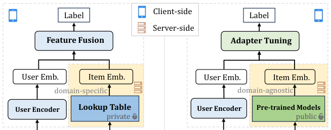
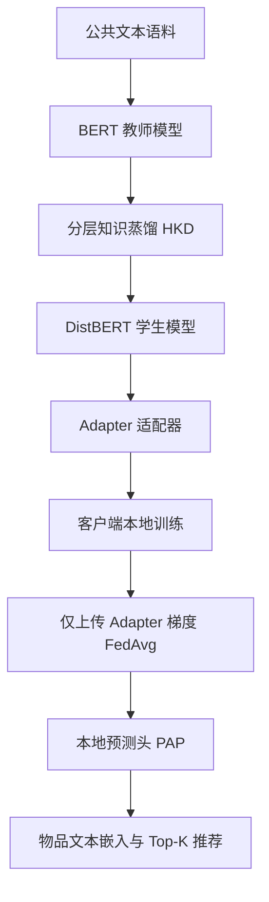
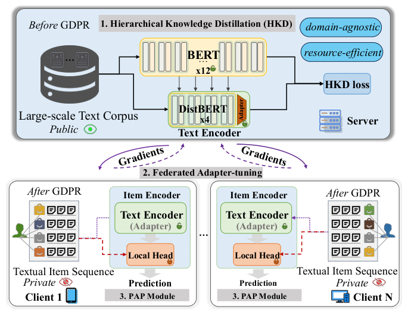

# TransFR: Transferable Federated Recommendation with Adapter Tuning on Pre-trained Language Models (基于预训练语言模型适配器调优的可迁移联邦推荐)

- **会议/期刊**: AAAI 2026
- **作者与机构**: Honglei Zhang, Zhiwei Li, Haoxuan Li, Xin Zhou, Jie Zhang, Yidong Li；北京交通大学、悉尼科技大学、北京大学、南洋理工大学
- **推荐链路定位**: 召回（物品表征与评分）
- **研究方向**: 去偏公平、可信隐私与工业架构 / 冷启动与长尾推荐
- **论文原文**: [https://arxiv.org/abs/2402.01124v3](https://arxiv.org/abs/2402.01124v3)
- **开源代码**: 暂未开源

## TL;DR (1分钟核心速览)

联邦推荐长期依赖离散物品 ID 查表，导致跨域不可迁移、冷启动物品失效，且物品嵌入直接由私有交互训练带来泄露风险。TransFR 用公共文本预训练语言模型生成域无关物品表征，仅上传轻量 Adapter 梯度，并在客户端加本地预测头做个性化。在 Amazon 三个跨域任务、Leave-One-Out 协议下，平均目标域 HR@10 达 0.2182，较最强联邦基线 FedDCSR 提升 12.53%，迁移损失从 12.29% 降至 4.33%。

## Background & Motivation (背景与核心矛盾)

- **主流范式**: 标准联邦推荐由本地用户编码器、服务器物品编码器与融合模块构成，物品普遍用离散 ID 映射到域特定嵌入表，再以 FedAvg 聚合。
- **前人局限**: 其一，物品 ID 跨平台不共享，同一 ID 在不同域语义不同，源域嵌入难以迁移；其二，ID 嵌入依赖充足交互，新物品只有文本时几乎不可用；其三，物品嵌入直接用用户私有数据训练并参与传输，存在隐私泄露面。
- **核心洞察 (Key Insight)**: 物品标题/描述等文本是跨域稳定语义载体；若把物品表征从“私有 ID 查表”改为“公共语料预训练的文本编码”，迁移与冷启动可同时缓解。
- **本文切入点**: 冻结预训练 BERT，只训练并上传 Adapter，实现“公共知识可共享、私有适配不出端”的折中。

<figure class="paper-figure" markdown="span">
  <figcaption>图1：标准FR（左）与我们的TransFR模型（右）的差异示意图。现有工作以带领域特定物品嵌入的查找表方式运行，而TransFR利用预训练语言模型生成通用的领域无关嵌入。</figcaption>
</figure>

图 1：标准联邦推荐依赖域特定 ID 嵌入查表（左），TransFR 用预训练语言模型产生域无关文本嵌入（右）。

## Method (核心方法设计)

### 1. 整体框架 (Overall Architecture)

服务器先在公共文本语料上准备 BERT，并通过分层知识蒸馏得到 4 层 DistBERT；DistBERT 叠加 Adapter 构成文本编码器 $g=\psi_{\text{Adapter}}\circ\phi_{\text{DistBERT}}$，下发到客户端。客户端用本地交互训练用户编码器与 Adapter，只上传 Adapter 梯度做 FedAvg；随后为每个客户端加本地预测头$h_u$，形成个性化物品编码器$\phi_i=h_u\circ g$，最终以$\hat y_{ui}=f(p_u,q_i)$ 打分。训练完成后，物品文本经编码器生成嵌入，客户端本地排序。

<figure class="paper-figure" markdown="span">
  <figcaption>图2：TransFR示意图，包括分层知识蒸馏、联邦适配器调优和适配后个性化（PAP）。</figcaption>
</figure>

图 2：TransFR 包含分层知识蒸馏、联邦适配器调优与适配后个性化三个环节。

### 2. 关键设计拆解 (Key Designs)

1. **分层知识蒸馏 HKD（把大模型压到端侧）**：直接部署 12 层 BERT 对手机端过重，TransFR 让 4 层学生模型对齐教师每第 3 层，即 $p(z)=3z$，并同时蒸馏注意力矩阵与嵌入层：
$\mathcal{L}_{\text{HKD}}=\sum_{x\in X}\sum_{z=0}^{s}\mathcal{L}_{\text{layer}}\big(\phi^z_{\text{Dist}}(x),\phi^{p(z)}_{\text{BERT}}(x)\big)$。
注意力用 $\mathcal{L}_{\text{attn}}=\frac1h\sum_{i=1}^{h}(A_i^{stu}-A_i^{tea})^2$，嵌入用$\mathcal{L}_{\text{embd}}=\|\mathbf{E}^{stu}\mathbf{W}-\mathbf{E}^{tea}\|^2$。直觉是注意力承载语义知识，逐层对齐比只对齐输出更能保留文本判别力。

2. **联邦适配器调优 FAT（只传少量参数）**：全模型微调通信大且易泄露，TransFR 冻结 DistBERT，仅训练 MLP Adapter，服务器聚合 $\theta_{\text{adapter}}\leftarrow\theta_{\text{adapter}}-\eta_s\frac1{|U_p|}\sum_{u\in U_p}g_u^\theta$。由于$\Delta\theta_{\text{bert}}=0$，上传维度被 Adapter 瓶颈压缩，兼顾通信效率与隐私。

3. **适配后个性化 PAP（吸收客户端异质性）**：全局文本编码器只学共性，客户端分布差异集中在预测头。为每客户端加本地头 $h_u$ 后，域适应界为
$\epsilon_T(h_u\circ g)\le\epsilon_S(g)+\frac12 d_{\mathcal{H}}(P_S,P_T)+\lambda^*$，
本地更新 $h_u$ 即最小化目标域误差，从而在不破坏全局表征的前提下拟合本地偏好。

**训练目标、负采样与推理效率**：本地损失为 BCE，
$\mathcal{L}_{\text{local}}=-\sum_{(u,i)\in D_u}[y_{ui}\log\hat y_{ui}+(1-y_{ui})\log(1-\hat y_{ui})]$，
每个正样本从无交互集中均匀采 $N$ 个负样本。用户嵌入本地 SGD 更新，Adapter 梯度上传聚合。推理时物品文本过一次轻量 DistBERT+Adapter，复杂度与物品数线性相关，但显著低于 7B LLM。

**理论保障**：在线性化设定下，共享模型 $\min_{A,B}\frac1n\sum_u\|AB-A^*B_u^*\|_2^2$的残差随$\{B_u^*\}$异质性增大；个性化$AB_u$在$A$与$A^*$同空间、$\{B_u^*\}$张成$\mathbb{R}^d$时可零损失。隐私侧，Adapter 参数量化后有$I(\psi_u;D_u)\le fd\log(2C/\delta)$，加高斯噪声满足$(\epsilon,\delta)$-DP 时$I(\tilde\psi_u;D_u)\le\epsilon^2+\delta$，说明瓶颈结构本身即泄露上界。

## Experimental Setup & Evaluation Protocol (实验设置与评估协议)

- **数据集与预处理**: Amazon 三个类目构成源域/目标域，移除无标题物品，保留用户交互数 $\ge 20$、物品交互数$\ge 30$。原文未披露具体用户/物品/交互规模。

| 数据集 | #Users | #Items | #Interactions | 稀疏度/密度 | 特征/场景说明 |
| :--- | :---: | :---: | :---: | :---: | :--- |
| Amazon-Movies | 未披露 | 未披露 | 未披露 | — | 电影标题文本，目标/源域 |
| Amazon-Music | 未披露 | 未披露 | 未披露 | — | 音乐标题文本，目标/源域 |
| Amazon-Books | 未披露 | 未披露 | 未披露 | — | 图书标题文本，目标/源域 |

- **数据划分与防穿越**: `Leave-One-Out`，每个用户最后一条交互作测试、倒数第二条作验证，其余训练；跨域任务为 Music→Books、Music→Movies、Books→Movies。
- **排名评测协议**: 报告 HR@10 与 NDCG@10。负样本从无交互物品中均匀采样，每正样本采 $N$ 个，属于 `Sampled Ranking`；原文未报告全库 `Full-Ranking` 结果，也未披露候选集大小。
- **对比基线与超参**: 集中式 CMF、EMCDR、DisenCDR；联邦式 FCF、IFedRec、FELLRec、FedCT、FedDCSR。教师 BERT 12 层、学生 DistBERT 4 层；Adapter 为 MLP，层数在 1–4 间分析；PAP 本地 epoch 取 6；未报告显著性检验。

## Key Experimental Results (实验关键数据)

### 1. 主实验对比 (Main Results)

下表汇总目标域 HR@10、平均迁移损失 $\Delta=\frac{\text{Source}-\text{Target}}{\text{Source}}$与 NDCG@10。$\Delta$ 越低表示跨域迁移越稳。

| 方法 | 类型 | Music→Books H@10 | Music→Movies H@10 | Books→Movies H@10 | 平均目标 H@10↑ | 平均 $\Delta$↓ | 平均目标 N@10↑ |
| :--- | :---: | :---: | :---: | :---: | :---: | :---: | :---: |
| CMF | 集中式 | 0.1833 | 0.1378 | 0.1455 | 0.1555 | 25.57% | 0.0794 |
| EMCDR | 集中式 | 0.2149 | 0.1893 | 0.1652 | 0.1898 | 9.17% | 0.0909 |
| DisenCDR | 集中式 | 0.2243 | 0.1988 | 0.1912 | 0.2048 | 9.49% | 0.0975 |
| FCF | 联邦 | 0.1380 | 0.1154 | 0.1004 | 0.1179 | 22.34% | 0.0556 |
| IFedRec | 联邦 | 0.1981 | 0.1810 | 0.1703 | 0.1831 | 11.40% | 0.0668 |
| FELLRec | 联邦 | 0.2003 | 0.1844 | 0.1731 | 0.1859 | 11.13% | 0.0879 |
| FedCT | 联邦 | 0.2034 | 0.1765 | 0.1585 | 0.1795 | 15.35% | 0.0955 |
| FedDCSR | 联邦 | 0.2217 | 0.1881 | 0.1719 | 0.1939 | 12.29% | 0.0903 |
| **TransFR** | **联邦** | **0.2335** | **0.2123** | **0.2089** | **0.2182** | **4.33%** | **0.0987** |
| **Improv. vs 最强联邦** | — | **+5.32%** | **+12.86%** | **+21.52%** | **+12.53%** | **降低 64.8%** | **+9.30%** |

冷启动设置下（目标域未见物品），TransFR 在 Books→Movies 上 HR@10 为 **0.1932**、NDCG@10 为 **0.0830**，较 FedDCSR 的 0.1719/0.0732 分别提升 **12.39%/13.39%**；Music→Books 上 HR@10 为 **0.2310**，亦优于 FedDCSR 的 0.2217。

### 2. 消融实验 (Ablation Study)

原文以图 3/图 4 柱状图呈现，未标注具体数值；下表按趋势与可核验数值整理。

| 变体 | Music→Books H@10 | Music→Books N@10 | 结论 |
| :--- | :---: | :---: | :--- |
| w/o PT | 显著下降 | 显著下降 | 随机初始化替代预训练，文本语义消失，降幅最大 |
| w/o FAT | 中等下降 | 中等下降 | 去掉联邦 Adapter 调优，跨客户端协作信号丢失 |
| w/o PAP | 小幅下降 | 小幅下降 | 去掉本地预测头，客户端异质性未被吸收 |
| **TransFR** | **0.2310** | **0.1126** | 完整模型最优 |

预训练模块效率对比（表 5）进一步说明端侧选型：

| 编码器 | H@10↑ | N@10↑ | 内存/通信 MB↓ | 推理 s↓ |
| :--- | :---: | :---: | :---: | :---: |
| DistBERT | 0.2182 | 0.0987 | 68 | 0.003 |
| Llama-2-7B | 0.2241 | 0.1014 | 14,336 | 0.015 |
| 相对增益 | +2.70% | +2.73% | 开销增至约 210 倍 | 慢 400% |

### 3. 关键实验发现 (Key Findings)

1. **迁移收益主要来自“去 ID 化”而非更大模型**：TransFR 平均目标域 HR@10 较 FedDCSR 提升 12.53%，平均迁移损失从 12.29% 压到 4.33%；而换成 Llama-2-7B 仅再涨 2.70% HR，却带来约 210 倍内存/通信开销，说明域无关文本表征比模型规模更关键。
2. **文本语义对冷启动物品更稳**：Books→Movies 冷启动 HR@10 提升 12.39%、NDCG@10 提升 13.39%，而纯 ID 的 FCF 仅 0.1004，IFedRec 加入文本但仍依赖 ID，仅 0.1583，验证“文本替代 ID”对未见物品的直接收益。
3. **预训练是主增益，Adapter 与 PAP 是稳定增量**：移除 PT 降幅最大，移除 FAT/PAP 均持续下降；同时 DP 噪声 $\delta=0.3$ 时 Music→Books HR@10 仅从 0.2310 降至 0.2234（约 3.3%），说明 Adapter 瓶颈在隐私与效用间有较好折中。

## Highlights & Limitations (亮点、对比与审稿批判)

- **与代表作对比 (vs. Prior Work)**: 相较 IFedRec 仅把物品文本当辅助特征、仍以 ID 嵌入为主，TransFR 直接用文本编码器替代 ID 查表；相较 FedDCSR 用解耦 ID 嵌入做迁移、传输中可能暴露敏感信息，TransFR 只上传 Adapter 梯度；相较 UniSRec 等集中式文本迁移，本文补上了联邦端侧适配与隐私界。
- **可迁移亮点**: “冻结大模型 + 轻量 Adapter + 本地头”三段式可直接迁移到跨域召回、冷启动物品冷启动和多场景联邦排序；用公共语料预训练、私有数据只调 Adapter 的分层思路也适用于隐私受限的工业召回。
- **审稿级局限批判**: 其一，实验仅覆盖 Amazon 三个类目，仍是同一平台内的跨类目迁移，缺少真实跨平台、跨设备客户端异质性与新用户冷启动验证；其二，评测采用采样排序而非全库排序，且未报告候选集大小与显著性检验，指标绝对值可能偏乐观；理论部分依赖线性化、参数有界与量化假设，实际多层非线性 Adapter 的隐私上界未必紧；此外未开源代码，通信轮数与端侧文本编码延迟也缺少线上评估。

## Rating (四维评分)

- **方法创新性 (Novelty)**: ⭐⭐⭐⭐ （用“文本替代 ID + 只传 Adapter”重构联邦推荐表征层，思路清晰，且给出有效性与互信息上界，虽非全新范式但组合有针对性。）
- **评估协议与实验扎实度 (Protocol & Experiments)**: ⭐⭐⭐ （三个跨域任务与冷启动、消融、DP、效率分析较完整，但仅 Amazon 同类目、采样排序、无显著性检验，统计规模也未披露。）
- **写作与数学规范度 (Clarity & Rigor)**: ⭐⭐⭐⭐ （HKD、FAT、PAP 三模块公式与动机对应清楚，理论假设交代较明确；隐私界中 $\delta$ 同时表示量化分辨率与 DP 参数，符号略有歧义。）
- **工业落地与复现价值 (Industrial & Practical Value)**: ⭐⭐⭐⭐ （68 MB、3 ms 级端侧编码与仅传 Adapter 的通信模式具备部署吸引力；但缺少开源代码与真实跨平台 A/B，工程复现仍需补足。）

