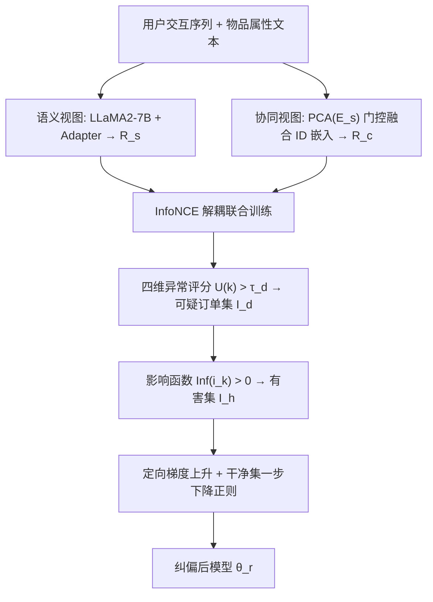
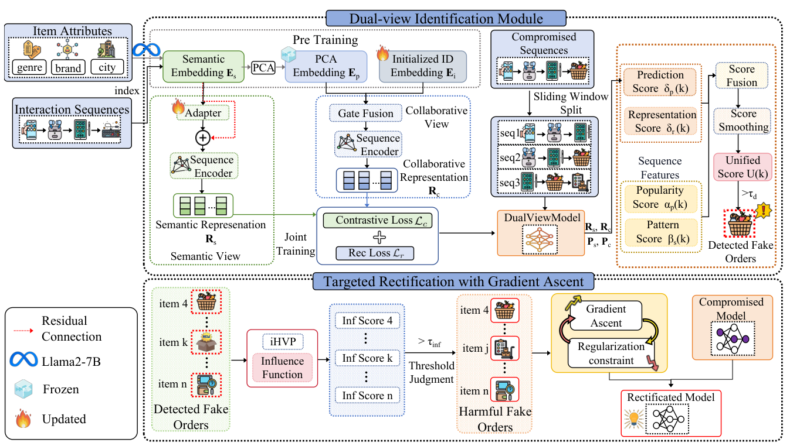
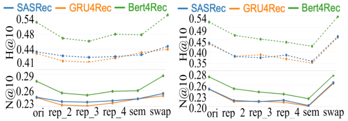

# Unbiased Rectification for Sequential Recommender Systems Under Fake Orders (虚假订单下序列推荐系统的无偏纠偏)

- **会议/期刊**: AAAI 2026
- **作者与机构**: Qiyu Qin, Yichen Li, Haozhao Wang, Cheng Wang, Rui Zhang, Ruixuan Li（华中科技大学）
- **推荐链路定位**: 精排 / 已部署模型的在线纠偏（免全量重训）
- **研究方向**: 去偏公平与可信工业架构 / 序列推荐
- **论文原文**: [https://arxiv.org/abs/2604.08550v1](https://arxiv.org/abs/2604.08550v1)
- **开源代码**: [https://github.com/QinWHang/DITaR](https://github.com/QinWHang/DITaR)

## TL;DR (1分钟核心速览)

本文关注一类隐蔽攻击：**虚假订单（fake orders）被注入真实用户的历史序列内部**（刷单重复、语义替换、顺序扰动），以极低成本操纵曝光而无需伪造用户。作者的关键洞察是"虚假订单并非绝对有害"，顺序扰动甚至等价于隐式数据增强。据此提出 DITaR：用协同视图 + 语义视图（LLaMA2-7B 属性嵌入）的**跨视图不一致性**做检测，再用**影响函数**从候选集中筛出真正有害的样本，仅对这些样本做定向梯度上升 + 干净数据一步下降正则。在 ML-1M/Beauty/Yelp 上采用 Leave-One-Out + 采样排序，NDCG@10 相比 Retrain 提升约 1.9%–13.6%，收敛 epoch 从 35–180 降到 5。

## Background & Motivation (背景与核心矛盾)

- **主流范式**: 数据纠偏（data rectification）以 user-wise/item-wise 删除、分片重训（SISA/RecEraser/UltraRE）或影响函数近似为主，目标是"去掉坏数据再训练"。
- **前人局限 C1**: 这些方法几乎都为协同过滤设计，无法处理序列模型中时间依赖与兴趣演化的复杂耦合，直接迁移会破坏序列结构。
- **前人局限 C2**: 虚假订单是**原位替换**（不改变序列长度与数据量），简单删除会撕裂上下文；且分片破坏用户协同关系、聚合引入近似误差，SISA 在 ML-1M 上 N@10 仅 0.1089（干净 0.2449）。
- **核心洞察 (Key Insight)**: 虚假订单由于是人工生成，**难以同时满足协同统计模式与语义关联的一致性**，跨视图裂隙天然可检出；同时其真实影响异质——语义替换持续有害，而顺序交换引入了受控时间噪声，起到正则/增广作用（图 4）。
- **本文切入点**: 把"删除重训"换成"精准定位有害样本 → 只对有害样本做参数级反向修正"，同时保留有益的"假数据"信息。

## Method (核心方法设计)

### 1. 整体框架 (Overall Architecture)

DITaR 分两阶段。**识别阶段**：先用物品属性文本过冻结的 LLaMA2-7B 得到语义嵌入 $E_s$，经 Adapter 残差接入语义序列编码器得$R_s$；对$E_s$做 PCA 降维得$E_p$，与可学习 ID 嵌入$E_i$通过自适应门控融合后送入协同编码器得$R_c$；两视图用 InfoNCE 显式解耦联合训练。再用四个互补异常信号（跨视图表征/预测分歧 + 流行度/上下文模式异常）加自适应权重与时间平滑得到统一异常分，超过验证集阈值$\tau_d$即为可疑订单。**纠偏阶段**：对每个可疑样本用影响函数估计其对干净验证集损失的真实影响，$Inf>\tau_{inf}=0$ 者判为有害，仅对这些样本执行定向梯度上升，并以干净数据一步梯度下降作正则，交替优化得到纠偏模型。

<figure class="paper-figure" markdown="span">
  <figcaption>图2：DITaR 的框架。DITaR 首先构建协同视图模型与语义视图模型以获得双视图表示，并将其与序列特征结合用于虚假订单检测。随后，影响函数评估检测样本对模型参数的真实影响，从而在适当正则化下对有害虚假订单进行选择性梯度上升修正，得到最终修正模型。</figcaption>
</figure>

### 2. 关键设计拆解 (Key Designs)

1. **双视图解耦表示（让假订单"自相矛盾"）**：直接单视图检测无法区分"探索性点击"与"刷单"。本文用残差 Adapter 保留 LLM 语义、用 PCA+门控把语义空间映射进协同空间，并强制两路独立编码器：

$$R_s = f_s[\mathrm{Adapter}(E_s) + \lambda_1 (w_1 E_s)],\quad R_c = f_c[G \odot (w_2 E_p + b_1) + (1-G)\odot E_i]$$

直觉：$G$ 让模型在"统计共现"与"物品个体化"之间自适应配比，而 InfoNCE 使两视图不塌缩为同一表征——只有两视图真正独立，"分歧"才具备判别力。

2. **四维异常评分与自适应融合**：假订单在"跨视图"与"内在行为"两个层面同时异常。构造 $f_k=[\delta_p(k),\delta_r(k),\alpha_p(k),\beta_s(k)]$，分别用 JS 散度度量预测分歧、余弦相似度度量表征分歧、z-score 度量流行度突增、局部序列模式一致性度量上下文断裂，再加权归一化并做时间平滑：

$$u(k)=w^{\top}\odot \mathcal{N}(f_k),\qquad U(k)=\mathrm{Smooth}(u(k))$$

真实兴趣漂移通常只在单一维度异常（如流行度），而伪造交互**多维度同时越界**，这是低误报的关键。

3. **训练目标、影响筛选与推理开销**：联合损失 $\mathcal{L}_t=\alpha\mathcal{L}_r^{s}+(1-\alpha)\mathcal{L}_r^{c}+\lambda_2\mathcal{L}_c$（$\alpha=0.5,\lambda_2=0.1$）。纠偏仅需两小步：$\theta_m=\theta_t+\eta_1\sum_{i_k\in I_h}\nabla_\theta \mathcal{L}(i_k,\theta_t)$，随后$\theta_{t+1}=\theta_m-\eta_2\frac{1}{|D_c|}\sum_{j\in D_c}\nabla_\theta\mathcal{L}(j,\theta_m)$，且$\eta_2\ll\eta_1$保证正常建模能力不被抹除。影响函数用 IHVP 近似$H_\theta^{-1}v$，复杂度由$O(p^2)$降到$O(p\cdot J)$；无需负采样改造、无需重训，收敛仅 5 epoch。

## Experimental Setup & Evaluation Protocol (实验设置与评估协议)

- **数据集与预处理**: 沿用 SASRec 的标准过滤，向 30%/60% 用户、以 30%/60% 强度注入三类虚假订单（重复/语义替换/非相邻交换），**原位替换不改序列长度**，且同位置互斥。

| 数据集 | #Users | #Items | #Interactions | 虚假订单占比 | 场景说明 |
| :--- | :---: | :---: | :---: | :---: | :--- |
| ML-1M | 6,040 | 3,416 | 999,611 | 140,258 (14.03%) | 电影，含属性文本 |
| Amazon-Beauty | 22,363 | 12,101 | 198,502 | 23,603 (11.89%) | 稀疏电商评论 |
| Yelp2018 | 213,170 | 94,304 | 3,277,932 | 43,165 (13.18%) | 大规模本地生活 |

- **数据划分与防穿越**: `Leave-One-Out`——每用户最后一项为测试、倒数第二项为验证，无全局时间戳切分。
- **排名评测协议**: `Sampled Ranking`（从未交互物品中随机采样负样本与正样本配对，原文未给出正负比与是否 1:1，亦未报告 Full-Ranking 结果），指标 HR@{10,20}、NDCG@{10,20}。
- **对比基线与超参**: Retrain（删假数据重训）、SISA、RecEraser、UltraRE（分片数固定为 10），主干为 SASRec / GRU4Rec / BERT4Rec；两组随机种子 {42,43} 取均值，**未报告显著性检验**。

## Key Experimental Results (实验关键数据)

### 1. 主实验对比 (Main Results)

NDCG@10（Original = 干净数据训练的性能上界）：

| 数据集·主干 | Original | Retrain | SISA | RecEraser | UltraRE | **DITaR** | Improv. vs Retrain |
| :--- | :---: | :---: | :---: | :---: | :---: | :---: | :---: |
| ML-1M · SASRec | 0.2449 | 0.2406 | 0.1089 | 0.2035 | 0.2120 | **0.2470** | +2.66% |
| ML-1M · GRU4Rec | 0.2440 | 0.2365 | 0.0818 | 0.1803 | 0.1104 | **0.2448** | +3.51% |
| ML-1M · BERT4Rec | 0.2790 | 0.2666 | 0.2411 | 0.2355 | 0.2440 | **0.2763** | +3.64% |
| Beauty · SASRec | 0.2036 | 0.1971 | 0.1023 | 0.1817 | 0.1768 | **0.2032** | +3.10% |
| Beauty · BERT4Rec | 0.2029 | 0.1912 | 0.1232 | 0.1779 | 0.1593 | **0.1971** | +3.09% |
| Yelp2018 · SASRec | 0.3161 | 0.3069 | 0.2009 | 0.2753 | 0.2795 | **0.3128** | +1.92% |
| Yelp2018 · GRU4Rec | 0.3174 | 0.2734 | 0.2070 | 0.2327 | 0.2881 | **0.3106** | +13.62% |

效率对比（收敛 epoch，user ratio=0.3）：

| 数据集 | Retrain | SISA | RecEraser | UltraRE | **DITaR** |
| :--- | :---: | :---: | :---: | :---: | :---: |
| ML-1M (SASRec) | 140 | 60 | 52 | 35 | **5** |
| Beauty (SASRec) | 175 | 86 | 43 | 38 | **5** |
| Yelp2018 (SASRec) | 145 | 119 | 55 | 43 | **5** |

### 2. 消融实验 (Ablation Study)

Amazon-Beauty，NDCG@10：

| 变体 | SASRec | GRU4Rec | BERT4Rec |
| :--- | :---: | :---: | :---: |
| DITaR 完整版 | **0.2032** | **0.1725** | **0.1971** |
| w/o 语义视图 | 0.1865 (−8.2%) | 0.1566 (−9.2%) | 0.1802 (−8.6%) |
| w/o 协同视图 | 0.1829 (−10.0%) | 0.1534 (−11.1%) | 0.1753 (−11.1%) |
| w/o 影响函数筛选 | 0.1941 (−4.5%) | 0.1641 (−4.9%) | 0.1862 (−5.5%) |

### 3. 关键实验发现 (Key Findings)

1. **"假订单并非全有害"被定量证实**：语义替换订单在所有设置下持续掉点；重复订单性能随重复长度非单调波动（适度重复可强化某些交互模式）；而**非相邻顺序交换反而带来增益**，因为受控时间噪声起到隐式增广与抗过拟合作用。这直接解释了为何 Retrain（全删）一定劣于保留有益样本的 DITaR。
2. **影响函数筛选是"无偏"的必要条件**：由于检测阈值偏松以保证召回，去掉 $Inf$ 过滤后直接对所有候选做梯度上升会误伤有益/中性样本，NDCG@10 从 0.2032 掉到 0.1941（−4.5%），但仍优于任何单视图变体，说明"宽召回 + 精筛"优于"严阈值"。
3. **协同视图比语义视图更不可替代**：移除协同视图掉点 10.0% ＞ 移除语义视图 8.2%，表明序列建模的统计共现与时序依赖仍是主干，LLM 语义为增益项；同时 DITaR 在 ML-1M·SASRec 上（0.2470）**反超干净数据上界**（0.2449），佐证了保留有益伪样本的正向价值，且效率提升 7–36 倍。

<figure class="paper-figure" markdown="span">
  <figcaption>图4：虚假订单类型对推荐性能的影响（ori：原始数据；rep X：长度为 X 的重复订单；sem：语义订单；swap：顺序订单）。</figcaption>
</figure>

## Highlights & Limitations (亮点、对比与审稿批判)

- **与代表作对比**: 相比 Retrain 的"删数据—重训"、SISA/RecEraser/UltraRE 的"分片—聚合近似"，DITaR 是**样本级、参数级、免重训**的纠偏：不改数据量与序列结构，用影响函数区分有害/有益，用双视图解决"如何可靠检出"，因此在序列模型上不再受分片破坏时序依赖之害。
- **可迁移亮点**: (1) "跨视图不一致性 + 多信号加权"是一种通用的低成本伪交互检测范式，可迁移到 CTR/CVR 的假曝光清洗；(2) "定向梯度上升 + 干净集一步下降正则"几乎是即插即用的模型修补算子，适合线上已部署模型的应急纠偏。
- **审稿级局限批判**: (1) **评估协议偏弱**——仅报告采样排序且未注明正负比，在 3 万–9 万物品规模上极易高估；缺失 Full-Ranking、缺失显著性检验、仅 2 个随机种子，"反超干净上界"的结论稳健性存疑。(2) **依赖攻击类型先验与高成本组件**：三类虚假订单由作者手工构造，真实刷单的分布漂移未验证；同时 LLaMA2-7B 前向 + IHVP 在 21 万物级的 Yelp 上的显存/时延开销未给出量化，阈值 $\tau_d$ 需验证集调优，工业可用性仍待补测。

## Rating (四维评分)

- **方法创新性 (Novelty)**: ⭐⭐⭐⭐ （首次刻画"序列内原位虚假订单"这一隐蔽威胁，双视图裂隙 + 影响函数筛选 + 定向梯度上升的组合清晰且动机自洽，"假数据可为增广"的洞察有实验支撑）
- **评估协议与实验扎实度 (Protocol & Experiments)**: ⭐⭐⭐ （三数据集 × 三主干 + 消融 + 效率对比较完整，但仅采样排序、无 Full-Ranking/显著性检验、攻击场景为人工构造）
- **写作与数学规范度 (Clarity & Rigor)**: ⭐⭐⭐⭐ （公式与两阶段流程交代清楚，IHVP 复杂度分析到位；异常分加权与平滑细节略欠推导）
- **工业落地与复现价值 (Industrial & Practical Value)**: ⭐⭐⭐⭐ （代码已开源、收敛仅 5 epoch、无需重训与改数据结构，工程价值高；但 LLM 语义前向与影响函数估计的线上开销需进一步优化）

