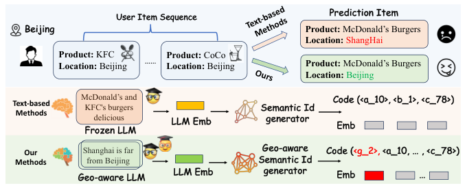
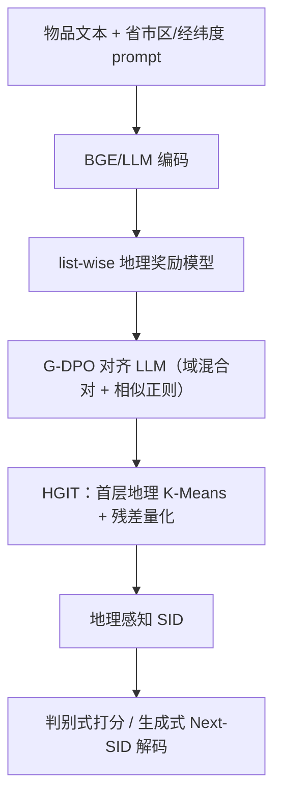
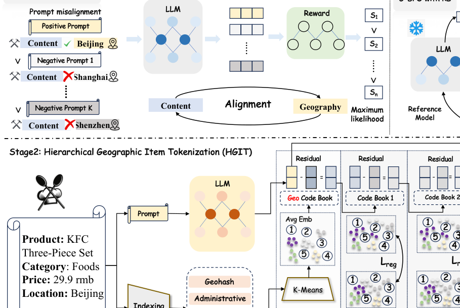

# LLM-Aligned Geographic Item Tokenization for Local-Life Recommendation（面向本地生活推荐的 LLM 对齐地理物品标记化）

- **会议/期刊**: AAAI 2026
- **作者与机构**: Hao Jiang, Guoquan Wang, Donglin Zhou 等，快手 / 独立研究者
- **推荐链路定位**: 召回 / 端到端生成式
- **研究方向**: 生成式推荐与离散语义ID / LLM4Rec、时空POI
- **论文原文**: [论文原文链接](https://arxiv.org/abs/2511.14221v1)
- **开源代码**: [开源代码仓库链接](https://github.com/JiangHaoPG11/LGSID)

## TL;DR (1分钟核心速览)

针对本地生活推荐中文本语义 ID 缺少真实地理距离感知、易推跨城不可达物品的痛点，LGSID 先用 list-wise 地理奖励模型与 G-DPO 将空间偏好和协同信号注入 LLM，再以地理/行政/类目/品牌特征初始化首层 token、残差量化细化 SID。在快手 50M 工业样本上，判别式 AUC 最高提升 4.17，生成式 TIGER 的 Hit@10 相对提升 30.83%。

## Background & Motivation (背景与核心矛盾)

- **主流范式**: 以 TIGER/RQ-VAE、QARM/Res-KMeans 为代表，将物品文本经 LLM 编码后量化成离散 SID，再接入判别式或生成式推荐。
- **前人局限**: 其一，只把 LLM 当文本编码器，重点改量化器，忽视上游 LLM 的领域对齐；其二，简单把省市区拼进 prompt，LLM 仍偏向文本相似，容易混淆“安徽苏州”与“江苏苏州”，甚至给北京用户推上海餐厅。
- **核心洞察 (Key Insight)**: 上游 LLM 的地理感知能力决定 item tokenization 的上界；SID 应同时压缩“真实距离序”与“协同共现”，而非仅压缩内容语义。
- **本文切入点**: 不改量化器为主，而是先 post-train LLM 注入地理奖励，再用地理先验层次量化。

<figure class="paper-figure" markdown="span">
  <figcaption>图1：本地生活推荐中基于文本的方法所面临挑战的示意图。由于缺乏地理感知，系统可能推荐语义相关但距离过远而用户无法访问的项目。</figcaption>
</figure>

## Method (核心方法设计)

### 1. 整体框架 (Overall Architecture)

LGSID 将物品文本与省/市/区地理属性拼成 prompt，先由 BGE 编码；Stage-1 用密度感知负采样构造 list-wise 地理奖励模型，再以 G-DPO 将奖励回传至 LoRA 微调的 LLM，并用批内相似正则防止语义漂移；Stage-2 以行政、经纬度、类目、品牌特征做 MiniBatch K-Means 生成首层地理 token，后续残差层用可学习码本逐层量化对齐后的 LLM 向量。产出的 SID 可直接接入 DIN/DIEN 等判别式模型或 TIGER/OneRec 等生成式模型。

<figure class="paper-figure" markdown="span">
  <figcaption>图2：LGSID的模型结构。上半部分展示基于RL的Geographic LLM Alignment流程，下半部分展示Hierarchical Geographic Item Tokenization流程。</figcaption>
</figure>

### 2. 关键设计拆解 (Key Designs)

1. **List-wise 地理奖励模型（把相对距离序压进奖励）**：point-wise 只判“内容-位置是否匹配”，无法区分远近。本文按 haversine 距离选 $K=15$个密度感知硬负例，固定内容替换位置构造 prompt，MLP 打分$r_{i,j}=MLP(E_{i,j})$，并按距离排序赋软标签$p_{i,j}=K-\mathrm{Rank}(dis_{i,j})+1$，以$\mathcal{L}_{RM}=-\frac{1}{N}\sum_i\sum_j p_{i,j}\log\sigma(r_{i,j})$ 训练。直觉是让 LLM 学“近-远”相对序，而非回归绝对经纬度。

2. **G-DPO 地理对齐（注入空间与协同信号）**：标准 DPO 只学内容偏好，缺地理约束。本文构造域混合偏好集 $D_{mix}=D_{dc}\cup D_{gc}$：$D_{dc}$用用户历史共现$s_{i_a,i_b}=\sum_u\mathbb{I}[i_a\in H_u\land i_b\in H_u]>1200$筛选，$D_{gc}$随机采异地负例。对齐损失为$\mathcal{L}_{align}=-\mathbb{E}_{(i^+,i^-)}\log\sigma(\beta[R(E_{\pi_\theta}(i^+))-R(E_{\pi_\theta}(i^-))-R(E_{\pi_{ref}}(i^+))+R(E_{\pi_{ref}}(i^-))])$，并加批内相似正则$\mathcal{L}_{sim}=\mathbb{E}_{i\in B}[\|E_{\pi_\theta}(i)-E_{\pi_{ref}}(i)\|_2^2-\frac{1}{|B|-1}\sum_{j\ne i}\|E_{\pi_\theta}(i)-E_{\pi_{ref}}(j)\|_2^2]$，总损失$\mathcal{L}_{G-DPO}=\mathcal{L}_{align}+\lambda\mathcal{L}_{sim}$。奖励差约束地理序，相似正则把 policy 锚在 reference 附近，防止语义被地理信号覆盖。

3. **HGIT 层次地理量化（首层硬地理先验 + 残差细化）**：RQ-VAE/Res-KMeans 首层无地理约束，码本易塌缩。本文先构造 $F=[w_{admin}f_{admin},w_{geo}f_{geo},w_{cat}f_{cat},w_{brand}f_{brand}]$，MiniBatch K-Means 得首层地理 token，中心取组内 LLM 向量均值；后续层用$z^{(l)}=\arg\min_k\|R^{(l-1)}-\mu^{(l)}_k\|_2^2$、$R^{(l)}=R^{(l-1)}-Q^{(l)}$残差量化，并以$\mathcal{L}_{HGIT}=\|X-\sum_{l=1}^L Q^{(l)}\|_2^2+\lambda_{reg}\sum_{l=2}^L KL(p^{(l)}\|u)$ 训练。首层注入硬地理/行政先验，残差层只修正剩余语义，熵正则防码本塌缩。训练顺序为 reward → G-DPO → HGIT，G-DPO 每正样本配 15 负例；在线仅查 SID 表，生成式需自回归解码少量 token。

## Experimental Setup & Evaluation Protocol (实验设置与评估协议)

- **数据集与预处理**: 未做 `5-core` 过滤，直接使用快手本地生活工业全量样本；判别式保留正例、负例按 1:4 降采样，生成式保留降采样结果。

| 数据集 | #Users | #Items | #Interactions | 稀疏度/密度 | 特征/场景说明 |
| :--- | :---: | :---: | :---: | :---: | :--- |
| Kuaishou Local-Life | 19,080,888 | 2,325,266 | 50,000,000 样本 | 未报告 | 19,408 品牌、818 类目；文本+省市区/经纬度 |

- **数据划分与防穿越**: 生成式采用 `Leave-One-Out`（最后一条测试、倒数第二条验证）；判别式未明示切分，按工业采样协议训练/评估。
- **排名评测协议**: 判别式用 AUC（二分类，负例 1:4），非全库排序；生成式用 `Hit@5/10` 与 `NDCG@5/10`，保留降采样候选，**非 Full-Ranking 全库排序**。
- **对比基线与超参**: 判别式 DIN/DIEN/SIM/TWIN/ETA；生成式 TIGER/OneRec；SID 量化对比 RQ-VAE、RQ-VAE-ngram、Lin et al.、Res-KMeans。LLM 用 BGE，$d=1024$，特征 embedding 为 8；LoRA rank=8，$\beta=0.9$，$\lambda$在 1.0–1.8 间调参（主结果取 1.8）；AUC 用 6 个随机种子并做 Wilcoxon 检验，$p<0.05$。

## Key Experimental Results (实验关键数据)

### 1. 主实验对比 (Main Results)

判别式 AUC（表 1，LGSID 均最优，括号为相对 Origin 的绝对提升）：

| Backbone | Origin | +RQ-VAE | +RQ-VAE-ngram | +LGSID (Δ) |
| :--- | :---: | :---: | :---: | :---: |
| DIN | 0.5859 | 0.6185 | 0.6163 | **0.6276 (+0.0417)** |
| DIEN | 0.6255 | 0.6364 | 0.6354 | **0.6484 (+0.0229)** |
| SIM | 0.5884 | 0.6111 | 0.6116 | **0.6224 (+0.0340)** |
| TWIN | 0.5898 | 0.6153 | 0.6129 | **0.6263 (+0.0365)** |
| ETA | 0.5903 | 0.6153 | 0.6145 | **0.6274 (+0.0371)** |

生成式推荐（表 2，指标为 Hit/NDCG@5/10，加粗为最优）：

| 模型 | 量化/SID | Hit@5 | Hit@10 | NDCG@5 | NDCG@10 |
| :--- | :--- | :---: | :---: | :---: | :---: |
| TIGER | RQ-VAE | 0.3087 | 0.3880 | 0.2255 | 0.2512 |
| TIGER | RQ-VAE-ngram | 0.2991 | 0.3769 | 0.2158 | 0.2411 |
| TIGER | Lin et al. | 0.1767 | 0.2067 | 0.1335 | 0.1432 |
| TIGER | **LGSID** | **0.3921** | **0.5077** | **0.2817** | **0.3191** |
| OneRec | RQ-VAE | 0.3739 | 0.4534 | 0.2798 | 0.3056 |
| OneRec | RQ-VAE-ngram | 0.3626 | 0.4358 | 0.2720 | 0.2957 |
| OneRec | Lin et al. | 0.2950 | 0.3346 | 0.2272 | 0.2401 |
| OneRec | **LGSID** | **0.4435** | **0.5537** | **0.3304** | **0.3661** |

LGSID 较各自最佳基线（TIGER RQ-VAE / OneRec RQ-VAE）相对提升：TIGER 为 +27.01%/+30.83%/+24.94%/+27.05%，OneRec 为 +18.63%/+22.13%/+18.09%/+19.79%。

### 2. 消融实验 (Ablation Study)

G-DPO 组件消融（表 3，@5）：

| 变体 | Sim@5 | P@5 | C@5 | T@5 |
| :--- | :---: | :---: | :---: | :---: |
| Origin | **0.9204** | 0.8716 | 0.7342 | 0.1601 |
| DPO-PR（point-wise reward） | 0.8771 | 0.9001 | 0.7478 | 0.1452 |
| DPO-LR（list-wise reward） | 0.7595 | 0.8995 | 0.8681 | **0.6114** |
| DPO-LRD（+密度负采样） | 0.7411 | 0.8715 | 0.8277 | 0.6114 |
| DPO-LRDM（+域混合对） | 0.8107 | 0.9047 | 0.7812 | 0.1816 |
| DPO-LRDMS（+相似正则） | 0.8856 | **0.9960** | **0.9548** | 0.4030 |
| G-DPO（λ=1.8） | 0.8977 | 0.9905 | 0.9173 | 0.2940 |

### 3. 关键实验发现 (Key Findings)

1. 地理奖励必须 list-wise：DPO-LR 将 T@5 从 0.1601 提至 0.5584，而 point-wise DPO-PR 仅 0.1452，说明“按距离排序的软标签”比绝对位置匹配更能教会 LLM 远近关系。
2. 纯地理对齐会牺牲语义：DPO-LR 的 Sim@5 降到 0.7595；加入域混合共现对与 in-batch 相似正则后，DPO-LRDMS 恢复至 0.8856 且 T@5=0.4030；最终 G-DPO 取 λ=1.8，Sim@5=0.8977、T@5=0.2940，以下游 AUC 最优为目标做语义-地理权衡。
3. 对齐后表示更地理可分：T-SNE 的 NMI 由 0.0137–0.0845 升至 0.6430–0.8644；生成式 TIGER 的 Hit@10 从 0.3880 提至 0.5077（+30.83%），证明 SID 质量提升可跨判别式与生成式范式迁移。

## Highlights & Limitations (亮点、对比与审稿批判)

- **与代表作对比 (vs. Prior Work)**: TIGER/RQ-VAE 与 QARM/Res-KMeans 主要改量化器，LGSID 直接 post-train 上游 LLM；GNPR-SID 仅把位置拼入 prompt，本文用距离感知 list-wise 奖励 + G-DPO 真正注入空间序；相比 Lin et al. 多层距离函数不一致导致收敛困难，LGSID 首层地理先验 + 残差量化更稳定。
- **可迁移亮点**: 距离排序软标签可迁移到外卖、打车、POI 等任何空间约束召回；DPO 中的批内相似正则可通用地防止领域对齐导致语义漂移。
- **审稿级局限批判**: 仅一个快手工业数据集，未开源数据且缺公开基准，结论外部有效性有限；评估以 1:4 负采样 AUC 和降采样生成指标为主，未做 Full-Ranking，可能高估线上真实收益；G-DPO 需奖励模型、LLM 微调与全量物品 embedding/码本训练，离线成本高，λ 与共现阈值 1200 对语义-地理平衡较敏感。

## Rating (四维评分)

- **方法创新性 (Novelty)**: ⭐⭐⭐⭐ （把“地理距离序”做成 list-wise 奖励并经 G-DPO 注入 LLM，再与层次地理量化闭环，思路新且针对本地生活痛点。）
- **评估协议与实验扎实度 (Protocol & Experiments)**: ⭐⭐⭐ （覆盖判别式与生成式两条链路，并有 6 seed Wilcoxon 检验；但仅单工业数据集、采样排序，缺 Full-Ranking 与公开数据复现。）
- **写作与数学规范度 (Clarity & Rigor)**: ⭐⭐⭐⭐ （两阶段流程、奖励/DPO/量化公式完整，符号清楚；附录 λ 与主表存在表述不一致，阅读时需以表 6 为准。）
- **工业落地与复现价值 (Industrial & Practical Value)**: ⭐⭐⭐⭐ （快手 50M 样本验证，SID 可插拔到 DIN/TIGER/OneRec；代码已开源，但 LLM 对齐与码本维护成本仍是上线门槛。）

