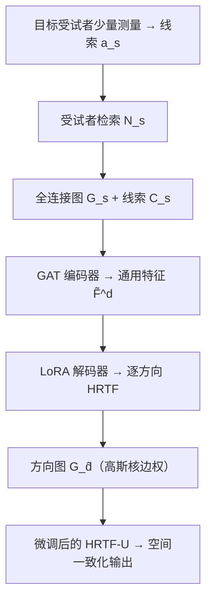
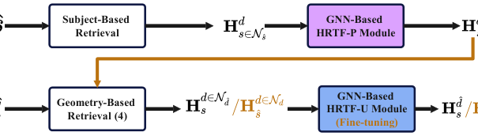

# Graph Neural Field with Spatial-Correlation Augmentation for HRTF Personalization (空间相关性增强的图神经场 HRTF 个性化)

- **会议/期刊**: AAAI 2026
- **作者与机构**: De Hu, Junsheng Hu, CuiCui Jiang（内蒙古大学计算机学院）
- **推荐链路定位**: 检索增强召回（retrieval-augmented generation）+ 二阶段后处理精修
- **研究方向**: 图神经网络与知识图谱推荐 / 冷启动与泛化
- **论文原文**: [arXiv:2511.10697v1](https://arxiv.org/abs/2511.10697v1)
- **开源代码**: [hu-junsheng/GraphNF-SCA](https://github.com/hu-junsheng/GraphNF-SCA)

> 领域说明：本文原始任务为空间音频中的 HRTF 个性化反问题，并非电商/内容推荐。但其"**新个体零样本冷启动 → 检索同质近邻 → 图注意力聚合 → 二次一致性精修**"的闭环，与图推荐中的邻域聚合召回、以及检索增强的冷启动泛化完全同构，故按 `graph_rec` 主分类归档。

## TL;DR (1分钟核心速览)

HRTF 个性化长期沿用"逐位置独立估计"范式：给定新受试者少量测量方向，直接回归各方向头相关传递函数（HRTF），完全忽略方向之间的几何相关性，导致稀疏测量下谱峰谷严重失真。本文提出 GraphNF-SCA：先用受试者近邻图（GAT 编码器-解码器 + LoRA 个体注入）生成各方向个性化 HRTF，再把该输出整体送入一个预先训练好的方向图 GNN（HRTF-U）并微调其 FC 层，用空间相关性反向"矫正"逐点预测。在受试者级冷启动划分（训练/验证/测试互不重叠）与全方向无偏评估协议下，SONICOM 仅 3 个测量方向时 LSD 由 4.33 dB 降至 3.60 dB（-16.9%），ILD 由 1.22 dB 降至 0.96 dB（-21.3%）。

## Background & Motivation (背景与核心矛盾)

- **主流范式**: 分两支——HRTF-P 将解剖/双耳线索特征直接映射到个体 HRTF（或检索相似受试者），HRTF-U 则在已测方向上插值出未测方向，代表作为 RANF 的检索增强神经场与 FiLM 的条件调制插值。
- **前人局限**: ① 直接解剖→HRTF 映射需拟合衍射、散射、共振等强非线性波-解剖交互，在小规模库（45–200 人）下极易过拟合；② HRTF-P 与 HRTF-U 始终被**独立建模**，前者输出逐方向互不约束，几何关系断裂。
- **核心洞察 (Key Insight)**: 方向映射（式 3）远易于受试者映射（式 1），因为相邻方向的 HRTF 高度相似；那么一个已学好的"空间相关性算子"就可以反过来当作主任务的**一致性正则器**。
- **本文切入点**: 构造复合映射 $\Psi_p:\tilde{\Phi}_u\big(\Phi_p(\mathbf{H}^d_{s\in\mathcal{N}_{\hat{s}}})\big)\mapsto \mathbf{H}^d_{\hat{s}}$，让 HRTF-U 的微调版本$\tilde{\Phi}_u$去精修$\Phi_p$ 的整片输出。

## Method (核心方法设计)

### 1. 整体框架 (Overall Architecture)

对未见受试者 $\hat{s}$，先按线索（ITD/ILD/LSD）从库中检索近邻集$\mathcal{N}_{\hat{s}}$，将其 HRTF 构造成全连接图送入 HRTF-P 模块；编码器以多层 GAT 抽取受试者共享特征并与方向-线索编码融合，平均池化得到**去个体差异的通用表征**；解码器再通过 LoRA 低秩矩阵把目标受试者特征注入该通用表征，输出各方向个性化 HRTF。第二阶段对每个方向$\hat{d}$ 以空间距离检索邻居建图，把 HRTF-P 的输出（含目标节点占位）送入预训练的 HRTF-U，仅微调其 FC 层，使结果在空间上自洽。最后以最小相位近似重建相位。

<figure class="paper-figure" markdown="span">
  <figcaption>图2：所提出的HRTF个性化框架（称为GraphNF-SCA）概览，其中对预训练的HRTF-U模块进行微调，以增强HRTF-P模块输出之间的空间相关性。</figcaption>
</figure>

### 2. 关键设计拆解 (Key Designs)

1. **受试者检索图 + LoRA 个体注入（HRTF-P）**：痛点是逐点回归丢失受试者间关系。本文把近邻受试者 HRTF 作为顶点、边权恒为 1 构图，节点特征为 $\mathbf{F}^d_s=\tilde{\mathbf{H}}^d_s\oplus\tilde{\mathbf{C}}^d_s$，其中线索$\mathbf{C}^d_s=d\oplus a_s$先经随机傅里叶特征再降维到$2K$。注意力按标准 GAT 计算$\alpha^{(n)}_{s,q}=f\big[f_l(\mathbf{a}^{(n)\top}_s\mathbf{W}^{(n)}_s\tilde{\mathbf{H}}^d_s+\mathbf{a}^{(n)\top}\mathbf{W}^{(n)}\tilde{\mathbf{H}}^d_q)\big]$。关键在于融合后再过一层 GAT 并**平均池化**，显式抹除个体差异得到通用场；解码器再用目标受试者导出的两个低秩向量$\mathbf{u},\mathbf{v}\in\mathbb{R}^{2K\times1}$做$\bar{\mathbf{F}}^d\leftarrow\bar{\mathbf{F}}^d+\mathbf{u}\mathbf{v}^{\top}$ 逐层调制，用极小参数量完成"通用→个体"的个性化。

2. **方向图 + 空间相关性回灌微调（SCA 核心）**：痛点在于 HRTF-U 只会插值已知受试者，而 HRTF-U 与 HRTF-P 从不互通。本文让方向图 $\mathcal{G}_{\hat d}$非全连接：边$(d,p)$满足$\|d-p\|_2<a\delta_d$，权重取高斯核$\exp(-\|d-p\|_2^2/2\sigma^2)$，并把待预测方向$\hat d$ 作为初始化为全 1 向量的占位节点入图。预训练后冻结 GAT，仅用 HRTF-P 的整片输出微调 FC 层。直觉：某个方向被错估的谱峰/谱谷会被邻域的一致结构拉回，尤其是跨头传播导致误差偏大的对侧方向（头影效应区）。

3. **训练目标与推理开销**：全流程以对数谱失真为损失，$\mathrm{LSD}(\hat{\mathbf{H}}^d_{\hat s},\mathbf{H}^d_{\hat s})=\sqrt{\frac{1}{2K}\sum_{k=1}^{2K}\big(20\log_{10}\frac{\hat{H}^d_{\hat s}(k)}{H^d_{\hat s}(k)}\big)^2}$。HRTF-P 用 RAdam（lr=1e-3, 200 epoch），HRTF-U 用 Adam（lr=2e-3, 200 epoch），微调 20 epoch（lr=2e-3, 指数衰减 0.95）。**免负采样**（回归任务），超参$B=2$、8/1 头，$I=2$、8/1 头，$P=2$、$Q=4$，$\sigma=0.5$、$a=0.75$、$\delta_d=20$。部署时新用户只需 3–5 个方向测线索，HRTF-U 无需重训，但需对全部方向逐一跑 HRTF-P 再逐点建图，属于串行两阶段推理。

## Experimental Setup & Evaluation Protocol (实验设置与评估协议)

- **数据集与预处理**:

| 数据集 | #Subjects | 方向数/人 | 采样率 | 特征/场景说明 |
| :--- | :---: | :---: | :---: | :--- |
| SONICOM | 200（剔除 P0079 缺 ITD/ILD 值，用 199） | 793 | 48 kHz | LAP Challenge 2024 官方赛道，含 3D 扫描 |
| HUTUBS_mea / _sim | 96 / 96 | 440 / 1730 | — | 实测与非均匀仿真两套分布 |
| CIPIC | 45 | 1250 | 44.1 kHz | 均匀空间采样，与上两者分布不同 |

- **数据划分与防穿越**: 严格**受试者级冷启动划分（unseen-subject split）**：SONICOM 160/19/20、HUTUBS 77/9/10、CIPIC 40/4/5（训练/验证/测试受试者完全不重叠），测试集从未参与任何预训练或微调。
- **排名评测协议**: 属**全方向无偏评测**（非采样）：在数据集全部方向集合上计算 LSD(dB) 与 ILD(dB)，而非仅在已测方向上；并做 3/5/19/100 四档测量稀疏度扫描 + $\zeta=6$ dB 阈值误差空间分布可视化。
- **对比基线与超参**: 传统法 Nearest Neighbor、HRTF selection(LSD/ITD)；数据驱动法 NF(CbC)、NF(LoRA)、RANF（SOTA）。评测覆盖三库 × 四稀疏度共 12 组设置，主表粗体为最优。

## Key Experimental Results (实验关键数据)

### 1. 主实验对比 (Main Results)

**表 1：SONICOM / LAP Challenge 2024（ILD↓ / LSD↓，单位 dB）**

| 方法 | 3 方向 | 19 方向 | 100 方向 |
| :--- | :---: | :---: | :---: |
| Nearest Neighbor | 7.64 / 8.69 | 2.99 / 5.42 | 1.35 / 3.42 |
| HRTF selection (LSD) | 1.46 / 5.78 | 1.54 / 5.47 | 1.34 / 5.41 |
| NF(CbC) | 1.54 / 4.87 | 1.79 / 5.01 | 1.67 / 5.12 |
| NF(LoRA) | 1.28 / 4.73 | 1.09 / 4.07 | 1.06 / 3.83 |
| RANF (SOTA) | 1.21 / 4.41 | 0.95 / 3.58 | 0.76 / 3.04 |
| GraphNF（无 SCA） | 1.22 / 4.33 | 0.93 / 3.51 | 0.76 / 3.03 |
| **GraphNF-SCA** | **0.96 / 3.60** | **0.78 / 3.12** | **0.70 / 2.72** |
| Improv. (vs RANF) | **-20.7% / -18.4%** | **-17.9% / -12.8%** | **-7.9% / -10.5%** |

跨库平均：稀疏（3–5 方向）下较 RANF 降 **26.9% ILD / 23.7% LSD**；高密度（100 方向）仍降 **18.3% / 13.1%**（HUTUBS_mea 3 方向 LSD 4.69→3.74、CIPIC 4.92→3.85）。

### 2. 消融实验 (Ablation Study)

**表 2：组件消融（SONICOM，3 方向，ILD/LSD）**

| 变体 | ILD | LSD |
| :--- | :---: | :---: |
| (a) w/o 方向 $d$、线索$a_s$、融合图$g$ | 1.69 | 4.65 |
| (b) w/ $d,a_s$，w/o 融合图$g$ | 1.34 | 4.41 |
| (c) GraphNF（完整 HRTF-P） | 1.22 | 4.33 |
| (d) GraphNF-SCA（+ 空间回灌） | **0.96** | **3.60** |

**表 3：HRTF-U 单独评测 vs 微调后（LSD，dB）**

| 方法 | HUTUBS_sim | HUTUBS_mea | SONICOM | CIPIC |
| :--- | :---: | :---: | :---: | :---: |
| 线性插值 | 6.61 | 6.69 | 6.86 | 3.68 |
| FiLM-HRTF | 1.77 | 3.64 | 2.36 | 3.25 |
| HRTF-U（预训练） | **1.56** | **3.18** | **2.26** | **3.11** |
| HRTF-U_ft（微调后） | 1.97 | 3.72 | 2.68 | 3.38 |

检索策略（LSD/ITD/ILD 线索 × 近邻数 $M\in\{1,5,10\}$）全组合仅带来 1.22–1.27 dB / 4.30–4.39 dB 的微幅波动。

### 3. 关键实验发现 (Key Findings)

1. **回灌增益与数据稀疏度严格正相关**：3 方向时 SCA 带来 16.9% LSD / 21.3% ILD 相对提升，100 方向时仅 10.5% / 7.9%；而纯 GraphNF 相对 RANF 在 3 方向仅 4.33 vs 4.41（1.8%）。说明图检索本身是次要贡献，**空间一致性先验才是性能跃升的主源**，且信息越稀缺价值越大。
2. **微调是"精度换一致性"的显式折衷**：HRTF-U_ft 作为独立插值器反而退化（SONICOM 2.26→2.68 dB），但联合后 HRTF-P 主线从 4.33 降到 3.60 dB；结合表 2 中 (c)→(d) 的 ILD 下降 21.3%，证明该模块的正确用法不是"更强的插值器"而是"空间一致性投影器"。
3. **瓶颈在聚合而非检索**：线索类型与近邻数 $M$ 几乎不敏感（波动 <0.05 dB），且 (b)→(c) 加入融合 GAT 层带来 1.34→1.22 dB 的 ILD 收益，说明检索质量已饱和，剩余增益来自图结构建模；误差可视化显示剩余大误差集中于对侧 180°–360° 头影区，同侧基本全部低于 6 dB 阈值。

## Highlights & Limitations (亮点、对比与审稿批判)

- **与代表作对比 (vs. Prior Work)**: RANF 用 ITD 检索 + 逐位置神经场，本质仍是独立回归且无法外推到非采样方向；NF(LoRA)/NF(CbC) 既无检索也无位置间耦合；FiLM-HRTF 依赖固定数量邻居的重复采样，会漏掉高信息节点。本文以**变长近邻图 + 二阶段空间回灌**同时解决"个体冷启动"与"方向外推"两件事。
- **可迁移亮点**: ① "易学子任务预训练 → 反向微调精修难学主任务的整片输出"这一元范式，可迁移到跨域冷启动的粗排打分一致性校正；② 用距离高斯核边权 + 变长邻域图替代固定 $k$ 近邻采样，缓解近邻选择偏差。
- **审稿级局限批判**: ① 两阶段串行推理，每个新用户需在全部方向跑一遍 HRTF-P 再逐点建图，在线时延与显存开销随方向数线性增长，论文未报告任何推理时延数据；② 仅建模幅度谱、相位靠最小相位近似重建，未端到端评估 ITD 与主观定位/外部化感知实验，$\zeta=6$dB 的误差可视化也缺乏感知显著性支撑；③ 测试集仅 5–20 名受试者，跨库泛化结论建立在三个小规模库上，统计显著性检验（$p$ 值）缺失。

## Rating (四维评分)

- **方法创新性 (Novelty)**: ⭐⭐⭐ （"检索图 + 空间回灌"的机制组合新颖且有效，但属工程性模块拼装，缺少对空间相关性为何成立的谱/理论分析）
- **评估协议与实验扎实度 (Protocol & Experiments)**: ⭐⭐⭐⭐ （三库 × 四稀疏度、受试者级冷启动划分、全方向无偏评测齐备，扣分在缺感知实验与显著性检验）
- **写作与数学规范度 (Clarity & Rigor)**: ⭐⭐⭐ （GAT/LoRA/LSD 公式定义清晰，但符号较繁、关键维度 $K$ 与参数量未给，附录承载过多关键结论）
- **工业落地与复现价值 (Industrial & Practical Value)**: ⭐⭐⭐⭐ （代码已开源，新用户仅需 3–5 方向测量且 HRTF-U 免重训，实用性强；但逐点建图的串行推理是部署主要障碍）

