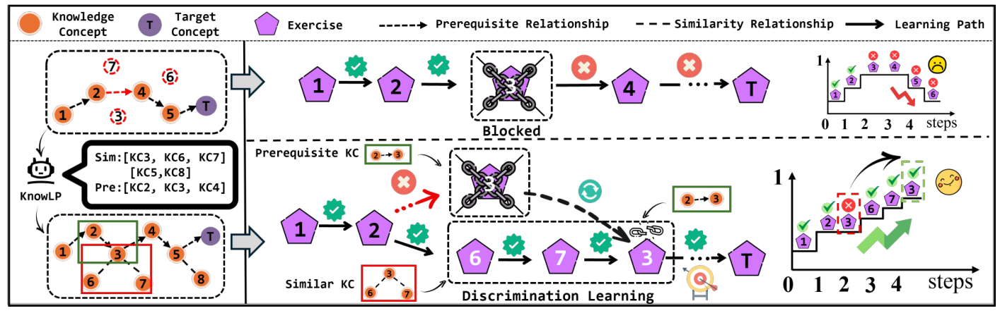
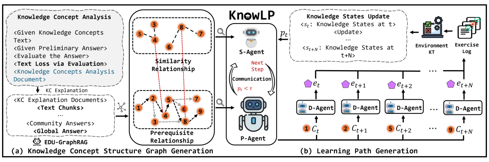
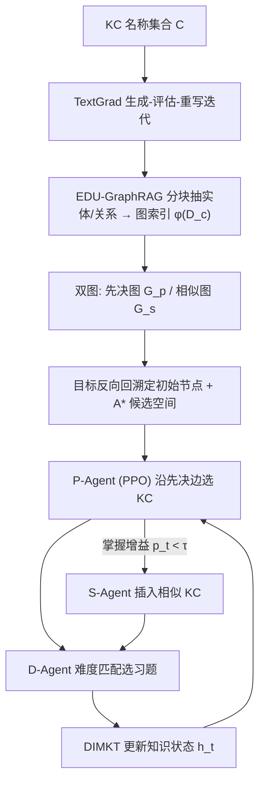

# GraphRAG-Induced Dual Knowledge Structure Graphs for Personalized Learning Path Recommendation (GraphRAG 诱导的双知识结构图用于个性化学习路径推荐)

- **会议/期刊**: AAAI 2026
- **作者与机构**: Xinghe Cheng, Zihan Zhang, Liangda Fang, Quanlong Guan, Weiqi Luo (暨南大学/琶洲实验室)；Jiapu Wang (北工大)；Chaobo He (华南师大)；Shirui Pan (Griffith University)
- **推荐链路定位**: 端到端序列决策（知识点序列 + 习题挑选一次生成）
- **研究方向**: 图神经网络与知识图谱推荐 / 强化学习与动态探索推荐
- **论文原文**: [https://arxiv.org/abs/2506.22303v2](https://arxiv.org/abs/2506.22303v2)
- **开源代码**: [https://github.com/THU-KEG/MOOCCubeX](https://github.com/THU-KEG/MOOCCubeX)（仅数据集仓库，方法代码暂未开源）

## TL;DR (1分钟核心速览)

学习路径推荐长期依赖**专家标注的先决关系图**，而真实教育数据中该图常缺失（ASS09 完全没有）、残缺（MCX 仅覆盖 46/443 个知识点）甚至近乎全连通而无区分度；同时单一先决链刚性太强，学生卡在某知识点会导致后续路径全线阻断。KnowLP 用 TextGrad 迭代改写 + EDU-GraphRAG 从知识点名称自动合成**先决图与相似图**，再用 P-Agent/S-Agent/D-Agent 三个 PPO 智能体协作生成路径，在 DKT 仿真掌握度增益指标 $E_p$ 上于 Junyi/MCX/ASS09 全面 SOTA，MCX step=20 相对最优基线 DLPR 提升 **+29.05%**。

## Background & Motivation (背景与核心矛盾)

- **主流范式**: 先决关系驱动的层级强化学习（CSEAL、GEHRL、DLPR）：先由先决图确定知识点偏序，再在候选空间内用 HRL 逐步规划 KC 与习题。
- **前人局限 1（构图不可得）**: 先决边需教育专家逐条标注，成本极高；LLM 直接生成又易产生幻觉边，且多数数据集仅提供 KC 名称、无描述文本，RAG 无从检索。
- **前人局限 2（刚性链阻断）**: 只沿先决边推进意味着单点失败即"路径阻塞"（blocked phenomenon），学生无法绕行，长步数下性能反而崩塌。
- **核心洞察 (Key Insight)**: 依据 Gagné 学习层级理论，**判别学习（discrimination learning）**——把易混淆的相似 KC 并置对比——正是解开概念混淆、恢复学习进度的关键；而这恰是先决图完全无法表达的第二类结构。
- **本文切入点**: 只在"选不出下一个先决 KC 或掌握无增益"时，把相似 KC 作为**回退分支（fallback）**插入路径，用对比脚手架替代硬性偏序。

<figure class="paper-figure" markdown="span">
  <figcaption>图 1：传统方法（上）与我们提出的 KnowLP（下）的比较。上图表示基于 KC 先决关系的传统方法，其中相似 KC（如 KC3、KC6 和 KC7）之间的混淆会妨碍学生掌握 KC3，并阻碍其理解后续 KC。下图展示 KnowLP 如何使学生更有效地区分这些相似 KC，从而改善学习效果。</figcaption>
</figure>

## Method (核心方法设计)

### 1. 整体框架 (Overall Architecture)

左侧构图：仅用各数据集的 KC 名称，先经 TextGrad 的"生成—评估—重写"三阶段迭代把名称扩写成可靠释义文档 $D_c$；EDU-GraphRAG 将全部文档拼接、按数据集规模切块，逐块让 LLM 抽取实体与关系并去重合并为文档级图索引$\phi(D_c)$，再以查询$Q$条件化生成**双图**（先决图$G_p$/ 相似图$G_s$）。右侧规划：先由目标节点沿先决边反向回溯确定初始节点，并预计算到目标的 A\* 最短路压缩候选空间；P-Agent 沿$G_p$选 KC，若掌握度增益低于阈值则触发 S-Agent 沿$G_s$ 插入对比 KC，D-Agent 再按难度匹配挑习题；每步后 DIMKT 环境更新知识状态，闭环至达到学习目标。

<figure class="paper-figure" markdown="span">
  <figcaption>图 2：KnowLP 框架概览。左侧的 KC 结构图生成模块首先将 KC 名称输入 TextGrad，由其生成文本描述。随后 EDU-GraphRAG 使用这些描述构建 KC 结构图。右侧的学习路径生成模块以 P-Agent 和 S-Agent 过滤 KC 开始。随后，D-Agent 选择难度合适的习题。然后，该模块利用环境 KT 动态更新每个会话中的知识状态。最后，该模块生成学习路径 s。</figcaption>
</figure>

### 2. 关键设计拆解 (Key Designs)

1. **EDU-GraphRAG：把"幻觉构图"变成可核验的多轮自纠错构图**：痛点是无标注文本时 LLM 生成的先决边大量捏造。本文把 KC 释义生成写成多轮优化，第 $t$轮由评估 LLM 产出文字反馈再做梯度式改写$\mathcal{T}^{(t+1)}=\mathrm{LLM}(P_{\text{rewrite}},\mathcal{T}^{(t)},\nabla^{(t)}_{\text{LLM}})$，其中$\nabla^{(t)}_{\text{LLM}}=\mathrm{LLM}(P_{\text{feedback}},\mathrm{LLM}(P_{\text{eval}},c,\mathcal{T}^{(t)}))$；随后图索引由各块局部子图并集给出$\phi(D_c)=\bigcup_{i=1}^{n}\mathcal{G}(E(\sigma_i),\mathcal{R}(\sigma_i))$，最终$A_G=\mathrm{LLM}(Q,\phi(D_c))$。直觉：让"证据文档"在构图前先收敛，等价于给 GraphRAG 补上原文缺失的语料基础，因此对仅有 KC 名称的数据集（ASS09）也能从零建图。
2. **双智能体切换：用判别学习解阻塞**：单一先决链下学生卡壳即终止。本文让 S-Agent 与 P-Agent 同构（同 PPO 架构，仅输入图换成 $G_s$），并以掌握度增量为切换信号$p_t=h_{c_t}^{\,t-1}-h_{c_t}^{\,t-2}$，当$p_t<\tau$（论文按 DKT 平均每习题增益校准为$0.001$）时激活 S-Agent 插入一组易混淆 KC 子路径，完成后交还 P-Agent。直觉：对比式插入直接提升"区分度"这一隐变量，从阻塞点恢复而非重开路径。
3. **训练目标、奖励与推理开销**：状态 $s_t=h_{t-1}\oplus \mathcal{G}$（目标 one-hot），策略$\pi(\mathcal{G}|s_t;\theta)=\mathrm{Softmax}(\mathrm{Linear}(s_t))$，稀疏终局奖励$R_e^t=E_p$（仅末步非零，其余为 0），配合 PPO-clip（$\epsilon=0.2$）与 Critic 的 MSE 损失；习题侧用确定性难度匹配$m=\arg\min_m|\mathrm{difficult}(e_{c_i}^m)-h_{c_i}|$，无需负采样。推理是逐 KC 前向 + 一次 A\* 最短路，开销远低于 LLM 构图；但构图阶段的 TextGrad 多轮调用属训练前一次性离线成本。

## Experimental Setup & Evaluation Protocol (实验设置与评估协议)

- **数据集与预处理**: 三套教育数据，均含学习记录与 KC 名称；构图块大小按 KC 规模手工设定（Junyi/ASS09/MCX 分别 800/600/400）。

| 数据集 | #KCs | #Learners | #Records | 正例率 | 原始 KC 图状况 |
| :--- | :---: | :---: | :---: | :---: | :--- |
| Junyi | 835 | 525,061 | 21,460,249 | 54.38% | 完整先决图 |
| MOOCCubeX (MCX) | 443 | 629 | 17,447 | 70.18% | 残缺：仅 46 KC / 1,035 边，近乎全连通 |
| ASSISTments09 (ASS09) | 167 | 4,217 | 346,860 | 63.81% | 无图 |

- **数据划分与防穿越 (Splitting Strategy)**: 按日志**时间顺序**切分——前 60% 习题日志仅用于训练环境 KT（DIMKT/DKT），剩余 40% 用于训练与测试推荐模型；评测用 DKT 在全量数据上训练，预测目标 KC 掌握度（阈值 0.5 视为已掌握）。
- **评估指标（非排序协议）**: **不使用** Full-Ranking 或 Sampled Ranking，而是 DKT 仿真的学习增益 $E_p=(E_{\text{end}}-E_{\text{start}})/(E_{\text{sup}}-E_{\text{start}})$，即一次会话内目标 KC 掌握度的归一化提升；同时在 KES-Junyi 知识进化仿真器上做在线场景验证。
- **对比基线与超参**: 8 个基线——KNN、GRU4Rec、RL-Tutor、Actor-Critic、CSEAL、SRC、GEHRL、DLPR；路径步数 $\{5,10,15,20\}$；Adam 学习率 0.001，切换阈值$\tau=0.001$；以$t$-test 标记$p<0.05$。

## Key Experimental Results (实验关键数据)

### 1. 主实验对比 (Main Results)

表 1：$E_p$ 学习增益对比（节选 step=5 与 step=20，加粗为最优，`Improv.` 相对该行最强基线）

| 设定 | GRU4Rec | RL-Tutor | Actor-Critic | CSEAL | SRC | GEHRL | DLPR | **KnowLP** | Improv. |
| :--- | :---: | :---: | :---: | :---: | :---: | :---: | :---: | :---: | :---: |
| Junyi@5 | 0.1504 | 0.1601 | 0.1891 | 0.1964 | 0.1874 | 0.1762 | 0.2086 | **0.2406** | +15.34% |
| Junyi@20 | 0.1909 | 0.1052 | 0.2129 | 0.1880 | 0.1739 | 0.2358 | 0.1880 | **0.2758** | +16.96% |
| MCX@5 | 0.2500 | 0.2500 | 0.2501 | 0.2686 | 0.2131 | 0.1164 | 0.2388 | **0.3194** | +18.91% |
| MCX@20 | 0.2272 | 0.1600 | 0.2352 | 0.2676 | 0.2631 | 0.1063 | 0.2781 | **0.3589** | +29.05% |
| ASS09@5 | 0.0759 | 0.0625 | 0.0498 | 0.0971 | 0.0759 | 0.0966 | 0.1245 | **0.1268** | +1.85% |
| ASS09@20 | 0.0675 | 0.1111 | 0.0616 | 0.0769 | 0.1417 | 0.1195 | 0.1434 | **0.1455** | +1.46% |

（MCX 上 step=10 增益最大：KnowLP 0.3508 vs. SRC 0.2203，+59.23%。）

### 2. 消融实验 (Ablation Study)

表 2：移除相似智能体（`w/o S`）的影响

| 设定 | Junyi w/ S | Junyi w/o S | MCX w/ S | MCX w/o S | ASS09 w/ S | ASS09 w/o S |
| :--- | :---: | :---: | :---: | :---: | :---: | :---: |
| step=5 | **0.2406** | 0.1932 | **0.3194** | 0.2148 | **0.1268** | 0.0737 |
| step=10 | **0.2431** | 0.2051 | **0.3508** | 0.1928 | **0.1174** | 0.1007 |
| step=15 | **0.2295** | 0.1851 | **0.3205** | 0.2258 | **0.1281** | 0.1190 |
| step=20 | **0.2758** | 0.2232 | **0.3589** | 0.1517 | **0.1455** | 0.1264 |

### 3. 关键实验发现 (Key Findings)

1. **图的质量决定收益上限**：MCX 原始图只覆盖 46/443 个 KC 且近乎全连通（关系同质、无区分度），EDU-GraphRAG 重建后 MCX 增益达 +29.05%（step=20）与 +59.23%（step=10），远高于原本已有完整图的 Junyi（+16.96%）；而 ASS09 因完全无图、只能从零合成，增益仅 +1.46%，说明"从残缺到可用"比"从无到有"更易兑现。
2. **S-Agent 的价值随路径长度放大**：去掉 S-Agent 后 MCX@20 从 0.3589 骤降至 0.1517（相对跌 57.7%），Junyi@20 跌 19.1%，而 step=5 时 MCX 跌幅为 32.7%——证明相似关系不是普适涨点，而是专门解锁长路径潜力的机制。
3. **长步数下基线集体退化，KnowLP 逆势增长**：Junyi 上 RL-Tutor 从 step=5 的 0.1601 崩至 step=20 的 0.1052、GRU4Rec 由 0.1504 降至 0.1909 后回落，MCX 上 GEHRL 更是 0.1164→0.1063；KnowLP 是唯一在三数据集 step=20 均取得全表最优的方法，直接对应"先决链阻塞累积"这一被现有方法忽视的失效模式。

## Highlights & Limitations (亮点、对比与审稿批判)

- **与代表作对比 (vs. Prior Work)**: DLPR 用层级图 + 难度驱动 HRL，但仍以人工先决图为准绳；GEHRL 靠图增强 + 内部奖励缓解奖励稀疏，却不解决图缺失；SRC 走 KC 相关性路线但丢掉教学偏序。KnowLP 的差异在于**把"图"本身当作可生成对象并补出第二种边类型**，同时以相似分支作为先决链的运行时回退，属于"构图 + 规划"两层同时改。
- **可迁移亮点**: ① TextGrad 式"生成—评估—重写"可作为任何缺乏描述文本的知识图谱冷启动构图前置；② "掌握度增量 < τ 则切换子策略"的**双策略切换信号**可直接迁移到多目标序列推荐中的探索—回退控制。
- **审稿级局限批判**: ① 评测完全架在 DKT 仿真之上，且 $E_p$用 DKT 判定掌握（>0.5），与 DIMKT 仿真器同源，存在自证偏差，缺乏真实在线 A/B；② 构图需对每个数据集手调 chunk size 并多次调用 LLM，离线成本高、可复现性受限，且$\tau=0.001$ 与两图冲突时的消解规则均未做敏感性分析。

## Rating (四维评分)

- **方法创新性 (Novelty)**: ⭐⭐⭐⭐ （首次把 GraphRAG 从"检索证据"改造为"生成教学结构图"，并用判别学习给出先决链的可解释回退机制）
- **评估协议与实验扎实度 (Protocol & Experiments)**: ⭐⭐⭐ （三数据集 + 8 基线 + 仿真器验证齐全，但指标依赖 DKT 仿真、非排序协议且与仿真器同源）
- **写作与数学规范度 (Clarity & Rigor)**: ⭐⭐⭐ （框架图与公式清晰，但消融表出现 step=15 重复行的笔误，S-Agent 与 P-Agent 的冲突消解未形式化）
- **工业落地与复现价值 (Industrial & Practical Value)**: ⭐⭐⭐ （仅 KC 名称即可建图，对冷启动教育平台极具吸引力；但方法代码未开源、构图 LLM 调用成本与 chunk 调参阻碍工程复现）

