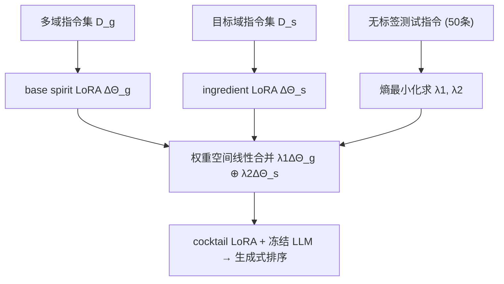
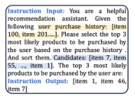

# RecCocktail: A Generalizable and Efficient Framework for LLM-Based Recommendation (RecCocktail：面向 LLM 推荐的通用高效框架)

- **会议/期刊**: AAAI 2026
- **作者与机构**: Min Hou, Chenxi Bai, Le Wu, Hao Liu 等（合肥工业大学、中国科学技术大学、上海交通大学、快手）
- **推荐链路定位**: 生成式端到端（LLM 指令微调 + 文本候选重排）
- **研究方向**: 大语言模型推荐（LLM4Rec）/ 冷启动与长尾推荐
- **论文原文**: [https://arxiv.org/abs/2502.08271v2](https://arxiv.org/abs/2502.08271v2)
- **开源代码**: [https://anonymous.4open.science/r/RecCocktail](https://anonymous.4open.science/r/RecCocktail)（匿名仓库，评审期链接）

## TL;DR (1分钟核心速览)

现有 LLM 推荐分两派：**广度派**（多域指令数据换取泛化，冷启动可用但域内精度低）与**深度派**（域内协同/指令精调，热启动强但对新物品与分布偏移脆弱）。RecCocktail 把两者分别训成一个 LoRA（"base spirit"与"ingredient"），在**权重空间**做一次线性合并，并用**测试时熵最小化**自动求解合并系数。在 Amazon Beauty/Toys/Sports 与 ML-1M 上，采样 1:29 排序协议下热启动 NDCG@1 相对最优基线提升 4.7%–23.4%，新物品冷启动提升最高 31.6%，而推理期**不增加任何参数与延迟**。

## Background & Motivation (背景与核心矛盾)

- **主流范式**: 广度派聚合多域/多任务指令数据（P5、RecFormer）以注入推荐世界知识；深度派用 LoRA 对齐域内行为（TALLRec、iLoRA、AlphaRec）以提升域内精度。
- **前人局限**: 广度派在具体域内欠拟合，"什么都懂一点但都不精"；深度派高度依赖协同 ID 信号，新物品/新域出现时性能塌陷。两类方法各自只占一个极点。
- **核心洞察 (Key Insight)**: 两个 LoRA 本质是同一预训练权重空间中的**任务向量** $\Delta\Theta=\Theta_{ft}-\Theta_{pre}$，而同源微调模型落在同一 error basin（Neyshabur et al. 2020），因此方向可加——合并权重即可同时保留"通用推荐感"与"域内风味"，且合并后参数量仍等于单个 LoRA。
- **本文切入点**: 用"调酒"隐喻把知识融合从**输出空间（集成，慢且语义易冲突）**与**数据空间（二轮微调，易灾难遗忘）**搬到**参数空间**，再加一个无标签熵引导定权器。

## Method (核心方法设计)

### 1. 整体框架 (Overall Architecture)

先用 Amazon 七个电商域（电影场景用 ML-10M）构造通用推荐指令集 $D_g$，LoRA 精调得到域通用 "base spirit"$\Delta\Theta_g$；再针对目标域（Beauty/Toys/Sports/ML-1M）数据$D_s$训练域专属 "ingredient"$\Delta\Theta_s$。测试前取 50–100 条无标签测试指令，对合并系数$(\lambda_1,\lambda_2)$ 做熵最小化，得到单一 "cocktail" LoRA 挂载到冻结 LLM 上做自回归候选排序。base spirit 只训一次，新域仅需一个轻量 ingredient，即插即用。

<figure class="paper-figure" markdown="span">
  <figcaption>图2：我们提出的 RecCocktail 框架示意图。</figcaption>
</figure>

### 2. 关键设计拆解 (Key Designs)

1. **LoRA Cocktail 权重合并**：传统集成需要多次前向、二轮微调会灾难遗忘。本文直接对每层低秩矩阵做逐元素凸组合：$\Delta\Theta_m=(\lambda_1\Delta\Theta_g)\oplus(\lambda_2\Delta\Theta_s)$，即$A^l_m=\lambda_1A^l_g+\lambda_2A^l_s$、$B^l_m=\lambda_1B^l_g+\lambda_2B^l_s$，约束$\lambda_1+\lambda_2=1$。其物理直觉是沿两个任务方向同时平移权重，既不放大参数规模（仍为 rank-$r$ 单 LoRA），也不引入推理开销。
2. **熵引导自适应定权**：验证集网格搜索既缺准则，又在测试分布漂移时失效。作者固定权重、只学两个标量，最小化无标签测试样本的预测熵：$\min_{\lambda_1,\lambda_2}\sum_{x_i\in D_t}H\!\left(F_{\Theta_{C}}(x_i)\right)$，其中$\Theta_{C}=\Theta_{pre}+(\lambda_1\Delta\Theta_g)\oplus(\lambda_2\Delta\Theta_s)$；因指令输出是候选标题，只需对**前 3 个 token** 求平均熵即可稳定收敛，50 条样本足够。
3. **训练目标与开销**：两个 LoRA 均用标准自回归负对数似然 $\max_{\Delta\Theta}\sum_{(x,y)\in D}\sum_{t}\log P_{\Theta_{pre}+\Delta\Theta}(y^t\mid y^{<t},x)$，候选集为 1 正 + 随机负样本（无难负采样设计）。推理时合并后只保留单 LoRA，显存/时延与 TALLRec 同级。

## Experimental Setup & Evaluation Protocol (实验设置与评估协议)

- **数据集与预处理**: 商品以标题文本表征；严格剔除通用域与目标域的重叠样本防泄漏。

| 数据集 | 规模/角色 | 过滤与说明 |
| :--- | :---: | :--- |
| Amazon ×7 域 | 通用域指令集 | 构造 base spirit，跨品类电商行为 |
| Beauty / Toys / Sports | 目标域（5-core） | 热启动 + 新物品冷启动双设定 |
| MovieLens-10M / 1M | 通用域 / 目标域 | 电影场景复现，跨域规模差异大 |

- **数据划分与防穿越 (Splitting Strategy)**: 采用 `Leave-One-Out`——最后一条交互为测试、倒数第二条为验证、其余训练；**新物品设定**保持训练/验证不变，仅把测试集 ground-truth 替换为训练与验证中从未出现的物品（O.O.D 冷启动）。
- **排名评测协议 (Ranking Protocol)**: `Sampled Ranking`，每用户候选集为 1 正 + 29 随机未交互负样本，指标 NDCG@1 / NDCG@3，$t$-test$p<0.05$。
- **对比基线与超参**: 传统序列（BPR-MF、GRU4Rec、SASRec、FMLP-Rec）、可迁移（UniSRec、VQ-Rec）、LLM 系（Qwen2-7B zero-shot、RecFormer、P5、TALLRec、AlphaRec）；基座 Qwen2-7B-Instruct，LoRA 低秩适配。

## Key Experimental Results (实验关键数据)

### 1. 主实验对比 (Main Results)

热启动 I.I.D（NDCG@1 / 部分 @3，粗体为最优，下划线为次优）：

| 方法 | Beauty N@1 | Beauty N@3 | Toys N@1 | Sports N@1 | ML-1M N@1 | ML-1M N@3 |
| :--- | :---: | :---: | :---: | :---: | :---: | :---: |
| SASRec | 0.2410 | 0.3284 | 0.2223 | 0.1957 | 0.2257 | 0.4708 |
| FMLP-Rec | 0.2988 | 0.4000 | 0.2994 | 0.2645 | 0.2410 | 0.5515 |
| UniSRec | 0.2654 | 0.4089 | 0.2612 | 0.2341 | 0.2615 | 0.5594 |
| VQ-Rec | 0.2714 | 0.4157 | 0.2715 | 0.2476 | 0.2805 | 0.5745 |
| P5 | 0.1775 | 0.2482 | 0.1171 | 0.1860 | 0.2046 | 0.2947 |
| TALLRec | 0.3347 | 0.3593 | **0.3746**\* | 0.3585 | 0.5392 | 0.5661 |
| AlphaRec | 0.2489 | 0.3456 | 0.2264 | 0.2418 | 0.2318 | 0.3661 |
| **RecCocktail** | **0.4132** | **0.4350** | 0.4097 | **0.3754** | **0.5783** | **0.6023** |
| Improv. | +23.4% | +4.6% | +9.4% | +4.7% | +7.3% | +4.8% |

新物品冷启动 O.O.D（NDCG@1）：

| 方法 | Beauty | Toys | Sports | ML-1M |
| :--- | :---: | :---: | :---: | :---: |
| SASRec | 0.0656 | 0.0670 | 0.0547 | 0.0912 |
| FMLP-Rec | 0.0587 | 0.0537 | 0.0545 | 0.1145 |
| VQ-Rec | 0.1189 | 0.0957 | 0.0985 | 0.1025 |
| RecFormer | 0.1051 | 0.0913 | 0.0922 | 0.1108 |
| TALLRec | 0.1480 | **0.1624** | 0.1251 | 0.1458 |
| AlphaRec | 0.0588 | 0.0553 | 0.0565 | 0.0923 |
| **RecCocktail** | **0.1825** | 0.1614 | **0.1646** | **0.1818** |
| Improv. | +23.3% | −0.6% | +31.6% | +24.7% |

### 2. 消融实验 (Ablation Study)

| 变体 | Beauty 热 N@1 | Beauty 冷 N@1 | ML-1M 热 N@1 | ML-1M 冷 N@1 |
| :--- | :---: | :---: | :---: | :---: |
| RecCocktail-G（仅 base spirit，域零样本） | 0.3081 | 0.1746 | 0.5680 | 0.1455 |
| RecCocktail-S（仅 ingredient） | 0.4079 | 0.1603 | 0.5460 | 0.1636 |
| RecCocktail-WA（固定 0.5/0.5 平均） | 0.3722 | 0.1766 | 0.5738 | 0.1636 |
| **RecCocktail（熵引导合并）** | **0.4132** | **0.1825** | **0.5783** | **0.1818** |

### 3. 关键实验发现 (Key Findings)

1. **互补性可量化**：仅 ingredient 在 Beauty 热启动得 0.4079，仅 base spirit 在冷启动得 0.1746，均优于对方在另一场景的表现；合并后两端同时最优（0.4132 / 0.1825），说明"域内精度"与"O.O.D 泛化"确实分居两个任务向量方向。
2. **定权比合并本身更关键**：简单平均 WA 在 Beauty 热启动仅 0.3722，反而低于单 ingredient（0.4079），即发生负迁移；熵引导把 $\lambda_2$推到 0.65/0.66/0.58（Beauty/Toys/Sports 热启动），冷启动则把$\lambda_1$ 提高至约 0.51，恰好匹配"热启动靠域、冷启动靠通用"的直觉。
3. **少样本与灾难遗忘**：ML-1M 仅 10% 训练样本时，二轮微调因破坏指令格式几乎输出崩溃（0.0704 / 冷启动 0.0000），TALLRec 为 0.3957 / 0.1091，RecCocktail 仍达 0.5353 / 0.1455——权重相加比数据叠加更稳健。

## Highlights & Limitations (亮点、对比与审稿批判)

- **与代表作对比 (vs. Prior Work)**: 相较 P5/RecFormer 的"数据空间广度扩展"，本文在**参数空间**融合，可在零样本域直接用 base spirit；相较 TALLRec/iLoRA 的纯域内对齐，本文以固定成本换回冷启动鲁棒性，且推理仍是单 LoRA，工程上更轻。
- **可迁移亮点**: ① 把"标量定权 + 少量无标签样本熵最小化"用于任意多 LoRA/多专家合并，可移植到多场景（跨业务）模型融合；② 用前 3 个 token 熵近似句子级不确定性，是对生成式推荐做测试时自适应的廉价技巧。
- **审稿级局限批判**: ① 评测采用 **1:29 采样排序**而非全库 Full-Ranking，LLM 对 29 个随机负样本的区分难度偏低，增益可能被高估，且论文"所有场景一致最优"的表述与 Toys 冷启动 NDCG@1/@3（0.1614/0.1821）略低于 TALLRec（0.1624/0.1831）不符；② 熵引导需在测试阶段对每个域重跑若干次前向求 $\lambda$，属 transductive 设定，真实线上（流式、无 batch 测试样本、分布持续漂移）如何稳定估计未讨论；③ 仅验证 Amazon 与 MovieLens 两个域族，候选文本只用 title，未触及特征更丰富的短视频/广告场景。

## Rating (四维评分)

- **方法创新性 (Novelty)**: ⭐⭐⭐⭐ （把 task-vector 算术系统化引入 LLM 推荐并用熵引导定权，机制简洁自洽，但"权重线性合并"本身并非首创）
- **评估协议与实验扎实度 (Protocol & Experiments)**: ⭐⭐⭐ （热/冷双设定 + 少样本 + 系数可视化较完整，但仅采样排序、无全库排序与大模型显著性多轮复现）
- **写作与数学规范度 (Clarity & Rigor)**: ⭐⭐⭐⭐ （调酒隐喻与公式对应清晰，合并算子与熵目标定义严谨，缺少复杂度/收敛性形式化分析）
- **工业落地与复现价值 (Industrial & Practical Value)**: ⭐⭐⭐⭐ （base spirit 训一次 + 单 LoRA 推理零额外开销，插件式扩域极契合多业务线，但依赖 7B 级 LLM 的在线推理成本仍需量化）

