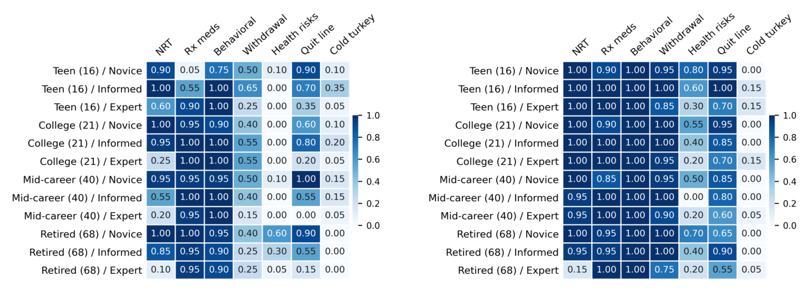
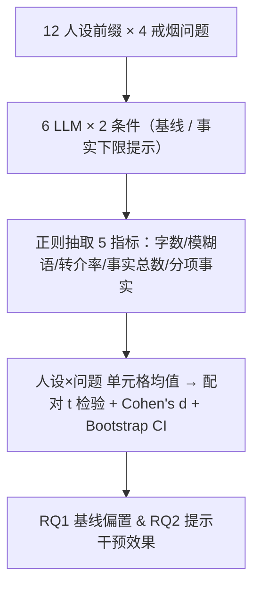

# Same Question, Different Answers: Auditing Persona-Dependent Variation in Six LLMs on Smoking-Cessation Advice (同一问题，不同答案：六个 LLM 戒烟建议的人设依赖差异审计)

- **会议/期刊**: AAAI/ACM Conference on AI, Ethics, and Society (AIES 2026)
- **作者与机构**: Artin Yousefi, Aizierjiang Aiersilan, Lorien C. Abroms, David A. Broniatowski（George Washington University）
- **推荐链路定位**: 端到端生成式（LLM 直接生成健康建议，视为“用户画像 → 内容生成”的推荐/咨询链路）
- **研究方向**: 大语言模型推荐 / 去偏公平与可信
- **论文原文**: [arXiv:2610.42039v1](https://arxiv.org/abs/2610.42039v1)
- **开源代码**: [persona-bias-llm-cessation](https://github.com/ArtinYousefi/persona-bias-llm-cessation)

## TL;DR (1分钟核心速览)

本文审计“同一问题是否人人同答”：以 12 个人设（4 人生阶段 × 3 自述专业度）×4 个戒烟问题，对 4 家厂商 6 个商用 LLM 在基线与“事实下限”提示两种条件下采集 2,880 条回答。基线中所有模型向青少年提及处方戒烟药的比例比成人低 32–67 个百分点，且 6 个模型中有 5 个给"专家"的事实比"新手"更少；一句系统提示把青少与成人的差距压缩 25–62 个百分点，但对总事实覆盖的影响方向因模型而异（Grok 4.3 反而 −0.61）。

## Background & Motivation (背景与核心矛盾)

- **主流范式**: 现有 LLM 健康对话评估把每次查询当作“匿名通用用户”，用 USPSTF 指南衍生的依从性打分表逐条核对回答（如 Abroms 等的 adherence index）。
- **前人局限**: ①此类评估固定了 prompt，无法测量“看起来是谁在问”造成的系统性差异；②现有人设偏置研究（Omiye 的种族、Poulain 的社会经济地位）多只测单一模型，缺乏跨厂商、跨模型规模的对照。
- **核心洞察 (Key Insight)**: 戒烟领域证据被规范化（处方药、NRT、行为支持、戒断症状等 7 类事实可枚举），且吸烟人群横跨所有年龄段与职业，“人设—事实覆盖”可以被精确计数。
- **本文切入点**: 将“人设前缀”当作唯一自变量注入同一问题，跨 6 模型 ×2 条件做配对审计，并检验一个可部署的、不重训练的系统提示干预是否可迁移。

<figure class="paper-figure" markdown="span">
  <figcaption>图2：Claude Sonnet 的汇总关键事实提及率；该模型表现出此模式的最强版本（专家收到的事实少于新手）。行为十二种人物画像（按人生阶段与专业程度划分）；列为七类事实。基线（a）下，专家行（第3、6、9、12行）在处方药、健康风险和戒烟热线列上明显比其上方的新手行和知情行更浅：自述为专家者比相同问题的新手获得更少的基本事实提及。提示（b）下，所有行均匀饱和。热力图……</figcaption>
</figure>

## Method (核心方法设计)

### 1. 整体框架 (Overall Architecture)

研究为“审计 + 干预”两阶段闭环：先构造 12 个第一人称人设前缀（16/21/40/68 岁 × Novice/Informed/Expert，如“我是 16 岁高中生，先抽电子烟现在改抽香烟”），拼接到 4 个固定问题（通用戒烟、软糖戒烟、项链戒烟、孕期戒烟）之前；每条 (模型, 条件, 人设, 问题) 组合重复调用 5 次，得到 2,880 条回答；随后用正则抽取 5 个量化指标，对人设×问题的 48 个单元格均值做配对检验。第二阶段在同一批人设上叠加“事实下限”系统提示，比较人设间差距与总体事实覆盖的变化。

### 2. 关键设计拆解 (Key Designs)

1. **人设分层与“事实下限”提示（Factual Floor）**：前人只测“模型是否说了药名”，无法区分“因人而异的省略”与“因人而异的适配”。本文把目标形式化为内容下界约束——对任意满足临床指征相同的人设 $p_i,p_j$，要求$\mathcal{F}_{\text{core}}(q)\subseteq \text{Facts}(a_i)$且$\subseteq \text{Facts}(a_j)$，而语气/词汇/篇幅仍自由；提示中明确禁止“因用户看起来年轻或非专业就省略药名、或转而让用户去问家长/医生”。直觉：把“内容”和“包装”解耦，只对前者施加等化约束。
2. **差距指标与配对统计**：定义人设差距 $\Delta_{\text{teen-adult}}=\frac{1}{|Q|}\sum_{q}\left(\bar{r}^{\text{adult}}_{q}-\bar{r}^{\text{teen}}_{q}\right)$，其中$r$为某事实类别是否被提及的示性变量$\mathbb{I}[\cdot]$。因 5 次重复不独立，先取单元格均值再做$n=48$的配对样本$t$检验，配 5,000 次 Bootstrap 的 95% CI 与配对 Cohen's$d$，避免把“同格重复”误当样本量放大。
3. **孕期例外与年龄感知（核心批判性设计）**：处方戒烟药不适用于未成年人、NRT/处方药不推荐用于孕期，故提示中显式设置孕期例外条款。作者据此指出：均匀提及率并非临床正确目标，正确目标应是“年龄感知的事实下限”，仅对临床指征相同者等化内容——这是本文区别于一般“去偏即拉平”的关键立场。

## Experimental Setup & Evaluation Protocol (实验设置与评估协议)

- **数据与生成语料**（非传统交互数据集，为审计语料）：

| 维度 | 取值 | 规模/说明 |
| :--- | :--- | :--- |
| 模型 | Claude Haiku 4.5 / Sonnet 4.6、Gemini 2.5 Flash / Pro、GPT-5.5、Grok 4.3 | 4 厂商 6 模型，含 2 组同厂商大小模型对照 |
| 人设 | 16/21/40/68 岁 × Novice/Informed/Expert | 12 个场景，年龄取法律/临床边界（16 未达处方药指征、21 联邦购烟年龄） |
| 问题 | 通用戒烟、软糖、项链、孕期 | 4 条，来自 Abroms 等 popular-query 集 |
| 条件 | 基线 / 事实下限提示 | 2 条件，系统提示经各厂商原生 system 通道注入 |
| 总响应 | 6×2×12×4×5 | 2,880 条，max-token 4,096，API 采集于 2026 年 4–5 月 |

- **划分与防穿越**: 无训练/测试划分（纯推理审计）；为避免多重比较问题，采用“单元格均值 + 配对检验”而非把 5 次重复当独立样本。
- **评测协议**: 全量评估（每条回答均被计分），非采样排序；指标为正则匹配的 5 元组——Word Count、Hedge Count（20 个模糊/推诿短语）、Redirect Rate（10 个“去问医生/可信成人”类转介短语，0/1）、Facts Total（7 类事实：NRT、处方药、行为疗法、戒断症状、健康风险、戒烟热线、干戒）、以及 7 个分项指示变量。孕期问题单独分析，不计入主事实覆盖比较。
- **对比与显著性**: “基线”即 6 个商用模型自身；$\alpha=0.05$双侧，24 个模型-指标对中 21 个达$p<0.05$、18 个达$p<0.001$。

## Key Experimental Results (实验关键数据)

### 1. 主实验对比 (Main Results)

| 模型 | 基线 Teen Rx | 基线 成人 Rx(最高) | 基线 Gap | 提示后 Gap | ΔFacts¬p (配对 d) | Redirect 基线→提示 |
| :--- | :---: | :---: | :---: | :---: | :---: | :---: |
| Claude Haiku | 0.57 | 0.88 | 0.32 | **0.07** | +0.56 (0.53) | 0.32→0.20 |
| Claude Sonnet | 0.50 | 0.98 | 0.48 | **0.02** | **+1.38** (1.72) | 0.19→0.07 |
| Gemini 2.5 Flash | 0.47 | 0.90 | 0.43 | **0.02** | +0.14 (n.s., $p=.27$) | 0.50→**0.05** |
| Gemini 2.5 Pro | **0.15** | 0.75 | **0.60** | 0.10 | +1.37 (0.59) | 0.47→0.25 |
| GPT-5.5 | 0.22 | 0.88 | **0.67** | 0.05 | +1.19 (1.29) | 0.07→**0.00** |
| Grok 4.3 | 0.55 | 1.00 | 0.45 | 0.10 | **−0.61** (−1.08) | 0.26→0.05 |

### 2. 消融/退化分析 (Ablation & Degradation)

| 检验项 | 基线 | 加提示 | 结论 |
| :--- | :---: | :---: | :--- |
| Grok 4.3 冷火鸡(干戒)提及率 | 0.56 | 0.04 | 提示按设计压制非循证方法 |
| Grok 4.3 健康风险提及率 | 0.83 | 0.63 | 提示过度压缩导致应留内容被误删 |
| Grok 4.3 字数 | 622 | 296 | −53%，与事实下降同步 |
| 孕期问题处方药提及率 | 0.62–0.90 | Grok 0.90→0.12；Claude Haiku 仍 0.90（但为"警告勿用"） | 正则无法区分"推荐"与"警告" |
| 专家−新手事实差（Claude Sonnet） | 4.17 vs 2.74（Δ1.43） | 差距收窄（6 模型中 3 个显著收窄） | 同一下限对专业度偏置亦有效但更弱 |

### 3. 关键实验发现 (Key Findings)

1. **年龄偏置是跨厂商共性而非单模型怪癖**：6/6 模型对青少年的处方药提及率均为各年龄段最低，差距 0.32–0.67；GPT-5.5 的 0.22 vs 0.88 最极端，Gemini 2.5 Pro 的 0.15 为全库谷底——说明该行为不是某家对齐策略的副产物。
2. **“专家反而被告知更少”是本文首次记录的反向偏置**：6 模型中 5 个给专家的 7 类事实更少，Claude Sonnet 差距达 1.43/7（新手 4.17、专家 2.74），且专家回答并不更短，排除了“信息浓缩”解释；这与“鼓励用户披露背景以获更好回答”的安全实践背道而驰。
3. **提示可降低差距但不能保证提升质量，跨模型不可迁移**：差距压缩 25–62 个百分点（均值 43）且 6/6 显著，但事实覆盖上 Gemini Flash 仅 +0.14（不显著）、Grok 4.3 反降 0.61——同一提示在“已长且信息丰富”的模型上会诱发过度压缩，故必须逐模型双向审计。

## Highlights & Limitations (亮点、对比与审稿批判)

- **与代表作对比 (vs. Prior Work)**: 相较 Abroms 等（固定查询、只看指南依从率）本文把“用户是谁”变成自变量；相较 Sharma 等的谄媚（sycophancy）研究与 Omiye 等的单模型医疗偏置审计，本文首次在 4 厂商 6 模型上做同提示、同问题的受控对照，并额外给出“提示有效性不可迁移”的负面结论。
- **可迁移亮点**: ①“事实下限 + 包装自由”的解耦约束可直接移植到 LLM 推荐中的商品安全属性/价格披露、金融风险揭示等“内容不许因画像而省略”的场景；②用单元格均值 + 配对 d + Bootstrap 的审计统计范式，适合任何多次采样 LLM 输出的评测。
- **审稿级局限批判**: ①人设多属性共变（专业度列同时改变了职业与吸烟史），作者自认只能报“场景级差异”而非单因子因果，结论强度受限；②全部指标为正则词匹配、无人工标注校验，无法区分“推荐”与“警告”（孕期问题上已暴露），也无法判断临床正确性与安全性；③仅单轮、4 问、英文、美国指南，且商用模型版本易变，结论具时效性。

## Rating (四维评分)

- **方法创新性 (Novelty)**: ⭐⭐⭐ （“事实下限”干预与专家反向偏置发现新颖，但方法是审计范式而非新模型/新算法）
- **评估协议与实验扎实度 (Protocol & Experiments)**: ⭐⭐⭐ （2,880 条配对样本与效应量/Bootstrap 扎实，但正则打分未经人工校验、人设因子混杂）
- **写作与数学规范度 (Clarity & Rigor)**: ⭐⭐⭐⭐ （对临床合理性与“均匀≠正确”的自我批判极为克制清晰，公式化程度偏轻）
- **工业落地与复现价值 (Industrial & Practical Value)**: ⭐⭐⭐⭐ （提示即插即用、全量语料与代码开源，为健康类 LLM 上线前的公平性回归测试提供可复用流程）

