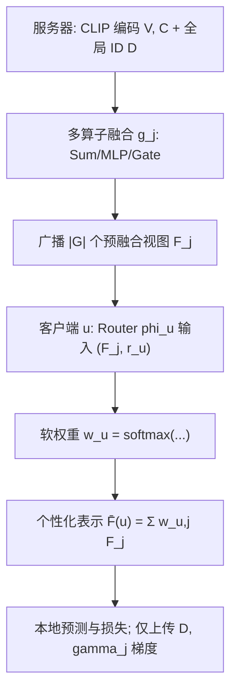
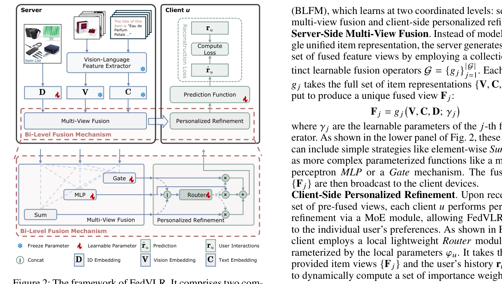

# Federated Vision-Language-Recommendation with Personalized Fusion (面向端侧个性化的联邦视觉-语言推荐)

- **会议/期刊**: AAAI 2026
- **作者与机构**: Zhiwei Li, Guodong Long, Jing Jiang (UTS); Chengqi Zhang, Qiang Yang (PolyU)
- **推荐链路定位**: 召回 / 端侧个性化推理
- **研究方向**: 多模态推荐与内容理解 / 联邦隐私与工业架构
- **论文原文**: [论文原文链接](https://arxiv.org/abs/2410.08478v4)
- **开源代码**: [开源代码仓库链接](https://github.com/mtics/FedVLR)

## TL;DR (1分钟核心速览)

联邦场景下引入视觉-语言（VLR）推荐时，现有方法对全体用户施加**统一模态融合逻辑**，忽略了“不同用户看重海报/文案/协同信号的程度不同”这一**偏好异质性**。本文提出 FedVLR 双层融合机制（BLFM）：服务器用 Sum/MLP/Gate 等多种算子预生成多样视图以卸载重算力，客户端仅凭本地交互历史训练轻量 MoE 路由做**逐用户视图加权**。在 7 个数据集上按 Leave-One-Out + 全排序 HR@50/NDCG@50 评估，FedVLR 使 FedRAP 在 Beauty 上 HR 提升 61.6%，在 Movie 上 NDCG 提升 46.3%，并在小数据集上反超集中式 VLR。

## Background & Motivation (背景与核心矛盾)

- **主流范式**: 中心化 VLR 先由 CLIP 抽取图文语义，再用单一融合模块得到物品统一表示；端侧联邦推荐则以 ID 嵌入为主，仅少数工作引入多模态但仍是全局共享融合层。
- **前人局限**: (1) 纯 ID 的联邦方法（FCF/PFedRec）无法利用内容，对冷物品无解；(2) 已有联邦多模态方案（AMMFRS/FedMMR）在所有客户端上复用**同一融合算子**，无法表达“用户 A 看海报、用户 B 读简介”的差异。
- **核心洞察 (Key Insight)**: 用户在 KU 上的模态偏好差异随活跃度上升而放大（图 3b/3c）；且消融显示**不存在普适的模态重要性层级**——不同骨干对 V/C/D 缺失的敏感度截然不同，说明最优融合权重既随架构变、也随人变。
- **本文切入点**: 把融合解耦为“服务器造视图 + 客户端学权重”两级，将个性化下沉到设备本地而不泄露原始交互。

## Method (核心方法设计)

### 1. 整体框架 (Overall Architecture)

服务器一次性用冻结 CLIP 编码 $V=h(E_v),C=h(E_c)$，与全局可学 ID 嵌入$D$组成三视图输入；一组可学习融合算子$\{g_j\}$并行生成$|\mathcal{G}|$个预融合视图并广播。每个客户端接收全部视图后，用本地路由器$\phi_u$依据自己的交互向量$r_u$输出视图权重并加权融合，再送入本地预测函数$\hat{r}_{ui}=f(\bar{F}^{(u)}_i;\theta_u)$计算重构损失。仅$\{D,\{\gamma_j\}\}$上传聚合，$\theta_u,\varphi_u$ 永不出端，形成“服务器学造视图、客户端学用视图”的协同闭环。

<figure class="paper-figure" markdown="span">
  <figcaption>图2：FedVLR框架由两部分组成：(1) 服务器端多视图融合，从视觉-语言内容生成多样化的预融合特征视图；(2) 客户端个性化细化，基于用户私有交互历史动态组合这些视图，以用于端侧VLR。</figcaption>
</figure>

### 2. 关键设计拆解 (Key Designs)

1. **服务器端多视图融合（Multi-View Fusion）**：痛点在于单一融合算子表达力有限，且大模型推理不能落在端侧。服务器用异构算子集合 $\mathcal{G}=\{\text{Sum},\text{MLP},\text{Gate},\dots\}$为每个算子学一组参数$\gamma_j$，输出多样视图：
$$F_j=g_j(V,C,D;\gamma_j),\quad j=1,\dots,|\mathcal{G}|$$
直觉：不同算子代表不同的“模态权衡假设”，把假设空间并行铺开，交给用户端挑选，比让单个 MLP 硬学所有用户折中更省参数。

2. **客户端 MoE 个性化精炼（Personalized Refinement）**：痛点在于偏好异质性无法用统一权重刻画。路由器以本地历史为 query 对视图打分，再软加权：
$$w_u=\mathrm{softmax}\big(\phi_u(\{F_j\}_{j=1}^{|\mathcal{G}|},r_u;\varphi_u)\big),\qquad \bar{F}^{(u)}=\sum_{j=1}^{|\mathcal{G}|}w_{u,j}F_j$$
直觉：$r_u$ 是用户行为的“指纹”，让路由权重成为其私有偏好的函数，等价于在客户端做一次轻量的专家选择，天然规避了全局共享融合层的折中损失。

3. **训练目标、通信与推理开销**：整体优化为带梯度有界假设的联邦重构问题
$$\min_{\Theta}\ J(\Theta)=\sum_{u\in\mathcal{U}}\alpha_u J_u(\Theta),\ \text{s.t.}\ \mathbb{E}\|\nabla J_u-\nabla J\|^2\le\zeta^2$$
客户端每轮本地 $A=5$步，仅回传$D$与$\{\gamma_j\}$的累积梯度；训练采用负采样 + Leave-One-Out 预测，测试阶段对全库未交互物品排序。服务器单轮生成视图复杂度$O(|\mathcal{G}||\mathcal{I}|d)$，客户端临时存储$O(|\mathcal{G}||\mathcal{I}|d+K)$。作者证明收敛率为$O(1/\sqrt{T})+O(A/T)+O(\zeta^2/n_s)$，与标准非凸 FL 同阶，说明双层结构未破坏收敛性。

## Experimental Setup & Evaluation Protocol (实验设置与评估协议)

- **数据集与预处理**: 7 个跨域数据集，均做 5-core 过滤；缺失图像用已有物品视觉均值填补，缺失标题填占位符。

| 数据集 | #Users | #Items | #Interactions | 稀疏度 | 特征/场景说明 |
| :--- | :---: | :---: | :---: | :---: | :--- |
| Beauty | 253 | 356 | 2,535 | 97.19% | 亚马逊美妆 |
| Cards | 377 | 129 | 2,429 | 95.01% | 亚马逊礼品卡 |
| ML | 610 | 3,650 | 90,274 | 95.95% | 电影 |
| KU | 204 | 560 | 3,488 | 96.95% | B站短视频 |
| Dance | 10,231 | 1,676 | 80,086 | 99.53% | B站舞蹈 |
| Food | 5,990 | 1,125 | 36,482 | 99.46% | B站美食 |
| Movie | 15,908 | 2,528 | 111,091 | 99.72% | B站影视 |

- **数据划分与防穿越 (Splitting Strategy)**: `Leave-One-Out`——每个用户最后一条交互作测试、倒数第二条作验证，其余训练；无时间戳全局切分。
- **排名评测协议 (Ranking Protocol)**: 无偏 `Full-Ranking`，即对全库未交互物品打分排序，评估 HR@50 与 NDCG@50；训练阶段用负采样构造负例。
- **对比基线与超参设置**: 集中式 VBPR/BM3/MGCN/PGL 作性能上界参照；联邦式 FedAvg/FCF/FedNCF/PFedRec/FedRAP 作骨干，各配 `+ours` / `+MLP` / `+VBPR` 三种融合变体。CLIP ViT-B-32 (OpenCLIP) 抽特征，线性投影至 $d=64$，batch=2048，三层 MLP，网格搜索$\eta\in\{10^{-4},\dots,10^{-1}\}$。

## Key Experimental Results (实验关键数据)

### 1. 主实验对比 (Main Results)

以 FedRAP 为主骨干的 HR@50 / NDCG@50 (%), 最优联邦结果加粗：

| 方法 | Beauty | Cards | KU | Food | Movie |
| :--- | :---: | :---: | :---: | :---: | :---: |
| FedAvg | 17.00 / 3.82 | 64.19 / 23.20 | 11.27 / 5.62 | 6.96 / 1.91 | 5.52 / 1.58 |
| FCF | 28.46 / 8.87 | 69.50 / 25.16 | 22.55 / 6.43 | 8.20 / 2.19 | 5.81 / 1.63 |
| FedNCF | 17.79 / 4.32 | 42.71 / 11.13 | 11.76 / 2.49 | 5.48 / 1.63 | 1.85 / 0.54 |
| PFedRec | 17.79 / 4.56 | 32.63 / 8.67 | 6.37 / 2.30 | 3.27 / 0.93 | 1.70 / 0.42 |
| FedRAP | 23.72 / 9.18 | 62.60 / 22.29 | 47.06 / 10.86 | 6.96 / 1.91 | 4.53 / 1.36 |
| **FedAvg + ours** | 19.37 / 5.51 | 70.29 / 27.60 | **54.90 / 16.04** | 9.48 / 2.68 | 5.64 / 1.60 |
| **FCF + ours** | 37.15 / 12.04 | 72.68 / 28.51 | 55.39 / 15.97 | 9.18 / 2.47 | **6.67 / 1.80** |
| **FedRAP + ours** | **38.34 / 11.39** | **73.74 / 28.76** | 48.24 / 13.05 | **11.42 / 2.94** | 5.86 / 1.99 |

相对 FedRAP 原始版本的提升：Beauty HR **+61.6%**、NDCG +24.1%；Cards HR +17.8%；Food HR +64.1%、NDCG +53.9%；Movie NDCG **+46.3%**。

### 2. 消融实验 (Ablation Study)

**(a) 模态移除（KU, HR@50 下降率）** 与 **(b) 融合策略（KU, HR@50）**：

| 骨干 | w/o V | w/o C | w/o D | Sum | MLP | Gate | Ours |
| :--- | :---: | :---: | :---: | :---: | :---: | :---: | :---: |
| FedAvg | 20.94%↓ | 27.63%↓ | 1.03%↓ | 18.14 | 36.27 | 51.39 | **51.47** |
| FCF | 48.67%↓ | 23.89%↓ | 57.52%↓ | 22.55 | 50.98 | 27.94 | **55.39** |
| FedRAP | 30.78%↓ | 15.40%↓ | 51.29%↓ | 23.53 | 33.33 | 23.04 | **38.24** |

客户参数量上，`+ours` 仅比 `+MLP` 高约 2–12%（如 FedRAP: 659K vs 647K），而 naive `+VBPR` 在 Dance/Movie 上直接 OOM。

### 3. 关键实验发现 (Key Findings)

- **模态重要性无普适层级，且随骨干翻转**：FedAvg 移除 ID 几乎无损（-1.03%）、移除文本损失 27.63%；而 FCF 移除 ID 却暴跌 57.52%。这直接证伪了“全局统一融合”的合理性——最优融合权重不仅因人而异，还因架构而异。
- **增益来自结构而非参数量**：`+MLP` 与 `+ours` 参数规模相当，但后者在 Cards/KU/Food 上 HR 分别领先 2.4/7.3/2.7 个点，说明 BLFM 的路由机制本身贡献了主要收益；而最简单的 Sum 融合几乎全线垫底（如 FCF 上 22.55 vs 55.39）。
- **小数据反而是联邦的甜区**：在 Beauty/KU 这类全局协同信号稀疏的数据集，FedVLR 反超集中式 PGL（KU: 54.90 vs 46.57 HR）；随数据规模增大（Dance/Movie）集中式凭全局高阶协同追回优势，但 FedVLR 仍持续缩小差距。加高斯噪声后 FedRAP HR 仅降 2.59%，隐私-效用折损可接受。

## Highlights & Limitations (亮点、对比与审稿批判)

- **与代表作对比 (vs. Prior Work)**: 相较 FedRAP 的两向加性个性化，本文把个性化从“参数分解”推进到“**融合权重**”层面；相较 FedMMR/AMMFRS 的全局统一多模态融合，本文用 MoE 路由实现逐用户视图选择，且不增加实质通信开销；相较集中式 BM3/MGCN 依赖全量交互矩阵，本文在端侧隔离数据下仍能逼近甚至局部反超。
- **可迁移亮点**: (1) “服务器造多假设视图 + 客户端软路由”的解耦范式可平移到任何端侧多源特征融合场景（多场景特征、多行为序列）；(2) 用路由器权重做可解释的模态偏好画像，可支持推荐理由生成。
- **审稿级局限批判**: (1) 视图数量 $|\mathcal{G}|$与客户端存储/传输量线性相关，论文未给出$|\mathcal{G}|$的敏感性曲线，也未讨论视图广播的带宽成本；(2) 评测仅用 HR/NDCG@50 的 Leave-One-Out，缺少更严格的时序切分与冷启动物品分桶，且 FedAvg+ours 在 KU 上反超 FedRAP+ours 的异常未做解释；(3) 差分隐私仅做了噪声注入的经验评估，缺少形式化隐私预算$(\epsilon,\delta)$ 分析。

## Rating (四维评分)

- **方法创新性 (Novelty)**: ⭐⭐⭐⭐ （双层解耦 + MoE 视图路由在联邦 VLR 中属首次形式化，收敛性证明补足了理论缺口）
- **评估协议与实验扎实度 (Protocol & Experiments)**: ⭐⭐⭐⭐ （7 数据集跨 3 域、全排序协议、参数效率与隐私噪声消融齐全，但划分方式偏单一）
- **写作与数学规范度 (Clarity & Rigor)**: ⭐⭐⭐⭐ （公式简洁、复杂度与收敛分析完整，附录推导清晰；主表与消融表数字存在小幅不一致）
- **工业落地与复现价值 (Industrial & Practical Value)**: ⭐⭐⭐⭐⭐ （代码开源、客户端参数仅增百 K 级、天然兼容 DP，可直接插拔到现有联邦 ID 推荐骨干）

