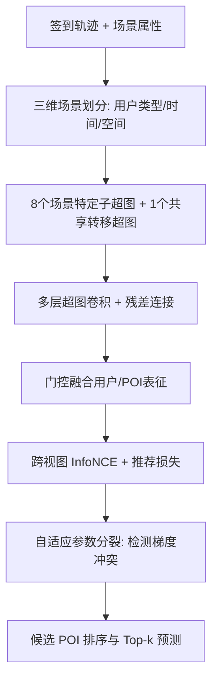
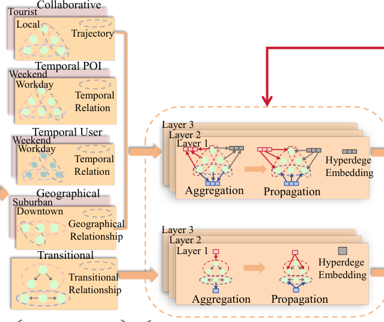
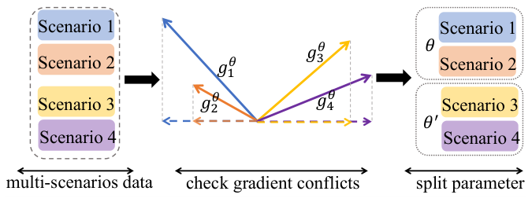

# Multifaceted Scenario-Aware Hypergraph Learning for Next POI Recommendation（面向下一兴趣点推荐的多面向场景感知超图学习）

- **会议/期刊**: AAAI 2026
- **作者与机构**: Yuxi Lin, Yongkang Li, Jie Xing, Zipei Fan；吉林大学人工智能学院、阿姆斯特丹大学信息研究所
- **推荐链路定位**: 精排（Next-POI 场景化排序/预测）
- **研究方向**: 时空轨迹与 POI 本地生活推荐 / 图神经网络与知识图谱推荐
- **论文原文**: [论文原文链接](https://arxiv.org/abs/2601.11610v2)
- **开源代码**: [开源代码仓库链接](https://github.com/COCOMiss/MSAHG)

## TL;DR (1分钟核心速览)

针对 Next-POI 推荐中“本地/游客、工作日/周末、城区/郊区”场景差异被统一模型抹平、跨场景联合训练又产生梯度冲突的问题，MSAHG 构建场景特定多视图子超图，并用自适应参数分裂解耦冲突参数。在 Gowalla/NYC/TKY 按用户 80/20 时间切分、以 Acc@k/MRR 做候选集排序评测，48/90 指标最优、86.7% 指标进入前二，NYC Downtown ACC@1 较 STHGCN 提升 23.9%。

## Background & Motivation (背景与核心矛盾)

- **主流范式**: 序列模型（DeepMove、HST-LSTM）与图/超图模型（GETNext、STHGCN、DCHL）将用户轨迹统一建模，以捕获时空与高阶共现关系。
- **前人局限**: ① 单场景统一假设无法刻画不同上下文下的移动差异；② 多场景数据混合训练时，共享参数在不同场景上梯度方向相反，产生负迁移与场景间干扰。
- **核心洞察 (Key Insight)**: 场景内行为相对一致，跨场景混合会引入噪声；例如游客与本地人在 Hotel/Residence/Transportation 类目上的分布显著不同，郊区与城区 POI 距离分布也明显分化。
- **本文切入点**: 在数据层按场景拆子超图，在参数层按梯度冲突拆共享参数，实现“场景内精建模 + 场景间弱干扰”。

## Method (核心方法设计)

### 1. 整体框架 (Overall Architecture)

MSAHG 先将每条轨迹按用户类型、时间上下文、空间区域划分到复合场景，构建 8 个场景特定子超图与 1 个共享转移超图；随后用多层超图卷积与残差连接得到各视图表征，经门控融合形成用户/POI 嵌入；训练时联合跨视图 InfoNCE 与推荐损失，并周期性检测场景间梯度冲突，对冲突参数执行分裂；推理时融合场景表征，对候选 POI 排序输出 Top-k。

<figure class="paper-figure" markdown="span">
  <figcaption>图 3：Multifaceted Scenario-Aware Hypergraph Learning（MSAHG）的整体框架。用户轨迹被划分为三个场景维度：用户类型、时间上下文和空间区域。基于这些维度和关系模式，构建八个子超图，并通过多层超图卷积处理。参数分裂机制处理冲突的场景信号。最终嵌入通过对比学习获得，并融合用于下一 POI 预测。</figcaption>
</figure>

### 2. 关键设计拆解 (Key Designs)

1. **场景特定多视图解耦子超图**：痛点是将本地/游客、工作日/周末、城区/郊区轨迹混在同一超图中，导致高阶共现被跨场景噪声稀释。MSAHG 为每个场景构造独立子超图，并保留一个全局转移超图共享通用转移模式；卷积采用节点-超边-节点传播与残差，最终节点表征为 \( \mathbf{v}^{final}=\frac{1}{L+1}\sum_{\ell=0}^{L}(\mathbf{v}^{(\ell)}+\mathbf{v}^{(\ell-1)}) \)。这样既保留场景内高阶关系，又缓解深层过平滑。

2. **自适应参数分裂机制**：痛点是同一参数在不同场景上的梯度可能相反，单一共享参数无法同时适配。对参数 \( \theta \)，计算场景 \(i,j\) 的归一化梯度相似度 \( s_{i,j}^{\theta}=\mathbf{g}_i^{\theta\top}\mathbf{g}_j^{\theta} \)；若 \(s_{i,j}^{\theta}<0\)，将 \( \theta \) 复制为 \( \theta' \)，并按梯度相似度把场景分组，各组使用对应参数。该机制只分裂冲突参数而非整体复制，因而在保持共享泛化的同时实现细粒度场景解耦。

<figure class="paper-figure" markdown="span">
  <figcaption>图 4：自适应参数分裂概览。对于每个参数 θ，比较来自不同场景的梯度。当检测到冲突方向时，复制 θ，并将场景分组以分别使用 θ 或新副本 θ′。</figcaption>
</figure>

3. **训练目标、负采样与推理效率**：总损失为 \( \mathcal{L}_{final}=\lambda(\mathcal{L}_{con}^{U}+\mathcal{L}_{con}^{P})+(1-\lambda)\mathcal{L}_{Rec} \)，其中对比损失采用跨视图 InfoNCE、以 batch 内样本作负例，推荐损失在候选 POI 上计算；原文未额外报告显式负采样比例。推理阶段直接融合多视图嵌入并对候选 POI 排序，单 epoch 训练约 10.69s、测试内存约 224.61MB（NYC），显著快于 GETNext 的 408.92s/epoch。

## Experimental Setup & Evaluation Protocol (实验设置与评估协议)

- **数据集与预处理**: 原文未说明 `5-core` 过滤；NYC/TKY 来自 Foursquare 市中心 40km 范围，Gowalla 覆盖加州与内华达。

| 数据集 | #Users | #Items | #Interactions | #Trajectories | 稀疏度/密度 | 特征/场景说明 |
| :--- | :---: | :---: | :---: | :---: | :---: | :--- |
| Gowalla | 3,996 | 9,823 | 238,488 | 24,499 | 0.607% | 本地 3,219 / 游客 777 |
| NYC | 1,743 | 7,289 | 57,327 | 6,102 | 0.451% | 本地 1,146 / 游客 597 |
| TKY | 1,383 | 17,023 | 507,260 | 41,374 | 2.154% | 本地 1,259 / 游客 124 |

- **数据划分与防穿越 (Splitting Strategy)**: 按用户签到时间做 `80%/20%` 时间切分；场景分组仅使用目标签到之前的最后位置与时间戳，避免使用未来信息。
- **排名评测协议 (Ranking Protocol)**: 使用 `Acc@1/5/10/20` 与 `MRR` 在候选 POI 集合上排序；原文未报告采样负例比例，不能严格判定为 Full-Ranking，但评测覆盖各场景候选集。
- **对比基线与超参设置**: 对比 HST-LSTM、DeepMove、GETNext、STHGCN、DCHL 五类 SOTA；嵌入维度 \(d=128\)，超图卷积 3 层，地理阈值 2.5km，\(\lambda=0.1\)，学习率 \(1\times10^{-3}\)，batch 200，100 epochs，early stopping patience 10；参数分裂在 NYC/Gowalla 第 20 epoch、TKY 第 30 epoch 后启用，每 10 个 batch 检查一次，冲突阈值 \(-0.5\)。原文未报告显著性检验。

## Key Experimental Results (实验关键数据)

### 1. 主实验对比 (Main Results)

下表选取 NYC 数据集四个代表性场景，报告 Acc@5 与 MRR：

| Model | Local A@5 | Local MRR | Tourist A@5 | Tourist MRR | Downtown A@5 | Downtown MRR | Suburban A@5 | Suburban MRR |
| :--- | :---: | :---: | :---: | :---: | :---: | :---: | :---: | :---: |
| HST-LSTM | 0.3762 | 0.2809 | 0.2576 | 0.1886 | 0.3731 | 0.2816 | 0.2877 | 0.2107 |
| DeepMove | 0.3311 | 0.2382 | 0.2322 | 0.1722 | 0.3078 | 0.2235 | 0.2660 | 0.1944 |
| GETNext | 0.2970 | 0.2398 | 0.2143 | 0.1519 | 0.2000 | 0.1600 | 0.2774 | 0.2155 |
| STHGCN | 0.3460 | 0.2533 | 0.3899 | 0.2663 | 0.4483 | 0.3360 | 0.3235 | 0.2337 |
| DCHL | 0.3555 | 0.2408 | 0.2111 | 0.1559 | 0.4774 | 0.3205 | 0.2937 | 0.2017 |
| **MSAHG** | **0.5500** | **0.3483** | **0.4868** | **0.3201** | **0.6974** | **0.4666** | **0.4447** | **0.3013** |
| **Improv.%** | +46.2% | +24.0% | +24.9% | +20.2% | +46.1% | +38.9% | +37.5% | +28.9% |

### 2. 消融实验 (Ablation Study)

| Variant (NYC) | ACC@1 | ACC@5 | ACC@10 | ACC@20 | MRR |
| :--- | :---: | :---: | :---: | :---: | :---: |
| w/o parameter splitting | 0.2026 | 0.5270 | 0.6416 | 0.6826 | 0.3392 |
| w/o scenario sub-hypergraph | 0.2164 | 0.5417 | 0.6514 | 0.6965 | 0.3592 |
| **Full Model** | **0.2268** | **0.5605** | **0.6743** | **0.7191** | **0.3721** |

### 3. 关键实验发现 (Key Findings)

- **参数分裂是主要增益源之一**：完整模型相对 `w/o parameter splitting` 的 ACC@5 提升 6.4%、MRR 提升 9.7%，说明仅靠场景子超图仍不足以消除跨场景优化冲突；相对 `w/o sub-hypergraph` 的 MRR 也提升 3.6%，证明数据层拆分与参数层拆分互补。
- **场景建模在异质场景上收益更大**：NYC Tourist 的 ACC@5 较最佳基线 STHGCN 提升 24.9%，Downtown ACC@1 由 STHGCN 的 0.2378 提升到 0.2947（+23.9%），Suburban ACC@1 由 0.1592 提升到 0.1816（+14.1%），说明本地/游客与城区/郊区的差异化行为被有效捕获。
- **预测分布更贴近真实场景分布**：郊区 0–5km 签到真实占比约 85%，MSAHG 预测约 70%，而 DCHL 仅 42%；同时训练效率明显优于深度序列模型（10.69s/epoch vs GETNext 408.92s/epoch），代价是训练内存因梯度相似度缓存升至约 1.29GB。

## Highlights & Limitations (亮点、对比与审稿批判)

- **与代表作对比 (vs. Prior Work)**: 相比 STHGCN 的单一超图与 DCHL 的多视图解耦，MSAHG 首次把“场景”同时落到子超图构建与参数优化上；相比 GETNext 的全局转移图，MSAHG 保留共享转移超图的同时显式拆出场景特定高阶关系。
- **可迁移亮点**: ① 按梯度余弦相似度周期性分裂冲突参数的轻量机制，可迁移到多场景/多任务推荐；② 场景内子图 + 全局共享图的“局部-全局”构图范式，适合 POI、跨域与多业务推荐。
- **审稿级局限批判**: ① 场景标签依赖启发式阈值（住宿签到 5%、市中心 10km、工作日/周末），跨城市迁移与阈值敏感性仍未被充分验证；② 参数分裂带来额外训练内存与冲突检测开销，且推理仍需对候选 POI 排序，POI 规模极大时的在线延迟未评估；原文也缺少显著性检验与线上 A/B。

## Rating (四维评分)

- **方法创新性 (Novelty)**: ⭐⭐⭐⭐ （首次显式形式化多场景 Next-POI，并将场景拆分落到子超图与参数分裂两层，机制清晰但部分组件承接 DCHL/多任务分裂思想）
- **评估协议与实验扎实度 (Protocol & Experiments)**: ⭐⭐⭐⭐ （三个真实 LBSN、六类场景、五个 SOTA、消融与效率对比较完整；但未报告显著性检验，排序协议的全量/采样属性说明不足）
- **写作与数学规范度 (Clarity & Rigor)**: ⭐⭐⭐⭐ （框架图与公式简洁，超图卷积、门控融合、冲突分裂链条清楚；场景阈值与分裂复杂度缺少理论分析）
- **工业落地与复现价值 (Industrial & Practical Value)**: ⭐⭐⭐⭐ （代码开源、训练速度优于主流序列模型，适合场景化 POI 排序；训练内存与启发式场景划分是部署前需解决的实际问题）

