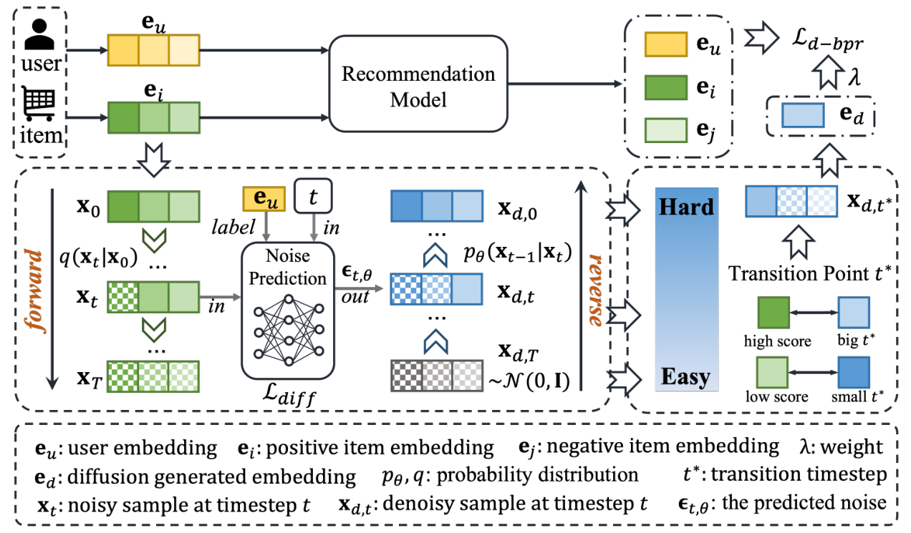
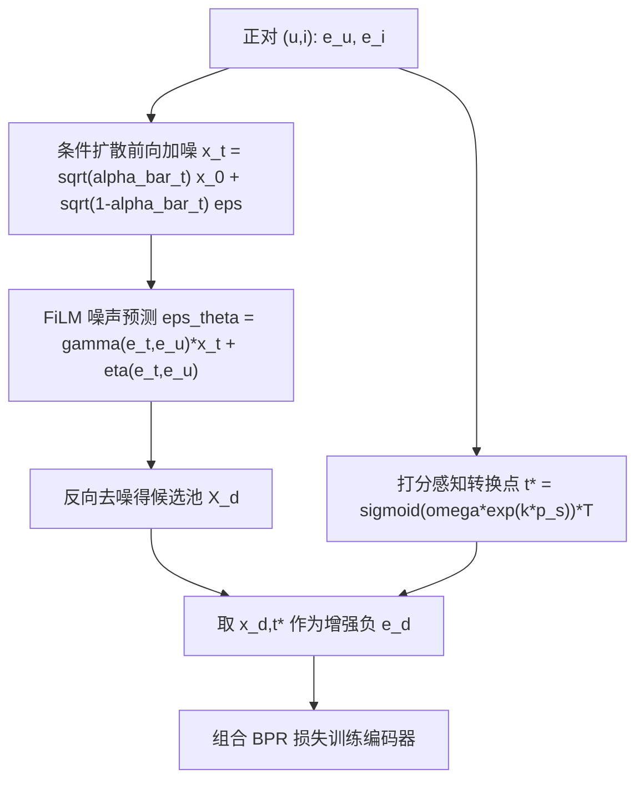

# Adaptive Diffusion-based Augmentation for Recommendation (面向推荐的自适应扩散增强负采样)

- **会议/期刊**: AAAI 2026
- **作者与机构**: Na Li, Fanghui Sun, Yan Zou, Yangfu Zhu, Xiatian Zhu, Ying Ma (哈尔滨工业大学、首都师范大学、萨里大学)
- **推荐链路定位**: 召回（训练阶段的负采样/样本增广，模型无关插件）
- **研究方向**: 自监督对比学习与交互去噪 / 协同过滤与双塔召回
- **论文原文**: [https://arxiv.org/abs/2601.01448v1](https://arxiv.org/abs/2601.01448v1)
- **开源代码**: [https://github.com/LN-Nlaine/ADAR](https://github.com/LN-Nlaine/ADAR)

## TL;DR (1分钟核心速览)

隐式反馈负采样面临两大痛点：未观测物品被误标为负（假阴性）且负样本硬度无法精确调控。本文提出 ADAR：用条件扩散模型的前向加噪过程把正物品嵌入 $e_i$渐进腐蚀为一系列候选负样本，并证明转换点$\bar{\alpha}_{t^*}=(\mu^-/\mu^+)^2$随正样本得分单调后移，再用打分感知函数$t^*=\mathrm{sigmoid}(\omega e^{k p_s})T$自适应取步。作为即插即用模块，在 4 个数据集、7 个 CF/序列基线上 R@10 最高相对提升 68.8%（GRU4Rec/Toys），并以$p<0.05$ 配对 t 检验验证显著性。

## Background & Motivation (背景与核心矛盾)

- **主流范式**: 从全体未交互集合做 Uniform 采样（BPR）、或按打分挑高分的难负样本（MixGCF 的图混合、AHNS 的分级硬度、GNNO 的全局转移）。
- **前人局限**: (i) 难负样本极易撞上真实正反馈，产生**假阴性**噪声，直接扭曲用户偏好分布；(ii) 硬度只能通过“从现有物品池里挑/混”间接实现，无法对正负间隔做**连续、细粒度**控制。
- **核心洞察 (Key Insight)**: 扩散前向加噪本质是“信息身份的连续退化”——正样本 $x_0$随$t$ 增大逐渐失去偏好语义，直到与负样本不可区分；这个**相变点**恰好对应最有价值（贴近决策边界）的难负样本。
- **本文切入点**: 不做“采样”，改做“生成”——沿单条扩散轨迹取步，把硬度变成一个可解析定位的时间戳 $t^*$。

<figure class="paper-figure" markdown="span">
  <figcaption>图1：所提出的 ADAR 概览：ADAR 利用扩散模型的生成动力学产生具有可控难度的有意义的负样本。首先，我们应用扩散模型通过逐步破坏正样本生成负候选样本。然后，我们通过一个分数感知函数确定过渡点 t∗，以自适应地选择增强负样本。ADAR 可作为即插即用模块增强多种推荐模型。</figcaption>
</figure>

## Method (核心方法设计)

### 1. 整体框架 (Overall Architecture)

ADAR 与主模型交替训练（Algorithm 1）。对每个正对 $(u,i)$，先用基模型编码器$\phi$取$e_u,e_i$，把$x_0=e_i$送入**以用户嵌入为条件的扩散模型**，得到前向噪声序列$X=\{x_t\}$；再反向去噪得到候选集$X_d=\{x_{d,t}\}_{t=0}^{T}$，其中每一步输出都是“某硬度的伪负样本”。训练好的打分头$f(u,x_0)$给出正样本得分$p_s$，据此算出转换点$t^*$，只取$x_{d,t^*}$作为增强负样本$e_d$，与基线负样本$e_j$一起代入改造后的 BPR 损失更新编码器。全流程不改动任何基模型结构，$T$ 在 CF 上取 50、SR 上取 20。

### 2. 关键设计拆解 (Key Designs)

1. **条件扩散负样本生成（可控硬度的来源）**：痛点是从现有池选负样本硬度离散、不可控；这里直接在嵌入空间做前向腐蚀 $x_t=\sqrt{\bar{\alpha}_t}x_0+\sqrt{1-\bar{\alpha}_t}\epsilon_t$，把“硬度”映射为连续变量$\bar{\alpha}_t$，于是硬度谱随$t$平滑可调。噪声预测器刻意做轻量：用 FiLM 调制$\epsilon_{t,\theta}=\gamma(e_t,e_u;\theta_\gamma)\odot x_t+\eta(e_t,e_u;\theta_\eta)$，以时间嵌入$e_t=\mathrm{PE}(t)$与用户嵌入$e_u$分别控制尺度/偏移，避免在推荐侧引入重型 U-Net。损失在标准 MSE 之外加一项重构一致性$\mathcal{L}_{diff}=\|\epsilon-\epsilon_{t,\theta}\|^2+\|x_0-x_{d,0}\|^2$，防止生成样本虽“像噪声”却丢掉物品语义。

2. **转换点检测（本文最核心的增量）**：样本太接近正样本则冗余、太噪则有害，因此需要 $t^*$。**Theorem 1** 指出：在内积打分假设下$\mathbb{E}[f(u,x_t)]=\sqrt{\bar{\alpha}_t}\mu^+$，令其降到负阈值$\mu^-$即得$\bar{\alpha}_{t^*}=(\mu^-/\mu^+)^2$，且$\mathrm{d}\bar{\alpha}_{t^*}/\mathrm{d}\mu^+<0$——正样本得分越高，其身份保持越久、转换越晚。因真实数据无显式$\mu^-$，作者用可观测的$p_s=f(u,x_0)$拟合该单调关系：$t^*=\mathrm{sigmoid}(\omega\cdot\exp(k\cdot p_s))\cdot T$（默认$\omega=k=1$）。物理直觉：高分正物品需要更深的腐蚀才“翻转”为负，从而每个样本都恰好停在决策边界附近。

3. **训练目标、负采样与推理开销**：总损失在 BPR 上做加权重构
   $\mathcal{L}_{d\text{-}bpr}=-\sum_{u,i,j,d}\ln\sigma\big(e_u^{\top}e_i-(e_u^{\top}e_j+\lambda e_u^{\top}e_d)\big)$，
   其中 $e_j$来自基线采样器（不替代而是**补充**），$\lambda\in[0,1]$控制生成信号的贡献；扩散模型与编码器交替优化。推理阶段完全不需扩散（$t^*$只在训练时用），线上开销与基模型一致，成本仅是训练期额外的$T$ 步去噪。

## Experimental Setup & Evaluation Protocol (实验设置与评估协议)

- **数据集与预处理**: 四个公开基准（Amazon 三域 + Yelp）。CF 任务按标准流程构交互矩阵；SR 任务按时间排序成序列并过滤交互数 $<5$ 的用户。

| 数据集 | #Users | #Items | #Interactions | Avg. Length | 密度/说明 |
| :--- | :---: | :---: | :---: | :---: | :--- |
| Amazon-Beauty | 22,363 | 12,101 | 0.20m | 8.9 | 0.05% |
| Amazon-Toys | 19,412 | 11,924 | 0.17m | 8.6 | 0.07% |
| Amazon-Sport | 35,598 | 18,357 | 0.30m | 8.3 | 0.05% |
| Yelp | 30,431 | 20,033 | 0.30m | 8.3 | 0.05% |

- **数据划分与防穿越 (Splitting Strategy)**: CF 采用**随机 80%/20% 比例划分**（非时间切分，存在轻微穿越风险）；SR 采用按时间排序序列 + `5-core` 过滤，属序列 next-item 设定。
- **排名评测协议 (Ranking Protocol)**: 指标为 Recall@10/20 与 NDCG@10/20；原文**未显式声明**是 Full-Ranking 还是 Sampled Ranking（未给出候选负样本比例），这是复现时的模糊点。
- **对比基线与超参设置**: CF 侧 NGCF / LightGCN / MixGCF / AHNS，SR 侧 GRU4Rec / SASRec / CL4SRec（数据经 DR4SR 增强）。嵌入维度 $d=64$，Xavier 初始化，Adam，学习率 0.001，batch 分别 2048（CF）与 256（SR），最大序列长 50，$\omega=k=1$，$\lambda$在$[0,1]$网格搜索，显著性用配对 t 检验$p<0.05$。

## Key Experimental Results (实验关键数据)

### 1. 主实验对比 (Main Results)

| 任务 | 方法 | Beauty R@10 | Beauty N@10 | Toys R@10 | Sport R@10 | Yelp R@10 | RelImp (Beauty R@10) |
| :--- | :--- | :---: | :---: | :---: | :---: | :---: | :---: |
| CF | NGCF | 6.37 | 4.11 | 5.94 | 3.92 | 4.27 | — |
| CF | NGCF + ADAR | **8.13** | **5.21** | **7.82** | **5.29** | **5.06** | +27.6% |
| CF | LightGCN | 8.69 | 5.77 | 8.22 | 5.96 | 5.27 | — |
| CF | LightGCN + ADAR | **8.99** | **6.05** | **8.46** | **6.32** | **5.55** | +3.45% |
| CF | MixGCF | 9.82 | 6.63 | 9.05 | 6.25 | 5.80 | — |
| CF | MixGCF + ADAR | **10.01** | **6.90** | **9.25** | **6.31** | **5.95** | +1.93% |
| CF | AHNS | 9.66 | 6.51 | 8.89 | 6.69 | 5.53 | — |
| CF | AHNS + ADAR | **10.05** | **6.89** | **9.15** | **6.84** | **5.82** | +4.04% |
| SR | GRU4Rec | 2.79 | 1.37 | 2.24 | 1.81 | 2.30 | — |
| SR | GRU4Rec + ADAR | **4.34** | **2.17** | **3.78** | **2.55** | **3.21** | +55.6% |
| SR | SASRec | 5.99 | 3.20 | 7.27 | 2.97 | 2.99 | — |
| SR | SASRec + ADAR | **6.32** | **3.27** | **7.72** | **3.62** | **3.30** | +5.51% |
| SR | CL4SRec | 7.24 | 4.20 | 7.80 | 4.33 | 3.27 | — |
| SR | CL4SRec + ADAR | **7.44** | **4.31** | **8.12** | **4.46** | **3.69** | +2.76% |

（全部提升均通过配对 t 检验，$p<0.05$。）

### 2. 消融实验 (Ablation Study)

在 Amazon-Beauty 上比较不同 $t^*$ 选步策略（base=无增强）：

| 变体 | NGCF R@10 | NGCF N@10 | GRU4Rec R@10 | GRU4Rec N@10 |
| :--- | :---: | :---: | :---: | :---: |
| base | 6.37 | 4.11 | 2.79 | 1.37 |
| + random $t^*$ | 7.81 | 5.13 | 4.00 | 1.99 |
| + fixed $t^*=T/2$ | 7.79 | 5.06 | 3.37 | 1.66 |
| + mixed（多步混合，DMNS 式） | 7.91 | 5.11 | 3.51 | 1.77 |
| **+ ADAR ($t^*$ 自适应)** | **8.13** | **5.21** | **4.34** | **2.17** |

### 3. 关键实验发现 (Key Findings)

- **自适应选步不可替代**：在 GRU4Rec 上，固定 $T/2$ 甚至劣于随机选步（R@10 3.37 vs 4.00），而 ADAR 达 4.34——说明“转换点”必须随样本打分变化，任何固定/多步混合的硬度都偏离决策边界。
- **增益与基线弱程度正相关**：NGCF（无增强时 R@10 仅 6.37）获 +27.6%，而已高度优化的 MixGCF 仅 +1.93%；SR 侧 GRU4Rec/Toys 更是 R@10 从 2.24 到 3.78（+68.8%）、N@10 从 1.08 到 1.89（+73.4%），表明 ADAR 主要弥补弱编码器缺乏判别性监督的问题。
- **与对比学习信号互补而非重叠**：CL4SRec 在 Yelp 上 N@10 提升 13.8%、R@10 提升 12.8%，远高于其在 Amazon 三域（2.6%–5.5%），说明扩散生成的难负样本提供了 InfoNCE 之外的正负间隔约束；t-SNE 亦显示用户表征由“团簇”变为更均匀分布。

## Highlights & Limitations (亮点、对比与审稿批判)

- **与代表作对比 (vs. Prior Work)**: 对比 MixGCF/AHNS 等“从既有物品池里混合/分级挑样本”的做法，ADAR 是**生成式**的，硬度由连续时间变量参数化，理论上可解析；对比 DMNS/MMKGC 这类扩散采样器，其步数固定且面向链接预测/知识图谱，ADAR 用打分感知函数把 $t^*$ 与用户偏好强度绑定，并可跨 CF/SR 迁移。
- **可迁移亮点**: (i) “用前向腐蚀轨迹定义负样本硬度谱”可直接搬到跨域/多模态推荐的难负构造；(ii) 轻量 FiLM 条件噪声预测器（无需 U-Net）使扩散模块在工业训练流中几乎零架构负担。
- **审稿级局限批判**: (i) **评估协议不透明**——未说明 Full-Ranking 还是采样排序，CF 又用随机 80/20 而非时间切分，Recall 数值偏低且可比性存疑；(ii) **训练成本与交替优化**：每个 batch 需 $T=50$步去噪并交替更新扩散与编码器，论文未报告训练时长或收敛步数，且$T$与$\lambda$均需按数据集调（图 2 显示$\lambda$ 有明显 trade-off），实际部署调参负担不轻。

## Rating (四维评分)

- **方法创新性 (Novelty)**: ⭐⭐⭐⭐ （把“负样本硬度”重构为扩散时间步并用闭式相变条件 $\bar{\alpha}_{t^*}=(\mu^-/\mu^+)^2$ 支撑，思路新颖且可解释）
- **评估协议与实验扎实度 (Protocol & Experiments)**: ⭐⭐⭐ （7 个跨范式基线 + t 检验 + 变体消融较完整，但未交代候选集规模、CF 用随机划分、缺训练开销与线上验证）
- **写作与数学规范度 (Clarity & Rigor)**: ⭐⭐⭐⭐ （Theorem 1 推导简洁自洽，$\mathrm{PE}$、FiLM、损失符号清晰；但$\mu^-$不可观测而以启发式替代，理论上界未与经验最优$t^*$ 对齐）
- **工业落地与复现价值 (Industrial & Practical Value)**: ⭐⭐⭐⭐ （代码已开源、模型无关即插即用、推理零额外开销，代价是训练期额外扩散前反向传播）

